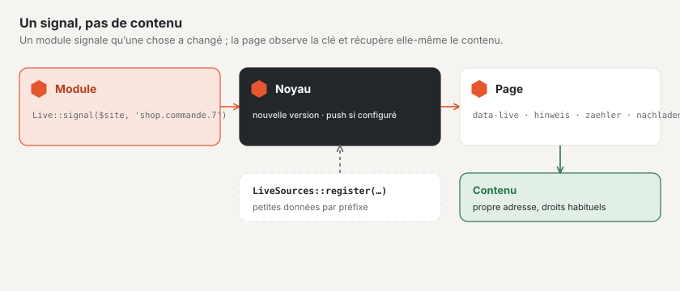

# Mise à jour en direct dans les modules

Les modules signalent par le même canal que le forum que quelque chose a changé — et les pages se mettent à jour sans
qu’un module ait besoin de son propre JavaScript. Le signal ne transporte aucun contenu : la page observe une **clé** et
va chercher les nouveautés par son adresse habituelle, avec les droits qui s’y appliquent de toute façon.



## 1. Envoyer un signal

```php
use Basalto\Core\Live\Live;

app(Live::class)->signal($site->id, 'shop.bestellung.'.$order->id);
```

- Les clés se composent de minuscules, de chiffres, de `-` et de `_`, séparés par des points (cinq parties au plus) ; la
  première partie est le préfixe du module.
- `signal()` attend la fin d’une transaction en cours — la page ne va jamais chercher le contenu avant qu’il soit
  visible.
- Si le push est configuré, le signal part vers le serveur WebSocket après la réponse ; une erreur à ce niveau
  n’interrompt rien.
- Les clés personnelles des comptes s’appellent `konto.{id}` (comptes clients) et `benutzer.{id}` (backend, sans site).

## 2. Un emplacement dans le balisage

`Live::attributes()` fournit les attributs d’un emplacement qui se met à jour lui-même — émis à la livraison de la page,
donc après votre contrôle des droits :

```php
$attributes = app(Live::class)->attributes($site->id, 'shop.bestellungen', 'hinweis');
$html = '<p class="hinweis" hidden'.$attributes.'>Neue Bestellungen — <a href="">Aktualisieren</a></p>';
```

| Action | Ce que fait l’îlot | Indications supplémentaires |
| --- | --- | --- |
| `hinweis` | affiche l’élément (masqué) dès que quelque chose change | — |
| `zaehler` | affiche un nombre tiré des données utiles, masqué à 0 | `feld` |
| `nachladen` | va chercher un fragment et l’insère au clic | `quelle`, `nach`, `ziel`, `eins`, `mehr` |
| `schreibt` | montre qui écrit (données `schreibt`), sans soi-même ; chaque entrée expire après ses secondes | `ich`, `eins`, `zwei`, `mehr` |

Passez les indications supplémentaires en quatrième argument (`['feld' => 'offen']` devient `data-live-feld="offen"`).
`nachladen` appelle `quelle?nach=<nach>` et attend du JSON `{anzahl, html, url, nach}` : `html` est placé dans `ziel`
(sélecteur CSS) ; sans `html`, le clic mène à `url` ; `eins` et `mehr` sont les textes pour le nombre (`:count`).

Si le balisage d’une page montée contient un tel emplacement, Basalto y joint lui-même le petit script de la mise à jour
en direct. Sur les autres pages, intégrez-le avec `Islands::attach($html)`.

## 3. Données utiles par préfixe

Pour livrer de petites données avec une clé modifiée — un compteur, par exemple —, enregistrez une source dans
`boot()` :

```php
use Basalto\Core\Live\LiveSources;

app(LiveSources::class)->register('shop', static fn (int $siteId, string $key): ?array => [
    'offen' => Order::query()->where('site_id', $siteId)->where('status', 'offen')->count(),
]);
```

L’interrogation n’appelle la source que pour les clés qui ont changé. Les données utiles sont visibles par toutes les
personnes qui observent la clé — les données personnelles vont sur des clés personnelles.

## 4. Îlots propres

Pour votre propre JavaScript, il existe deux événements sur `document` :

| Événement | Quand | `detail` |
| --- | --- | --- |
| `basalto:live` | une version a changé | `{ key, version, data }` |
| `basalto:inhalt` | du balisage a été chargé et inséré | `{ root }` — reprendre les îlots qu’il contient |

## 5. Présence : qui écrit, qui modifie

`Presence` tient une courte liste des personnes présentes à un endroit. Le noyau l’utilise pour « qui écrit en ce
moment » dans la communauté (clés `schreibt.…`, classe `Typing`) et pour « qui modifie en ce moment » dans le backend
(`bearbeitet.…`). `update($siteId, $key, $id, $name, $actif, $ttl)` annonce une arrivée ou un départ et envoie un
signal ; `current()` renvoie la liste avec les secondes restantes.

Votre propre champ de réponse reçoit « qui écrit » en deux lignes :

```php
$editor = Islands::editor('antwort', 'body', '', $lang, 6, true, ['typing' => Typing::key('shop.'.$id), 'preview' => route('basalto.community.preview', absolute: false)]);
$indication = Islands::typingIndicator($site->id, 'shop.'.$id, $lang, $profilId);
```

L’endroit n’a pas besoin de source propre : le noyau fournit les données pour `schreibt.…`.

## Bon à savoir

- L’interrogation `/_live` fonctionne sans session et ne lit que des versions du cache ; le travail coûteux appartient à
  la source du contenu, pas au signal.
- Ne signalez que ce que toutes les personnes qui observent la clé ont le droit de voir (contenus en attente seulement
  lors de leur approbation).
- La configuration, la cadence et le push sont décrits dans [Configurer la mise à jour en direct](../betrieb/live.md).

## Pour continuer

- [Modules et plugins](erweiterungen.md)
- [Notifications](benachrichtigungen.md)
- [Configurer la mise à jour en direct](../betrieb/live.md)
