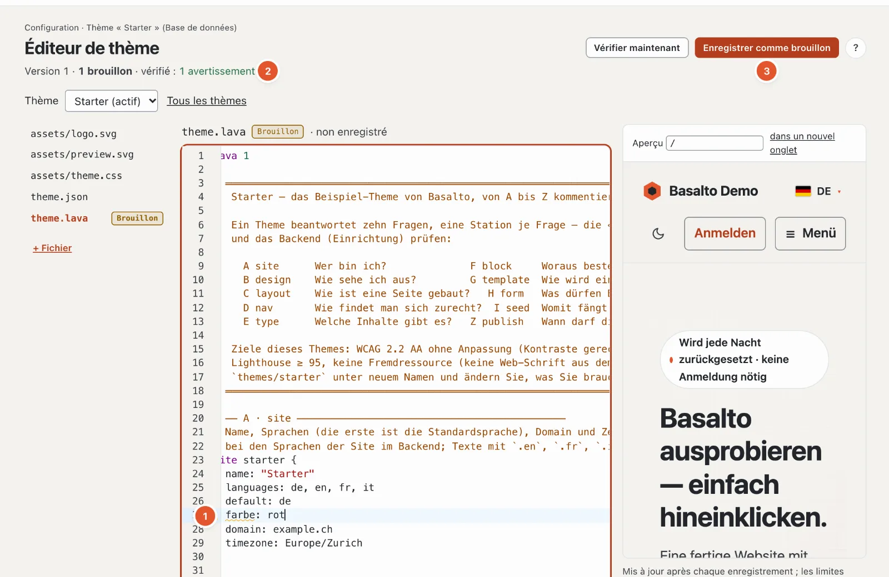

# Serveur de langage pour Lava

Le serveur de langage apporte les constats de `basalto:check` dans l’éditeur — pendant la saisie, y compris pour les fichiers non enregistrés —
ainsi que la complétion, le saut vers la définition et des explications. Il existe en deux exemplaires avec le même noyau
(`Basalto\Lava\Lsp\LanguageService`) : comme serveur LSP pour VS Code et PhpStorm, et dans l’éditeur Lava du backend.



## `php artisan basalto:lsp`

```text
basalto:lsp [--stdio]
```

Démarre un Language Server (LSP) sur l’entrée et la sortie standard. `--stdio` est la valeur par défaut ; VS Code ajoute
l’option lui-même. La sortie standard appartient au protocole, les messages PHP vont sur stderr. Le serveur n’écrit jamais
de fichier.

| Méthode LSP | Prestation |
| --- | --- |
| `textDocument/publishDiagnostics` | Constats à l’ouverture et à chaque modification ; le thème entier (dossier le plus proche contenant `theme.lava`) est compilé, chaque constat aboutit dans son fichier |
| `textDocument/completion` | Mots-clés, propriétés, types de champs (y compris ceux des modules), sortes de parties, dans le balisage les balises, filtres et fonctions, noms issus du thème |
| `textDocument/definition` | Saut vers les blocs, parties, mises en page, modèles, types, navigations, formulaires, globales et pages issues de `seed` |
| `textDocument/hover` | Explication des mots-clés, des types de champs, signature des filtres et des fonctions, forme des balises |

Non inclus : renommage, formatage, plan du document, aide à la signature pendant la saisie. Le serveur LSP ne vérifie pas
un thème stocké dans la base de données — pour cela, il y a l’éditeur Lava du backend (ci-dessous) et `basalto:check --site=<handle>`.

## Intégrer VS Code et PhpStorm

La compilation, l’installation et la configuration — extension VS Code, paramètres `lava.phpPath` et `lava.artisanPath`,
bundle TextMate et LSP4IJ pour PhpStorm — sont décrites dans
`tools/vscode-lava/README.md`. En bref :

```sh
cd tools/vscode-lava
npm install && npm run compile && npx @vscode/vsce package
code --install-extension basalto-lava-0.1.0.vsix
```

Dans PhpStorm, LSP4IJ démarre le serveur avec `php $PROJECT_DIR$/artisan basalto:lsp` ; les fichiers `*.lava` et
`*.lava.html` sont associés aux Language-IDs `lava` et `lava-html`.

## Le même service dans l’éditeur Lava

L’éditeur de thème du backend (Configuration › Éditeur de thème, voir [Thèmes](themes.md)) utilise le même
`LanguageService` via HTTP :

```text
POST /admin/einrichtung/lava/sprachdienst      Route basalto.setup.lava.language
```

`admin` est le chemin du backend (`basalto.backend.path`). La requête s’exécute dans la session du backend (connecté,
jeton CSRF, droit `update` sur le site). On travaille sur le thème du site avec tous les brouillons ouverts
et le contenu non enregistré de l’éditeur.

| Champ | Obligatoire | Signification |
| --- | --- | --- |
| `action` | oui | `diagnostics`, `completions`, `hover` ou `definition` |
| `path` | oui | chemin modifiable dans le thème, p. ex. `theme.lava` ou `assets/theme.css` (comme dans l’éditeur de thème, voir [Thèmes](themes.md)) |
| `lava_source` | oui (peut être vide) | contenu actuel de l’éditeur, 512 Ko au maximum |
| `line` | non | ligne à partir de 1 |
| `character` | non | caractère à partir de 0, compté en UTF-16 comme dans le navigateur |

| `action` | Réponse |
| --- | --- |
| `diagnostics` | `{"findings": [{file, line, column, character, severity, message}, …]}` |
| `completions` | `{"items": [...]}` |
| `hover` | `{"markdown": "..."}`, sans résultat `{"markdown": null}` |
| `definition` | `{"location": {...}}`, sans résultat `{"location": null}` |

L’éditeur (CodeMirror 6) demande les constats après chaque pause de saisie, les suggestions avec Ctrl+Espace,
l’explication au survol et la définition avec F12.

## Pour continuer

- [Lava — le langage des thèmes](lava.md)
- [Thèmes](themes.md)
