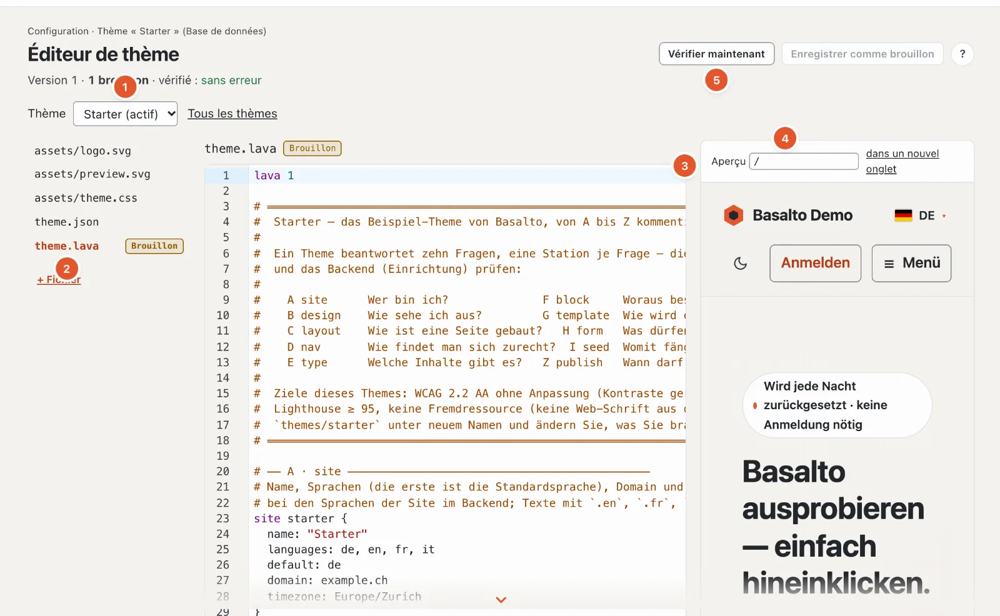

# Thèmes

Un thème est un dossier contenant `theme.lava`, `assets/` et, en option, `theme.json` — le langage correspondant est décrit dans
[Lava — le langage des thèmes](lava.md). Cette page montre où se trouvent les thèmes, comment commencer avec le thème Starter, utiliser les design tokens et
les contenus de départ, transmettre un thème sous forme de paquet et comment un site gère son thème dans la base de données.



## Dossier des thèmes

| Paramètre | Signification |
| --- | --- |
| `BASALTO_THEMES_PATH` (`basalto.themes_path`) | Dossier contenant les thèmes ; vide signifie `themes/` dans le projet |
| `BASALTO_DEFAULT_THEME` (`basalto.default_theme`) | Thème d’un site sans choix propre, par exemple `starter` |
| `BASALTO_DEFAULT_SITE` (`basalto.default_site`) | Site pour les commandes sans handle, p. ex. `basalto:tokens` |

Est considéré comme thème tout sous-dossier contenant un `theme.lava`. Le thème qu’utilise un site se choisit dans le backend sous
Configuration › Thèmes ; on y trouve aussi les indications de `theme.json`, l’image d’aperçu, l’étendue et l’état de vérification de chaque thème et —
avant un changement — ce que le site n’afficherait plus ensuite. Rien n’est supprimé lors du changement.

## Le thème Starter comme modèle

`themes/starter` est un exemple entièrement commenté des dix stations : deux
langues (DE, EN), polices système, une feuille de style sans build, aucun script (hormis le petit sélecteur clair/sombre,
en ligne) et aucune ressource externe, une présentation sombre (`color … dark #…`), des contrastes calculés selon
WCAG 2.2 AA. Il apporte dix-huit blocs (dont formulaire, liste d’articles, recherche et commentaires ainsi que, pour les
pages d’accueil, « Bandeau avec carte », « Chiffres clés », « Étapes », « Choix », « Fonctionnalités » avec pictogrammes et « Remarques »), un blog
avec flux Atom, des pages juridiques et des contenus de départ. « Image avec graphique » (`visual`) superpose à une image un graphique transparent
— photo avec schéma, comme le montre la démo ; « Bandeau avec carte » et « Choix » peuvent faire de même avec `art` et `art_overlay`.

```sh
cp -R themes/starter themes/mein-theme
php artisan basalto:check --theme=themes/mein-theme
```

Ensuite, adaptez dans `theme.json` le nom, l’auteur et la version, et dans `site` le nom, les langues et le domaine.

## Design tokens

Chaque couleur, chaque police, chaque espacement et le rayon issus de `design` deviennent une variable CSS (`--color-text`,
`--font-body`, `--space-3`, `--radius`). `` les écrit dans l’en-tête de chaque page — avec les surcharges
du site issues de Configuration › Design.

```text
basalto:tokens [--tailwind] [<site>]
```

| Argument / option | Signification |
| --- | --- |
| `<site>` | Handle du site, sinon `BASALTO_DEFAULT_SITE`, sinon le premier site |
| `--tailwind` | sous forme de `@theme { … }` pour Tailwind 4 au lieu de `:root { … }` |

```text
$ php artisan basalto:tokens --tailwind
@theme {
 --color-text: #23262b;
 --color-background: #f6f4f0;
 …
```

Pour un thème qui construit son CSS avec Tailwind : `php artisan basalto:tokens --tailwind > themes/x/assets/tokens.css`.

## Contenus de départ : `seed`

La station I (`seed`) crée des pages avec titre, slug, modèle et blocs par langue, ainsi que des contenus globaux et
des contenus de types propres (`post willkommen { … }`, `person redaktion { … }`) — publiés, afin que le site soit prêt après la
première mise en ligne sans travail manuel.

```text
basalto:seed <site>
```

L’importation est **idempotente** : chaque entrée porte un UUID fixe dérivé du site et du nom de seed. Ce qui existe déjà reste
intact (y compris ce qui a été modifié ou supprimé), les langues manquantes sont ajoutées. La sortie nomme chaque entrée
créée et, à la fin, « Seed: n angelegt, m schon vorhanden ».

Si le seed d’un thème a changé (nouveaux textes, nouveaux blocs), `basalto:seed <site> --auffrischen` apporte la modification
sur un site existant : les entrées qui sont encore exactement telles que le seed les a créées (toutes les versions sans auteur)
sont recréées ; ce que quelqu’un a modifié ou supprimé dans le backend reste.

`php artisan basalto:publish <site>` importe le seed, vérifie le site et le met en ligne ; `--ohne-seed`
omet le seed, `--dry-run` ne fait que vérifier.

Si le site a son propre Lava (éditeur Lava, niveau « Site »), il peut apporter son propre `seed`. Ce qui porte le même nom remplace
alors celui du thème à sa place — `page home { … }` dans le Lava du site est la nouvelle page d’accueil, `global footer
{ … }` le nouveau pied de page. C’est ainsi que procède la démo avec le thème Starter.

## Paquets de thème

Un paquet est un ZIP destiné à la diffusion et à le Marketplace : tous les fichiers du dossier du thème sous `<name>/`, plus
`manifest.json` et — avec une clé — `signature`.

```text
basalto:theme-pack <name> [--output=ORDNER] [--key=SCHLUESSEL]
basalto:theme-verify <zip> [--public-key=SCHLUESSEL]
```

| Commande · option | Signification |
| --- | --- |
| `theme-pack <name>` | Dossier sous `themes/` ; écrit `<name>-<version>.zip` (version issue de `theme.json`, sinon `0.0.0`) |
| `--output=` | Dossier cible, par défaut `storage/app/themes` |
| `--key=` | clé secrète Ed25519, en Base64 ou chemin vers un fichier contenant du Base64 |
| `theme-verify <zip>` | vérifie chaque fichier par rapport au manifeste |
| `--public-key=` | clé publique Ed25519, en Base64 ou fichier — ce n’est qu’avec elle que la signature est vérifiée |

Le manifeste (format 1) :

```json
{
    "format": 1,
    "name": "starter",
    "version": "1.0.0",
    "files": {
        "assets/theme.css": "7430…1dd5",
        "theme.lava": "c858…1a8e"
    }
}
```

`files` contient pour chaque fichier la somme de contrôle SHA-256 ; les fichiers dont le nom commence par `.` sont absents du paquet. La signature est
une signature Ed25519 sur `manifest.json`, encodée en Base64. `theme-verify` signale une erreur si un fichier a été modifié, s’il manque dans le
paquet ou ne figure pas dans le manifeste, si `theme.lava` manque et — avec `--public-key` — si la signature manque
ou ne correspond pas. Sans `--public-key`, « signiert » indique seulement qu’une signature est jointe.

```text
$ php artisan basalto:theme-pack starter --output=/tmp/pakete --key=/tmp/secret.key
/tmp/pakete/starter-1.0.0.zip · 5 Dateien · signiert
$ php artisan basalto:theme-verify /tmp/pakete/starter-1.0.0.zip --public-key=/tmp/public.key
Paket in Ordnung: starter 1.0.0 · 5 Dateien · signiert
```

Une paire de clés se génère avec libsodium, par exemple :

```sh
php -r '$k = sodium_crypto_sign_keypair();
  file_put_contents("secret.key", base64_encode(sodium_crypto_sign_secretkey($k)));
  file_put_contents("public.key", base64_encode(sodium_crypto_sign_publickey($k)));'
```

`theme-pack` ne vérifie pas le Lava — lancez `basalto:check` auparavant.

## Bibliothèque de thèmes du site et éditeur Lava

À côté des thèmes fournis dans le dossier `themes/` (valables pour tous les sites de l’installation, en lecture seule dans le backend),
chaque site dispose de sa propre **bibliothèque de thèmes** dans la base de données : autant de thèmes propres que souhaité, chacun avec
des fichiers texte, des images et des polices, des brouillons et des versions. On peut ainsi ajouter, modifier
et retirer des thèmes même là où le disque est volatil (Laravel Cloud) ou là où le dossier appartient à tous les clients (SaaS).

| Partie | Stockage |
| --- | --- |
| Entrée | `site_themes` (nom, désignation, origine `ordner` · `kopie` · `paket` · `marktplatz`, signature) |
| Fichiers texte | `lava_sources` avec `scope = theme:<id>` |
| Images et polices | disque standard sous `theme-assets/<site>/<theme>/…` ; chemins avec somme de contrôle dans `site_themes.assets`, afin que les pages construisent les adresses sans lire les fichiers |
| Brouillons, versions | `theme_drafts`, `theme_versions` avec `site_theme_id` |

Le thème qu’affiche un site reste indiqué dans `sites.theme`. Si un thème propre porte le même nom qu’un dossier, il a la priorité sur le
dossier — c’est ainsi qu’agit « Reprendre dans la base de données » ; les images et polices qui lui manquent proviennent alors du dossier.

### Station « Thèmes »

**Configuration › Thèmes** (`/admin/einrichtung/themes`) affiche « Thèmes propres » et « Thèmes fournis ». Changer,
ajouter et retirer est permis à qui peut modifier le site.

| Action | Ce qui se passe |
| --- | --- |
| **Ajouter un thème › Téléverser un paquet** | ZIP avec `manifest.json` (20 Mo au maximum, 800 fichiers, 50 Mo décompressé). Sont vérifiées les sommes de contrôle et — si elle est présente — la signature avec la clé du produit ou du Marketplace. Nom issu du manifeste ; s’il est déjà pris (y compris par un dossier), avec un compteur (`starter-2`) |
| **Créer une copie** | de n’importe quel thème (propre ou dossier) avec tous les fichiers, images et polices, sous un nouveau nom |
| **Depuis le Marketplace** | module « Marketplace » : un thème arrive signé comme nouveau thème propre ; une installation ultérieure du même thème arrive sous forme de brouillons (mise à jour) |
| **Passer à ce thème** | comme jusqu’ici, avec un rapport sur ce que le site n’affichera plus |
| **Aperçu** | le site entier avec ce thème dans votre propre session |
| **Télécharger comme paquet** | thème propre avec ses images, thème de dossier tel quel (non signé) |
| **Retirer** | thème propre avec ses fichiers, images, brouillons et versions — pas le thème actif, sauf si un dossier du même nom prend le relais |
| **Masquer** | retirer un thème fourni de la liste pour ce site (`sites.settings.themes.hidden`) ; pas le thème actif |

Dans le journal : `theme.add`, `theme.copy`, `theme.remove`, `theme.hide`, `theme.show`, `theme.asset`, `site.theme`.

### Éditeur de thème

**Configuration › Éditeur de thème** (`/admin/einrichtung/theme-editor`) modifie chaque thème propre — le thème actif ou, avec
`?theme=<name>`, un thème que le site n’affiche pas encore (choix en haut). Fichiers à gauche, code au milieu, aperçu
à droite.

| Étape | Ce qui se passe |
| --- | --- |
| **Reprendre dans la base de données** | si le site affiche un thème de dossier : crée un thème propre du même nom avec les fichiers texte ; la version 1 conserve l’état de départ |
| **Modifier** | chaque modification est un brouillon par fichier (la suppression d’un fichier est un brouillon sans contenu). Sont modifiables les chemins en `.lava`, `.html`, `.json`, `.css`, `.js`, `.svg`, `.txt`, `.md`, 512 Ko au maximum, UTF-8 ; `theme.lava` ne peut pas être supprimé |
| **Vérification avant l’enregistrement** | un brouillon n’est enregistré que si le thème entier se compile sans erreur avec lui — sinon réponse 422 avec les constats dans le texte. Les avertissements sont transmis, mais ne bloquent pas |
| **Conflit** | qui enregistre avec un état périmé (la somme de contrôle `base` ne correspond pas) reçoit 409 au lieu d’écraser silencieusement |
| **Aperçu** | chaque page du site avec les brouillons (y compris d’un thème non actif), rendue dans le backend (`vorschau-seite?pfad=/…`) ; ou le site entier avec les brouillons dans votre propre session — le site lui-même reste inchangé |
| **Soumettre pour validation**, **Publier** | comme jusqu’ici, avec le principe des quatre yeux (`four_eyes`) ; chaque publication est une version du thème. Les images ne sont recadrées à nouveau que si les variantes d’images du thème actif changent |
| **Versions**, **Écarter** | les 50 dernières versions par thème ; une version antérieure revient sous forme de brouillons |
| **Images et polices** | téléverser (`woff2`, `woff`, `png`, `jpg`, `jpeg`, `webp`, `avif`, `ico`, 5 Mo au maximum par fichier, 40 Mo au total) dans un dossier sous `assets/`, supprimer — s’applique immédiatement, sans brouillon |
| **Exporter**, **Importer** | paquet du thème avec ses images ; une importation arrive sous forme de brouillons (texte) et immédiatement (images) |
| **Retour au dossier** | uniquement pour un thème propre portant le nom d’un dossier : le site affiche de nouveau le dossier, le thème propre reste dans la bibliothèque sous `<name>-eigen` avec ses brouillons et ses versions |

L’éditeur de code est CodeMirror 6 avec coloration Lava et le même serveur de langage que dans VS Code — constats après chaque
pause, suggestions avec Ctrl+Espace, explication au survol, F12 pour la définition (voir
[Serveur de langage pour Lava](sprachdienst.md)).

> Encore en suspens : les brouillons CSS n’apparaissent dans l’aperçu qu’après la publication, car les assets du thème lisent la
> version en ligne.

### Vérifier un thème stocké en base de données

```sh
php artisan basalto:check --site=<handle>
```

vérifie le thème que le site utilise réellement (ligne d’en-tête « (Datenbank) » ou « (Dateien) »).

## `basalto:lava-import`

```text
basalto:lava-import <site> [--theme=THEME] [--scope=theme|site]
```

Copie un thème de fichiers, sans backend, sous forme d’enregistrements dans `lava_sources` — par exemple lors de la configuration d’un site sur un
serveur sans disque inscriptible. Avec `--scope=theme`, les fichiers aboutissent dans la bibliothèque de thèmes du site, dans le
thème propre portant le nom de leur thème (s’il manque, il est créé).

| Argument / option | Signification |
| --- | --- |
| `<site>` | Handle du site |
| `--theme=` | Répertoire du thème relatif à l’installation, par exemple `themes/starter` — à indiquer toujours |
| `--scope=` | `theme` (par défaut) : le thème du site · `site` : compléments propres au site, intégrés sous `site/…` à la fin de `theme.lava` (p. ex. types de contenu propres issus du backend) |

Les enregistrements existants ayant le même chemin sont écrasés ; les fichiers non UTF-8 sont ignorés. Contrairement à
« Reprendre dans la base de données » dans l’éditeur, la commande ne crée **aucune version**.

## Pour continuer

- [Lava — le langage des thèmes](lava.md)
- [Apparence : thèmes, design et variantes d’images](../einrichtung/aussehen.md)
- [Marketplace pour les autrices et les auteurs](../marktplatz/autoren.md)
