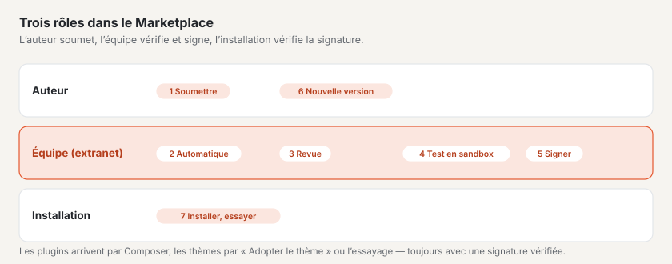

# Marketplace pour les autrices et les auteurs

Sur le Marketplace de basaltocms.com, vous proposez des thèmes et des plugins pour Basalto. Chaque soumission est vérifiée
automatiquement, passée en revue à la main et signée par basaltocms.com lors de la validation — ce n’est qu’alors qu’elle figure dans le catalogue. Une
fiche est gratuite ou coûte un montant unique par installation — vous le choisissez lors de la soumission. Une fiche
payante apparaît dans le catalogue dès que basaltocms.com ouvre la vente et que votre compte Stripe est connecté
([Vendre](#vendre)).



> **Conditions :** qui soumet accepte les conditions pour les auteurs
> ([Conditions pour les auteurs du Marketplace](../recht/de/autoren-bedingungen.md), dans le produit sous `/_recht/<sprache>/autoren-bedingungen`).
> Il s’agit d’un projet, l’examen juridique est en attente. La date et la version de l’acceptation figurent sur chaque version.

## Compte auteur

1. Sur la page **« Compte auteur »** de basaltocms.com, saisissez votre e-mail. Il n’y a pas de mot de passe : vous recevez un
   code par e-mail ; la première fois, votre compte client est ainsi créé (le même que pour l’achat de licences).
2. **« Créer le profil d’auteur »** : « Nom d’auteur » (personne, entreprise ou studio — c’est ainsi qu’il figure dans le catalogue), lieu, site web.
3. Le compte auteur est une **rubrique de votre compte client** (à côté des achats, des licences et de la communauté) ;
   la page « Compte auteur » y mène. En haut figurent les chiffres (dans le catalogue, installations, en vérification),
   puis **« Vos fiches »** sous forme de cartes : type, état (« dans le catalogue », « en revue », « refusé », « attend
   l’ouverture de la vente »), version, offre, installations et téléchargements, avec **« Voir dans le catalogue »**,
   **« Nouvelle version »** et les volets **« Modifier l’offre »**, **« Rapport de vérification »** et **« Versions »**.
   En dessous **« Soumettre »**, dès qu’il y a quelque chose à vendre **« Ventes par mois »** et **« Versement »**,
   enfin le profil d’auteur et le **« Jeton Composer »**.
4. **« À faire ensuite »** dans l’aperçu du compte indique ce que vous devriez faire — par exemple soumettre à nouveau une
   version refusée ou relier le compte de versement ; **« Dernier »** montre les validations et les refus.

Vous ne voyez pas les fiches des autres dans le compte auteur, et un nom de paquet appartient à l’auteur qui l’a soumis en premier.

## Formats de paquet

Une soumission est un ZIP. La Marketplace reconnaît à son contenu s’il s’agit d’un thème ou d’un plugin.

### Thème

Un paquet de thème au format de `basalto:theme-pack` ([Thèmes](../entwickler/themes.md#paquets-de-thème)) : les fichiers du
dossier du thème et `manifest.json` avec la somme de contrôle SHA-256 de chaque fichier.

```sh
php artisan basalto:check --theme=themes/mein-theme   # vérifier le Lava auparavant
php artisan basalto:theme-pack mein-theme              # → storage/app/themes/mein-theme-1.0.0.zip
```

- **Nom :** le nom du dossier — minuscules, chiffres et trait d’union, 64 caractères au maximum.
- **Version** issue de `theme.json` (`version`), sous forme de numéro de version comme `1.2.0` ; sans indication, `theme-pack` emballe en `0.0.0`.
- **Indications** issues de `theme.json` : `label` (titre dans le catalogue), `description`, `license`, `preview` (chemin vers une
  image d’aperçu dans le paquet : SVG, PNG, JPG ou WebP, 1 Mo au maximum), `requires` (version minimale de Basalto,
  par exemple `{"basalto": ">=1.3.9"}` — la fiche l’affiche sous « Nécessite » ; sans indication, `>=1.0` s’applique).
- **Obligatoire :** `category` — l’une de `firma`, `portfolio`, `gastro`, `verein`, `magazin`, `onepager`,
  `shop` — et au moins une image : `screenshots` (liste de chemins dans le paquet, 1 à 6 images, PNG, JPEG ou WebP, chacune
  de 1 Mo au maximum) ou `preview`.
- **Facultatif :** `homepage`, `docs`, `support` (adresses https). Un `seed` avec des contenus de départ montre le thème dans la
  sandbox et dans la vitrine avec du contenu plutôt que vide. Les langues de `site { languages: … }` deviennent les
  langues du site de la sandbox et de la vitrine — des contenus de départ en plusieurs langues y sont donc tous visibles.

```json
{
    "label": "Fjord",
    "description": "Ruhig und klar, mit Dunkelmodus.",
    "version": "1.0.0",
    "license": "MIT",
    "category": "firma",
    "preview": "assets/preview.svg",
    "screenshots": ["assets/screens/start.webp", "assets/screens/kontakt.webp"],
    "docs": "https://example.ch/fjord"
}
```
- **Pas de PHP :** la vérification refuse les fichiers en `.php`, `.phtml` ou `.phar` — les thèmes sont des données.
- Une signature propre n’est pas nécessaire ; basaltocms.com signe à nouveau lors de la validation.

### Plugin

Un paquet Composer sous forme de ZIP : `composer.json` à la racine ou dans l’unique dossier de la racine (comme une archive qu’un hébergeur de code livre en ZIP).
Structure et interface comme pour les modules ([Modules et plugins](../entwickler/erweiterungen.md)).

```json
{
    "name": "hersteller/karten",
    "version": "1.0.0",
    "type": "basalto-plugin",
    "license": "MIT",
    "description": "Karten als Lava-Tag",
    "require": { "php": "^8.4", "basalto/core": "*" },
    "autoload": { "psr-4": { "Hersteller\\Karten\\": "src/" } },
    "extra": {
        "laravel": { "providers": ["Hersteller\\Karten\\KartenServiceProvider"] },
        "basalto": {
            "module": "karten", "name": "Karten", "api": 1,
            "category": "inhalte",
            "icon": "assets/icon.svg",
            "screenshots": ["assets/screens/block.png"],
            "adds": { "blocks": ["Karte"], "forms": [], "types": [], "pages": [], "settings": ["Kartenanbieter"] }
        }
    }
}
```

| Champ | Règle |
| --- | --- |
| `name` | nom Composer valide `hersteller/paket`, en minuscules |
| `version` | obligatoire — le Marketplace lit la version à cet endroit (`1.2.0`, `v` devant autorisé) |
| `type` | `library`, `basalto-plugin` ou `basalto-module` |
| `extra.basalto` | `module` (handle : a–z, 0–9, `-` et `_`, commençant par une lettre, 40 caractères au maximum), `name` (nom affiché), `api` = `1` |
| `extra.laravel.providers` | au moins un fournisseur de services |
| `autoload.psr-4` | sinon remarque : les classes ne peuvent pas être chargées |
| `license` | si elle diffère de la licence choisie lors de la soumission, une remarque est émise |
| `extra.basalto.category` | obligatoire : `inhalte`, `formulare`, `shop`, `marketing`, `medien`, `mitglieder`, `anbindung` ou `entwicklung` |
| `extra.basalto.icon` | SVG, PNG ou WebP dans le paquet, 256 Ko au maximum — sinon remarque, le catalogue affiche la lettre initiale |
| `extra.basalto.screenshots` | 1 à 6 images dans le paquet (PNG, JPEG, WebP, chacune de 1 Mo au maximum) — sinon remarque |
| `extra.basalto.adds` | ce que le plugin ajoute au site : `blocks`, `types`, `forms`, `pages`, `settings` (chacun une liste de noms) — le catalogue l’affiche selon les stations du parcours de configuration ; sinon remarque |
| `homepage`, `support.docs`, `support.issues` | adresses https vers le site web, la documentation et le support |

## Ce que vérifie la vérification automatique

Lors du téléversement, le Marketplace vérifie immédiatement le paquet et si le nom et la version sont reconnaissables ; les erreurs figurent au champ.
La vérification complète s’exécute ensuite dans la file d’attente et aboutit au **rapport de vérification** en sept étapes. Rien de ce que contient le paquet
n’est exécuté.

| Étape | Vérifié | Refus en cas de |
| --- | --- | --- |
| **Paquet** | ZIP lisible, taille, chemins | plus de 10 Mo compressé ou 50 Mo décompressé, plus de 2000 fichiers ; **ZIP slip** (chemins avec `..`, chemins absolus, lettres de lecteur, barres obliques inverses) ; liens symboliques |
| **Manifeste** | thème : manifeste et sommes de contrôle, compilateur Lava ; plugin : `composer.json`, `php -l` sur chaque fichier PHP, liste d’interdictions | manifeste absent ou non concordant, erreur du compilateur, erreur de syntaxe, appels interdits, champs invalides |
| **Tests** | thèmes : le compilateur au lieu de tests ; plugins : présence de tests | — (les tests fournis ne sont jamais exécutés ; la revue les lit) |
| **Banc d’essai** | thèmes : contrastes selon WCAG 2.2 AA (clair et sombre, aussi pour chaque variante de couleurs), mode sombre, variantes de couleurs (`palette`, pastille propre), ressources externes (`src`, `<link href>`, `url()`, `@import` vers des serveurs tiers), poids des assets, contenus de départ ; plugins : PHPStan (niveau 5, statique), accès en écriture, tests | — (remarques uniquement ; les indicateurs figurent sous forme de pastilles dans le catalogue) |
| **Sandbox** | nous installons la soumission dans une installation jetable avec du contenu d’exemple et l’essayons | ce qui n’y fonctionne pas, avec une note |
| **Signature** | en attente jusqu’à la validation | — |
| **Revue** | à la main | motif du refus |

**Liste d’interdictions** (via le tokenizer PHP ; les commentaires et les chaînes ne comptent pas) : `exec`, `shell_exec`, `system`,
`passthru`, `proc_open`, `popen`, `pcntl_exec`, `pcntl_fork`, `dl`, `create_function`, `eval` et l’opérateur
backtick entraînent le refus. Écrire en contournant Flysystem (`file_put_contents`, `fopen`, `fwrite`,
`unlink`, `rename`, `copy`, `mkdir`, `chmod`, `symlink`, entre autres) donne lieu à une **remarque** — seuls les
disques Storage sont autorisés.

Les **remarques** n’entraînent pas de refus, mais la revue les voit : avertissements du compilateur Lava, ligne rouge
incomplète, tests manquants, `autoload.psr-4` manquant.

## Soumettre

**« Nouvelle soumission »** dans le compte auteur ouvre une fenêtre en quatre étapes — **Paquet**, **Informations**,
**Offre**, **Vérifier et soumettre**. « Suivant » vérifie les champs de l’étape ; glissez le fichier ZIP sur le champ ou
choisissez-le, et la fenêtre affiche aussitôt le type, le nom et la version du paquet. Avant l’envoi, la dernière étape
résume le paquet, la description courte et l’offre. Si le Marketplace signale une erreur, la fenêtre se rouvre à l’étape
concernée. **« Nouvelle version »** sur une fiche ouvre la même fenêtre avec ses informations. Les champs :

| Champ | |
| --- | --- |
| « Paquet (ZIP) » | obligatoire, 10 Mo au maximum |
| « Offre » | **« Gratuit »** ou **« Vendre »** — avec « Vendre », en plus « Prix par installation » et « Devise » ([Vendre](#vendre)) |
| « Licence » | avec « Gratuit », par fiche : MIT, GPL-3.0-or-later, LGPL-3.0-or-later, Apache-2.0, BSD-3-Clause ou la Licence Basalto Marketplace ; avec « Vendre », toujours la Licence Basalto Marketplace |
| « Description courte » | une ligne pour la carte dans le catalogue ; vide = tirée du paquet |
| « Description » | texte brut ; les lignes vides séparent les paragraphes |
| « Nouveautés » | modifications de cette version |
| Acceptation | « J’accepte les conditions pour auteurs. » — sans elle, le Marketplace n’accepte rien |

Par adresse IP, le Marketplace accepte au maximum 30 soumissions par heure.

## Revue et refus

| État | Signification |
| --- | --- |
| **en vérification** | la vérification automatique est en cours |
| **en revue** | vérification réussie, la revue suit (en règle générale deux à trois jours ouvrables) |
| **publié** | validé, signé, dans le catalogue et dans le dépôt Composer |
| **refusé** | automatiquement (les endroits marqués dans le rapport de vérification) ou lors de la revue avec motif |

Après la vérification automatique, nous testons la soumission dans une **sandbox** — une installation propre réservée à
ce test, avec les contenus de départ du thème ou le thème Starter. Elle est ensuite supprimée. Seul un test en sandbox
réussi permet la validation ; en cas de « échoué », notre note figure dans le motif du refus.

Dans le catalogue, chaque fiche porte son **banc d’essai** : les indicateurs de la vérification automatique et « Testé en sandbox le … ».
Les thèmes validés reçoivent une **vitrine** — un site avec leurs contenus de départ, que les visiteurs essaient en direct.

Pour chaque décision, vous recevez un e-mail dans votre langue. Lors de la validation, le titre, les textes, la licence et
l’image d’aperçu de la version passent sur la fiche. Après un refus, corrigez les endroits concernés et téléversez de nouveau avec **« Soumettre à nouveau »**
sur la même fiche.

## Avis

Les acheteurs et les utilisatrices évaluent les fiches avec 1 à 5 étoiles et un texte ; la moyenne figure sur la carte du catalogue
(« ★ 4.6 (12) ») et permet de trier par « Note ». Vos propres fiches ne peuvent pas être évaluées. Pour chaque nouvel
avis, vous recevez un e-mail. Une fois connecté au compte client, sur la page de la fiche figure sous chaque avis
**« Répondre publiquement »** — enregistrée vide, la réponse est supprimée. Les avis inappropriés (publicité, injures,
données personnelles) sont masqués avec motif par l’équipe de basaltocms.com ; ils ne comptent alors plus dans la moyenne.

## Versions

- Chaque soumission est une version d’une fiche. Pour une nouvelle version, choisir **« Soumettre à nouveau »** sur la fiche —
  le paquet doit porter le même nom.
- Un numéro de version qui est déjà en vérification, en revue ou publié ne peut pas être soumis une nouvelle
  fois — augmentez le numéro. Un numéro refusé peut être réutilisé.
- Le catalogue affiche la version publiée la plus élevée ; Composer reçoit toutes les versions publiées.

## Jeton Composer

Sous **« Jeton Composer »**, créez un jeton avec **« Générer un jeton »** ; l’utilisateur est l’e-mail du compte, le mot de passe le
jeton. Un nouveau jeton invalide l’ancien. Le jeton est nécessaire à toutes celles et ceux qui installent des plugins du Marketplace —
même sans fiches propres ([Marketplace pour les installations](installieren.md)). Avec votre jeton, vous obtenez aussi vos
propres versions payantes, sans les acheter.

## Vendre

Vous pouvez choisir « Vendre » dès maintenant lors de la soumission — même avant que basaltocms.com ouvre la vente (les
conditions pour les auteurs l’annoncent 30 jours à l’avance). Une fiche payante validée **attend** de pouvoir être
vendue : elle ne figure pas dans le catalogue, n’a pas de page et n’est pas téléchargeable, pas même gratuitement. Votre
compte auteur indique alors **« attend l’ouverture de la vente »** ou, une fois la vente ouverte, **« attend le compte
de versement »**. Dès que les deux sont réunis, la fiche apparaît d’elle-même.

### Connecter Stripe Connect

Le versement se fait via **Stripe Connect** avec un **compte Express** : Stripe vérifie votre identité, enregistre votre
compte bancaire et vous verse directement votre part. basaltocms.com ne voit ni les données bancaires ni les données d’identité.

1. Dans le compte auteur, onglet **« Versement »** → **« Connecter avec Stripe »**. basaltocms.com crée le compte et vous envoie
   dans l’onboarding de Stripe.
2. Remplissez les informations chez Stripe. Vous revenez ensuite dans le compte auteur ; si le lien a expiré, basaltocms.com en génère
   un nouveau.
3. Stripe tient l’état à jour (événement `account.updated`) :

| État | Signification |
| --- | --- |
| **non connecté** | pas encore de compte Stripe |
| **informations manquantes** | onboarding non terminé, ou Stripe exige des informations supplémentaires — **« Compléter les informations chez Stripe »** |
| **connecté ✓** | informations transmises, Stripe vérifie encore ; vos fiches payantes apparaissent dans le catalogue |
| **versements actifs ✓** | Stripe verse selon son calendrier de paiement |

Avec **« Ouvrir le tableau de bord Stripe »**, vous voyez chez Stripe les versements, le compte bancaire et les informations fiscales.

### Prix

Dans la soumission, choisissez **« Vendre »**, puis **« Prix par installation »** (p. ex. `59` ou `59.50`) et
**« Devise »** (CHF, EUR ou USD) — entre 5 et 5000.

- Une fiche payante est toujours sous **Licence Basalto Marketplace** ; le Marketplace change la licence elle-même.
- Le prix s’applique avec la **validation** de la version, comme les textes et la licence.
- Pour une fiche validée, modifiez l’offre avec **« Modifier l’offre »** : gratuit ou vendre, prix et devise. Cela vaut
  pour la version actuelle et toutes les nouvelles ; les anciennes versions gardent leur prix, et qui l’a déjà installée
  garde sa version. Vendre de cette manière n’est possible que sous Licence Basalto Marketplace — si la fiche est sous
  une licence libre, soumettez une nouvelle version sous la licence du Marketplace.
- Un achat vaut **une seule fois par installation** et apporte **un an de mises à jour** : toutes les versions qui paraissent jusqu’à un an après
  l’achat. Ensuite, l’acheteur ne reçoit les nouvelles versions qu’avec un nouvel achat.
- La fiche ne peut être achetée que tant que Stripe autorise les virements vers votre compte — sinon « Actuellement pas
  en vente » figure sur la fiche.

### Commission

basaltocms.com conserve **10 pour cent du prix hors taxe sur la valeur ajoutée** ; les fiches gratuites sont sans commission. Exemple
hors TVA : prix CHF 59.00 → commission CHF 5.90 → **CHF 53.10 pour vous**. Si basaltocms.com est assujetti à la TVA,
la commission s’applique au montant net, et la TVA reste chez basaltocms.com. basaltocms.com annonce une autre
commission à tous les auteurs par e-mail au moins 30 jours à l’avance ; jusqu’à son entrée en vigueur, elle figure dans
l’onglet « Ventes ». Le vendeur, c’est vous : le reçu vous nomme, basaltocms.com sert d’intermédiaire.

Techniquement, chaque achat est une **Destination Charge** : Stripe débite l’acheteur sur le compte de basaltocms.com, y conserve
la commission (et la TVA) sous forme de `application_fee_amount` et vire le reste sur votre compte Express. Les frais
de Stripe sont à la charge de basaltocms.com, ils ne réduisent pas votre part. En cas de remboursement intégral, Stripe reprend votre
part, et l’acheteur perd l’accès.

### Ventes et versement

- Onglet **« Ventes »** : total par mois (selon le mois du paiement, par devise) avec chiffre d’affaires, commission et
  montant versé, en dessous les dernières ventes. Vous ne voyez pas d’informations sur les acheteurs.
- Onglet **« Versement »** : état de Stripe Connect, le mois en cours (« CHF 1'550 ventes · 10 % de commission ·
  CHF 1'395 »), le **prochain versement** et les derniers versements. La date et le montant d’un versement sont fixés par Stripe
  (calendrier de paiement, délai d’attente) ; basaltocms.com les affiche dès que Stripe les planifie (`payout.created`). D’ici là figure
  la part ouverte issue de vos achats — à titre d’estimation.

## Pour continuer

- [Marketplace](README.md)
- [Thèmes](../entwickler/themes.md)
- [Modules et plugins](../entwickler/erweiterungen.md)
