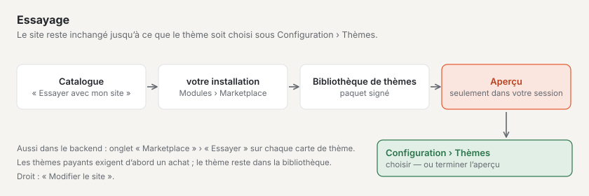

# Marketplace pour les installations

Chaque installation Basalto voit dans le backend le catalogue du Marketplace de basaltocms.com. Les plugins arrivent dans
l’installation via Composer, les thèmes sous forme de paquet signé via « Adopter le thème » — il n’existe pas de téléversement ZIP pour du code.
Les fiches payantes s’achètent au préalable sur basaltocms.com ([Acheter](#acheter)).

## Administration › Modules

**Administration › Modules** (`/admin/module`) — uniquement pour les propriétaires et l’administration du site. Deux onglets :

| Onglet | Contenu |
| --- | --- |
| **Modules** | modules et plugins installés, leur état sur ce site (« actif sur ce site » ou « désactivé … ») et ce dont ils ont besoin ; « Vers le site » mène à l’interrupteur |
| **Marketplace** | catalogue de basaltocms.com avec filtre Thèmes/Plugins et recherche ; « Installer » ouvre le dialogue d’installation |

L’activation ne se fait pas ici, mais par site sous **Administration › Sites › Modifier le site › onglet « Modules »**.

Une **carte** dans l’onglet « Marketplace » affiche le nom, l’autrice, le prix (« gratuit » ou p. ex. « CHF 59 »), les étoiles avec le nombre
d’avis, les installations et le **banc d’essai** : les indicateurs de la vérification automatique sous forme de pastilles — ✓ rempli,
✗ non rempli, ○ aucune indication (pour les thèmes p. ex. contrastes selon WCAG 2.2 AA, mode sombre, sans ressources externes ; pour les plugins
p. ex. PHPStan, enregistre uniquement via Storage, avec tests) et « Testé en sandbox le … ». Seuls les thèmes ont **« Essayer »**.

Le noyau lit le catalogue sans jeton via `GET <BASALTO_MARKETPLACE_URL>/marketplace/api/entries` et le garde dix
minutes en cache ; **« Recharger »** le récupère immédiatement. Si basaltocms.com n’est pas joignable, l’onglet affiche « Marketplace
injoignable » et réessaie au bout d’une minute — le reste du backend ne l’attend pas. Le noyau ne reprend
de la réponse que les champs connus et construit lui-même chaque adresse à partir de `BASALTO_MARKETPLACE_URL`.

## Acheter

Les fiches payantes affichent dans le catalogue le prix (« CHF 59 ») au lieu de « gratuit ». L’achat se fait sur basaltocms.com dans le
compte client — le même compte que pour les licences et le jeton Composer.

1. Sur la page de la fiche, **« Acheter CHF 59 »**. Sans connexion, on passe d’abord par le **compte client** (code par e-mail,
   pas de mot de passe) ; là, **« Poursuivre l’achat »** ramène à la fiche.
2. Une fois connecté, remplir **« Pour quelle installation ? »** (domaine ou nom — figure sur le reçu) et acheter. Le paiement
   se fait chez **Stripe Checkout** avec les moyens de paiement que basaltocms.com a activés chez Stripe.
3. Dès que Stripe confirme le paiement (généralement après quelques secondes), l’achat figure dans le compte client sous **« Achats sur le
   Marketplace »** : date, montant, installation, **mises à jour jusqu’au**, le **reçu** en PDF et, pour les thèmes, le paquet
   signé. Le reçu arrive aussi par e-mail, dans la langue de l’achat.

Ce que comprend un achat :

- **un montant unique par installation** — pour une autre installation, vous achetez une nouvelle fois ;
- **un an de mises à jour :** toutes les versions qui paraissent jusqu’à un an après l’achat. Ensuite, Composer et
  « Adopter le thème » ne livrent plus de versions plus récentes ; un nouvel achat apporte une année supplémentaire. Les versions que vous avez,
  vous pouvez continuer à les utiliser ;
- la **Licence Basalto Marketplace** de l’auteur. Retour dans les 14 jours selon les CG — avec le remboursement prend fin
  l’accès.

Sans achat, basaltocms.com répond pour une version payante par **403** (avec jeton) ou **401** (sans).

## Installer un plugin

Le dialogue d’installation affiche les commandes à copier (« Copier les commandes »). À exécuter dans l’installation :

```sh
composer config repositories.basalto composer https://basaltocms.com/composer
composer config http-basic.basaltocms.com <E-Mail> <Token>
composer require hersteller/karten:^1.0
php artisan migrate
```

- **Jeton :** l’utilisateur est l’e-mail de votre compte client sur basaltocms.com, le mot de passe est le jeton issu du
  **compte auteur** (connexion par code, même sans fiches propres ; [Jeton Composer](autoren.md#jeton-composer)). Sans
  paire valide, le dépôt Composer du Marketplace répond par 401, et Composer demande des identifiants.
- `composer config http-basic…` écrit le jeton dans `auth.json` dans le dossier du projet. Ce fichier n’a pas sa place dans le
  contrôle de version (`/auth.json` figure dans `.gitignore`) ; sur Laravel Cloud, le déposer comme secret `COMPOSER_AUTH`.
- Lors du téléchargement, Composer vérifie la somme de contrôle SHA-1 du paquet (`dist.shasum`). Le paquet contient en outre
  le manifeste et la signature du Marketplace (`basalto-manifest.json`, `basalto-signature`).
- Après `migrate`, le plugin apparaît sous **Modules** ; s’il est activable, l’activer sur le site.
- Un build propre pour les pages du backend (Vue) des plugins de tiers est encore en suspens
  ([Modules et plugins](../entwickler/erweiterungen.md#pages-inertia-avec-espace-de-noms)).

Les mises à jour se font comme pour tout paquet Composer : `composer update hersteller/karten`, puis `php artisan migrate`.

Les **plugins payants** ne sont livrés par le dépôt Composer qu’au jeton d’un acheteur : `packages.json` ne nomme pour chaque jeton que les
versions qu’il peut obtenir (toutes les gratuites, les payantes jusqu’à la fin de l’année de mises à jour). Achetez donc avec le même
compte client que celui dont le jeton figure dans `auth.json`.

## Essayer un thème



Sur la page d’un thème dans le catalogue : **« Essayer avec mon site »** — saisir l’adresse de votre propre site Basalto,
puis **« Continuer vers … »**. Dans votre propre installation, **Administration › Modules › Marketplace › Essayage** demande
confirmation ; **« Essayer avec mon site »** récupère le thème (signé) dans la bibliothèque de thèmes ([Thèmes](../entwickler/themes.md))
et affiche le site avec lui dans votre propre session. Le site reste inchangé jusqu’à ce que le thème soit choisi sous **Configuration ›
Thèmes**. Dans l’onglet « Marketplace », le même bouton **« Essayer »** figure sur chaque carte de thème, ainsi que le
banc d’essai de chaque fiche.

- Pendant la récupération s’affiche « Récupération … ». Pour les thèmes payants, l’essayage signale qu’un achat est d’abord nécessaire ;
  si le thème n’existe pas (ou plus), il le dit.
- Ensuite, un bandeau « Aperçu avec le thème … » indique que vous voyez un aperçu. On y met fin via le bandeau ou sous
  **Configuration › Thèmes** ; c’est là aussi que vous choisissez le thème pour le site. Le thème reste dans la bibliothèque, même si
  vous mettez fin à l’aperçu.
- Essayer exige le droit de modifier le site.

## Adopter un thème

Pour un thème, le dialogue affiche **« Adopter le thème »**. Basalto

1. télécharge le paquet depuis `<BASALTO_MARKETPLACE_URL>/marketplace/themes/<name>/<version>.zip` (10 Mo au maximum),
2. compare la somme de contrôle SHA-256 avec le catalogue,
3. vérifie le manifeste et la **signature de la clé du Marketplace** avec la clé publique du noyau — sans signature
   valide, rien n’est repris,
4. crée les fichiers sous forme de **brouillons** dans l’éditeur de thème (**Configuration › Éditeur de thème**).

La publication s’y fait comme pour toute modification de thème, après aperçu et validation ([Thèmes](../entwickler/themes.md)).
Jusque-là, le thème précédent reste en ligne.

Les **thèmes payants**, Basalto les télécharge avec l’e-mail et le jeton de votre compte client — issus de `BASALTO_MARKETPLACE_EMAIL` et
`BASALTO_MARKETPLACE_TOKEN` ou, s’ils manquent, de `auth.json` (`http-basic.<host>`, comme pour Composer). Les
identifiants ne sont envoyés qu’à `BASALTO_MARKETPLACE_URL`. Si le dialogue signale « Aucun achat de ce thème … », l’achat manque
avec ce compte ou l’année de mises à jour est terminée. Sans installation propre avec `.env` (par exemple sur le SaaS), téléchargez le
paquet signé dans le compte client.

## Donner un avis

Sur la page d’une fiche figurent sous **« Avis »** la moyenne avec la répartition des étoiles et les
avis des autres — avec la mention **« acheté »** (fiche payante, achat attesté) ou **« installé »** (téléchargement
via Composer ou « Adopter le thème » avec e-mail et jeton attesté).

Une fois connecté au compte client : choisir les étoiles (1–5), facultativement un titre, puis **« Votre expérience »** (10–2000 caractères) et
**« Publier l’avis »**. Seules les personnes qui les ont achetées donnent un avis sur les fiches payantes. Par compte client, il y a un
avis par fiche ; **« Modifier l’avis »** le remplace (une réponse de l’autrice disparaît alors), **« Supprimer mon
avis »** le retire. Sous l’avis figure le prénom avec la première lettre du nom de famille issus du
compte client — jamais l’e-mail.

Sous chaque avis d’une autre personne figure **« Signaler l’avis »** — même sans compte client : choisir un motif (« Publicité ou spam »,
« Injurieux ou dénigrant », « Contient des données personnelles », « Ne concerne pas cette entrée », « Autre »), facultativement
une remarque, puis **« Envoyer le signalement »**. Par personne, un signalement compte par avis ; qui a donné l’avis n’apprend pas qui
l’a signalé. À partir de trois signalements ouverts, un avis est masqué provisoirement jusqu’à ce que l’équipe décide.

## Paramètres

| Variable | Signification | Par défaut |
| --- | --- | --- |
| `BASALTO_MARKETPLACE_URL` | adresse du Marketplace pour le catalogue, les paquets de thème et les commandes Composer affichées | `https://basaltocms.com` |
| `BASALTO_MARKETPLACE_PUBLIC_KEY` | clé publique Ed25519 pour la vérification de la signature — uniquement pour les tests ou une Marketplace propre | vide : `Core::MARKETPLACE_PUBLIC_KEY` |
| `BASALTO_MARKETPLACE_EMAIL`, `BASALTO_MARKETPLACE_TOKEN` | e-mail et jeton du compte client pour les thèmes payants — comme secret, jamais dans un fichier sous contrôle de version | vide : depuis `auth.json` |

Pour essayer avec un site produit local, définir `BASALTO_MARKETPLACE_URL=https://basalto.localhost` ; l’hôte
pour `http-basic` comporte alors un port, si l’adresse en a un.

## Pour continuer

- [Apparence : thèmes, design et variantes d’images](../einrichtung/aussehen.md)
- [Mises à jour](../verwaltung/updates.md)
- [Marketplace](README.md)
