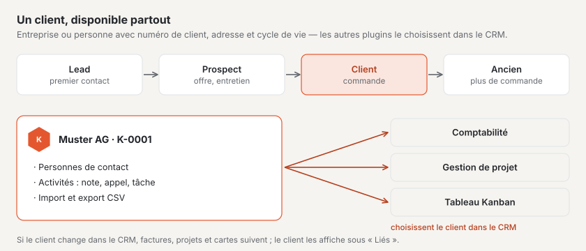
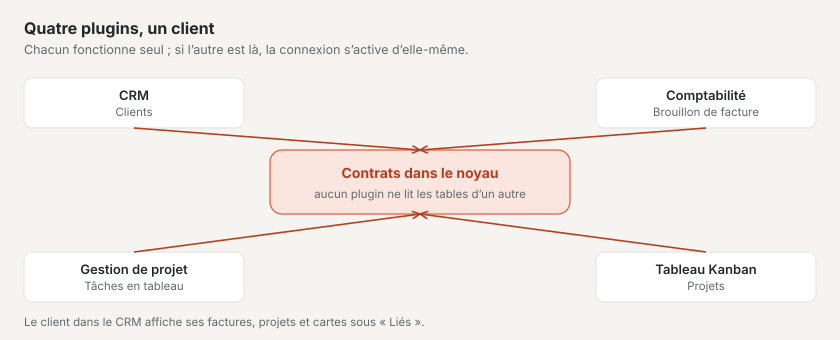

# Plugin « CRM »

Avec le « CRM », vous gérez vos clients en un seul endroit : entreprises et personnes avec numéro de client, adresse,
personnes de contact, activités et leur étape du cycle de vie — du premier contact à l’ancien client. Si vous avez aussi
les plugins « Comptabilité », « Gestion de projet » ou « Tableau Kanban », ceux-ci choisissent les clients directement
dans le CRM. Le plugin est payant — CHF 99 avec un an de mises à jour — et vient de Basalto.

## Installer et activer

1. Achetez-le sur basaltocms.com — une fois par installation ([Acheter](installieren.md#acheter)).
2. Dans le backend sous **Administration › Modules › Marketplace**, cliquez sur **« Installer »** pour « CRM »
   ([Installer un plugin](installieren.md#installer-un-plugin)).
3. Activez-le sous **Administration › Sites › Modifier le site › onglet « Modules »**. Il est désactivé par défaut.

L’entrée **« CRM »** apparaît ensuite sous **Contenus**. Le nombre à côté indique les tâches ouvertes échues aujourd’hui
ou avant.

## Créer un client

1. Sous **CRM**, cliquez sur **« Nouveau client »**.
2. Choisissez le **Type** : **Entreprise** ou **Personne**. Pour une entreprise, saisissez la **Raison sociale** ; pour
   une personne, le **Prénom** et le **Nom** — ils forment alors le nom.
3. Choisissez le **Cycle de vie** (voir ci-dessous) et cochez **« Aussi fournisseur »** si vous achetez aussi chez ce
   client.
4. Complétez adresse, e-mail, téléphone et, si vous le souhaitez, **IDE**, **Langue**, **Site web**, **Responsable** et
   **Notes**.
5. **« Créer »**.

Le CRM attribue lui-même le **numéro de client** : « K-0001 », « K-0002 » et ainsi de suite, sans lacune. Le client
s’ouvre ensuite ; tout ce que vous y modifiez s’enregistre de lui-même.

| Champ | Ce qui est vérifié |
| --- | --- |
| **Pays** | code ISO à deux lettres, par exemple CH, LI, DE, AT, FR ou IT ; vide signifie la Suisse |
| **NPA** | Suisse et Liechtenstein : quatre chiffres de 1000 à 9658 · Autriche : quatre chiffres · Allemagne, France, Italie : cinq chiffres · autres pays : jusqu’à 12 caractères |
| **IDE** | s’il commence par « CHE », il a la forme CHE-123.456.789, suivi au besoin de « TVA » |
| **E-mail** | une adresse valide ; elle est enregistrée en minuscules |

## Cycle de vie

| Étape | Signification |
| --- | --- |
| **Lead** | premier contact, pas encore d’entretien |
| **Prospect** | vous êtes en discussion ou avez envoyé une offre |
| **Client** | il y a une commande — c’est la valeur par défaut |
| **Ancien client** | plus de commande pour le moment |

Changez l’étape sur le client ou pour plusieurs à la fois : sélectionnez-les dans la liste et choisissez en bas
**« Cycle de vie : … »**.

## Personnes de contact

Pour une entreprise, notez sous **Personnes de contact** les personnes avec qui vous êtes en contact : prénom, nom,
**Fonction**, e-mail et téléphone. L’une d’elles est le **Contact principal** — la première automatiquement ; cochez
**« Contact principal »** chez une autre pour changer. Un clic sur une personne de contact l’ouvre pour la modifier ; on
peut aussi la supprimer à cet endroit.

**Bon à savoir :** avec le plugin « Gestion de projet », l’adresse e-mail d’une personne de contact ouvre les projets de
ce client dans le compte client du site web.

## Activités et tâches

Sous **« Saisir une activité »**, vous notez ce qui s’est passé avec le client ou ce qui reste à faire :

| Type | Pour |
| --- | --- |
| **Note** | ce que vous voulez retenir |
| **Appel**, **Réunion**, **E-mail** | échanges avec date et, au besoin, personne de contact |
| **Tâche** | quelque chose à faire — avec **« Échéance le »** |

Les tâches ouvertes figurent en tête chez le client ; une fois la date passée, elles sont rouges. **« Marquer comme
terminée »** termine une tâche. Le chiffre clé **« Tâches échues »** au-dessus de la liste et le nombre à côté de l’entrée
du menu comptent toutes les tâches ouvertes échues aujourd’hui ou avant.

## Trouver des clients

La liste montre tous les clients qui ne sont pas archivés, par nom. La **recherche** trouve noms, numéros de client,
localités, adresses e-mail, IDE et personnes de contact — accents, majuscules et minuscules ne jouent aucun rôle :
« zurich » trouve Zürich. Plusieurs mots doivent tous apparaître (« anna keller »). Vous filtrez en plus par **Cycle de
vie** et sous **Liste** par **Actif**, **Fournisseurs** ou **Archives**.

## Archiver au lieu de supprimer

Les clients ne sont pas supprimés mais archivés — sur le client avec **« Archiver »** ou pour plusieurs dans la liste.
Un client archivé peut toujours être consulté et modifié, mais n’apparaît plus dans aucune sélection des autres
plugins ; factures, projets et cartes le conservent. Sous **Liste › Archives**, vous le récupérez avec **« Restaurer »**.

## Importation et exportation

Sous **CRM › Importation et exportation** :

- **« Exporter tous les clients »** télécharge tous les clients non archivés sous forme de fichier CSV.
- **« Télécharger le modèle »** fournit un fichier avec les colonnes et une ligne d’exemple.
- **« Importer une liste »** accepte un fichier CSV.

Le fichier utilise des points-virgules comme séparateurs et est enregistré en UTF-8 — dans Excel en « CSV UTF-8 ». Les
colonnes s’appellent **Numéro de client**, **Type**, **Raison sociale**, **Prénom**, **Nom**, **Cycle de vie**,
**Fournisseur**, **E-mail**, **Téléphone**, **Site web**, **Rue et numéro**, **NPA**, **Localité**, **Pays**, **IDE**,
**Langue** et **Notes** ; la ligne d’en-tête peut aussi être en allemand, en anglais ou en italien, et toutes les colonnes
ne doivent pas être présentes. À l’importation :

- Une ligne avec un **numéro de client** ou une **adresse e-mail connus** modifie ce client au lieu de créer un doublon.
  Les cellules vides et les colonnes manquantes laissent ses données telles quelles.
- Toutes les autres lignes deviennent de nouveaux clients avec le numéro de client suivant.
- Une ligne avec des erreurs — par exemple un NPA erroné — est ignorée ; le message l’indique avec son numéro. Les autres
  lignes sont reprises.

**Bon à savoir :** les valeurs qu’Excel lirait comme une formule (par exemple un numéro de téléphone commençant par
« + ») reçoivent une apostrophe devant à l’exportation. Elle disparaît à l’importation.

## Avec les autres plugins

Dès qu’un client est créé, les autres plugins peuvent le choisir — sans autre étape :

| Plugin | Ce qu’il fait du client |
| --- | --- |
| **Comptabilité** | clients comme débiteurs pour les factures, fournisseurs comme créanciers |
| **Gestion de projet** | projets par client ; les adresses e-mail du client et des personnes de contact ouvrent les projets dans le compte client |
| **Tableau Kanban** | rattacher des cartes à des clients |

Si vous modifiez le nom ou l’adresse dans le CRM, les autres plugins reprennent la modification. Ce qu’ils savent d’un
client — factures, projets, cartes — figure chez lui sous **« Liés »**.

## Protection des données

- L’administration se charge des **renseignements et de la suppression** par adresse e-mail sous « Administration ›
  Utilisateurs » (ou `php artisan basalto:privacy`) : le renseignement indique les clients avec cette adresse, avec
  activités et personnes de contact. La suppression retire les personnes de contact avec cette adresse ; un client qui
  est une personne perd nom, adresse, téléphone, notes et activités — le numéro de client reste, pour que factures et
  projets gardent leur référence. Pour une entreprise, seule l’adresse e-mail disparaît.
- L’**exportation d’un site** n’emporte pas les clients — utilisez pour cela l’exportation CSV.

## En cas de problème

| Signe | Cause | Solution |
| --- | --- | --- |
| « Le NPA en Suisse et au Liechtenstein a quatre chiffres (1000–9658). » | NPA et pays ne correspondent pas | saisir le bon code ISO sous **Pays**, par exemple DE pour l’Allemagne |
| « Une entreprise a besoin d’une raison sociale. » | type « Entreprise » sans raison sociale | saisir la raison sociale ou choisir le type « Personne » |
| Un client manque dans la sélection de la comptabilité ou d’un projet | il est archivé, ou le CRM est désactivé pour ce site | le restaurer sous **Liste › Archives** ou activer le CRM sous « Modules » du site |
| « Le fichier n’a pas de ligne d’en-tête reconnaissable … » | la première ligne ne nomme aucune colonne connue | télécharger le modèle et reprendre sa ligne d’en-tête |
| Les accents sont faux après l’importation | le fichier n’est pas enregistré en UTF-8 | choisir « CSV UTF-8 » dans Excel |
| Un client existe deux fois après l’importation | ni le numéro de client ni l’adresse e-mail ne correspondaient | archiver le doublon ; la prochaine fois, reprendre la colonne **Numéro de client** de l’exportation |

## Pour continuer

- [Marketplace pour les installations](installieren.md)
- [Marketplace](README.md)
- [Plugin « Cotisations avec facture QR »](plugin-vereinsbeitraege.md)
