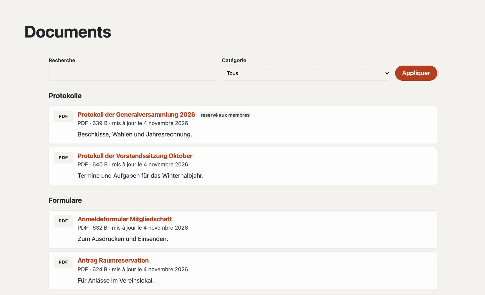

# Plugin « Documents et téléchargements »

Avec « Documents et téléchargements », vous proposez des fichiers à télécharger : procès-verbaux, formulaires, listes
de prix, statuts. Les visiteurs les trouvent par catégorie sur une page dédiée ; si vous téléversez une nouvelle
version, le lien reste le même. Les documents « Réservé aux membres » ne peuvent être téléchargés que par des membres
connectés. Le plugin est gratuit et vient de Basalto.



## Installer et activer

1. Dans le backend sous **Administration › Modules › Marketplace**, cliquez sur **« Installer »** pour « Documents et
   téléchargements » ([Installer un plugin](installieren.md#installer-un-plugin)).
2. Activez-le sous **Administration › Sites › Modifier le site › onglet « Modules »** pour les sites — il est désactivé
   par défaut.

L’onglet **« Documents »** apparaît ensuite sous **Contenus**.

## Créer la page des documents

1. **Pages › Nouveau** (ou une page existante), nom par exemple « Téléchargements ».
2. Onglet **« Experts »** › **« Monter un module »** › **« Documents »**, enregistrer.
3. Publier la page comme d’habitude.

La page affiche tous les documents par catégorie, avec une recherche dès six documents. `?kategorie=<identifiant>`
n’affiche qu’une catégorie — pratique comme lien depuis le menu.

## Téléverser un document

Sous **Contenus › Documents**, **« Téléverser un document »** : choisissez le fichier, un titre (vide : à partir du nom
du fichier) et une catégorie. Il figure aussitôt sur la page des documents. Sont autorisés PDF, Word, Excel,
PowerPoint, OpenDocument, RTF, texte, CSV, ZIP et images (JPEG, PNG, WebP) jusqu’à 20 Mo.

| Dans le document | |
| --- | --- |
| Titre, description | par langue du site |
| Catégorie | pour les groupes sur la page des documents |
| Réservé aux membres | les invités voient le document avec un cadenas et se connectent pour le télécharger |
| Afficher sur la page des documents | sans coche, le document est **masqué** — son lien ne fonctionne alors pas |
| Adresse sous la page des documents | proposée à partir du titre |
| **Téléverser une nouvelle version** | remplace le fichier, le lien reste ; les cinq dernières versions restent sous « Versions antérieures » |

La colonne **« Téléchargements »** compte combien de fois un fichier a été téléchargé.

## Catégories

Sous **Contenus › Documents › Catégories**, vous créez des catégories avec un nom, un identifiant (pour `?kategorie=`
et Lava) et un ordre. Sans catégories, tous les documents figurent dans une seule liste. Si vous supprimez une
catégorie, ses documents restent — sans catégorie.

## Réservé aux membres

Avec le module **« Membres »**, les invités voient un document « Réservé aux membres » avec un cadenas et se
connectent pour le télécharger ([Membres](../redaktion/mitglieder.md)). Si le module est désactivé, personne à part
la rédaction ne peut télécharger un tel document.

## Documents sur d’autres pages

La partie Lava **« Documents »** affiche les documents d’une catégorie sur n’importe quelle page : sous
**Configuration › Mises en page › onglet « Parties »**, **« + Instance »** (catégorie, nombre, titre), ou dans le
thème :

```lava

```

## Bon à savoir

- Les téléchargements passent par le site, pas par un chemin direct vers le fichier — ainsi l’accès et le compteur
  s’appliquent toujours.
- Les PDF et les images s’ouvrent dans le navigateur ; tout le reste est téléchargé.
- Les fichiers ne font pas partie de l’export d’un site ; déplacez-les avec la sauvegarde.

## Pour continuer

- [Membres](../redaktion/mitglieder.md)
- [Marketplace pour les installations](installieren.md)
- [Marketplace](README.md)
