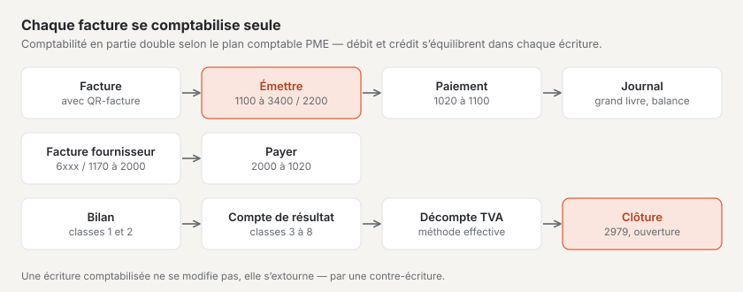

# Plugin « Comptabilité »

Avec « Comptabilité », vous tenez la comptabilité de votre entreprise dans Basalto : comptabilité en partie double selon
le plan comptable PME suisse avec journal, grand livre et balance de vérification, débiteurs et créanciers, factures
avec QR-facture suisse, factures fournisseurs, paiements, bilan, compte de résultat, décompte TVA selon la méthode
effective et bouclement annuel. Le plugin est payant — CHF 149 avec une année de mises à jour — et provient de Basalto.

## Installer et activer

1. Achetez-le sur basaltocms.com — une fois par installation ([Acheter](installieren.md#acheter)).
2. Dans le backend sous **Administration › Modules › Marketplace**, cliquez sur **« Installer »** pour « Comptabilité »
   ([Installer un plugin](installieren.md#installer-un-plugin)).
3. Activez-le sous **Administration › Sites › Modifier le site › onglet « Modules »**. Le plugin est désactivé par
   défaut.

L’entrée **« Comptabilité »** apparaît ensuite sous **Contenus**. Le nombre à côté indique les factures en retard.

## Saisir l’entreprise et le compte

Sous **Comptabilité › Paramètres** se trouvent les indications pour chaque facture et la section paiement QR. Elles
s’enregistrent d’elles-mêmes.

| Champ | |
| --- | --- |
| **Nom de l’entreprise**, **Rue**, **Numéro**, **NPA**, **Localité**, **Pays** | expéditeur de la facture et « Compte / Payable à » dans la section paiement ; Suisse ou Liechtenstein |
| **IBAN ou QR-IBAN** | le compte de l’entreprise. Avec un QR-IBAN, chaque facture porte une **référence QR**, avec un IBAN ordinaire une **Creditor Reference (RF)** |
| **ID BVR** | seulement si votre banque en a attribué un au QR-IBAN — sinon laisser vide |
| **Numéro IDE/TVA** | figure sur chaque facture, par exemple « CHE-123.456.789 TVA » |
| **Assujetti à la TVA** | sans coche, les nouvelles positions ne portent pas de TVA et la facture indique « Non assujetti à la TVA. » |
| **Taux de TVA des nouvelles positions**, **Compte de produits des nouvelles positions** | valeurs par défaut des positions — aussi pour les factures transmises par d’autres plugins |
| **Compte pour les paiements** | le compte bancaire sur lequel les paiements sont comptabilisés (1020 Banque par défaut) |
| **Délai de paiement (jours)** | fixe « Payable jusqu’au » quand une facture n’a pas de date propre (30 par défaut) |
| **Phrase sur la facture** | par exemple un remerciement pour la commande |

## Créer le premier exercice

Les écritures appartiennent toujours à un exercice ouvert. Sous **Comptabilité › Exercices**, saisissez le **Début** et
la **Fin** et choisissez **« Créer »**. Le premier exercice crée :

- le **plan comptable** avec les comptes usuels du plan comptable PME, de 1000 Caisse et 1020 Banque à 1100 Créances
  résultant de livraisons et de prestations, 2000 Dettes résultant d’achats et de prestations de services et 2200 TVA
  due, jusqu’à 3400 Produits des prestations de services, 6000 Charges de locaux et 2979 Bénéfice ou perte de
  l’exercice ;
- les **taux de TVA** dès 2024 : impôt sur le chiffre d’affaires 8,1 % (UN81), 2,6 % (UR26) et 3,8 % (UB38), impôt
  préalable sur le matériel et les prestations (VM81, VM26, VM38, compte 1170) et sur les investissements et autres
  charges d’exploitation (VI81, VI26, compte 1171), chacun avec son chiffre du décompte TVA.

Sous **Plan comptable**, vous ajoutez vos propres comptes (numéro de quatre à six chiffres) et renommez les comptes
existants. Le **type** — actifs, passifs, produits, charges ou bouclement — découle de la classe et détermine si le
compte figure au bilan ou au compte de résultat. Un compte sans la coche **« Proposer dans les listes de choix »**
conserve ses écritures mais n’apparaît plus dans aucune sélection. Si un taux change, créez plutôt un nouveau code TVA et
rendez l’ancien inactif — les montants comptabilisés gardent leur taux.

## Débiteurs et créanciers

**Débiteurs et créanciers** liste les comptes de tiers : les **débiteurs** reçoivent vos factures, les **créanciers**
vous envoient des factures. La colonne **Postes ouverts** montre ce qui reste ouvert ; un clic ouvre le compte de tiers
avec ses factures.

- **Sans CRM**, vous créez les comptes de tiers ici : type, nom ou entreprise, personne de contact, adresse, e-mail et
  numéro IDE/TVA. La comptabilité attribue le numéro elle-même (« DEB-0001 », « KRE-0001 »).
- **Avec le plugin « CRM »**, vous choisissez directement un client de votre liste de clients sur une facture. Le compte
  de tiers est créé à la première utilisation ; vous gérez nom et adresse dans le CRM et la comptabilité suit chaque
  modification. Pour les factures fournisseurs, vous pouvez choisir les clients marqués **« Fournisseur »** dans le
  CRM. Un compte de tiers qui existait avant le CRM se lie de lui-même au client qui a la même adresse e-mail.

## Rédiger une facture

1. Dans l’aperçu **Comptabilité**, sous **« Nouvelle facture »**, choisissez le **Débiteur** et un **Titre** puis
   **« Créer un brouillon »**.
2. Dans le brouillon, sous **« Ajouter une position »**, saisissez le texte, la **Quantité**, l’**Unité**, le **Prix hors
   TVA**, la **TVA** et le **Compte de produits** puis **« Ajouter »** — autant de positions que nécessaire. Les totaux se
   calculent d’eux-mêmes : la TVA par taux sur la somme de ses positions, arrondie au centime.
3. En haut, complétez si vous le souhaitez la **Date de facture**, **Payable jusqu’au** et une **Introduction** — vides,
   ce sont le jour de l’émission et le délai de paiement des paramètres qui s’appliquent. **« Aperçu (PDF) »** montre la
   facture avec la mention « Brouillon ».
4. **« Émettre »** : la facture reçoit le prochain numéro de l’année (« 2027-0001 »), sa référence de paiement et est
   comptabilisée — créances au débit, produits et TVA due au crédit.

S’il manque encore quelque chose — positions, débiteur, coordonnées bancaires ou exercice ouvert pour la date de
facture —, le brouillon l’indique sous **« Pas encore prête »**. **« PDF »** ouvre la facture émise avec la section
paiement QR pour l’envoi. Un brouillon peut être supprimé ; une facture émise sans paiement peut seulement être
**annulée** (bouton **« Annuler »**) : une contre-écriture extourne l’écriture, et la facture reste dans la liste avec le
statut **Annulée**.

## Saisir des paiements

Dans une facture ouverte, sous **« Saisir un paiement »**, saisissez le **Montant** (le montant ouvert est proposé) et
**« Reçu le »** puis **« Saisir »**. La comptabilité comptabilise le compte pour les paiements contre les créances. Les
paiements partiels sont possibles ; si le montant suffit, la facture est **Payée**. La liste de l’aperçu filtre par
**Ouverte**, **Brouillons**, **En retard**, **Payé**, **Annulée** et **Tous**.

## Saisir des factures fournisseurs

Sous **Factures fournisseurs**, dans **« Saisir une facture fournisseur »**, choisissez le **Créancier** et saisissez le
texte, la **Date de facture**, le **Montant TVA comprise**, le **Compte de charges** et le taux d’**Impôt préalable**.
**« Saisir et comptabiliser »** déduit l’impôt préalable du montant et comptabilise la charge et l’impôt préalable (1170
ou 1171) contre les dettes. Dans la facture fournisseur, **« Saisir un paiement »** comptabilise le paiement depuis le
compte pour les paiements ; sans paiement, elle peut être annulée.

## Comptabiliser à la main

Le **Journal** liste toutes les écritures d’un exercice avec **N° de pièce**, date, texte, **Débit**, **Crédit** et
origine. Sous **« Saisir une écriture »**, vous comptabilisez vous-même — sous forme d’écriture « débit à crédit » :

1. Saisissez la **Date**, la **Pièce** et le **Texte**.
2. Choisissez le compte au **Débit** et le compte au **Crédit** et saisissez le **Montant TVA comprise**.
3. Choisissez si besoin un **Code TVA** : avec l’impôt sur le chiffre d’affaires, la part d’impôt passe du compte de
   produits sur 2200, avec l’impôt préalable du compte de charges ou d’immobilisations sur 1170 ou 1171.
4. **« Comptabiliser »** — l’écriture reçoit le prochain numéro de pièce.

Débit et crédit doivent concorder dans chaque écriture. Ce qui est comptabilisé ne se modifie jamais : ouvrez une
écriture erronée et choisissez **« Annuler »** — une contre-écriture avec débit et crédit inversés l’extourne, puis
comptabilisez correctement.

## Grand livre et rapports

- **Grand livre :** un clic sur un compte dans le **Plan comptable** montre toutes ses écritures de l’exercice choisi avec
  **Contrepartie** et **Solde** courant ; le nouvel exercice commence par l’écriture d’ouverture.
- **Balance de vérification :** débit, crédit et solde par compte — le total des débits égale celui des crédits.
- **Bilan :** actifs (actif circulant, actif immobilisé) et passifs (capitaux étrangers à court et à long terme,
  capitaux propres) à la fin de l’exercice, avec l’**Exercice précédent**. Tant que l’exercice n’est pas bouclé, le
  résultat figure sur la ligne **« Bénéfice/perte (non bouclé) »** sous les capitaux propres.
- **Compte de résultat :** produits et charges par classes 3 à 8, avec l’exercice précédent ; à la fin le **Bénéfice de
  l’exercice** ou la **Perte de l’exercice**.

Les rapports choisissent l’exercice en haut de la liste ; un clic sur un compte ouvre son grand livre.

## Décompte TVA

Sous **Décompte TVA**, la comptabilité calcule selon la **méthode effective** avec les **contre-prestations convenues** —
c’est la date de la facture ou de l’écriture qui compte. Choisissez le **trimestre**, le **semestre** ou l’**année
entière**. La liste montre les chiffres du formulaire de l’Administration fédérale des contributions (AFC) avec des
montants hors TVA :

| Chiffre | |
| --- | --- |
| **200** | Total des contre-prestations convenues (produits de la classe 3) |
| **289** | Chiffre d’affaires sans code TVA — vérifiez ici les chiffres d’affaires exonérés et exclus (chiffres 220 à 280) |
| **299** | Chiffre d’affaires imposable total |
| **303**, **313**, **343** | Prestations à 8,1 %, 2,6 % et 3,8 % avec l’impôt |
| **399** | Total de l’impôt dû |
| **400**, **405**, **479** | Impôt préalable sur le matériel et les prestations, sur les investissements et autres charges d’exploitation, total |
| **500** ou **510** | montant à payer ou solde en faveur de l’assujetti |

Le décompte est une aide : comparez les valeurs avec le formulaire de l’AFC avant de le déposer, et saisissez vous-même
les diminutions de la contre-prestation, les corrections de l’impôt préalable et les chiffres 220 à 280.

## Boucler l’exercice

Sous **Exercices**, l’exercice ouvert le plus ancien affiche **« Clôturer »**. Le bouclement annuel

1. reporte le résultat par une écriture de bouclement sur le compte **2979 Bénéfice ou perte de l’exercice**,
2. verrouille l’exercice — plus aucune écriture n’est possible ensuite,
3. crée l’exercice suivant s’il manque et l’ouvre avec les soldes du bilan (écriture d’ouverture).

Vous comptabilisez ensuite vous-même l’emploi du bénéfice dans le nouvel exercice — par exemple de 2979 sur 2970
Bénéfice reporté ou perte reportée. Le compte de résultat de l’exercice bouclé montre toujours le résultat.

## Avec le CRM et la gestion de projet

- **CRM :** vous choisissez clients et fournisseurs dans le CRM ; le client dans le CRM affiche ses factures avec numéro,
  montant et statut sous « Liés ».
- **Gestion de projet :** le temps saisi d’un projet arrive en comptabilité comme brouillon de facture — avec le taux de
  TVA et le compte de produits par défaut. Le brouillon indique de quel plugin il provient. Si vous le supprimez ou
  annulez la facture, la gestion de projet libère à nouveau le temps pour la facturation.

## Dans le compte client

Les clientes et clients voient dans leur compte client l’espace **« Factures »** avec leurs factures émises — toutes
celles dont le débiteur porte leur adresse e-mail et, avec le CRM, aussi les factures à l’entreprise à laquelle ils
appartiennent comme personne de contact. Les factures ouvertes figurent sous « À faire ensuite », et le PDF avec la
section paiement QR peut être téléchargé.

## Protection des données et conservation

- Le **renseignement** par adresse e-mail (sous « Administration › Utilisateurs » ou `php artisan basalto:privacy`) liste
  les comptes de tiers et les factures.
- **Suppression :** les factures, écritures et comptes de tiers sont des livres comptables et doivent être conservés dix
  ans. Ils restent avec nom et adresse ; l’adresse e-mail est supprimée afin que les factures n’apparaissent plus dans le
  compte client. Les comptes de tiers sans facture ni écriture disparaissent entièrement.
- L’**export d’un site** n’emporte pas la comptabilité — elle reste sur le site d’origine.

## Bon à savoir

- Les factures sont calculées au centime près, sans arrondi à cinq centimes — la QR-facture se paie électroniquement.
- La comptabilité vous facilite le travail, mais ne remplace pas les obligations légales de la tenue des comptes et de la
  TVA. En cas de doute, faites vérifier le plan comptable, le bouclement et le décompte TVA par votre fiduciaire.
- La comptabilité salariale, la comptabilité des immobilisations, la méthode des taux de la dette fiscale nette et les
  devises autres que CHF et EUR n’en font pas partie.

## En cas de problème

| Signe | Cause | Solution |
| --- | --- | --- |
| **« Pas encore d’exercice »** | il n’y a pas encore d’exercice | créer le premier sous **Exercices** |
| **« Coordonnées bancaires manquantes »** | le nom, l’IBAN, le NPA ou la localité de l’entreprise manquent | les compléter sous **Paramètres** |
| **« Pas encore prête »** dans le brouillon | positions, débiteur, coordonnées bancaires ou exercice manquent | effectuer les étapes indiquées |
| « Il n’y a pas d’exercice pour le … » | la date se situe hors de tout exercice | créer l’exercice correspondant ou corriger la date |
| « L’exercice … est bouclé » | la date se situe dans un exercice bouclé | comptabiliser dans l’exercice ouvert |
| « Le débit et le crédit ne concordent pas » | une écriture n’est pas équilibrée | vérifier les montants des lignes |
| « L’impôt sur le chiffre d’affaires exige un compte de produits … » | le code TVA ne correspond pas aux comptes | utiliser les codes d’impôt sur le chiffre d’affaires avec un compte de produits, ceux d’impôt préalable avec un compte de charges ou d’immobilisations |
| **« Annuler »** manque | la facture a déjà un paiement | clarifier d’abord si le paiement est remboursé ; comptabiliser une note de crédit à la main |
| Aucun client du CRM dans la sélection | le CRM est désactivé pour ce site ou le client est archivé | activer le CRM ou restaurer le client dans le CRM |

## Pour continuer

- [Plugin « CRM »](plugin-crm.md)
- [Plugin « Gestion de projet »](plugin-projektmanagement.md)
- [Marketplace pour les installations](installieren.md)
- [Marketplace](README.md)
