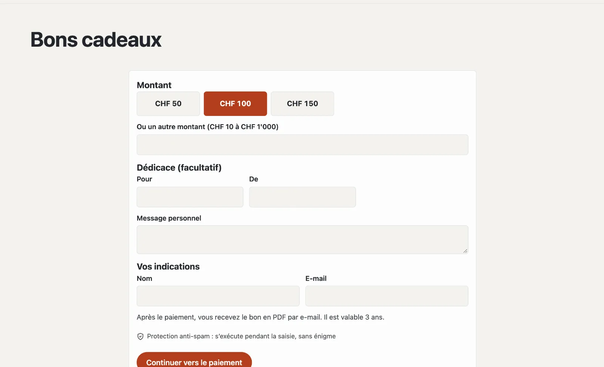

# Plugin « Vendre des bons »

Avec « Vendre des bons », vous proposez des bons de valeur en ligne : choisir un montant, ajouter une dédicace, payer
par carte ou TWINT via votre propre compte Stripe — et aussitôt après, le bon arrive dans la boîte de réception en PDF
avec un code. Dans le backend, vous l’encaissez en totalité ou en partie et voyez la valeur restante. Le plugin coûte
CHF 99 avec une année de mises à jour et vient de Basalto.



## Installer et activer

1. Achetez-le dans le Marketplace sur basaltocms.com ([Acheter](installieren.md#acheter)), puis dans le backend sous
   **Administration › Modules › Marketplace**, cliquez sur **« Installer »** pour « Vendre des bons »
   ([Installer un plugin](installieren.md#installer-un-plugin)).
2. Activez-le sous **Administration › Sites › Modifier le site › onglet « Modules »** pour les sites — il est désactivé
   par défaut.
3. Connectez votre compte Stripe sous **Administration › Paiements** ([Paiements](../verwaltung/zahlungen.md)).

L’onglet **« Bons »** apparaît ensuite sous **Contenus**.

## Créer la page des bons

**Pages › Nouveau**, nom par exemple « Bons cadeaux », onglet **« Experts »** › **« Monter un module »** › **« Bons »**,
publier. Les visiteurs y choisissent un montant (ou un autre dans vos limites), écrivent s’ils le souhaitent **Pour**,
**De** et un **message personnel**, et indiquent nom et e-mail. **« Continuer vers le paiement »** mène à Stripe.

Après le paiement :

- l’acheteur reçoit un e-mail avec le bon en PDF (montant, dédicace, code, valable jusqu’au, votre adresse),
- la page affiche le code et **« Télécharger le bon (PDF) »**,
- votre équipe reçoit un message « Bon vendu ».

Sans paiement, la commande expire — aucun bon n’est créé.

Vous placez une incitation avec les montants comme boutons sur n’importe quelle page avec la partie Lava **« Bons »** :

```lava

```

## Régler la vente

En bas de **Contenus › Bons** sous **« Vente »** :

| Réglage | |
| --- | --- |
| Montants au choix | séparés par des virgules, p. ex. 50, 100, 150 |
| Montant libre autorisé, dès, jusqu’à | un autre montant dans ces limites |
| Valable (années) | à partir de l’achat ; faites vérifier la durée juridiquement pour votre commerce |
| Remarque sur le bon | p. ex. « Valable au restaurant et au bar » |

## Encaisser

En haut de **Contenus › Bons** sous **« Encaisser »** : **code** (tirets, espaces et minuscules n’ont pas
d’importance) et **montant**, si vous le souhaitez une note comme « Facture 1043 ». Basalto déduit le montant et
affiche la valeur restante ; il n’accepte ni plus que la valeur restante, ni un bon expiré ou annulé. Avec une valeur
restante de 0, le bon est **épuisé**.

La page d’un bon affiche chaque encaissement avec date, montant, note et personne, ainsi que le **PDF**,
**« Prolonger d’un an »** et **« Annuler »**. Un remboursement en cas d’annulation se déclenche dans le tableau de bord
Stripe.

## Bons sans achat en ligne

**« Émettre un bon »** en bas de **Contenus › Bons** crée un bon valable — vendu à la caisse ou offert —, avec le PDF
par e-mail si vous le souhaitez. L’émission et l’encaissement fonctionnent aussi sans paiements configurés.

## Protection des données

Le nom et l’e-mail de l’acheteur ainsi que la dédicace sont enregistrés. Si vous supprimez les données d’une personne
sous **Administration › Utilisateurs** ([Utilisateurs](../verwaltung/benutzer.md)), le bon reste valable. Deux ans
après l’échéance, le nettoyage nocturne retire les données personnelles ; les commandes jamais payées, après un jour.

## Dans les statistiques

Sous [Statistiques](../verwaltung/statistik.md), l’onglet **Bons** montre bons vendus, chiffre d’affaires, montants utilisés et la valeur restante ouverte, comparés à la période précédente.

## Pour continuer

- [Paiements](../verwaltung/zahlungen.md)
- [Marketplace pour les installations](installieren.md)
- [Marketplace](README.md)
