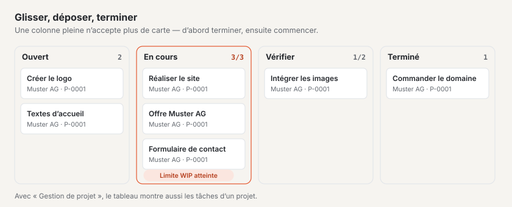

# Plugin « Tableau Kanban »

Avec le « Tableau Kanban », vous planifiez le travail selon la méthode Kanban : les cartes passent de colonne en
colonne, de « Ouverte » à « Terminé », et une **limite WIP** (work in progress — au plus autant de cartes à la fois
dans une colonne) veille à ce que ce qui est commencé soit d’abord terminé. Les cartes portent une personne
responsable, une échéance et des étiquettes ; avec les plugins « CRM » et « Gestion de projet », vous les rattachez à
des clients et à des projets. Le plugin est gratuit et provient de Basalto.

## Installer et activer

1. Dans le backend sous **Administration › Modules › Marketplace**, cliquez sur **« Installer »** pour « Tableau
   Kanban » ([Installer un plugin](installieren.md#installer-un-plugin)).
2. Activez-le sous **Administration › Sites › Modifier le site › onglet « Modules »** pour les sites qui doivent
   l’utiliser — il est désactivé par défaut.

L’entrée de menu **« Tableau Kanban »** apparaît ensuite sous **Contenus**. Le nombre à côté indique les cartes
ouvertes dont l’échéance est passée.

## Créer un tableau

1. Sous **Contenus › Tableau Kanban**, saisissez un **Nom** et, si vous le souhaitez, une **Description** dans le
   formulaire **« Nouveau tableau »**.
2. **« Créer »** — le tableau s’ouvre.

Chaque nouveau tableau est livré avec quatre colonnes et trois étiquettes, que vous adaptez ensuite sous
**« Paramètres »** :

| Colonne | Limite WIP | |
| --- | --- | --- |
| **Ouverte** | aucune | tout ce qui n’est pas encore commencé |
| **En cours** | 3 | |
| **Vérifier** | 2 | |
| **Terminé** | aucune | compte comme terminé — les cartes y reçoivent leur date d’achèvement |

Les étiquettes s’appellent **Urgent** (rouge), **En attente** (jaune) et **Idée** (lave).

## Ajouter et déplacer des cartes

- **Ajouter :** sous chaque colonne se trouve le champ **« + Ajouter une carte »**. Tapez un titre, appuyez sur
  Entrée — la carte apparaît en bas de la colonne.
- **À la souris :** faites glisser une carte et déposez-la à l’endroit voulu, dans la même colonne ou une autre.
- **Au clavier :** sous chaque carte se trouvent quatre boutons fléchés, accessibles avec la touche Tab — **←** et
  **→** déplacent la carte dans la colonne de gauche ou de droite (en bas), **↑** et **↓** d’une place vers le haut ou
  vers le bas.
- **Ouvrir :** un clic sur le titre ouvre la carte.

Le tableau affiche immédiatement le nouvel état. Sur les écrans étroits, les colonnes s’empilent.

Chaque carte affiche son titre, en dessous le client et le projet, les étiquettes, l’échéance — en rouge lorsqu’elle
est passée et que la carte n’est pas dans une colonne terminée — et la personne responsable.

## La limite WIP

En haut à droite de chaque colonne figure le nombre de cartes qu’elle contient, avec limite par exemple **« 2/3 »**.
Une fois la limite atteinte, la colonne n’accepte plus de carte : ni le déplacement ni « Ajouter une carte » ne
fonctionnent, et le tableau signale **« La colonne « En cours » a atteint sa limite WIP (3). »** Terminez d’abord une
carte et faites-la avancer — c’est ainsi que fonctionne la méthode Kanban.

- Réordonner à l’intérieur d’une colonne pleine et en sortir des cartes fonctionne toujours.
- Si vous abaissez la limite sous le nombre de cartes déjà présentes, la colonne est bordée de rouge jusqu’à ce que
  suffisamment de cartes aient avancé.
- Vide ou 0 signifie : sans limite.

## Modifier une carte

Un clic sur le titre ouvre la carte. Elle s’enregistre d’elle-même.

| Champ | |
| --- | --- |
| **Titre**, **Description** | de quoi il s’agit |
| **Responsable** | une personne qui travaille dans le backend de ce site — elle reçoit une notification |
| **Échéance le** | une fois la date passée, elle apparaît en rouge sur le tableau (sauf dans une colonne terminée) |
| **Étiquette « … »** | les étiquettes du tableau à cocher |
| **Client** | seulement avec le plugin « CRM » : un client de votre liste de clients |
| **Projet** | seulement avec le plugin « Gestion de projet » : un projet en cours |

En haut se trouvent **« Vers le tableau »**, **« Archiver »** et **« Supprimer »**.

## Configurer colonnes et étiquettes

Sur le tableau, **« Paramètres »** ouvre :

- **Tableau :** nom, description et jusqu’à six **étiquettes** avec une couleur (gris, vert, jaune, rouge, lave). Si
  vous renommez une étiquette, elle reste sur ses cartes ; si vous videz le nom, elle en disparaît.
- **Colonnes :** un clic sur une colonne ouvre son nom, sa **limite WIP** et **« Les cartes ici comptent comme
  terminées »**. **« Vers la gauche »** et **« Vers la droite »** changent l’ordre. Une colonne ne peut être supprimée
  que lorsqu’elle ne contient plus aucune carte — même archivée.
- **Nouvelle colonne :** nom, limite WIP, terminé — **« Créer »** l’ajoute à droite.
- **Cartes archivées :** **« Restaurer »** les remet en bas de leur colonne, si la limite WIP le permet.

## Avec le CRM et la gestion de projet

Le tableau Kanban fonctionne seul. Si les autres plugins sont installés et activés pour le site, leurs données s’y
ajoutent d’elles-mêmes :

- **Avec le [plugin « CRM »](plugin-crm.md)**, vous choisissez le **client** d’une carte. Si son nom change dans le
  CRM, la carte suit. Dans le CRM, le client affiche ses cartes ouvertes parmi les données liées.
- **Avec le [plugin « Gestion de projet »](plugin-projektmanagement.md)**, vous choisissez le **projet** ; le projet
  affiche lui aussi ses cartes. De plus, **« En tableau Kanban »** dans un projet ouvre ses tâches sous forme de
  tableau : les colonnes sont les états des tâches, déplacer change l’état, et les tâches restent dans la gestion de
  projet. Vous réglez les limites WIP de ces tableaux sous le tableau, à **« Limites WIP »**. La vue d’ensemble
  mentionne ces tableaux sous **« Autres tableaux »**.

S’il manque un plugin, la carte n’a pas de champ pour lui, et une remarque indique ce qu’apporterait le plugin. Ce qui
est déjà rattaché à une carte est conservé et affiché en haut de la carte.

## Archiver et supprimer

- Les **tableaux** s’archivent dans la vue d’ensemble (les cocher, puis **« Archiver »**) ou sous **« Paramètres »**.
  Le filtre **« Archives »** les affiche ; **« Restaurer »** les ramène. Un tableau ne peut être supprimé
  définitivement que depuis les archives — avec toutes ses colonnes et cartes.
- Les **cartes** s’archivent depuis la carte ; elles disparaissent du tableau et figurent sous **« Paramètres »**
  parmi les cartes archivées.

## Notifications

Lorsqu’une carte vous est attribuée, la cloche affiche **« Carte attribuée »** — aussi par e-mail si vous le
souhaitez ([Notifications](../redaktion/index.md#notifications)). Qui s’attribue une carte à soi-même ne reçoit pas
de message.

## Bon à savoir

- Les tableaux et les cartes appartiennent à leur site. Ils ne sont pas repris lors de l’exportation d’un site — ce
  sont des travaux en cours avec des personnes et des renvois vers d’autres plugins.
- Qui peut créer et déplacer des cartes est réglé par le domaine **« Tableau Kanban »** dans les rôles
  ([Rôles](../verwaltung/rollen.md)).

## En cas de problème

| Signe | Cause | Solution |
| --- | --- | --- |
| « La colonne « … » a atteint sa limite WIP (…). » | la colonne est pleine | terminer d’abord une carte et la faire avancer — ou augmenter la limite sous « Paramètres » |
| Les champs **Client** ou **Projet** manquent | le plugin « CRM » ou « Gestion de projet » n’est pas installé ou est désactivé pour le site | l’installer ou l’activer sous Modifier le site › « Modules » |
| « La colonne contient encore des cartes … » | la colonne contient des cartes, y compris archivées | déplacer ou supprimer les cartes, puis supprimer la colonne |
| « En tableau Kanban » manque dans le projet | le tableau Kanban est désactivé pour le site | l’activer sous Modifier le site › « Modules » |
| Une carte archivée ne peut pas être restaurée | sa colonne a atteint la limite WIP | faire de la place dans la colonne ou augmenter la limite |

## Pour continuer

- [Plugin « CRM »](plugin-crm.md)
- [Plugin « Gestion de projet »](plugin-projektmanagement.md)
- [Marketplace pour les installations](installieren.md)
- [Marketplace](README.md)
