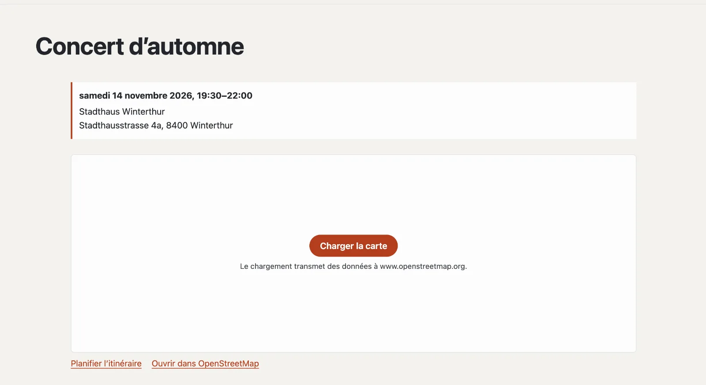

# Plugin « Carte sans pistage »

« Carte sans pistage » montre un lieu sur une carte d’OpenStreetMap — mais seulement lorsque la visiteuse clique
dessus. D’ici là, la page ne charge rien depuis un serveur tiers. Basalto trouve lui-même les adresses en Suisse, une
seule fois, grâce à la recherche des géodonnées fédérales (geo.admin.ch). Sous la carte figurent « Planifier
l’itinéraire » et « Ouvrir dans OpenStreetMap ». Le plugin est gratuit et vient de Basalto.



## Installer et activer

1. Dans le backend sous **Administration › Modules › Marketplace**, cliquez sur **« Installer »** pour « Carte sans
   pistage » ([Installer un plugin](installieren.md#installer-un-plugin)).
2. Activez-le sous **Administration › Sites › Modifier le site › onglet « Modules »** pour les sites — il est désactivé
   par défaut.

## Placer une carte

La carte est une partie Lava : sous **Configuration › Mises en page › onglet « Parties »**, cliquez sur
**« + Instance »** pour « Carte » et remplissez les réglages. Insérez l’instance dans l’éditeur d’une page avec
**« + Partie Lava »** — par exemple sur la page « Contact » — ou dans une région d’une mise en page
([Structure : mises en page, parties et modèles](../einrichtung/aufbau.md)).

| Réglage | |
| --- | --- |
| Adresse | p. ex. « Stadthausstrasse 4a, 8400 Winterthur » — Basalto cherche le lieu une fois et le retient |
| Désignation | en gras sous la carte, p. ex. « Hôtel de ville » |
| Zoom | 3 (très loin) à 19 (porte d’entrée), 16 par défaut |
| Hauteur | en pixels, de 200 à 800, 360 par défaut |

Dans le thème, cela fonctionne directement ; à la place d’une adresse, des coordonnées conviennent aussi :

```lava


```

Avec le [plugin « Événements »](plugin-veranstaltungen.md), chaque événement avec une adresse affiche sa carte
automatiquement.

## Vérifier et corriger les lieux

Sous **Contenus › Lieux de la carte**, chaque adresse qui affiche une carte figure avec le lieu trouvé et sa source.

| Action | Effet |
| --- | --- |
| **Vérifier une adresse** | cherche une adresse à l’avance — vous voyez ainsi si elle est trouvée |
| **Latitude, longitude** | saisies à la main, p. ex. pour une entrée à l’arrière du bâtiment ; la source devient « à la main » et Basalto ne cherche plus |
| **Rechercher à nouveau** | interroge à nouveau geo.admin.ch ; les coordonnées saisies à la main sont remplacées |
| **Oublier** | supprime le lieu ; Basalto le recherche au prochain affichage d’une carte |

geo.admin.ch connaît les adresses, lieux et noms de Suisse. Si la recherche ne trouve pas une adresse, un lien
« Rechercher sur OpenStreetMap » apparaît à la place de la carte ; Basalto réessaie après sept jours. Si le service ne
répond pas, Basalto ne retient rien et réessaie à la prochaine requête.

## Protection des données

- Tant que **« Charger la carte »** n’est pas cliqué, le navigateur de la visiteuse ne contacte aucun serveur tiers.
  Qui a autorisé les « Contenus externes » dans les paramètres des cookies voit la carte tout de suite.
- C’est seulement avec le clic que la carte se charge depuis OpenStreetMap (www.openstreetmap.org) ; OpenStreetMap
  reçoit alors l’adresse IP et les indications du navigateur. Mentionnez-le dans la déclaration de protection des
  données de votre site.
- La recherche sur geo.admin.ch est effectuée par le serveur de Basalto — avec l’adresse du bloc, jamais avec des
  données des visiteurs. Les lieux trouvés font partie de l’export d’un site.

## Pour continuer

- [Plugin « Événements »](plugin-veranstaltungen.md)
- [Marketplace pour les installations](installieren.md)
- [Marketplace](README.md)
