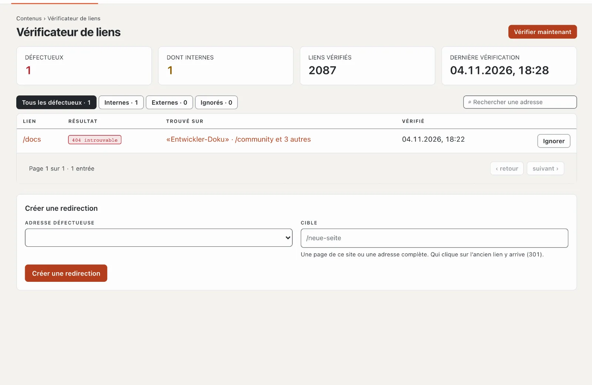

# Plugin « Vérificateur de liens »

Le vérificateur de liens trouve les liens et images défectueux de votre site — vers vos propres pages qui n’existent
plus et vers des adresses externes qui ne répondent plus. Il montre sur quelle page se trouve le lien et, pour les
erreurs internes, crée une redirection en un clic. Le plugin est gratuit et vient de Basalto.

## Installer et activer

1. Dans le backend sous **Administration › Modules › Marketplace**, cliquez sur **« Installer »** pour « Vérificateur
   de liens » ([Installer un plugin](installieren.md#installer-un-plugin)).
2. Activez-le sous **Administration › Sites › Modifier le site › onglet « Modules »** pour les sites — il est désactivé
   par défaut.

L’onglet **« Vérificateur de liens »** apparaît ensuite sous **Contenus**.

## Quand la vérification a lieu

- **Chaque nuit** entre 1 et 5 heures (fuseau horaire du site), d’elle-même — à condition que la planification de
  l’installation fonctionne ([Exploitation](../verwaltung/betrieb.md)).
- **À tout moment** avec **« Vérifier maintenant »**. Les grands sites demandent quelques minutes ; la page montre
  l’avancement de la vérification.

Toutes les pages publiées dans toutes les langues sont vérifiées : liens, images et fichiers intégrés. Basalto vérifie
les adresses internes directement, sans détour par le réseau ; il interroge poliment les adresses externes, l’une
après l’autre.

## Lire les résultats

| Colonne | |
| --- | --- |
| Lien | l’adresse défectueuse |
| Résultat | p. ex. « 404 introuvable », « 410 supprimé », « Délai dépassé », « Pas de connexion » |
| Trouvé sur | les pages qui contiennent le lien — un clic les ouvre |

En haut, vous choisissez **« Tous les défectueux »**, **« Internes »**, **« Externes »** ou **« Ignorés »** ; la
recherche filtre par adresse.

## Corriger un lien défectueux

- **Corriger sur la page :** ouvrez la page et adaptez le lien dans l’éditeur. À la vérification suivante, il disparaît.
- **Créer une redirection** (adresses internes seulement) : l’ancienne adresse renvoie alors durablement (301) vers une
  nouvelle cible — une page du site ou une adresse complète. La redirection figure ensuite aussi sous
  **Pages › Redirections**.
- **Ignorer :** pour les liens voulus tels quels ou qui ne répondent qu’occasionnellement pas. Sous « Ignorés », vous
  les récupérez avec **« Signaler de nouveau »**.

## Dans les statistiques

Sous [Statistiques](../verwaltung/statistik.md), l’onglet **Vérificateur de liens** montre liens cassés après la dernière vérification avec le nombre de pages où ils figurent, comparés à la période précédente.

## En cas de problème

| Signe | Cause | Solution |
| --- | --- | --- |
| « Pas encore vérifié » reste affiché | la planification de l’installation ne fonctionne pas | configurer cron ([Exploitation](../verwaltung/betrieb.md)) ou « Vérifier maintenant » |
| une page externe est « défectueuse », mais s’ouvre dans le navigateur | elle bloque les requêtes automatiques | « Ignorer » |
| la vérification dure longtemps | beaucoup de pages ou des serveurs externes lents | elle continue par étapes ; rechargez plus tard |

## Pour continuer

- [Redirections](../redaktion/seiten.md#redirections)
- [Marketplace pour les installations](installieren.md)
- [Marketplace](README.md)
