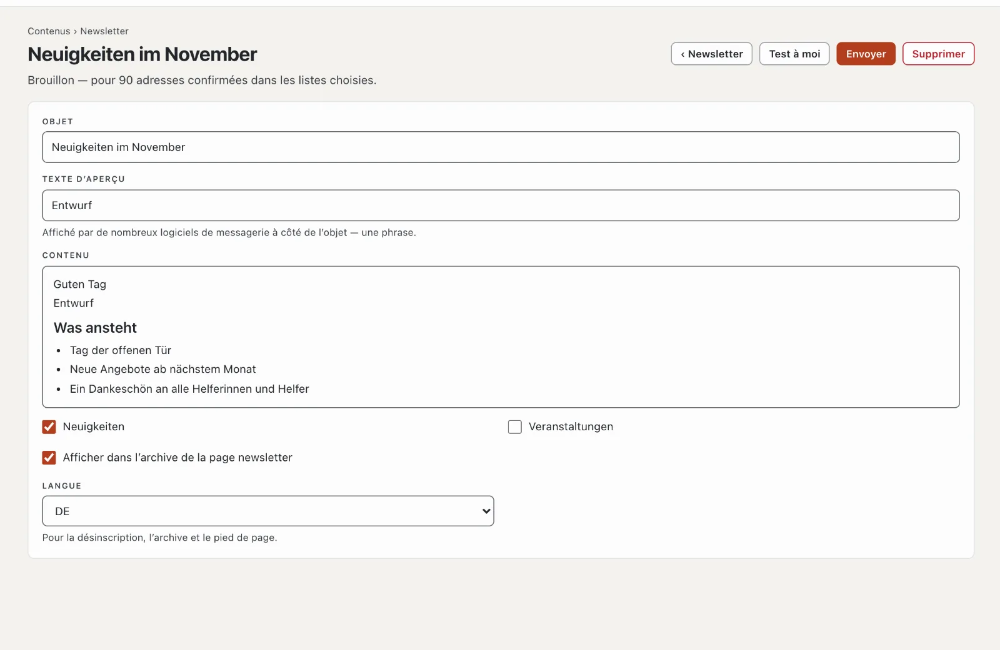

# Plugin « Newsletter »

Avec « Newsletter », vous écrivez régulièrement à vos abonnés : inscription avec confirmation par e-mail (double
opt-in), plusieurs listes au choix, désinscription en un clic et archive des éditions sur votre site. L’envoi passe
par un service d’envoi comme Brevo, Mailjet ou Infomaniak. Le plugin coûte CHF 99 avec une année de mises à jour et
vient de Basalto.



## Installer et activer

1. Achetez-le dans le Marketplace sur basaltocms.com ([Acheter](installieren.md#acheter)), puis dans le backend sous
   **Administration › Modules › Marketplace**, cliquez sur **« Installer »** pour « Newsletter »
   ([Installer un plugin](installieren.md#installer-un-plugin)).
2. Activez-le sous **Administration › Sites › Modifier le site › onglet « Modules »** pour les sites — il est désactivé
   par défaut.

L’onglet **« Newsletter »** apparaît ensuite sous **Contenus**.

## Configurer

1. **Page newsletter :** **Pages › Nouveau**, nom par exemple « Newsletter », onglet **« Experts »** › **« Monter un
   module »** › **« Newsletter »**, publier. Les visiteurs s’y inscrivent, confirment, se désinscrivent et lisent
   l’archive.
2. **Listes :** sous **Contenus › Newsletter › Listes et envoi**, au moins une liste, par exemple « Actualités ».
   **« Au choix lors de l’inscription »** la rend publique ; seule l’équipe alimente les listes internes.
3. **Service d’envoi :** même page, plus bas. Un hébergement simple n’autorise qu’une centaine d’e-mails par heure —
   les newsletters passent donc par un service :

| Service | Ce que vous saisissez |
| --- | --- |
| Brevo | identifiant SMTP et clé SMTP de votre compte Brevo |
| Mailjet | clé API comme nom d’utilisateur, clé secrète comme mot de passe |
| Infomaniak | adresse et mot de passe d’une boîte aux lettres chez Infomaniak |
| Serveur SMTP propre | serveur, port (587 ou 465), nom d’utilisateur, mot de passe |

Pour Brevo, Mailjet et Infomaniak, Basalto remplit lui-même le serveur et le port. L’**adresse de l’expéditeur** doit
être vérifiée auprès du service, et votre domaine a besoin de SPF et DKIM pour le service — sinon les newsletters
finissent dans les spams. Réglez **E-mails par minute** selon votre abonnement. **« Vérifier la connexion »** se
connecte une fois au serveur. Le mot de passe reste chiffré sur le serveur ; laissé vide, celui enregistré est
conservé.

## S’inscrire et se désinscrire

- L’**inscription** figure sur la page newsletter et, comme partie Lava **« Inscription à la newsletter »**, sur
  n’importe quelle page, par exemple dans le pied de page :

```lava

```

  Avec `list: "Veranstaltungen"`, la partie n’inscrit qu’à cette liste ; sinon, les visiteurs choisissent parmi les
  listes publiques.
- Après l’envoi, la personne reçoit un e-mail avec **« Confirmer l’inscription »**. Ce n’est qu’ensuite qu’elle est
  inscrite ; le lien est valable sept jours. Basalto conserve la preuve : moment du consentement, page de
  l’inscription, moment de la confirmation.
- La **désinscription** se fait en un clic : via le lien en bas de chaque édition (avec un bouton sur la page
  newsletter) ou via le bouton de désinscription que des logiciels de messagerie comme Gmail affichent à côté de
  l’expéditeur.

## Envoyer une édition

1. **Contenus › Newsletter** › **« Nouvelle édition »** avec l’objet.
2. **Texte d’aperçu** (une phrase que de nombreux logiciels de messagerie affichent à côté de l’objet), **contenu**
   dans l’éditeur, cocher les **listes**. Les modifications s’enregistrent toutes seules.
3. **« Test à moi »** envoie l’édition à votre propre adresse.
4. **« Envoyer »** — la question indique le nombre de destinataires. Ensuite, l’envoi démarre au rythme du service ;
   la page montre combien d’e-mails sont partis et combien ont échoué, avec la raison.

Avec **« Afficher dans l’archive de la page newsletter »**, l’édition figure dans l’archive après l’envoi — et chaque
e-mail contient le lien **« Voir dans le navigateur »**. **« Copier comme nouvelle édition »** reprend une édition
envoyée comme modèle.

## Abonnés

**Contenus › Newsletter › Abonnés** affiche **Inscrit**, **En attente de confirmation** et **Désinscrit**, avec
recherche, filtre par liste, actions groupées (désinscrire, supprimer) et **« Confirmés en CSV »**. **« Ajouter une
adresse »** envoie la demande de confirmation — ou inscrit la personne tout de suite si elle a donné son accord par
écrit de manière démontrable.

## Protection des données

Le nettoyage nocturne supprime les inscriptions non confirmées après sept jours et les désinscrits après 30 jours. Les
adresses d’une personne font partie du **droit d’accès** et de la **suppression** sous **Administration ›
Utilisateurs** ([Utilisateurs](../verwaltung/benutzer.md)). Les abonnés ne font pas partie de l’export d’un site —
leur consentement vaut pour le site précédent.

## En cas de problème

| Signe | Cause | Solution |
| --- | --- | --- |
| « Pas de connexion au service d’envoi » | nom d’utilisateur, mot de passe ou port erroné | vérifier l’accès auprès du service, port 587 ou 465 |
| les e-mails arrivent dans les spams | expéditeur non vérifié, SPF/DKIM manquants | vérifier le domaine auprès du service, définir les entrées DNS |
| l’envoi s’arrête | la planification de l’installation ne fonctionne pas | configurer cron ([Exploitation](../verwaltung/betrieb.md)) |

## Pour continuer

- [Utilisateurs](../verwaltung/benutzer.md)
- [Marketplace pour les installations](installieren.md)
- [Marketplace](README.md)
