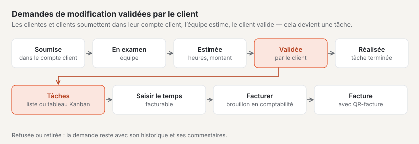

# Plugin « Gestion de projet »

Avec « Gestion de projet », vous menez des projets pour vos clientes et clients : jalons, tâches, temps saisi et budget
au même endroit. Vos clients soumettent des **demandes de modification** dans leur compte client, voient votre
**estimation de l’effort** et la valident — elle devient alors une tâche. Le plugin fonctionne de lui-même avec les
plugins « CRM », « Comptabilité » et « Tableau Kanban ». Il est payant — CHF 129 avec une année de mises à jour — et
vient de Basalto.

## Installer et activer

1. Achetez-le sur basaltocms.com — une fois par installation ([Acheter](installieren.md#acheter)).
2. Dans le backend sous **Administration › Modules › Marketplace**, cliquez sur **« Installer »** pour « Gestion de
   projet » ([Installer un plugin](installieren.md#installer-un-plugin)).
3. Activez-le sous **Administration › Sites › Modifier le site › onglet « Modules »** — il est désactivé par défaut.

L’entrée **« Projets »** apparaît ensuite sous **Contenus**. Le nombre à côté indique les demandes de modification
nouvellement arrivées qui attendent votre équipe.

## Créer un projet

1. Sous **Contenus › Projets**, saisissez le **nom** dans le formulaire **« Nouveau projet »**.
2. Choisissez ou saisissez le **client**, si vous le souhaitez le **taux horaire** et le **budget (heures)**.
3. **« Créer »** — le projet reçoit le numéro suivant du site et s’ouvre.

La liste montre les projets en cours (planifiés, actifs, en pause) ; les boutons au-dessus filtrent par **Terminé**,
**Archives** et **Tous**, la recherche trouve le nom, le numéro et le client. En haut figurent les indicateurs : projets
en cours, tâches ouvertes, demandes de modification chez l’équipe et celles qui attendent la validation du client.

## Données, budget et accès dans le compte client

Sur la page d’un projet, les **données** s’enregistrent d’elles-mêmes :

| Champ | |
| --- | --- |
| **Client** | avec le plugin « CRM », un choix dans votre liste de clients, sinon un nom |
| **État** | Planifié, Actif, En pause, Terminé ou Abandonné |
| **Direction du projet**, **Début**, **Fin** | qui est responsable et quand le projet se déroule |
| **Taux horaire**, **Devise** | s’applique au temps nouvellement saisi et propose le montant d’une estimation |
| **Budget (heures)**, **Budget (CHF)** | les indicateurs en haut y comparent le temps saisi |
| **Afficher dans le compte client** | les clients ayant accès voient le projet et soumettent des demandes de modification |
| **Accès dans le compte client (adresses e-mail)** | une adresse par ligne — qui se connecte au compte client avec l’une d’elles voit le projet |

Les indicateurs **Heures** et **Montant** montrent la consommation à côté du budget. À partir de 80 %, ils passent au
jaune avec la remarque « Plus de 80 % du budget sont consommés », au-delà de 100 % au rouge.

**Archiver** retire un projet des listes et du compte client ; **Restaurer** le ramène.

## Jalons et tâches

- Créez les **jalons** avec une date sous **« Nouveau jalon »**. **« Atteint »** enregistre la date ; une date manquée
  apparaît comme **en retard**.
- Les **tâches** ont un statut — **Ouverte**, **En cours**, **Vérifier**, **Terminé** —, une personne responsable,
  une échéance, une **estimation** (sous la forme 2:30 ou 2.5 heures) et, si vous le souhaitez, un jalon. Un clic ouvre
  la tâche ; elle s’enregistre d’elle-même.
- Les tâches sélectionnées changent ensemble de statut avec **« Statut : … »** dans la barre du bas, ou sont supprimées.

## Les tâches en tableau Kanban

Si le plugin « Tableau Kanban » est installé et activé, **« En tableau Kanban »** apparaît en haut de la page du projet.
Les tâches y figurent comme cartes dans quatre colonnes — une par statut — avec jalon, estimation, échéance et personne
responsable. Faites glisser une carte dans une autre colonne et le statut de la tâche change ; l’ordre est conservé.
Vous réglez les limites WIP dans le tableau Kanban. Sans le plugin, le projet affiche ses tâches sous forme de liste.

## Saisir et facturer le temps

1. Sur la page du projet sous **« Saisir du temps »**, indiquez la **date**, la **durée** (1:30 ou 1.5), si vous le
   souhaitez une **tâche** et un **texte** ; **« Facturable »** est coché.
2. **« Saisir »** — le temps apparaît dans la liste **« Temps saisi »** et compte pour le budget. Le taux horaire du projet
   est enregistré avec le temps ; s’il change plus tard, l’ancien reste pour le temps déjà saisi.

**Facturer avec le plugin « Comptabilité » :** **« Facturer le temps »** transmet tout le temps facturable pas encore
facturé comme **brouillon de facture** — une position par tâche avec les heures, le taux horaire et la période. Dans la
comptabilité, vous vérifiez et émettez la facture ; TVA, numéro et QR-facture y sont ajoutés. Le temps indique ensuite
la facture et ne peut plus être supprimé. Si le brouillon est supprimé ou la facture annulée, le temps est de nouveau
ouvert.

**Sans comptabilité**, **« Temps en CSV »** télécharge tout le temps du projet sous forme de tableau (point-virgule,
s’ouvre correctement dans Excel).

## Demandes de modification avec les clients

Une demande de modification est un souhait de changement pour un projet. Elle passe par ces statuts :

| Statut | À qui le tour | Ce qui se passe |
| --- | --- | --- |
| **Soumise** | votre équipe | soumise dans le compte client ou saisie par l’équipe |
| **En vérification** | votre équipe | vous clarifiez la demande |
| **Estimée — en attente de validation** | le client | votre estimation de l’effort (heures et montant) est chez le client |
| **Validé** | votre équipe | le client a validé l’estimation — une tâche avec l’estimation a été créée |
| **Réalisée** | — | toutes les tâches de la demande sont terminées |
| **Refusé** | — | refusée par vous, ou estimation refusée par le client |
| **Retirée** | — | le client l’a retirée avant la validation |

Chaque demande de modification reçoit un numéro continu dans le projet et une priorité selon la méthode MoSCoW :
**Indispensable**, **Important**, **Souhaitable** ou **Pas cette fois**.

### Dans le compte client

Les clients ayant accès voient dans leur compte client la section **« Projets »** : par projet, les demandes de
modification avec statut et historique.

1. Ouvrez **« Soumettre une demande de modification »**.
2. Saisissez le **titre**, **« Que faut-il changer ? »**, si souhaité **« Pourquoi ? »**, **« Quelle importance ? »**
   et **« Souhaité pour le »**.
3. **« Envoyer »** — votre équipe reçoit un message.

Lorsqu’une estimation est disponible, elle figure dans le compte client sous « À faire ensuite ». Le client choisit
**« Valider l’estimation »** ou **« Refuser »** ; tant que rien n’est validé, il peut **retirer** la demande. Il écrit
ses commentaires directement sur la demande. À chaque nouveau statut et à chacune de vos réponses, la personne qui l’a
soumise reçoit un e-mail.

**Ont accès** les personnes qui se connectent avec une adresse figurant sous **« Accès dans le compte client »** — et,
avec le plugin « CRM », toutes les adresses du client et de ses personnes de contact.

### Dans le backend

Sous **Contenus › Projets › Demandes de modification**, vous trouvez toutes les demandes, filtrées selon à qui est le
tour : **Chez l’équipe**, **Chez le client**, **Validé**, **Terminé**. Un clic en ouvre une :

- **« Mettre en examen »**, **« Refuser »** et — une fois validée — **« Marquer comme réalisée »**.
- **« Estimer l’effort »** : heures, montant (vide : heures × taux horaire) et une **remarque pour le client**.
  **« Envoyer l’estimation »** passe le statut à « Estimée » et avertit le client. Une nouvelle estimation remplace
  l’ancienne tant que rien n’est validé.
- **« Commentaire »** : avec **« Interne »**, seule votre équipe le voit, sinon le client aussi.
- L’**historique** montre chaque changement de statut et tous les commentaires.

Votre équipe peut aussi saisir une demande de modification sur la page du projet, par exemple après un appel.

## Avec d’autres plugins

| Plugin | Ce qu’il apporte |
| --- | --- |
| [CRM](plugin-crm.md) | choisir les clients dans votre liste de clients ; si un client change dans le CRM, le projet suit ; les personnes de contact ont accès dans le compte client ; le client dans le CRM affiche ses projets |
| [Comptabilité](plugin-finanzbuchhaltung.md) | le temps saisi devient un brouillon de facture en un clic |
| [Tableau Kanban](plugin-kanban.md) | les tâches d’un projet en tableau ; les cartes peuvent être liées à des projets |

Sous **Administration › Modules**, « Gestion de projet » indique avec quels plugins il fonctionne.

## Notifications

Votre équipe reçoit **« Nouvelle demande de modification »**, **« Demande de modification décidée »** (validée, refusée,
retirée) et **« Commentaire sur une demande de modification »** — dans la cloche et, si réglé, par e-mail. Qui les
reçoit dépend du droit sur le domaine « Projets » ([Notifications](../redaktion/index.md#notifications)).

## Protection des données

- L’administration se charge des **renseignements et de la suppression** par adresse e-mail sous « Administration ›
  Utilisateurs » (ou `php artisan basalto:privacy`) : le renseignement indique les projets avec accès, les demandes de
  modification soumises et les commentaires. La suppression retire l’adresse des accès et remplace nom et adresse sur
  les demandes et les commentaires ; les demandes elles-mêmes restent dans le projet.
- L’**export d’un site** n’emporte aucun projet — ils restent sur l’ancien site.

## En cas de problème

| Signe | Cause | Solution |
| --- | --- | --- |
| Le client ne voit pas le projet dans son compte client | l’adresse manque sous « Accès dans le compte client », « Afficher dans le compte client » est désactivé ou le projet est archivé | saisir l’adresse, cocher la case, restaurer le projet |
| « Facturer le temps » manque | le plugin « Comptabilité » n’est pas là ou est désactivé pour le site — ou il n’y a pas de temps facturable ouvert | activer le plugin ou utiliser « Temps en CSV » |
| « En tableau Kanban » manque | le plugin « Tableau Kanban » n’est pas là ou est désactivé pour le site | l’installer depuis le Marketplace et l’activer |
| « Saisissez la durée sous la forme 1:30 ou 1.5. » | durée sous une autre forme | heures et minutes avec deux-points, ou heures avec point décimal |
| « Le temps facturé ne peut pas être supprimé » | le temps appartient à une facture | annuler la facture dans la comptabilité — le temps est ensuite de nouveau ouvert |
| « Ce n’est plus possible dans ce statut. » | la demande de modification est déjà décidée | consulter l’historique ; soumettre une nouvelle demande |

## Pour continuer

- [Plugin « CRM »](plugin-crm.md)
- [Plugin « Comptabilité »](plugin-finanzbuchhaltung.md)
- [Plugin « Tableau Kanban »](plugin-kanban.md)
- [Marketplace pour les installations](installieren.md)
