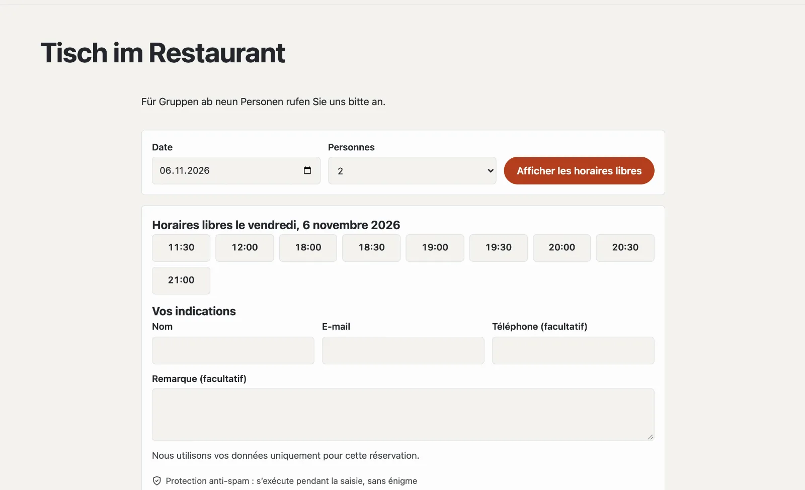

# Plugin « Réservations et rendez-vous »

Avec « Réservations et rendez-vous », vos hôtes réservent en ligne : une table au restaurant, un conseil, une salle.
Vous fixez quand il est possible de réserver et combien de places il y a ; les hôtes choisissent le jour et l’heure,
reçoivent une confirmation avec une entrée de calendrier et un rappel, et annulent eux-mêmes via leur lien. Si vous le
souhaitez, ils paient un acompte via votre compte Stripe. Le plugin coûte CHF 149 avec une année de mises à jour et
vient de Basalto.



## Installer et activer

1. Achetez-le dans le Marketplace sur basaltocms.com ([Acheter](installieren.md#acheter)), puis dans le backend sous
   **Administration › Modules › Marketplace**, cliquez sur **« Installer »** pour « Réservations et rendez-vous »
   ([Installer un plugin](installieren.md#installer-un-plugin)).
2. Activez-le sous **Administration › Sites › Modifier le site › onglet « Modules »** pour les sites — il est désactivé
   par défaut.

L’onglet **« Réservations »** apparaît ensuite sous **Contenus**.

## Définir ce qui peut être réservé

Une **offre** est ce que les hôtes réservent — « Table au restaurant », « Conseil en magasin », « Salle de réunion ».
Sous **Contenus › Réservations › Offres et horaires**, vous en créez une à partir d’un modèle, puis vous l’adaptez :

| Modèle | prévu pour |
| --- | --- |
| Tables | groupes, plusieurs à la fois, confirmées immédiatement |
| Rendez-vous pour une personne | une réservation par horaire, sans demander le nombre de personnes |
| Salle | une réservation par horaire, sur demande |

| Réglage | |
| --- | --- |
| Horaires par jour de la semaine | sous la forme « 11:30-14:00, 18:00-22:00 » — entre les deux, c’est la pause ; vide signifie fermé |
| Durée (minutes) | durée pendant laquelle une réservation occupe les places |
| Début toutes les (minutes) | p. ex. 30 : 18:00, 18:30, 19:00 … |
| Places simultanées | pour des tables, le nombre de personnes ; pour des rendez-vous, en général 1 |
| Plus grand groupe en ligne | les groupes plus grands vous contactent directement ; 1 = sans demander le nombre de personnes |
| Délai (minutes) | délai minimal pour réserver |
| À l’avance (jours) | jusqu’où dans le futur |
| Annulation en ligne jusqu’à (heures avant) | ensuite, seulement directement auprès de vous |
| Confirmation | **immédiate** (la réservation est valable tout de suite) ou **sur demande** (vous acceptez ou refusez) |
| Acompte | fixe ou par personne ; 0 = aucun |
| Réservable en ligne | sans coche, l’offre est en pause |

**Fermé** (même page) : vacances, jours fériés, soirées privées — du premier au dernier jour, pour une offre ou pour
toutes. Les réservations existantes pendant cette période restent ; la remarque indique combien il y en a.

## Créer la page de réservation

1. **Pages › Nouveau** (ou votre page « Réserver » existante).
2. Onglet **« Experts »** › **« Monter un module »** › **« Réservations »**, enregistrer et publier.

Avec une seule offre, les hôtes réservent directement sur cette page ; avec plusieurs, ils choisissent d’abord l’offre.
Un jour sans horaire libre indique les prochains jours libres. Les horaires complets sont barrés.

Réserver rapidement depuis n’importe quelle page — par exemple la page d’accueil — avec la partie Lava
**« Réserver »** (jour et personnes, suite sur la page de réservation) ou dans le thème :

```lava

```

## Ce que reçoivent les hôtes

| Quand | E-mail |
| --- | --- |
| confirmée immédiatement | confirmation avec entrée de calendrier (.ics) et lien vers sa propre réservation |
| sur demande | accusé de réception ; plus tard, confirmation ou refus |
| avant le rendez-vous | rappel (réglable : 2 heures, un jour ou deux jours avant, ou aucun) |
| annulée ou modifiée | message avec les nouvelles indications |

Sous le lien vers leur propre réservation, les hôtes voient l’état, téléchargent l’entrée de calendrier et
**annulent** eux-mêmes jusqu’au délai. Votre équipe reçoit un message pour les nouvelles réservations, les demandes et
les annulations (cloche et e-mail, réglable dans le profil).

## Gérer les réservations

**Contenus › Réservations** affiche un jour (navigation avec **« ‹ Jour précédent »**, **« Aujourd’hui »**,
**« Jour suivant › »**) ou **« Toutes à venir »**, **« Demandes »** et **« Antérieures »**, avec une recherche par nom,
e-mail ou téléphone. Le chiffre dans le menu indique les demandes en attente.

- **Confirmer**, **Refuser** et **Annuler** individuellement ou en groupe — les hôtes reçoivent un e-mail.
- **Inscrire une réservation** pour les appels et les hôtes au comptoir : confirmée tout de suite, e-mail seulement
  avec une adresse e-mail. L’équipe peut inscrire en dehors des horaires et au-delà des places ; si un horaire est
  alors surréservé, la remarque le signale.
- Dans une réservation, vous modifiez l’offre, le jour, l’heure et le nombre de personnes ; si vous le souhaitez,
  l’hôte reçoit les nouvelles indications. La **note interne** n’est visible que par l’équipe.

## Avec acompte

Un acompte passe par votre propre compte Stripe ([Paiements](../verwaltung/zahlungen.md)) : après l’envoi, l’hôte est
redirigé vers Stripe, et l’horaire reste réservé pour lui pendant ce temps. Après le paiement, la réservation est
valable (ou attend comme demande) ; s’il interrompt ou ne paie pas, la place redevient libre à l’expiration du
paiement Stripe. Un remboursement en cas d’annulation se déclenche dans le tableau de bord Stripe. Sans paiements
configurés, les hôtes réservent sans acompte.

## Protection des données

Les hôtes indiquent nom, e-mail et, s’ils le souhaitent, téléphone et remarque. Après un délai (par défaut 365 jours
après le rendez-vous, réglable), le nettoyage nocturne remplace ces indications ; jour, heure et nombre de personnes
restent pour vos chiffres. Les réservations d’une adresse e-mail font partie du **droit d’accès** et de la
**suppression** sous **Administration › Utilisateurs** ([Utilisateurs](../verwaltung/benutzer.md)). Les réservations
ne font pas partie de l’export d’un site ; les offres, si.

## Dans les statistiques

Sous [Statistiques](../verwaltung/statistik.md), l’onglet **Réservations** montre nouvelles réservations, clients pendant la période, annulations, demandes ouvertes et acomptes — par offre, comparés à la période précédente.

## En cas de problème

| Signe | Cause | Solution |
| --- | --- | --- |
| « Ce jour ne peut pas être réservé en ligne » | jour avant le délai ou après « À l’avance » | vérifier les réglages de l’offre |
| aucun horaire un jour de semaine | aucun horaire saisi, ou fermé | vérifier les horaires et « Fermé » |
| aucun rappel | la planification de l’installation ne fonctionne pas | configurer cron ([Exploitation](../verwaltung/betrieb.md)) |

## Pour continuer

- [Paiements](../verwaltung/zahlungen.md)
- [Marketplace pour les installations](installieren.md)
- [Marketplace](README.md)
