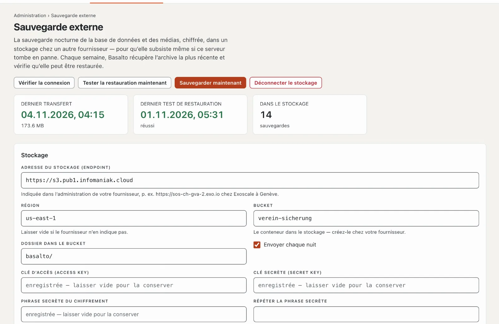

# Plugin « Sauvegarde externe »

Basalto sauvegarde chaque nuit la base de données et les médias sur son propre serveur. Si le serveur tombe en panne,
cette sauvegarde disparaît avec lui. « Sauvegarde externe » envoie chaque sauvegarde, chiffrée, vers un stockage chez un
autre fournisseur, y supprime les anciennes sauvegardes et vérifie chaque semaine que la plus récente peut être
restaurée. Le plugin coûte CHF 79 avec une année de mises à jour et vient de Basalto.



## Installer

1. Achetez-le dans le Marketplace sur basaltocms.com ([Acheter](installieren.md#acheter)), puis dans le backend sous
   **Administration › Modules › Marketplace**, cliquez sur **« Installer »** pour « Sauvegarde externe »
   ([Installer un plugin](installieren.md#installer-un-plugin)).
2. Le plugin vaut pour toute l’installation — il n’y a pas d’interrupteur par site. Ensuite, l’entrée **« Sauvegarde
   externe »** apparaît sous **Administration**. Toutes les personnes qui voient **Administration › Exploitation** la
   voient aussi.

Le plugin a besoin de l’extension PHP « sodium » ; la plupart des hébergeurs l’ont activée. Si elle manque, la page
affiche l’avis **« Chiffrement impossible »** — votre hébergeur l’active dans les réglages PHP.

## Configurer le stockage

Il vous faut un stockage compatible S3 chez un autre fournisseur que votre hébergeur, par exemple Infomaniak Swiss
Backup ou Exoscale.

1. Chez le fournisseur, créez un **bucket** — le conteneur des sauvegardes — et des accès S3 (clé d’accès et clé
   secrète) qui peuvent écrire, lire et supprimer dans le bucket. Chez Infomaniak Swiss Backup et chez Exoscale,
   l’endpoint, la région et les accès figurent dans l’administration du fournisseur.
2. Sous **Administration › Sauvegarde externe**, remplissez la section **« Stockage »** :

   | Champ | Ce qu’il faut y mettre |
   | --- | --- |
   | **Adresse du stockage (endpoint)** | l’adresse S3, p. ex. `https://sos-ch-gva-2.exo.io` chez Exoscale à Genève |
   | **Région** | p. ex. `ch-gva-2` chez Exoscale ; laisser vide si le fournisseur n’en indique pas |
   | **Bucket** | le nom du bucket |
   | **Dossier dans le bucket** | `basalto/` par défaut — avec un dossier chacune, plusieurs installations tiennent dans un bucket |
   | **Clé d’accès (Access Key)**, **Clé secrète (Secret Key)** | les accès de l’étape 1 |
   | **Phrase secrète du chiffrement**, **Répéter la phrase secrète** | au moins 12 caractères — lisez la section suivante |
   | **Conserver : au moins autant de sauvegardes**, **… de jours** | 14 sauvegardes et 30 jours par défaut, voir [Conservation](#conservation) |
   | **Envoyer chaque nuit** | activé par défaut |

3. **« Enregistrer et vérifier »** : Basalto écrit un petit fichier dans le bucket, le lit et le supprime. Ce n’est que
   si cela fonctionne que tout est enregistré ; sinon, la raison s’affiche à l’endpoint.

La page n’affiche plus jamais les clés enregistrées ni la phrase secrète — laisser un champ vide les conserve.
**« Vérifier la connexion »** répète la vérification à tout moment. **« Déconnecter le stockage »** supprime la
connexion ; les sauvegardes dans le stockage restent.

## Conserver la phrase secrète en lieu sûr

Basalto chiffre chaque sauvegarde sur votre serveur avant qu’elle ne le quitte — le fournisseur du stockage ne voit que
des données chiffrées, pas même les noms de fichiers. La clé est dérivée de la phrase secrète (Argon2id) ; les données
sont chiffrées avec XChaCha20-Poly1305 de la bibliothèque libsodium.

- Conservez la phrase secrète **en dehors de ce serveur**, par exemple dans un gestionnaire de mots de passe. **Sans
  elle, aucune sauvegarde ne peut être déchiffrée** — pas même par Basalto. Si elle ne se trouve que sur le serveur,
  elle disparaît avec lui.
- Conservez aussi l’`APP_KEY` de l’installation : sans la même clé, les données chiffrées de la base de données
  restaurée sont illisibles ([Sauvegarde](../betrieb/backup.md)).
- Si vous changez la phrase secrète, les sauvegardes plus anciennes du stockage nécessitent toujours l’ancienne.
  Gardez les deux jusqu’à ce que les anciennes sauvegardes soient sorties de la conservation.

## Ce qui se passe chaque nuit

1. À **03:15 UTC**, Basalto sauvegarde la base de données et les médias sur le serveur ([Sauvegarde](../betrieb/backup.md)).
2. À **04:15 UTC**, le plugin chiffre la sauvegarde la plus récente et l’envoie sous le nom
   `basalto-backup-AAAAMMJJ-HHMMSS.zip.enc` dans le dossier du bucket. Il compare ensuite la taille dans le stockage avec
   celle du fichier envoyé. Une sauvegarde qui se trouve déjà dans le stockage n’est pas envoyée une deuxième fois.
3. Pour finir, il applique la conservation.

La copie chiffrée est créée brièvement dans le dossier `storage/app` de l’installation — il y faut autant d’espace
libre que la sauvegarde est grande. Le plugin envoie les sauvegardes du dossier standard `storage/app/backups`, où la
sauvegarde nocturne les écrit ; les sauvegardes que vous placez ailleurs à la main avec `--path` ne sont pas reprises.

**« Sauvegarder maintenant »** crée tout de suite une nouvelle sauvegarde et l’envoie — en arrière-plan. Après quelques
minutes, le résultat apparaît dans l’**Historique** : heure, type, sauvegarde, taille, état et message. En haut, la page
montre le **Dernier transfert**, le **Dernier test de restauration** et combien de sauvegardes se trouvent **Dans le
stockage**. Si **Envoyer chaque nuit** est désactivé, la page indique **« En pause »** ; « Sauvegarder maintenant » et
le test de restauration fonctionnent toujours.

## Conservation

Seul ce qui dépasse **les deux** limites est supprimé du stockage : les sauvegardes les plus récentes selon
**Conserver : au moins autant de sauvegardes** restent toujours, de même que toutes celles des derniers jours selon
**Conserver : au moins autant de jours**. Avec les valeurs par défaut 14 et 30, il reste donc au moins les 14
sauvegardes les plus récentes, plus toutes celles des 30 derniers jours. Le plugin ne touche pas aux autres fichiers du
dossier.

## Le test de restauration chaque semaine

Chaque dimanche à **05:30 UTC**, le plugin récupère la sauvegarde la plus récente du stockage, la déchiffre pendant le
téléchargement et la contrôle avec la vérification de restauration de Basalto : manifeste, taille et SHA-256 de chaque
fichier.

- **Avec SQLite**, le test restaure la base de données dans une base jetable et l’ouvre (contrôle d’intégrité et
  comptage).
- **Avec MariaDB, MySQL ou PostgreSQL**, le test vérifie seulement que l’export de la base de données est complet —
  en-tête, dernière ligne et tables principales. Rien n’est restauré dans une base ; restaurez donc de temps en temps une
  sauvegarde à la main dans une base vide ([Restaurer](../betrieb/backup.md#restaurer)).

**« Tester la restauration maintenant »** le lance tout de suite. Dans l’historique, il apparaît comme **Test de
restauration** avec **« en ordre »** ou **« échoué »** et les étapes de contrôle sous **Message** ; **Administration ›
Exploitation** montre aussi l’état de la dernière vérification.

## Alerte

Si un transfert ou un test de restauration échoue, toutes les personnes qui voient **Administration › Exploitation**
reçoivent la notification **« La sauvegarde externe a échoué »** dans la cloche et par e-mail — avec la raison.
L’e-mail est activé par défaut ; qui n’en veut pas le désactive dans son **Profil**, onglet **« Notifications »**. La
page elle-même affiche aussi la raison en haut : **« Le dernier transfert a échoué »** ou **« Le dernier test de
restauration a échoué »**.

## Récupérer une sauvegarde

La récupération et le déchiffrement se font sur la console du serveur :

```sh
php artisan basalto:ausser-haus-holen --liste                              # ce qui se trouve dans le stockage
php artisan basalto:ausser-haus-holen                                      # la plus récente
php artisan basalto:ausser-haus-holen basalto-backup-20261104-031500.zip   # une sauvegarde précise
php artisan basalto:ausser-haus-holen --ziel=/srv/restauration             # dans un autre dossier
```

Par défaut, le ZIP déchiffré arrive dans `storage/app/backups` ; si un fichier du même nom s’y trouve déjà, il reste
intact. Continuez ensuite comme sous [Restaurer](../betrieb/backup.md#restaurer) : d’abord
`php artisan basalto:backup-verify <archive>`, puis la restauration.

### Après la perte du serveur

1. Réinstallez Basalto, puis le plugin.
2. Sous **Administration › Sauvegarde externe**, saisissez le stockage et la phrase secrète, puis lancez
   `php artisan basalto:ausser-haus-holen`.
   Ou sans configuration : téléchargez le fichier dans l’administration du fournisseur, déposez-le sur le serveur et
   lancez `php artisan basalto:ausser-haus-holen --datei=/chemin/basalto-backup-20261104-031500.zip.enc --passphrase-fragen`
   — la commande demande la phrase secrète.
3. Continuez comme sous [Restaurer](../betrieb/backup.md#restaurer) — avec l’`APP_KEY` de l’ancienne installation.

`--passphrase-fragen` aide aussi lorsqu’une sauvegarde plus ancienne nécessite encore l’ancienne phrase secrète.

## En cas de problème

| Signe | Cause | Solution |
| --- | --- | --- |
| « Pas de connexion au stockage : … » à l’enregistrement | endpoint, région, bucket ou clés incorrects, ou les clés ne peuvent pas écrire dans le bucket | comparer les indications avec l’administration du fournisseur ; donner aux clés le droit d’écrire, de lire et de supprimer dans le bucket |
| « Chiffrement impossible » | l’extension PHP « sodium » manque | la faire activer par l’hébergeur dans les réglages PHP |
| « Il n’y a pas de sauvegarde sur le serveur … » | la sauvegarde nocturne ne tourne pas | vérifier l’entrée cron du planificateur ([Hébergement](../betrieb/hosting.md)) ; **Administration › Exploitation** montre l’état |
| « Sauvegarder maintenant » ou « Tester la restauration maintenant » reste sans résultat | la file d’attente n’est pas traitée | vérifier l’entrée cron du planificateur ; les jobs échoués figurent sous **Administration › Exploitation** |
| « Échec du déchiffrement : phrase secrète erronée ou fichier modifié. » | la sauvegarde est chiffrée avec une autre phrase secrète | saisir l’ancienne phrase secrète avec `--passphrase-fragen` |
| « La sauvegarde chiffrée est incomplète. » lors du test | le fichier dans le stockage est tronqué | **« Sauvegarder maintenant »**, puis **« Tester la restauration maintenant »** ; si l’erreur persiste, s’adresser au fournisseur |
| Le transfert échoue pour les grandes sauvegardes | pas assez d’espace libre dans `storage/app` pour la copie chiffrée | libérer de l’espace ou réserver plus d’espace chez l’hébergeur |

## Pour continuer

- [Sauvegarde](../betrieb/backup.md)
- [Exploitation](../verwaltung/betrieb.md)
- [Marketplace pour les installations](installieren.md)
- [Marketplace](README.md)
