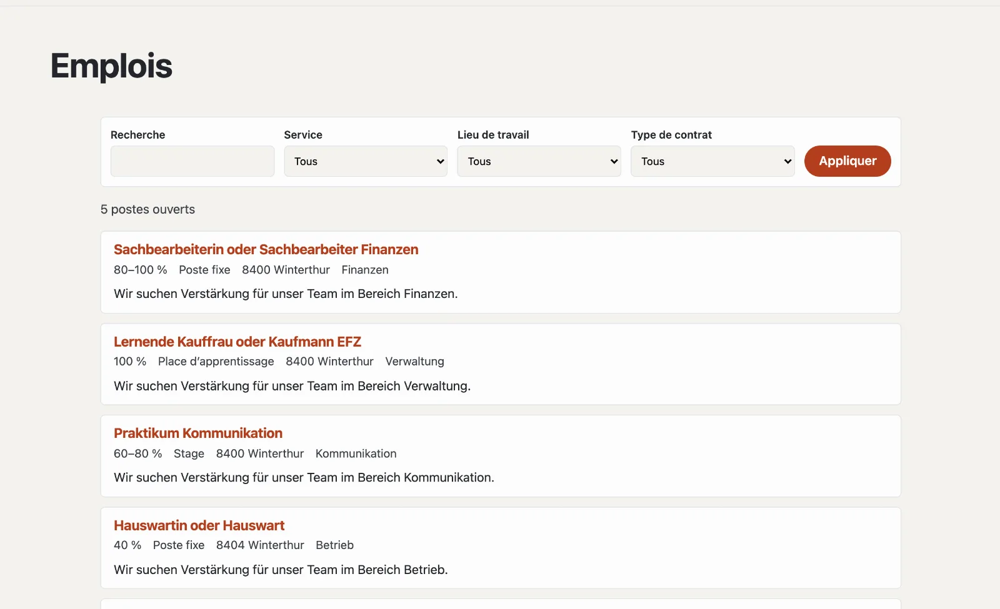

# Plugin « Offres d’emploi »

Avec « Offres d’emploi », vous mettez des postes au concours : avec taux d’activité, type de contrat, lieu de travail
et entrée en fonction, sur une page des postes avec un filtre. Les candidatures arrivent par un formulaire du site ou,
si vous le souhaitez, par votre propre lien. Les moteurs de recherche reçoivent des données structurées pour chaque
poste ouvert. Le plugin est gratuit et vient de Basalto.



## Installer et activer

1. Dans le backend sous **Administration › Modules › Marketplace**, cliquez sur **« Installer »** pour « Offres
   d’emploi » ([Installer un plugin](installieren.md#installer-un-plugin)).
2. Activez-le sous **Administration › Sites › Modifier le site › onglet « Modules »** pour les sites qui doivent
   l’utiliser — il est désactivé par défaut.

L’onglet **« Postes »** apparaît ensuite sous **Contenus**.

## Créer la page des postes

1. **Pages › Nouveau** (ou une page existante), nom par exemple « Postes ouverts ».
2. Onglet **« Experts »** › **« Monter un module »** › **« Postes »**, enregistrer.
3. Publier la page comme d’habitude.

| Adresse sous la page | Ce qui apparaît |
| --- | --- |
| (la page elle-même) | postes ouverts, les plus récents d’abord ; dès quatre postes avec recherche et filtre par service, lieu de travail et type de contrat |
| `<adresse>` | un poste avec toutes les indications et la candidature |

Un poste qui n’est plus au concours reste accessible sous son adresse — avec la mention qu’il n’est plus ouvert, et
sans candidature.

## Mettre un poste au concours

Sous **Contenus › Postes**, vous créez un poste avec son **Titre**. C’est d’abord un **brouillon** ; ensuite s’ouvre le
formulaire avec toutes les indications. Les modifications s’enregistrent toutes seules.

| Champ | |
| --- | --- |
| Titre, texte court, description | par langue du site ; le texte court figure dans la liste et pour les moteurs de recherche |
| Taux de, jusqu’à (%) | p. ex. 80–100 % |
| Type de contrat | poste fixe, durée déterminée, place d’apprentissage, stage, mandat ou bénévolat |
| Service, lieu de travail | pour le filtre et les données structurées |
| En partie à domicile | figure parmi les informations clés |
| Entrée en fonction | vide signifie « à convenir » |
| Mise au concours jusqu’au | ensuite, le poste disparaît de lui-même de la liste |
| Personne de contact, e-mail de la personne de contact | figurent avec le poste |
| Lien de candidature | seulement si les candidatures passent par un portail de candidature |

| Bouton | Effet |
| --- | --- |
| **Publier** | le poste apparaît sur la page des postes |
| **Marquer comme pourvu** | il disparaît de la liste |
| **Remettre au concours** | un poste pourvu est de nouveau ouvert |
| **Retirer** | de nouveau un brouillon |
| **Dupliquer** | une copie en tant que brouillon — pratique pour des postes semblables |

## Candidatures

Sans lien propre, le formulaire de candidature du site figure sous chaque poste ouvert :

1. Sous **Contenus › Postes**, **« Créer un formulaire de candidature »** — il contient nom, e-mail, téléphone, message,
   CV (PDF) et autres documents.
2. Vous l’adaptez sous **Contenus › Formulaires** (« bewerbung »).
3. Choisissez un autre formulaire en bas de **Contenus › Postes** sous **« Candidature »**.

Les candidatures sont des envois du formulaire : vous les trouvez sous **Formulaires › Envois**, avec la page du poste
dont elles viennent. La colonne « Candidatures » de la liste les compte par poste. Elles sont conservées et supprimées
comme tous les envois ([Formulaires](../redaktion/formulare.md)).

## Postes ouverts sur d’autres pages

La partie Lava **« Postes ouverts »** affiche les postes ouverts les plus récents — par exemple sur la page d’accueil :
sous **Configuration › Mises en page › onglet « Parties »**, cliquez sur **« + Instance »** (nombre, titre), puis
placez-la dans une région ou insérez-la dans l’éditeur d’une page avec **« + Partie Lava »**. Dans le thème, cela
fonctionne aussi directement :

```lava

```

## Moteurs de recherche et protection des données

Chaque poste ouvert porte des données structurées (schema.org `JobPosting` : titre, description, type de contrat, lieu
de travail, employeur, mise au concours jusqu’au) et figure dans le plan du site. Le plugin lui-même n’enregistre
aucune candidature — elles se trouvent parmi les envois des formulaires. Les postes font partie de l’export d’un site.

## Pour continuer

- [Formulaires](../redaktion/formulare.md)
- [Marketplace pour les installations](installieren.md)
- [Marketplace](README.md)
