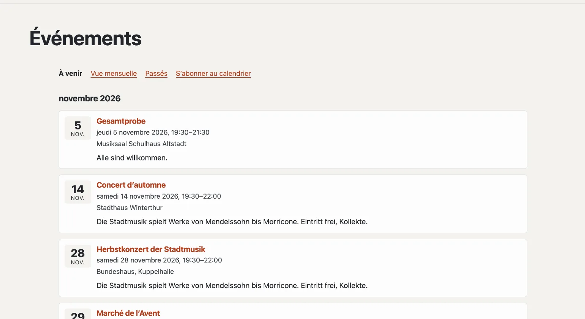

# Plugin « Événements »

Avec « Événements », vous annoncez des dates : concerts, répétitions, cours, marchés. Les visiteurs les voient sous
forme de liste et de vue mensuelle, ajoutent un événement à leur calendrier ou s’abonnent à tout le calendrier du site.
Les moteurs de recherche reçoivent des données structurées pour chaque événement. Le plugin est gratuit et vient de
Basalto.



## Installer et activer

1. Dans le backend sous **Administration › Modules › Marketplace**, cliquez sur **« Installer »** pour « Événements »
   ([Installer un plugin](installieren.md#installer-un-plugin)).
2. Activez-le sous **Administration › Sites › Modifier le site › onglet « Modules »** pour les sites qui doivent
   l’utiliser — il est désactivé par défaut.

L’onglet **« Événements »** apparaît ensuite sous **Contenus**.

## Créer la page des événements

Pour que les visiteurs voient les dates, une page doit accueillir le plugin :

1. **Pages › Nouveau** (ou une page existante), nom par exemple « Événements ».
2. Onglet **« Experts »** › **« Monter un module »** › **« Événements »**, enregistrer.
3. Publier la page comme d’habitude.

Le plugin répond désormais à la page elle-même et à toutes les adresses en dessous — dans la mise en page de votre
thème, avec le titre de la page. Si la page manque, la liste dans l’administration le signale.

| Adresse sous la page | Ce qui apparaît |
| --- | --- |
| (la page elle-même) | événements à venir par mois |
| `monat` | vue mensuelle avec navigation ; sur les écrans étroits sous forme de liste des jours |
| `archiv` | événements passés, les plus récents d’abord |
| `kalender.ics` | calendrier auquel s’abonner — événements à venir et ceux des 90 derniers jours |
| `<adresse>` | un événement avec toutes les indications |
| `<adresse>.ics` | le même, à ajouter à votre propre calendrier |

Un événement d’aujourd’hui reste toute la journée sous « À venir » ; à minuit (fuseau horaire du site), il passe aux
archives.

## Saisir des événements

Sous **Contenus › Événements**, vous créez un événement avec **Titre** et **Début**. C’est d’abord un **brouillon** ;
ensuite s’ouvre le formulaire avec toutes les indications. Les modifications s’enregistrent toutes seules.

| Champ | |
| --- | --- |
| Titre, texte court, description | par langue du site ; si une langue manque, la langue par défaut apparaît. Le texte court figure dans les listes et pour les moteurs de recherche |
| Début, fin | dans le fuseau horaire du site ; sans fin, l’événement dure jusqu’à minuit |
| Toute la journée | seule la date compte, l’heure n’apparaît pas |
| Lieu, adresse | pour la page, le calendrier, les moteurs de recherche et « Planifier l’itinéraire » |
| Lien | inscription ou informations complémentaires |
| Adresse sous la page des événements | proposée à partir du titre, p. ex. `herbstkonzert` |

| Bouton | Effet |
| --- | --- |
| **Publier** | les visiteurs voient l’événement |
| **Annuler l’événement** | il reste visible, avec la mention « Annulé » ; les abonnements au calendrier le suppriment à la prochaine synchronisation |
| **Retirer** | de nouveau un brouillon |
| **Dupliquer** | une copie en tant que brouillon — pratique pour les événements récurrents |

La liste affiche « À venir », « Passés », « Brouillons » et « Tous », avec recherche et actions groupées (publier,
retirer, supprimer).

## Prochains événements sur d’autres pages

La partie Lava **« Prochains événements »** affiche les prochaines dates — par exemple sur la page d’accueil : sous
**Configuration › Mises en page › onglet « Parties »**, cliquez sur **« + Instance »** pour « Prochains événements »
(nombre, titre), puis placez-la dans une région ou insérez-la dans l’éditeur d’une page avec **« + Partie Lava »**
([Structure : mises en page, parties et modèles](../einrichtung/aufbau.md)). Dans le thème, cela fonctionne aussi
directement :

```lava

```

## Avec la carte

Si le [plugin « Carte sans pistage »](plugin-karte.md) est aussi installé et activé, la page d’un événement avec une
adresse affiche sa carte — seulement après un clic.

## Moteurs de recherche et protection des données

Chaque événement porte des données structurées (schema.org `Event` : nom, horaires, lieu, état, organisateur) et figure
dans le plan du site. Le plugin n’enregistre aucune donnée personnelle ; les événements font partie de l’export d’un
site.

## Dans les statistiques

Sous [Statistiques](../verwaltung/statistik.md), l’onglet **Événements** montre événements à venir, ceux de la période, nouvellement saisis et annulés, comparés à la période précédente.

## Pour continuer

- [Plugin « Carte sans pistage »](plugin-karte.md)
- [Marketplace pour les installations](installieren.md)
- [Marketplace](README.md)
