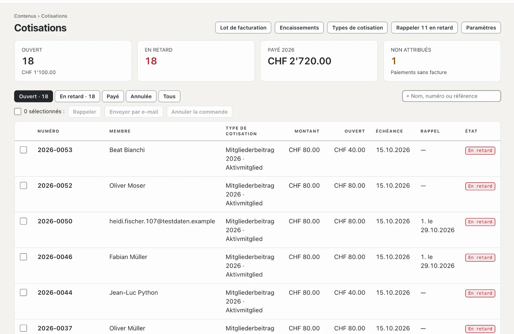

# Plugin « Cotisations avec facture QR »

Avec « Cotisations avec facture QR », vous facturez les cotisations aux membres de votre association : chaque membre a
un type de cotisation, un lot de facturation crée les factures en PDF avec section paiement QR et les envoie par e-mail
— ou les prépare dans un PDF groupé à imprimer. S’y ajoutent des rappels en trois niveaux et les encaissements à partir
du fichier bancaire au format camt.054 (ISO 20022). Le plugin est payant — CHF 129 avec un an de mises à jour — et vient
de Basalto.

## Installer et activer

1. Achetez-le sur basaltocms.com — une fois par installation ([Acheter](installieren.md#acheter)).
2. Dans le backend sous **Administration › Modules › Marketplace**, cliquez sur **« Installer »** pour « Cotisations
   avec facture QR » ([Installer un plugin](installieren.md#installer-un-plugin)).
3. Activez-le sous **Administration › Sites › Modifier le site › onglet « Modules »** — avec le module **« Membres »** :
   les cotisations s’adressent aux membres actifs du site ([Membres](../redaktion/mitglieder.md)). Les deux sont
   désactivés par défaut.

L’entrée **« Cotisations »** apparaît ensuite sous **Contenus**. Le nombre à côté indique les factures en retard.

## Saisir l’association et le compte

Sous **Cotisations › Paramètres**, vous saisissez les indications pour chaque facture et la section paiement QR. Elles
s’enregistrent d’elles-mêmes.

| Champ | |
| --- | --- |
| **Nom de l’association**, **Rue**, **Numéro**, **NPA**, **Localité**, **Pays** | expéditeur de la facture et « Compte / Payable à » dans la section paiement ; Suisse ou Liechtenstein |
| **IBAN ou QR-IBAN** | le compte de l’association. Avec un QR-IBAN, chaque facture porte une **référence QR**, avec un IBAN ordinaire une **Creditor Reference (RF)** — les encaissements attribuent les deux automatiquement |
| **BESR-ID** | seulement si votre banque en a attribué un au QR-IBAN — sinon laisser vide |
| **Devise** | CHF ou EUR |
| **Délai de paiement (jours)** | propose « Payable jusqu’au » dans le lot de facturation (30 par défaut) |
| **Délai d’un rappel (jours)** | après ce délai, le rappel suivant est possible ; le rappel indique ce délai (14 par défaut) |
| **E-mails par heure au maximum** | 80 par défaut — de nombreux hébergeurs autorisent environ 100 e-mails par heure |
| **Phrase sur la facture** | par exemple un merci pour la fidélité à l’association |

S’il manque le nom, l’IBAN, le NPA ou la localité, l’aperçu affiche **« Coordonnées bancaires manquantes »** et aucun lot
de facturation n’est possible.

## Créer et attribuer les types de cotisation

Sous **Cotisations › Types de cotisation**, **« Nouveau type de cotisation »** crée un nom et un montant, par exemple
« Membre actif » à CHF 80 ou « Membre passif » à CHF 40. Un clic sur un type l’ouvre : nom, montant, une
**description** rien que pour vous, **« Sélectionnable dans les nouveaux lots de facturation »** et l’ordre.

En dessous figurent les membres actifs avec leur type de cotisation et l’envoi. Filtrez par type, **« Sans type de
cotisation »**, **« Exonérés »** ou **« Par la poste »**, sélectionnez des membres et choisissez dans la barre en bas :

| Bouton | Effet |
| --- | --- |
| **Type de cotisation : …** | le membre paie ce type de cotisation |
| **Exonérer** | pas de facture, par exemple pour les membres d’honneur |
| **Facture par la poste** | la facture va dans le PDF groupé à imprimer au lieu de partir par e-mail |
| **Facture par e-mail** | de nouveau par e-mail — c’est le réglage par défaut |

## Lancer un lot de facturation

Sous **Cotisations › Lot de facturation**, vous voyez en haut combien de membres sont actifs, combien sont encore **sans
type de cotisation** (ils ne reçoivent pas de facture) et combien d’e-mails attendent.

1. Dans le formulaire **« Nouveau lot de facturation »**, saisissez le **titre** — il figure sur la facture, par exemple
   « Cotisation 2027 » —, l’**année**, la **date de facture** et **« Payable jusqu’au »**.
2. Cochez les types de cotisation à facturer.
3. Laissez **« Envoyer tout de suite les factures par e-mail »** coché ou envoyez plus tard.
4. **« Créer les factures »**.

Chaque membre actif ayant l’un des types choisis reçoit une facture avec le prochain numéro de l’année (« 2027-0001 »)
et sa référence de paiement. Le nom et l’adresse viennent du compte client du membre, tels qu’ils sont au moment du lot ;
la facture paraît dans la langue du compte client. Les membres exonérés, en attente de validation ou bloqués n’en
reçoivent pas. Qui a déjà une facture du même titre la même année est ignoré — vous pouvez ainsi relancer le même lot
plus tard pour les nouveaux membres.

## Par e-mail ou par la poste

- **Par e-mail :** l’e-mail indique le montant et le délai, le PDF avec la section paiement QR est joint. Les e-mails
  partent peu à peu, au maximum autant par heure que réglé ; le reste suit l’heure suivante. Sous **« Lots
  précédents »**, **« Envoyer par e-mail »** envoie toutes les factures ouvertes d’un lot qui ne sont pas encore parties
  par e-mail.
- **Par la poste :** dans la colonne **« Par la poste »**, **« PDF groupé »** ouvre toutes les factures du lot pour les
  membres avec « Facture par la poste » — une page A4 par facture, la section paiement en bas avec la ligne pour la
  détacher.
- **Une seule facture :** ouvrez-la dans la liste, puis **« PDF »** ou **« Envoyer par e-mail »**.

## Garder les factures à l’œil

L’aperçu **Cotisations** montre le nombre et le montant des factures ouvertes, celles en retard, le montant des factures
payées de l’année en cours et les paiements sans facture. La liste filtre par **Ouvert**, **En retard**, **Payé**,
**Annulée** et **Tous** et cherche par nom, numéro ou référence. L’état d’une facture est **Ouvert**, **Payé en
partie**, **En retard**, **Payé** ou **Annulée**. Pour plusieurs factures sélectionnées, il y a **« Rappeler »**,
**« Envoyer par e-mail »** et **« Annuler »** — une facture annulée reste dans la liste avec une mention.

## Rappeler

Une fois « Payable jusqu’au » dépassé, une facture ouverte peut être rappelée :

- en haut de l’aperçu avec **« Rappeler … en retard »** pour toutes à la fois,
- pour les factures sélectionnées avec **« Rappeler »** dans la barre,
- dans une facture avec **« Rappeler »**.

Il y a trois niveaux. Le suivant n’est possible qu’une fois le **délai d’un rappel** écoulé depuis le dernier. Le rappel
porte le titre « Rappel 1 » (ou 2 ou 3), la date du rappel, un nouveau délai et le montant ouvert après les paiements
partiels — aussi dans la section paiement QR. Les membres avec e-mail le reçoivent par e-mail ; avec « Facture par la
poste », le PDF de la facture affiche désormais le rappel à imprimer.

## Encaissements à partir du fichier bancaire

1. Dans l’e-banking, téléchargez l’avis de crédit au format **camt.054 (ISO 20022)** en XML — en général sous documents
   ou relevés de compte.
2. Sous **Cotisations › Encaissements**, choisissez le fichier sous **« Importer le fichier bancaire »** et cliquez sur
   **« Importer »**.
3. Le message indique combien de paiements ont été attribués, combien non, combien étaient des paiements partiels et
   combien avaient déjà été importés.

Un crédit portant la référence d’une facture ouverte se comptabilise de lui-même : si le montant suffit, l’état de la
facture passe à **Payé** (avec la date de comptabilisation) ; sinon elle reste ouverte et le reste devient le nouveau montant ouvert.
Chaque écriture ne compte qu’une fois, même si vous téléversez un fichier deux fois. Le plugin ignore les débits et les
contre-passations.

Les paiements sans référence correspondante — ou pour une facture déjà payée ou annulée — figurent comme **« non
attribué »**. Ouvrez-en un, saisissez le **numéro de facture** sous **« Attribuer une facture »** et choisissez
**« Attribuer »**. Un paiement importé par erreur peut aussi y être supprimé.

## Paiements à la main

Payé en espèces à l’assemblée ? Dans la facture, sous **« Saisir un paiement »**, indiquez le montant (le montant ouvert
est proposé), **« Reçu le »** et une **note**, puis **« Saisir »**. Les paiements d’une facture figurent en bas de
celle-ci.

## Dans le compte client

Les membres voient dans leur compte client l’espace **« Cotisations »** avec leurs factures, l’état et le PDF — avec la
section paiement QR tant qu’une facture est ouverte. Les factures ouvertes figurent aussi sous « À faire ensuite ».

## Protection des données et conservation

- L’administration se charge des **renseignements et de la suppression** par adresse e-mail sous « Administration ›
  Utilisateurs » (ou `php artisan basalto:privacy`) : le renseignement indique le type de cotisation et les factures.
  La suppression retire l’attribution ; les factures restent comme pièces comptables avec numéro, montant et état, mais
  sans nom ni adresse.
- **Conservation :** dix ans après la fin de l’année de facturation, le nettoyage nocturne supprime les factures avec
  leurs paiements.
- L’**export d’un site** n’emporte que les types de cotisation ; factures et paiements restent sur le site d’origine.

## En cas de problème

| Signe | Cause | Solution |
| --- | --- | --- |
| **« Coordonnées bancaires manquantes »** | il manque le nom, l’IBAN, le NPA ou la localité de l’association | compléter sous **Paramètres** |
| « Ce n’est pas un IBAN valable de Suisse ou du Liechtenstein. » | faute de frappe ou compte à l’étranger | vérifier l’IBAN — la facture QR exige un compte en Suisse ou au Liechtenstein |
| Un membre ne reçoit pas de facture | pas actif, exonéré, sans type de cotisation ou déjà une facture du même titre la même année | vérifier l’état sous **Contenus › Membres** et le filtre **« Sans type de cotisation »** |
| Les e-mails attendent longtemps | le contingent de l’heure est atteint | patienter — le reste part l’heure suivante |
| « Ce n’est pas un fichier bancaire au format camt.054 (ISO 20022). » | un PDF, un CSV ou un autre format a été téléversé | télécharger l’avis de crédit en camt.054 (XML) dans l’e-banking |
| Un paiement est « non attribué » | viré sans référence ou avec une référence erronée | saisir le numéro de facture sous **« Attribuer une facture »** |
| « Rappeler » manque | pas encore échue, le délai depuis le dernier rappel court encore ou le 3e rappel est déjà parti | rappeler plus tard ou contacter directement le membre |

## Pour continuer

- [Membres](../redaktion/mitglieder.md)
- [Marketplace pour les installations](installieren.md)
- [Marketplace](README.md)
