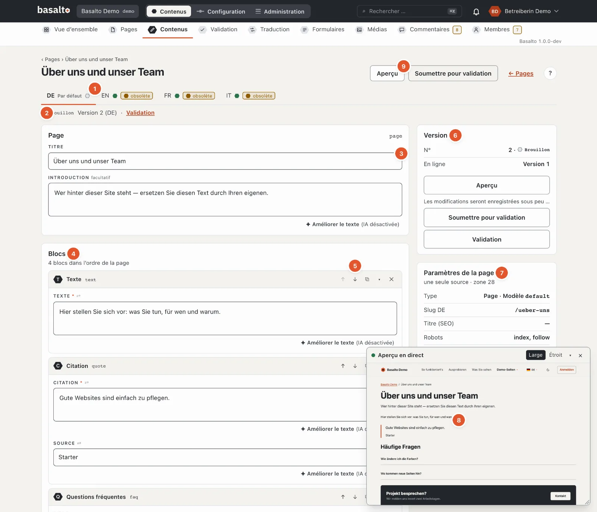
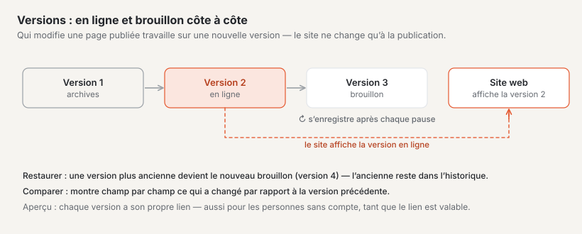
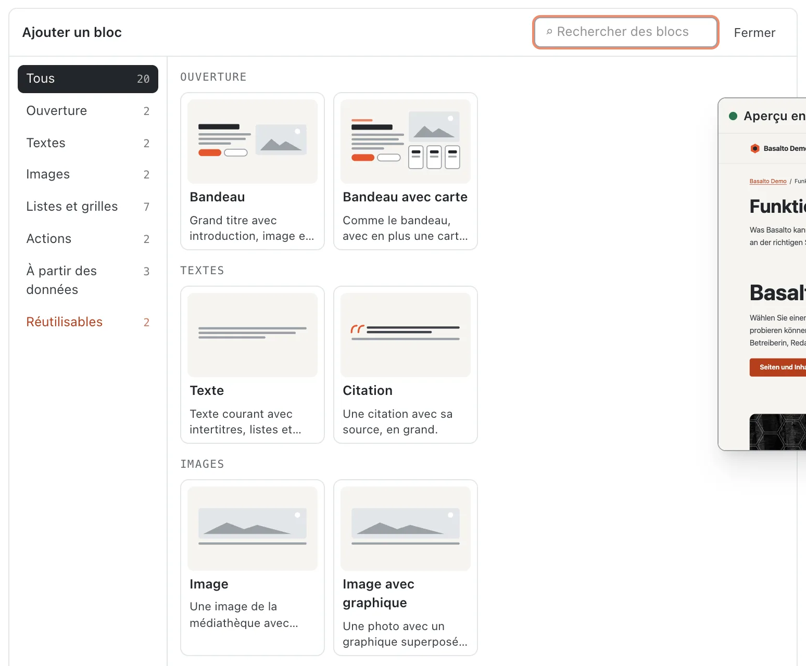
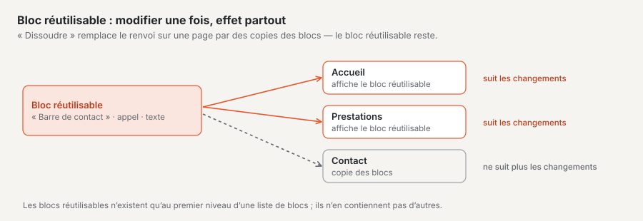
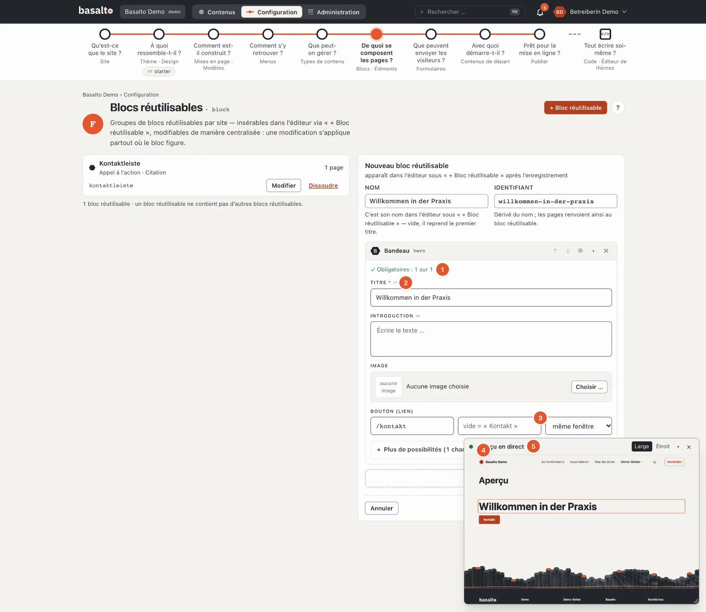
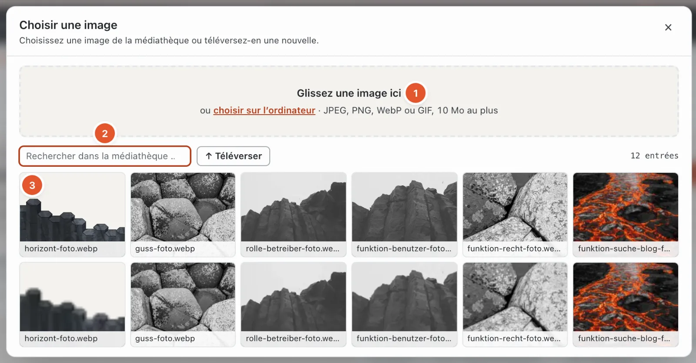
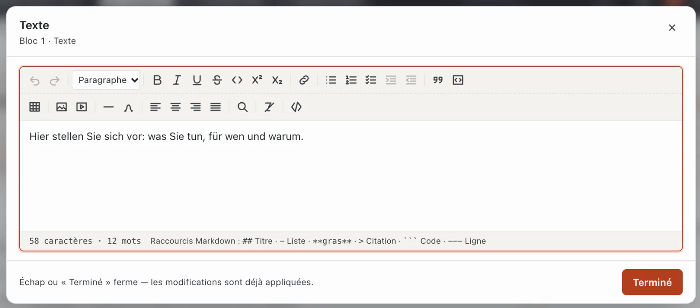
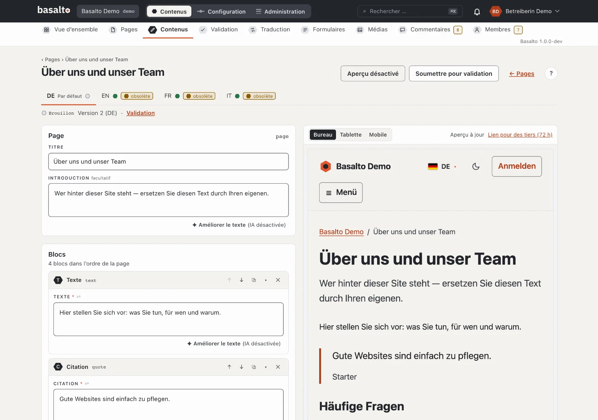
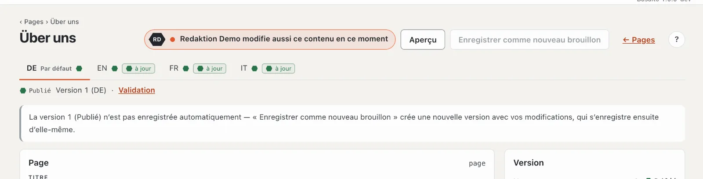

# Modifier le contenu avec des blocs

Le contenu d’une page se compose de **blocs** : sections de texte, images, scènes, formulaires et tout ce que le thème de votre site propose par ailleurs. Vous assemblez les blocs dans l’éditeur ; Basalto enregistre lui-même chaque modification.

## Où

- Pour les pages : mode « Contenus » › **Pages**, dans la ligne de la page, le bouton **« ✎ Modifier le contenu »**.
- Pour les autres contenus (par exemple des articles de blog) : mode « Contenus » › **Contenus**, choisir le type, puis sur l’entrée
  **« modifier »**. Vous y créez une nouvelle entrée avec **« Nouveau contenu »**.

### La liste « Contenus »

En haut figure, pour chaque **type de contenu** du thème, un onglet avec le nombre de ses entrées. Un signe d’avertissement sur l’onglet signifie : ce
type n’existe plus dans le thème — les entrées restent enregistrées, mais ne peuvent de nouveau être modifiées que lorsque le
thème connaît de nouveau le type (Configuration › Types de contenu).

- **Filtres :** le statut et la langue ont un effet immédiat, la recherche (sur les titres de toutes les versions) se lance avec Entrée.
- **Colonnes :** pour chaque langue, un hexagone avec le statut, plus la marque « obsolète » si la traduction repose sur une version
  plus ancienne.
- **L’ordre et la taille de page** proviennent de votre profil (Paramètres › « Tri des listes », « Éléments par
  page ») ; la barre de pied de page indique les deux.
- **« Nouveau contenu »** crée une entrée comme brouillon dans la langue par défaut ; s’il n’y a qu’un seul type, sans question.
  Le titre est d’abord « Nouveau : ‹type› ».
- **Vide :** « Aucun type de contenu » signifie que le thème n’en définit encore aucun (voir Configuration) ; « Pas encore de contenu de ce
  type » et « Aucun contenu avec ce filtre » parlent d’eux-mêmes.

## Structure de l’éditeur

1. Les **langues** du site sous forme d’onglets ; « Par défaut » marque la langue par défaut. Pour chaque langue, un point de statut et, si la
   traduction est en retard sur la langue par défaut, la marque « obsolète ». Si une langue n’existe pas encore, l’onglet
   propose **« Créer la traduction depuis XX »** : la structure est reprise, les textes traduisibles restent vides.
2. **Statut et version**, par exemple « Brouillon · version 2 (DE) », à côté le lien vers la **validation** de cette version.
3. Le **titre**, pour les contenus sans arborescence le **slug** (vide = à partir du titre), l’**introduction** et les **champs**
   du type.
4. Les **blocs** dans l’ordre dans lequel ils figurent sur la page.
5. Les **boutons d’un bloc** (voir ci-dessous).
6. **Version :** numéro, statut, quelle version est en ligne et le message de l’enregistrement automatique.
7. **Paramètres de la page** (seulement pour les pages) : type et modèle, slug, titre pour les moteurs de recherche, robots, visibilité,
   plage horaire — et « Tous les paramètres (12 onglets) ». Le slug et les métadonnées d’une page ne se trouvent pas dans l’éditeur, mais
   là (voir [Pages](seiten.md)).
8. Les **versions** de cette langue avec « Comparer », « Aperçu » et « Restaurer ».
9. **Aperçu** et **Soumettre pour validation**.

En haut, l’éditeur compte « N champs à vérifier » lorsque des indications manquent ou sont incorrectes ; le bloc concerné reçoit une
bordure rouge et un nombre — les erreurs dans les sous-blocs sont comptées vers le haut.

## Ajouter et ordonner des blocs

1. Cliquez sous les blocs sur **« + Insérer un bloc »**. Si la liste est encore vide, la palette est déjà ouverte.
2. Choisissez dans la **palette** le bloc souhaité. Chaque carte montre un **schéma** du bloc — où se trouve le titre,
   s’il y a une image, des boutons, des cartes ou des questions dépliables — ainsi que le nom et une phrase sur son usage.
   À gauche figurent les **groupes** (par exemple « Ouverture », « Texte », « Images », « Listes et grilles », « Actions », « À partir des
   données ») avec le nombre de leurs blocs ; un clic n’affiche que ce groupe. Le champ **« Rechercher des blocs … »** filtre par nom,
   phrase et groupe, **Entrée** insère le premier résultat. Les blocs qui ne sont pas autorisés à cet endroit apparaissent
   en pointillés et en pâle — la raison figure sur la carte. Sous **« Réutilisables »**, vous insérez un bloc réutilisable ou
   une partie Lava. **Échap** ou « Fermer » replie la palette.
3. Remplissez les champs du bloc.

Les nouveaux blocs arrivent à la fin de la liste ; avec ↑ ↓, vous les amenez à leur place. Dans l’en-tête de chaque bloc, vous trouvez :

| Bouton | Effet |
| --- | --- |
| ↑ / ↓ | une position vers le haut ou vers le bas (verrouillé tout en haut ou tout en bas) |
| ⧉ | dupliquer le bloc — la copie se place juste en dessous |
| ▾ / ▸ | replier ou déplier le bloc |
| ✕ | supprimer le bloc — avec la question « Supprimer le bloc ? » |

Il n’est pas possible de faire glisser avec la souris dans l’éditeur de blocs — ↑ ↓ sont pour cela sans ambiguïté et utilisables au clavier.
Les blocs repliés affichent un bref résumé de leur contenu. Un nombre sur le bloc signale des champs qui ne sont pas encore
corrects.

### Blocs réutilisables et parties Lava

- Un **bloc réutilisable** est un groupe de blocs qui figure à l’identique sur plusieurs pages (par exemple une barre de contact).
  Dans l’éditeur, il apparaît comme **référence** : si quelqu’un modifie le bloc réutilisable sous Configuration › Blocs réutilisables (« modifier de manière centrale »),
  il change sur toutes les pages. **« Dissoudre »** remplace la référence sur cette seule page par des copies des blocs —
  dès lors, elles sont librement modifiables ici, le bloc réutilisable reste en place pour les autres pages. Les blocs réutilisables n’existent qu’au niveau
  supérieur d’une liste de blocs ; si aucun n’a été créé, la sélection indique « Aucun bloc réutilisable pour l’instant ».
- Une **partie Lava** est un élément du thème avec des paramètres, par exemple une navigation ou un champ de recherche. Ses
  paramètres se trouvent sous Configuration › Mise en page › Parties ; dans l’éditeur, vous choisissez seulement quelle partie figure ici. Une
  partie Lava ne peut pas être dissoute.

### Blocs verrouillés

Les blocs autorisés à un endroit sont définis par le thème pour chaque type de contenu ou pour chaque champ. Les blocs verrouillés restent visibles dans
la palette ; la raison indique le champ d’application, par exemple « ‹Scène› n’est pas autorisé pour le type Page ».
Vous pouvez le modifier sous Configuration › Types de contenu.

### Blocs imbriqués

Certains blocs contiennent eux-mêmes des blocs, par exemple une colonne ou un onglet. Vous y ajoutez des blocs exactement comme ci-dessus — à n’importe quelle profondeur. Le thème définit quels blocs sont autorisés et où.

Si « Bloc inconnu » apparaît, ce bloc n’existe pas (ou plus) dans le thème. Le contenu reste enregistré ; adressez-vous à la personne qui s’occupe du thème.

## Les champs d’un bloc

Le formulaire d’un bloc vous guide :

1. **Indications obligatoires.** Au-dessus des champs, le compteur « Obligatoires : 1 sur 2 » s’affiche jusqu’à ce qu’elles soient toutes là (puis avec ✓).
2. **Libellé et aide.** Au-dessus de chaque champ figure son libellé avec `*` pour obligatoire et ⇄ s’il est traduit par
   langue. En dessous, une phrase explique à quoi sert le champ, et le champ vide contient un exemple — les deux
   proviennent du thème.
3. **Ce qui vient automatiquement.** Un champ vide qui reprend une valeur d’ailleurs l’affiche en gris : « vide =
   « Contact » ». Si vous laissez vide le libellé d’un lien, la page affiche le titre de la page cible. Pour le champ
   « Adresse », l’éditeur propose les pages du site — tapez une partie du titre ou de l’adresse et choisissez.
4. **L’essentiel d’abord.** En haut figurent les champs obligatoires, tout ce qui est déjà rempli et les champs principaux du bloc —
   pour une scène par exemple le titre, l’introduction, l’image et le bouton. Les réglages fins comme les crédits, les petites
   variantes d’image ou un libellé différent se trouvent sous **« + Plus de possibilités (N champs) »** ; un clic
   les déplie, « − Afficher moins » les replie. Ce qui est rempli reste toujours visible.
5. **Aperçu en direct** dans la petite fenêtre — voir [ci-dessous](#aperçu-en-direct-dans-la-fenêtre).

Basalto ne vérifie les champs obligatoires qu’à la **soumission** — l’enregistrement automatique accepte aussi l’incomplet, afin que
rien ne se perde.

| Type de champ | Utilisation |
| --- | --- |
| Texte, e-mail, URL, slug | une ligne ; slug uniquement a–z, 0–9 et « - » |
| Zone de texte, Markdown, code | plusieurs lignes ; Markdown et code en chasse fixe |
| Texte courant (richtext) | texte mis en forme — un clic ouvre la grande fenêtre (voir ci-dessous) |
| Nombre | chiffres, avec minimum et maximum issus du thème |
| Interrupteur | activé ou désactivé |
| Date, date avec heure | sélection dans le calendrier |
| Sélection | une option de la liste ; « — » signifie aucune (seulement si le champ n’est pas obligatoire) |
| Tags | saisir un mot, le reprendre avec Entrée ou une virgule ; les doublons sont ignorés, ✕ en retire un |
| Image | « Choisir … » (ou un clic sur la vignette) ouvre la médiathèque sous forme de dialogue — voir ci-dessous ; le texte alternatif est prérempli à partir du nom de fichier — veuillez le vérifier |
| Image (adresse) | comme « Image » : choisir ou téléverser une image de la médiathèque ; un clic dans le champ vide ouvre le dialogue. Si vous connaissez un fichier du thème, tapez son adresse (p. ex. `landing/foto.webp`) |
| Galerie | « + Choisir des images … » : dans le dialogue, un clic sélectionne ou désélectionne, « Terminé » ferme ; ↑ ↓ ordonnent, texte alternatif pour chaque image |
| Fichier | un fichier de la médiathèque, dans le même dialogue |
| Lien | adresse (/kontakt, https://…, mailto:), libellé et cible (« même fenêtre » ou « nouvelle fenêtre »). Si vous tapez le titre d’une page (« Contact »), il devient son adresse (« /kontakt ») ; si ce n’est ni une adresse ni une page, le champ avertit |
| Relation | un autre contenu du site (par exemple une personne), choisi dans une liste |
| Répétition (repeater) | plusieurs lignes construites de la même façon (par exemple des cartes) : « + Ligne », ↑ ↓ ordonnent, « Retirer » supprime la ligne **sans confirmation** |
| Blocs | blocs imbriqués (voir ci-dessous) |
| Couleur | sélecteur de couleur ou valeur hexadécimale (#rrggbb) |
| SEO | titre et description avec compteurs (recommandé 60 ou 160, au plus 120 ou 320 caractères) |
| JSON | données structurées ; vérifiées lorsque vous quittez le champ |

### Choisir et téléverser des images

Pour les champs d’image, de galerie et de fichier, la médiathèque s’ouvre sous forme de dialogue au-dessus de la page :

1. **Glisser** — faites glisser des images depuis le Finder ou l’Explorateur sur la zone du haut, ou **« choisir sur l’ordinateur »**.
   JPEG, PNG, WebP ou GIF jusqu’à 10 Mo. Ce qui est téléversé aboutit dans la médiathèque et est immédiatement choisi.
2. **Rechercher et dossiers** — filtrer par nom et limiter à un dossier de la médiathèque.
3. **Choisir** — un clic sur une image la reprend et ferme le dialogue. Pour une galerie, chaque clic sélectionne
   ou désélectionne ; « Terminé » ferme. Les images sans texte alternatif portent la marque « Texte alternatif manquant ».

Les champs avec une adresse d’image (par exemple l’image d’une scène) acceptent aussi une **image du thème** : le
dialogue a alors l’onglet **« Images du thème »** à côté de la médiathèque. Les images sont classées par dossier
(onglets avec leur nombre) ; les fichiers qui vont ensemble forment un motif — par exemple « buehne » avec Foto,
Foto · 960 et Schema. Les **Photos** et les **Graphiques** peuvent être affichés séparément, l’image choisie apparaît en
haut sous « Sélection actuelle ». Le champ montre une miniature ; s’il manque un fichier, il indique **« Fichier
manquant »**.

Échap, × ou un clic à côté du dialogue ferment sans modification.

Si un champ affiche « Type de champ inconnu », Basalto ne connaît pas le type (par exemple d’un module désactivé) ; le
contenu reste enregistré.

## Modifier le texte courant

Dans le formulaire, les champs de texte courant n’affichent que le texte mis en forme. Un clic dessus (ou sur **« Modifier ↗ »**) ouvre le texte dans une grande fenêtre avec la barre d’outils complète. **« Terminé »** ou Échap la ferme — vos modifications sont alors déjà reprises.

La barre d’outils comporte deux rangées :

- **Annuler**, **Rétablir** et le **format de paragraphe** (paragraphe, titre 2, 3 ou 4),
- **Gras**, **Italique**, **Souligné**, **Barré**, **Code**, **Exposant**, **Indice**,
- **Lien**, **Liste à puces**, **Liste numérotée**, **Liste de tâches**, augmenter et diminuer le retrait,
- **Citation**, **Bloc de code**, **Tableau**, **Image de la médiathèque**, **Intégration** (YouTube, Vimeo, carte), **Ligne de séparation**, **Caractères spéciaux**,
- alignement **à gauche**, **centré**, **à droite**, **justifié**,
- **Rechercher et remplacer**, **Effacer la mise en forme** et **Code source** (en lecture seule).

En bas, l’éditeur compte les caractères et les mots. Si vous préférez taper, utilisez les raccourcis Markdown : `##` pour un titre, `-` pour une liste, `**fett**`, `>` pour une citation, trois backticks pour du code et `---` pour une ligne.

**Raccourcis clavier** (Mod = ⌘ sur Mac, Ctrl sous Windows ; la barre d’outils les affiche aussi au survol) :

| Raccourci | Effet | Raccourci | Effet |
| --- | --- | --- | --- |
| Mod+Z / ⇧+Mod+Z | annuler / rétablir | Mod+K | lien |
| Mod+B / Mod+I / Mod+U | gras / italique / souligné | ⇧+Mod+8 / 7 / 9 | liste à puces / liste numérotée / liste de tâches |
| ⇧+Mod+S | barré | Tab / ⇧+Tab | augmenter / diminuer le retrait d’un point de liste |
| Mod+E | code dans le texte | ⇧+Mod+B | citation |
| Mod+. / Mod+, | exposant / indice | Alt+Mod+C | bloc de code |
| ⇧+Mod+L / E / R / J | gauche / centré / droite / justifié | | |

**Tableaux :** « Tableau » insère 3 × 3 cellules avec une ligne d’en-tête. Si le curseur se trouve dans un tableau, un menu propose d’insérer ou de supprimer des lignes
et des colonnes, de fusionner ou de scinder des cellules et de supprimer le tableau.

**Bloc de code :** vous choisissez la langue du code (pour les couleurs) dans le bloc lui-même.

**Rechercher et remplacer** (loupe) : les majuscules et minuscules ne comptent pas ; « Suivant », « Remplacer » et « Tout remplacer »,
sans résultat « aucun résultat ».

**Liens :** sélectionnez le texte, cliquez sur « Lien » et saisissez l’adresse (https://…, mailto:, un chemin comme /kontakt ou #). Au choix un **titre** (apparaît au survol). Choisissez si le lien s’ouvre dans la même fenêtre ou dans une nouvelle, puis cliquez sur **« Appliquer »**. « Retirer le lien » le supprime.

**Images dans le texte :** « Image de la médiathèque » insère une image. Saisissez un **texte alternatif** (il décrit l’image pour les personnes qui ne la voient pas), si vous le souhaitez une légende, et choisissez l’alignement.

**Intégrations :** insérez l’adresse d’une vidéo YouTube ou Vimeo ou d’une carte Google Maps ou OpenStreetMap. Si Basalto reconnaît l’adresse, la fenêtre indique « … reconnu » ; une adresse inconnue ne peut pas être insérée. Sur le site web, l’intégration ne se charge que lorsque la visiteuse ou le visiteur y consent.

## Coller depuis Word et d’autres programmes

Copiez du texte depuis Word, Google Docs ou une page web et collez-le avec ⌘V ou Ctrl+V dans un champ de texte courant. Basalto reprend alors :

- les titres, les paragraphes, les listes à puces et les listes numérotées (aussi depuis Word),
- le gras, l’italique, le souligné, le barré, l’exposant et l’indice,
- les tableaux et les liens,
- les **images** : elles sont automatiquement téléversées dans la médiathèque et liées dans le texte.

Les polices, les couleurs et les tailles de police disparaissent — l’apparence est déterminée par le thème. Un titre de niveau supérieur provenant de Word devient « Titre 2 », les niveaux inférieurs s’arrêtent à « Titre 4 ». Le texte **Markdown** collé (depuis un éditeur de texte) est également converti.

Pour les images collées : JPEG, PNG, WebP ou GIF, 10 Mo au plus par image. Si une image ne passe pas, l’éditeur signale « Une image n’a pas pu être téléversée. » Après le collage, vérifiez les **textes alternatifs** des images dans la [médiathèque](medien.md).

## Aperçu en direct dans la fenêtre

Une petite fenêtre **« Aperçu en direct »** en bas à droite montre le contenu avec le vrai thème, renouvelé une bonne demi-seconde
après chaque saisie — sans enregistrer. Elle vous suit :

- **Le champ dans lequel vous écrivez s’illumine** dans l’aperçu avec un cadre lave ; l’aperçu défile jusqu’à lui.
- **Un clic sur un endroit de l’aperçu** saute au champ correspondant du formulaire.
- **Déplacer** par l’en-tête, **taille** par le coin inférieur droit, **« Large »** (ordinateur) ou **« Étroit »** (téléphone),
  **▾** la replie, **×** la ferme. Le navigateur mémorise la position et la taille ; une fois fermée, le bouton
  **« Aperçu en direct »** dans l’en-tête de la page la rouvre.

La fenêtre apparaît tant que le grand aperçu (écran partagé) est désactivé et que l’écran mesure au moins 768 px de large.

## Aperçu en écran partagé

Le bouton **« Aperçu »** partage l’écran : à gauche l’éditeur, à droite la page telle qu’elle apparaîtra — avec vos modifications, même si elles ne sont pas encore enregistrées. L’aperçu se met à jour un peu moins d’une seconde après chaque modification (« Mise à jour de l’aperçu … », puis « Aperçu à jour ») ; s’il échoue, la raison y est indiquée.

Avec la **largeur d’appareil**, vous vérifiez l’affichage sur « Ordinateur » (pleine largeur), « Tablette » (768 px) et « Mobile » (375 px). Sur les écrans étroits, vous basculez avec les onglets « Éditeur » et « Aperçu ». « Aperçu désactivé » ferme de nouveau l’aperçu.

### Partager l’aperçu avec d’autres personnes

**« Lien pour des tiers (72 h) »** crée un lien avec lequel même des personnes sans accès au backend peuvent consulter la page — par exemple pour un retour de clientes. Avec « Copier », le lien passe dans le presse-papiers. Il montre la version enregistrée la plus récente de cette langue, est valable 72 heures (« expire … ») et n’est pas indexé par les moteurs de recherche.

## Enregistrement automatique

Il n’y a pas de bouton d’enregistrement dans l’éditeur. Une bonne seconde après votre dernière saisie, Basalto enregistre de lui-même. En bas à droite apparaît brièvement « … enregistré » avec l’heure ; un message d’erreur y reste affiché jusqu’à ce qu’il soit réglé. À droite, sous « Version », figure ce qui se passe en ce moment :

| Message | Signification |
| --- | --- |
| Enregistre automatiquement dans la version … | tout est enregistré |
| Les modifications seront enregistrées sous peu … | vous êtes encore en train de taper |
| Enregistrement … | l’enregistrement est en cours |
| Sans titre, rien n’est enregistré. | saisissez d’abord un titre |
| Non enregistré — veuillez vérifier les champs signalés. | un champ est incorrect ; il est signalé |

L’enregistrement se fait toujours **dans le brouillon**. La version en ligne sur le site web n’en est pas modifiée. Les blocs modifiés affichent brièvement « ✓ enregistré ».

Si la version la plus récente est déjà soumise, validée ou publiée, l’éditeur n’enregistre pas de lui-même. Le bouton **« Enregistrer comme nouveau brouillon »** crée alors une nouvelle version avec vos modifications ; dès lors, elle s’enregistre de nouveau d’elle-même.

### Qui y travaille en même temps

Si quelqu’un d’autre a le même contenu ouvert, **« Marco Bernasconi modifie aussi ce contenu en ce moment »** apparaît
en haut à côté des boutons, avec les initiales dans un hexagone. Mettez-vous d’accord avant de modifier tous les deux :
chaque enregistrement crée une nouvelle version, et toutes restent sous « Version ». L’indication disparaît dès que
l’autre personne ferme l’éditeur — au plus tard après une minute.

## Versions et restauration

La liste **« Versions »** à droite affiche toutes les versions de cette langue avec le numéro, le statut, l’autrice ou l’auteur et la date.

- **« Comparer »** déplie ce qui a changé par rapport à la version précédente — ligne par ligne « Champ : ‹ancien› → ‹nouveau› », ou « aucune modification par rapport à la précédente ».
- **« Aperçu »** ouvre exactement cette version dans un nouvel onglet.
- **« Restaurer »** crée immédiatement un **nouveau brouillon** à partir d’une version plus ancienne (« Version 2 restaurée en tant que version 5 »). Rien n’est écrasé ; la version en ligne reste jusqu’à ce que la nouvelle soit publiée.

Le nombre de versions archivées conservées est défini par le paramètre « Conserver les versions archivées » (par défaut : 50 par contenu et par langue).

## Soumettre

Lorsque vous avez terminé, cliquez sur **« Soumettre pour validation »**. Auparavant, l’éditeur enregistre ce qui est encore en attente ; puis la version part en validation. « Soumettre pour validation » est verrouillé, avec la raison, tant que le titre manque (« saisissez d’abord le titre, puis soumettez ») ou que des champs obligatoires sont vides (« Soumission seulement avec tous les champs obligatoires — il en manque N ») ; l’éditeur les signale. Plus de détails sous [Validation et publication](freigabe.md).

Si une version a été refusée, le haut de la page affiche « Refusé » avec le commentaire de la personne qui a vérifié.

## Sur le téléphone

En dessous de 768 px de large, les blocs s’affichent les uns sous les autres comme **cartes** avec un aperçu du contenu. Un toucher ouvre un bloc comme
feuille sur toute la surface ; « Terminé » la ferme. La suppression se fait en deux étapes (« Retirer », puis « Vraiment
retirer »). « + Bloc » ouvre la palette par le bas. Une barre fixe en bas porte l’aperçu et la soumission.

## Questions fréquentes

**Où régler le slug, le titre ou la description d’une page ?**
Dans les paramètres de la page — lien « Tous les paramètres (12 onglets) » à droite dans l’éditeur. Voir [Pages](seiten.md).

**Je travaille dans une autre langue que la langue par défaut.**
Utilisez « Traduire côte à côte » — le texte de la langue par défaut y figure directement au-dessus du vôtre. Voir [Traduire](uebersetzen.md).

**J’ai supprimé un bloc par erreur.**
Dans la liste « Versions », ouvrez la version précédente avec « Restaurer ». Le bloc supprimé est de nouveau là dans le nouveau brouillon ; vous devrez alors refaire les modifications apportées depuis cette version.

## Pour continuer

- [Médias](medien.md)
- [Validation et publication](freigabe.md)
- [Traduire](uebersetzen.md)
