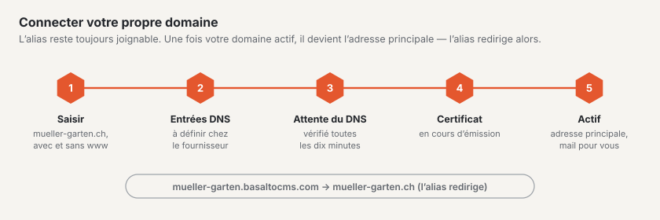

# Domaines

Sous **Administration › Compte › Domaines**, vous définissez les adresses sous lesquelles votre site est accessible. L’onglet est visible pour le propriétaire, l’administration et la facturation du compte ; le propriétaire et l’administration peuvent le modifier.

## Alias

Chaque site est accessible dès le premier instant sous son **alias**, par exemple `mueller-garten.basaltocms.com` — inclus dans chaque plan.

- **Modifier l’alias :** saisissez le nouveau nom (3–40 caractères, minuscules, chiffres et trait d’union) et choisissez « Modifier l’alias ». Le nouvel alias s’applique immédiatement. L’ancien redirige encore **30 jours** vers le site et est ensuite libre.
- Vous voyez dès la saisie si un nom est libre ; s’il est pris, une suggestion figure à côté.
- Les moteurs de recherche n’indexent pas l’alias. Si vous voulez être trouvé, connectez un domaine propre.

## Domaine propre

Vous apportez votre domaine (enregistré chez votre fournisseur, par exemple Infomaniak, Hostpoint, Cloudflare ou Swizzonic).

1. Sous « Autre domaine », saisissez le domaine, par exemple `mueller-garten.ch`, et choisissez « Ajouter un domaine ». Nous créons l’adresse avec et sans `www` — elles comptent pour **un seul** domaine.
2. Saisissez chez votre fournisseur les **enregistrements DNS** affichés, exactement tels qu’ils apparaissent (type, nom, valeur).
3. Attendez : nous vérifions toutes les dix minutes. Avec « Vérifier maintenant », c’est immédiat (une fois par minute). L’état passe de « en attente du DNS » à « certificat en cours d’émission » puis à « actif » — en règle générale en moins de 15 minutes, parfois jusqu’à quelques heures.
4. Dès que le domaine est actif, il devient l’**adresse principale** de votre site, et vous recevez un e-mail. L’alias redirige dès lors vers votre domaine ; les liens avec l’alias continuent de fonctionner.

Si « Erreur » apparaît, l’onglet indique le message. Le plus souvent, un enregistrement DNS manque ou contient une faute de frappe — corrigez-le et vérifiez de nouveau.

**Changer d’adresse principale :** avec « … comme adresse principale », vous choisissez si votre site apparaît sous `www.mueller-garten.ch` ou `mueller-garten.ch` ; l’autre adresse redirige.

**Retirer :** « Retirer » supprime le domaine. S’il était l’adresse principale, c’est de nouveau l’alias.

## Combien de domaines

| Plan | Domaines propres |
| --- | --- |
| Start | aucun |
| Standard | 1 |
| Pro | 5 |

Si le quota est épuisé, le propriétaire et la facturation peuvent commander lors de l’ajout un **domaine supplémentaire pour CHF 5 par mois** — ou passer à un plan plus grand. Pendant la période d’essai, il n’y a pas encore de domaine propre. Votre site reste dans tous les cas accessible.

## Pour continuer

- [Export et résiliation](konto.md)
- [Mise en ligne](../einrichtung/live-gehen.md)
