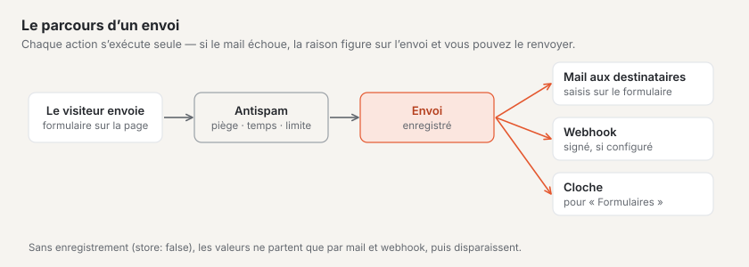
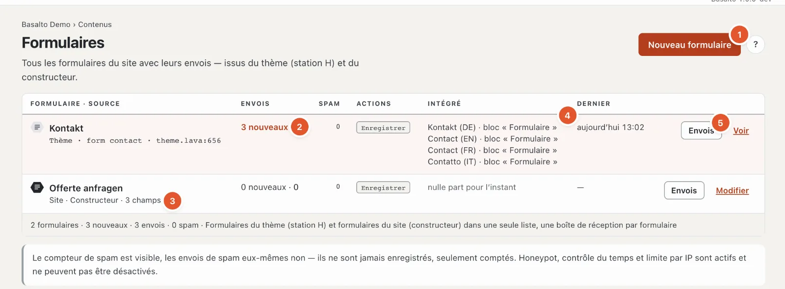
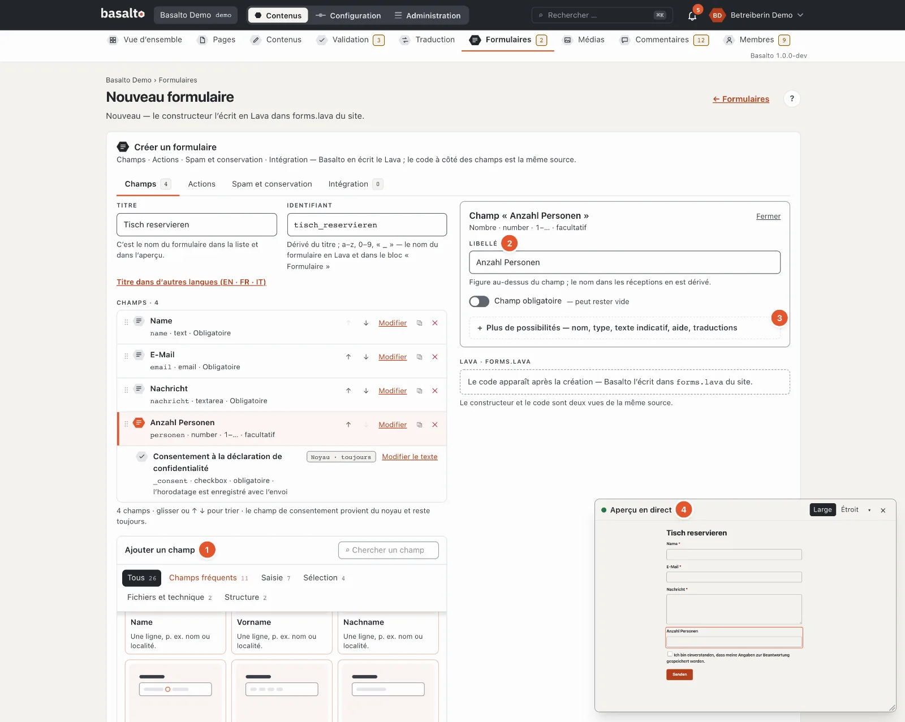
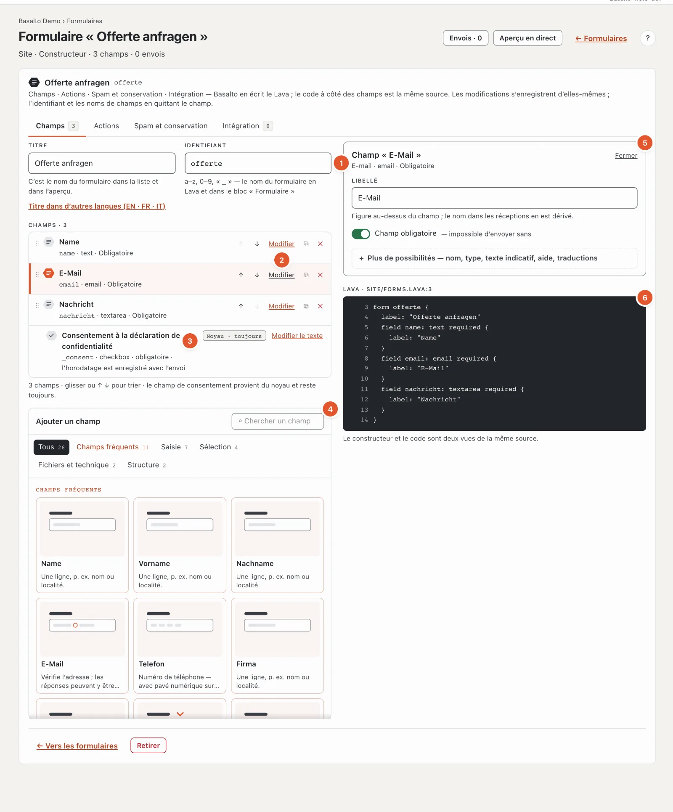
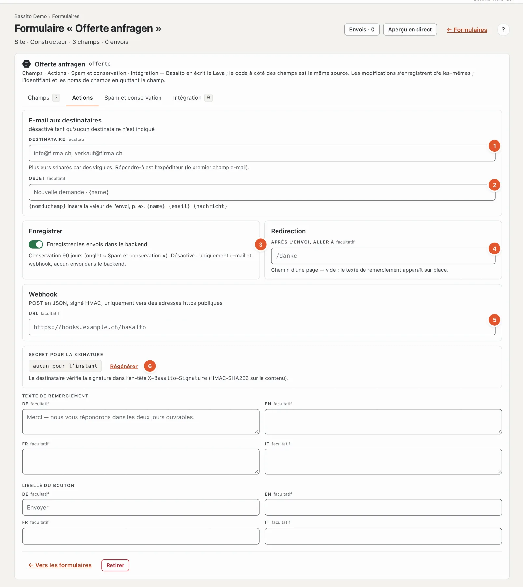
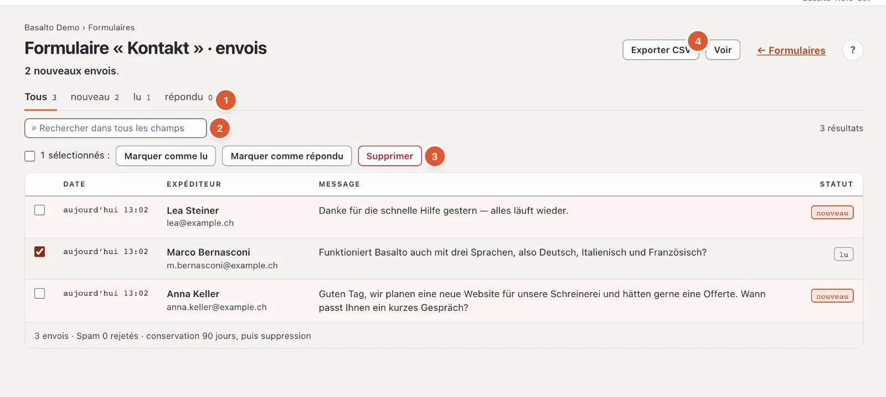
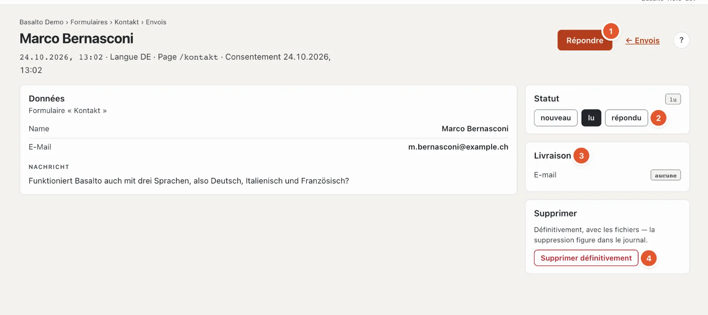

# Formulaires

Avec les formulaires, vous recevez des demandes, des inscriptions ou des commandes via le site web. Chaque formulaire a sa propre **boîte de réception** dans le backend et peut en outre envoyer chaque envoi par e-mail ou le transmettre à un autre système.

## Où

Mode « Contenus » › **Formulaires**.

1. **« Nouveau formulaire »** crée un formulaire avec le constructeur.
2. **Envois** : « 3 nouveaux · 3 » signifie trois nouveaux sur trois au total. Les formulaires avec de nouveaux envois sont sur fond clair.
3. **Source** : « Site · constructeur » ou « Thème · form contact · theme.lava:612 » (l’emplacement dans le thème).
4. **Intégré** : sur quelles pages et dans quelle langue le formulaire figure dans le bloc « Formulaire » — ou « nulle part pour l’instant ».
5. **« Envois »** ouvre la boîte de réception, « Modifier » (pour les formulaires du thème « Voir ») le formulaire.

La liste affiche en outre le **compteur de spam**, les **actions** configurées (e-mail, enregistrement, redirection, webhook) et, sous « Dernier », le moment du dernier envoi. Si un e-mail n’a pas pu être livré, la mention rouge « 1 e-mail non livré — renvoyer depuis l’envoi » apparaît.

Il existe deux sortes de formulaires :

- **Formulaire du site** — créé dans le backend avec le constructeur ; vous pouvez le modifier vous-même.
- **Formulaire du thème** — fourni avec le thème. Vous pouvez le consulter et traiter ses envois, mais pas modifier ses champs ni ses textes. Le thème de départ fournit par exemple le formulaire « Contact ».

## Créer un formulaire

1. Cliquez sur **« Nouveau formulaire »**.
2. Saisissez le **titre**, par exemple « Réserver une table ». L’**identifiant** en découle (« tisch_reservieren ») ; c’est sous cet identifiant que vous choisirez plus tard le formulaire dans le bloc « Formulaire ». Les titres dans d’autres langues se trouvent derrière **« Titre dans d’autres langues »** — vide, c’est le titre de la langue par défaut qui s’applique.
3. Cliquez sur **« Créer »**.

Un nouveau formulaire a déjà trois champs obligatoires : **Nom**, **E-mail** et **Message**. Adaptez-les ou ajoutez-en d’autres.

Ensuite, toutes les modifications s’enregistrent d’elles-mêmes ; l’identifiant et les noms de champ lorsque vous quittez le champ. Tant qu’une indication est incorrecte, rien n’est enregistré : le haut de la page indique « N indications sont incorrectes », l’onglet le nombre d’erreurs et le champ la raison. Le formulaire comporte quatre onglets.

### Ajouter et configurer des champs

Le constructeur vous guide comme les formulaires des blocs :

1. **Ajouter un champ** — une palette avec un dessin et une phrase par champ, par groupes (Champs fréquents, Saisie, Sélection, Fichiers et technique, Structure) et avec une recherche ; Entrée insère le premier résultat. Les **champs fréquents** apportent d’emblée le libellé, le nom et l’obligation : Nom, Prénom, Nom de famille, E-mail, Téléphone, Entreprise, Message, Date souhaitée, Nombre de personnes, Pièce jointe et « Merci de me rappeler » — le libellé dans chaque langue du site.
2. **L’essentiel d’abord** — un champ choisi n’affiche en haut que son **libellé**, **Champ obligatoire** et ce dont le type a absolument besoin (les **options** d’une sélection, les **types de fichiers** d’un fichier, la **valeur** d’un champ masqué). Le **nom** dans l’envoi découle du libellé tant que vous ne le modifiez pas vous-même.
3. **Plus de possibilités** — nom, type, texte indicatif, texte d’aide, limites et les **traductions** pour chaque autre langue (vide, c’est la langue par défaut qui s’applique). Si une erreur s’y trouve, la zone est déjà ouverte.
4. **Aperçu en direct** — le formulaire tel que les visiteurs le voient, dans la petite fenêtre en bas à droite, renouvelé à chaque modification. Le champ choisi s’illumine ; un clic sur un champ de l’aperçu ouvre ses paramètres. Déplacement, taille et fermeture comme pour les [blocs](bloecke.md#aperçu-en-direct-dans-la-fenêtre) ; une fois fermé, « Aperçu en direct » dans l’en-tête de la page le rouvre.

### Onglet « Champs »

1. **Identifiant** — minuscules, chiffres et « _ », une lettre au début, 2 à 60 caractères, unique dans le site. Les identifiants des formulaires du thème sont déjà pris.
2. **Les champs** dans leur ordre. Sous le titre figure une ligne de résumé, par exemple « email · email · obligatoire » (nom, type, obligation) ou « radio · 4 options ». « Modifier » ouvre les paramètres, ↑ et ↓ déplacent le champ (ou faites-le glisser par la poignée ⠿), ⧉ le duplique, ✕ le retire.
3. **Consentement à la déclaration de protection des données** — figure dans chaque formulaire et ne peut pas être retiré (« Noyau · toujours »). Le moment du consentement est enregistré avec l’envoi. Vous modifiez le texte avec « Modifier le texte ».
4. **Ajouter un champ** — la palette (voir ci-dessus) avec les champs fréquents et une carte par type : Texte, E-mail, Nombre, Téléphone, URL, Date, Multiligne, Sélection, Bouton radio, Case à cocher, Fichier, Plage, Champ masqué, Explication et Groupe.
5. **Les paramètres du champ choisi** — « Fermer » les replie.
6. **Le code** — le même formulaire en Lava, en lecture seule et avec des numéros de ligne ; il apparaît après la création. Vous n’en avez pas besoin : le constructeur et le code sont deux vues de la même source.

Les paramètres d’un champ :

- **Libellé** et **Champ obligatoire** — en haut.
- **Nom** (sous « Plus de possibilités ») — la clé du champ dans l’envoi et dans l’export CSV, dérivée du libellé. Il doit être unique dans tout le formulaire, y compris d’un groupe à l’autre. Ne le modifiez qu’avec prudence pour un formulaire qui a des envois : les anciens envois conservent l’ancienne clé.
- **Type**, **Texte indicatif** (apparaît en gris dans le champ vide) et **Texte d’aide** (apparaît sous le champ) — sous « Plus de possibilités », où se trouvent aussi le libellé, le texte indicatif, le texte d’aide et les options pour chaque autre langue.
- Selon le type :
  - **Sélection** et **Bouton radio** : les **options**, une par ligne et par langue. Sans options, le formulaire ne peut pas être enregistré.
  - **Nombre** et **Plage** : **Min**, **Max** et **Pas**.
  - **Texte** et **Multiligne** : **Caractères maximum** — sans indication, 500 pour Texte, 5000 pour Multiligne.
  - **Fichier** : les **types de fichiers** autorisés (par exemple « pdf, docx ») et la **taille en MB**. Sans indication, les PDF et les images jusqu’à 10 Mo sont autorisés.
  - **Champ masqué** : la **valeur** envoyée de façon invisible — par exemple pour reconnaître de quelle action provient une demande.
  - **Explication** : seulement un texte, sans saisie.
  - **Groupe** : réunit des champs sous un titre ; vous ajoutez ses sous-champs avec la palette « Ajouter un sous-champ » dans les paramètres du groupe. Les groupes ne peuvent pas être imbriqués ; le glisser trie au sein du même niveau.

Un formulaire a besoin d’au moins un champ de saisie.

### Onglet « Actions »

1. **Destinataire** — une ou plusieurs adresses, séparées par une virgule. Sans destinataire, l’envoi d’e-mails est désactivé. Les réponses à cet e-mail vont à l’expéditrice (le premier champ e-mail du formulaire).
2. **Objet** — avec {feldname}, vous insérez des valeurs de l’envoi, par exemple « Nouvelle demande · {name} ».
3. **Enregistrer les envois dans le backend** — si l’interrupteur est désactivé, les valeurs ne sont transmises que par e-mail et webhook, et rien ne reste dans le backend ; pas même les fichiers joints.
4. **Redirection** — où les visiteurs arrivent après l’envoi : le chemin d’une page (« /danke ») ou une adresse https complète. Vide, le texte de remerciement apparaît sur place.
5. **Webhook** — transmet chaque envoi au format JSON à un autre système, par exemple un CRM. Seules les adresses https sur l’internet public sont autorisées. C’est en général l’équipe technique qui le configure.
6. **Secret pour la signature** — l’autre système vérifie ainsi que l’envoi provient vraiment de votre site (en-tête X-Basalto-Signature). « Régénérer » crée un nouveau secret ; l’ancien n’est alors immédiatement plus valable, reportez le nouveau chez le destinataire.

En dessous figurent le **texte de remerciement** et le **libellé du bouton** pour chaque langue.

Seules les personnes qui ont tous les droits sur les formulaires (droit « Formulaires · tout ») voient et modifient le webhook et le secret.

### Onglet « Spam et conservation »

La **protection anti-spam** fonctionne sans énigme pour les visiteurs. Le champ, le contrôle du temps et la limite sont toujours actifs :

- un champ invisible pour les humains, que seules les machines remplissent,
- un contrôle du temps : qui envoie moins de 3 secondes après le chargement est considéré comme une machine — de même que qui envoie une page restée ouverte plus de 14 jours,
- une limite de 5 envois par minute et par adresse IP.
- une petite **tâche de calcul pour le navigateur** (preuve de travail) : elle s’exécute en arrière-plan pendant la saisie, sans énigme et sans données transmises à des tiers ; sous le formulaire s’affiche « Protection anti-spam : vérifié ». Sans script, le formulaire pose un petit calcul (« 4 + 7 = »). Elle se désactive sous Administration › Réglages › Protection anti-spam.

Le spam n’est jamais enregistré, seulement compté. L’expéditeur reçoit la même réponse de remerciement que tout le monde — ainsi, une machine n’apprend pas où elle a échoué.

Sous **Conservation**, vous définissez après combien de jours les envois sont supprimés (1 à 3650). Vide, c’est le paramètre du site qui s’applique — par défaut **90 jours** (« Administration › Paramètres », groupe « Conservation », « Conserver les envois de formulaires »). Ensuite, un nettoyage nocturne supprime définitivement les envois avec leurs fichiers.

### Onglet « Intégration »

Vous voyez ici sur quelles pages figure le formulaire, avec un lien vers l’éditeur. Vous le placez sur une page avec le **bloc « Formulaire »** dans l’éditeur de blocs (voir [Modifier le contenu avec des blocs](bloecke.md)). Il peut aussi être intégré de façon fixe dans une mise en page. La boîte de réception est la même dans les deux cas.

### Modifier l’identifiant

Les blocs et les mises en page trouvent le formulaire par son identifiant. S’il est intégré, l’identifiant reste donc fixe — Basalto signale « L’identifiant reste tant que le formulaire est intégré » et nomme les pages. Choisissez d’abord un autre formulaire à ces endroits ; l’identifiant peut ensuite être modifié. Les envois et le compteur de spam suivent lors d’une modification.

## Consulter les envois

Dans la liste, cliquez sur **« Envois »** à côté du formulaire (le même bouton figure en haut dans le formulaire lui-même).

1. **Statut** — « Tous », « nouveau », « lu », « répondu », chacun avec le nombre.
2. **Recherche** dans tous les champs ; elle se lance d’elle-même dès que vous arrêtez brièvement de taper.
3. **Traiter plusieurs envois** — cochez les cases devant les envois (la case du haut sélectionne tous ceux de cette page), puis **« Marquer comme lu »**, **« Marquer comme répondu »** ou **« Supprimer »**.
4. **« Exporter CSV »** — les envois sous forme de tableau, voir ci-dessous.

La liste affiche la date, l’expéditeur, un extrait du message et le statut. L’expéditeur correspond au premier champ de texte et à l’adresse e-mail, l’extrait provient du premier champ multiligne. Vous feuilletez les longues listes en bas.

Les trois statuts :

- **nouveau** — pas encore ouvert,
- **lu** — ouvert (cela se fait automatiquement à l’ouverture),
- **répondu** — marqué ainsi par vous.

## Un envoi

En haut figurent le moment, la langue, la page d’où provient l’envoi et le moment du consentement. En dessous, toutes les **données** ; vous téléchargez les fichiers joints d’un clic. Si quelqu’un a retiré plus tard un champ du formulaire, sa valeur figure malgré tout avec « (champ supprimé) ».

1. **« Répondre »** ouvre votre programme de messagerie avec l’adresse de l’expéditrice. Le bouton n’apparaît que si l’envoi contient une adresse e-mail valide. Ensuite, marquez l’envoi comme « répondu ».
2. **Statut** — nouveau, lu ou répondu.
3. **Livraison** — pour l’e-mail et le webhook, chacun « livré », « en attente d’envoi », « non livré » ou « aucune » (le formulaire n’envoie pas d’e-mail ou n’a pas de webhook).
4. **« Supprimer définitivement »**, voir ci-dessous.

### E-mail non livré

Si l’e-mail n’a pas pu être envoyé aux destinataires, la carte « Livraison » indique « non livré » et, en dessous, la raison (de même pour le webhook). Avec **« Renvoyer l’e-mail »**, vous faites une nouvelle tentative. La liste des formulaires et l’« Aperçu général » signalent aussi de tels envois.

## Notification

La cloche en haut à droite signale les nouveaux envois (plusieurs envois d’un même formulaire figurent sur une seule ligne). Si vous souhaitez aussi recevoir un e-mail à ce sujet, réglez-le dans le profil sous « Notifications ». L’e-mail avec le contenu de l’envoi va en revanche aux destinataires indiqués dans l’onglet « Actions ».

## Exporter

**« Exporter CSV »** télécharge les envois sous forme de tableau qui s’ouvre directement dans Excel ou Numbers (point-virgule comme séparateur, les caractères accentués sont conservés) — avec la date, la langue, la page, le statut, le consentement et tous les champs. Pour les fichiers, seul le nom de fichier figure. Un filtre défini (statut, recherche) s’applique aussi à l’export. Le fichier s’appelle par exemple « eingaenge-contact-2026-10-21.csv ». Chaque export est consigné au journal.

## Supprimer

Un envoi est supprimé **définitivement**, avec ses fichiers joints — il n’y a pas de corbeille. Dans l’envoi : « Supprimer définitivement », puis « Oui, supprimer ». Plusieurs à la fois : cocher les cases, « Supprimer », puis « Oui, supprimer définitivement ». La suppression figure au journal.

Vous supprimez un formulaire du site entier en bas du formulaire avec « Retirer ». Ses envois sont conservés jusqu’au prochain nettoyage.

## Questions fréquentes

**Pourquoi ne vois-je pas les envois de spam ?**
Le spam n’est jamais enregistré, seulement compté. Le nombre figure dans la liste des formulaires et en bas de la boîte de réception.

**Un formulaire du thème doit recevoir un champ supplémentaire.**
Les formulaires du thème sont modifiés par la personne qui s’occupe du thème. Vous pouvez aussi créer votre propre formulaire du site et le choisir dans le bloc « Formulaire ».

**Je ne peux pas modifier l’identifiant.**
Le formulaire est intégré. Sur les pages nommées, choisissez d’abord un autre formulaire dans le bloc « Formulaire ».

**Les envois d’un formulaire du thème ont disparu.**
Si un formulaire ne figure plus dans le thème, ses envois ne sont plus accessibles non plus. Adressez-vous à la personne qui s’occupe du thème.

**Puis-je conserver les envois plus longtemps ?**
Ne conservez les données personnelles que le temps nécessaire. Vous réglez le délai pour chaque formulaire dans l’onglet « Spam et conservation ».

## Pour continuer

- [Aide pour la rédaction](index.md)
- [Paramètres](../verwaltung/einstellungen.md)
