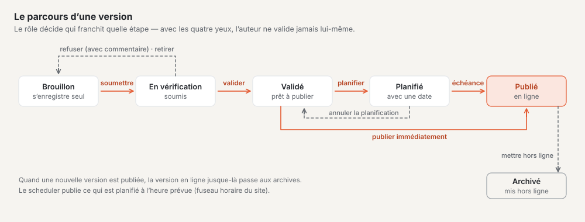
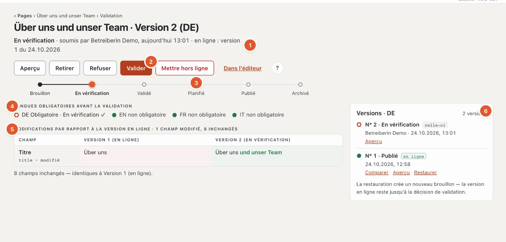
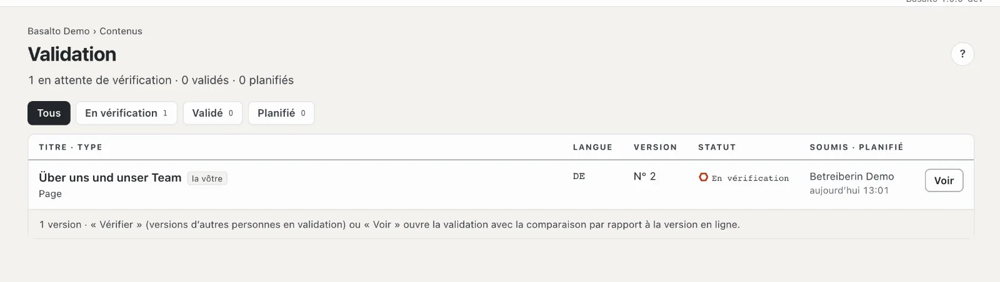

# Validation et publication

Rien ne passe en ligne sans vérification. Chaque version suit un déroulement fixe : la rédaction soumet, la validation vérifie, valide et publie — immédiatement ou à un moment planifié. La version en ligne sur le site web reste inchangée pendant ce temps, jusqu’à ce qu’une nouvelle soit publiée.

## Où

- Mode « Contenus » › **Validation** — toutes les versions qui attendent une vérification ou une publication.
- Vous ouvrez la validation d’une page individuelle dans l’arborescence avec le bouton **« ✓ Validation »** de la ligne, dans l’éditeur
  via le lien « Validation » à côté du statut, depuis la liste avec **« Vérifier »** ou **« Voir »**.

Qui peut valider est informé de chaque version soumise aussi par la **cloche** (et, si souhaité, par e-mail) ; qui a
soumis est informé lorsque la version est refusée, validée ou publiée — voir
[Notifications](index.md#notifications).

> « Publier » signifie ici : mettre en ligne **une version** d’une page. Le « Publier » du mode Configuration
> est autre chose — il s’agit de mettre en ligne pour la première fois tout le **site**.

## Le déroulement d’une version

En haut de la page de validation, une piste indique où en est la version :

**Brouillon → En vérification → Validé → Planifié → Publié → Archivé**

| Statut | Signification |
| --- | --- |
| Brouillon | en cours de modification, s’enregistre automatiquement |
| En vérification | soumis, attend la validation |
| Validé | vérifié, prêt à être publié |
| Planifié | sera publié à un moment déterminé |
| Publié | est en ligne sur le site web |
| Archivé | une ancienne version en ligne ou mise hors ligne |

Chaque langue a ses propres versions et suit le déroulement séparément.

## Qui peut faire quoi

| Étape | Rôles |
| --- | --- |
| Soumettre, retirer | Rédacteur, Traducteur, Administrateur, Exploitant |
| Valider, refuser | Approbateur, Administrateur, Exploitant |
| Planifier, publier, mettre hors ligne | Approbateur, Administrateur, Exploitant |

Les boutons dont votre rôle ne dispose pas n’apparaissent pas du tout. **« Valider »** et **« Publier »**, en revanche, restent affichés
même verrouillés, avec la raison en dessous — et toujours **une seule** raison, dans un ordre fixe (voir les étapes ci-dessous).
Si la même raison vaut pour les deux, la mention est « Valider et publier verrouillés : … ».

## La page de validation

1. **En-tête :** le statut, qui l’a fixé et quand, et quelle version est en ligne (« en ligne : version 1 du … » ou
   « aucune version en ligne pour l’instant »).
2. **Les étapes** possibles en ce moment (Aperçu, Retirer, Refuser, Valider, Planifier, Publier,
   Mettre hors ligne) et « Dans l’éditeur ».
3. **La piste de statut.**
4. **Langues obligatoires avant la validation :** pour chaque langue obligatoire, ✓ ou ✗. ✓ signifie que la version la plus récente de cette langue n’est
   plus un brouillon ; les langues qui ne sont pas obligatoires figurent à côté à titre d’information.
5. **Modifications** par rapport à la version en ligne (sinon par rapport à la précédente) : pour chaque champ modifié, une ligne avec « ancien » et
   « nouveau », les mots modifiés mis en évidence, en dessous « N champs inchangés ». Pour la première version, la mention est « Première version
   — rien à comparer ».
6. **Versions** de cette langue : « celle-ci » marque la version affichée, « en ligne » la version publiée, les plus anciennes figurent sous
   « Archives » — avec « Comparer », « Aperçu » et « Restaurer ».

Sur le téléphone, les étapes figurent dans une barre fixe en bas.

## Les différentes étapes

### Soumettre

Dans l’éditeur ou sur la page de validation : **« Soumettre pour validation »**. La version passe à « En vérification » et apparaît dans la liste « Validation ». S’il manque des champs obligatoires, Basalto ne soumet pas et signale les champs dans l’éditeur.

Vous soumettez plusieurs pages à la fois dans l’arborescence via l’action groupée (voir [Pages](seiten.md)).

### Retirer

Si vous avez soumis trop tôt, **« Retirer »** ramène la version au brouillon. C’est possible tant qu’elle est « En vérification ».

### Vérifier

La page de validation montre **ce qui a changé** — par rapport à la version en ligne ou, si aucune n’est encore en ligne, par rapport à la version précédente. Avec « Aperçu », vous voyez la page telle qu’elle apparaîtra ; « Dans l’éditeur » mène au contenu.

Dans la liste des **versions**, vous comparez avec « Comparer » une version plus ancienne avec la version actuelle ; « Fermer la comparaison » masque de nouveau la comparaison.

### Valider

**« Valider »** fait passer la version à « Validé ». Le bouton est verrouillé — vérifié dans cet ordre — si

1. le principe des quatre yeux s’applique et que vous avez vous-même créé ou soumis la version,
2. une langue obligatoire manque encore (« Validation seulement avec toutes les langues obligatoires — il manque : … », voir [Traduire](uebersetzen.md)),
3. votre rôle ne valide pas.

### Refuser

**« Refuser »** ouvre un champ **« Commentaire »** avec l’indication de la personne à qui la version retourne (« retour à ‹nom› »). Écrivez ce qui doit changer — le commentaire est obligatoire (2000 caractères au plus). La version retourne comme brouillon à l’autrice ou à l’auteur ; le commentaire figure ensuite en haut de l’éditeur sous « Refusé », et la personne reçoit une notification.

### Planifier

Sous **« Planifier »**, choisissez la **date** et l’**heure** (préréglage : demain 08:00) et cliquez sur **« Planifier la publication »**. L’heure s’entend dans le fuseau horaire du site ; si vous travaillez dans un autre fuseau horaire, la page vous le signale. Un moment dans le passé est refusé — pour une publication immédiate, utilisez « Publier ». Jusqu’au moment planifié, la version en ligne actuelle reste en ligne.

- **« Replanifier »** modifie le moment.
- **« Annuler la planification »** ramène la version à « Validé ».

La publication est assurée par un service en arrière-plan (le planificateur), à la minute près. Sa « pulsation » figure à côté du champ de planification : s’il s’est manifesté au cours des cinq dernières minutes, tout va bien ; sinon, la mention rouge « les publications planifiées ne s’exécutent pas » apparaît — informez alors l’administration, car sans lui, ce qui est planifié reste en suspens.

### Publier

**« Publier »** met **immédiatement** en ligne une version validée ou planifiée. La version en ligne précédente est archivée. Le bouton est verrouillé — vérifié dans cet ordre — si

1. le slug dans cette langue est déjà occupé par une autre page publiée,
2. l’obligation de texte alternatif s’applique et qu’une image n’a pas de texte alternatif (voir [Médias](medien.md)),
3. votre rôle ne publie pas.

### Mettre hors ligne

**« Mettre hors ligne »** retire la version en ligne du réseau — possible dès qu’il existe une version en ligne, quel que soit le statut actuel de la version la plus récente. Après la confirmation « Oui, mettre hors ligne », la page n’est plus accessible dans cette langue ; la version est archivée. Le contenu lui-même est conservé : avec « Restaurer » dans la liste des versions, il redevient un brouillon qui suit de nouveau le déroulement.

## Principe des quatre yeux

Lorsque le principe des quatre yeux est activé, personne ne peut valider son propre travail : qui a créé ou soumis une version ne peut pas la valider soi-même. La page de validation indique alors « Principe des quatre yeux : qui soumet ne valide pas soi-même. », et dans la liste, vos propres versions sont marquées « la vôtre ».

Il est activé par une administratrice ou un administrateur sous « Administration › Paramètres », groupe « Validation ». Par défaut, il est désactivé.

## La liste « Validation »

L’en-tête compte « N en attente de vérification · N validées · N planifiées ». En haut, vous filtrez par **« En vérification »**, **« Validé »** et **« Planifié »** — chacun avec le nombre de versions — ou affichez « Tous ». Chaque ligne indique le titre, le genre, la langue, le numéro de version, le statut et qui a soumis quand, ou quand la publication aura lieu ; les versions planifiées figurent en premier, selon leur moment. « la vôtre » marque les versions que vous avez soumises (sans personne ayant soumis : celles que vous avez rédigées).

**« Vérifier »** figure pour les versions soumises par d’autres personnes ; pour toutes les autres, le bouton s’appelle « Voir ». Si rien n’attend, la mention est « Rien en attente de validation », et pour un filtre sans résultat « Rien dans ce filtre ». Le nombre sur l’entrée de menu « Validation » compte ce qui attend une vérification.

## Récupérer une version plus ancienne

Dans la liste des versions de la page de validation, **« Restaurer »** crée un nouveau brouillon à partir d’une version plus ancienne. La version en ligne reste jusqu’à ce que ce brouillon ait suivi le déroulement.

## Questions fréquentes

**J’ai soumis — et maintenant ?**
La version attend dans « Validation ». Qui peut valider la voit là et comme tâche dans l’« Aperçu général ». Si elle est refusée, le commentaire figure dans votre éditeur.

**La page est publiée, mais je veux corriger quelque chose.**
Modifiez-la simplement dans l’éditeur. Un nouveau brouillon est créé ; la version en ligne reste en ligne jusqu’à ce que la correction soit validée et publiée.

**Puis-je valider et publier en une seule étape ?**
Non, ce sont deux étapes : d’abord « Valider », puis « Publier » ou « Planifier la publication ».

## Pour continuer

- [Traduire](uebersetzen.md)
- [Pages et arborescence](seiten.md)
- [Rôles](../verwaltung/rollen.md)
