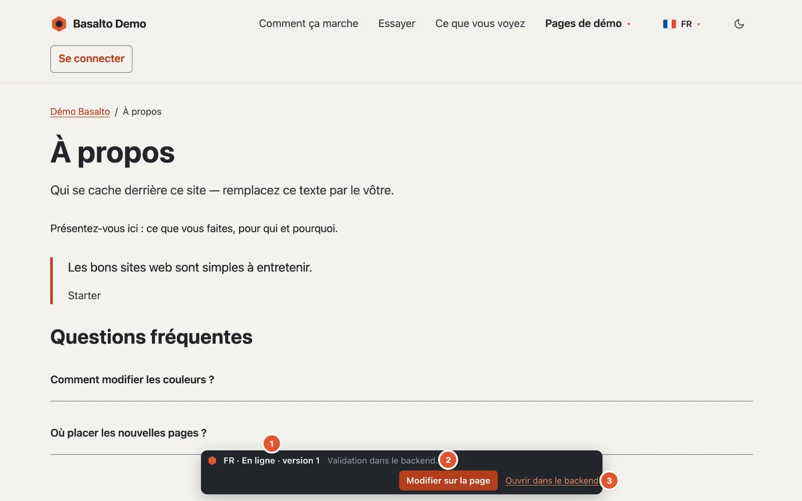
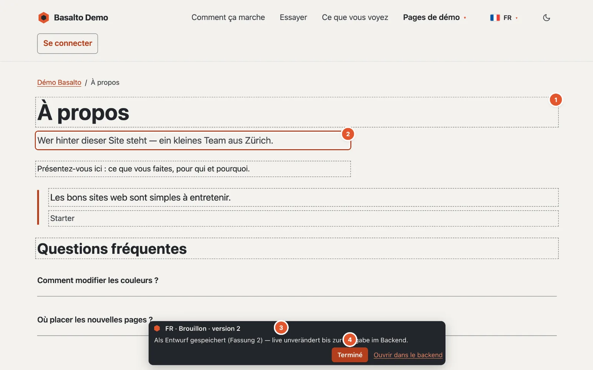

# Modifier sur la page

Vous effectuez les petites corrections de texte directement sur le site web : corriger des fautes de frappe, reformuler une phrase, raccourcir un titre. Votre modification est enregistrée comme **brouillon** — sur le site web, rien ne change pour les visiteurs jusqu’à ce que la version soit validée et publiée dans le backend.

## Où

Sur le site web lui-même. Si vous êtes connecté au backend dans le même navigateur et que vous pouvez modifier la page, une petite **barre de Basalto** apparaît en bas de chaque page publiée.

1. **Langue et état** — par exemple « DE · En ligne · version 4 ». Si une version plus récente attend déjà, elle est indiquée aussi : « En ligne · version 4 · En vérification : version 5 ». À côté, une indication ou le dernier message.
2. **« Modifier sur la page »** active le mode de modification ; dans ce mode, le bouton s’appelle **« Terminé »**.
3. **« Ouvrir dans le backend »** mène directement à l’éditeur de cette page et de cette langue.

Les visiteuses et visiteurs ne voient jamais cette barre.

## Qui peut le faire

Toutes les personnes qui peuvent modifier des contenus : Rédacteur, Administrateur et Exploitant. Les rôles « Traducteur » et « Approbateur » seuls ne suffisent pas — les traductions se font champ par champ dans la vue de traduction (voir [Traduire](uebersetzen.md)).

## Comment procéder

1. Ouvrez la page sur le site web et cliquez dans la barre sur **« Modifier sur la page »**. La page se recharge et affiche maintenant l’état le plus récent — y compris un brouillon pas encore publié. La barre indique combien de champs sont modifiables (« 3 champs modifiables — les modifications s’enregistrent comme brouillon. »).
2. Les textes modifiables sont **entourés de pointillés** (1 sur l’image). Cliquez dedans et modifiez le texte ; le champ en cours a un **cadre** (2).
3. Un peu moins d’une seconde après votre dernière saisie, Basalto enregistre de lui-même. La barre signale « Enregistrement … », puis par exemple « Enregistré comme brouillon (version 5) — en ligne inchangé jusqu’à la validation dans le backend. » (3)
4. Cliquez sur **« Terminé »** (4) pour quitter le mode de modification. Sinon, il reste activé pour votre session, y compris sur d’autres pages. Si tout n’est pas encore enregistré, Basalto demande « Toutes les modifications ne sont pas enregistrées. Terminer quand même ? ».
5. Soumettez la version dans le backend — via « Ouvrir dans le backend », puis « Soumettre pour validation » (voir [Validation et publication](freigabe.md)).

Si la version la plus récente est déjà soumise, validée ou publiée, votre première modification commence un **nouveau brouillon** ; la barre vous le signale.

## Ce qui peut être modifié ici

- le **titre** et l’**introduction**,
- les champs de texte du type de contenu,
- le texte, la zone de texte et le texte courant dans les **blocs**, y compris dans les blocs imbriqués.

Dans le texte courant, l’éditeur sur la page connaît le **gras** (⌘B ou Ctrl+B), l’**italique** (⌘I ou Ctrl+I) et le **lien** (⌘K ou Ctrl+K) — sans barre d’outils. Avec ⌘K, une petite fenêtre demande l’adresse ; vide, elle retire le lien. Le texte collé arrive toujours en texte brut, sans mise en forme étrangère.

Dans les champs d’une ligne, **Entrée** termine la saisie ; dans les zones de texte de plusieurs lignes, Entrée crée une nouvelle ligne. **Échap** quitte chaque champ.

## Ce qui reste dans le backend

- les images, les tableaux et les intégrations,
- le texte courant avec plus qu’une mise en forme simple — le champ n’est alors pas modifiable sur la page. Simple signifie : paragraphes, intertitres, listes, citations, lignes de séparation et sauts de ligne, ainsi que gras, italique, souligné, barré, code, exposant et indice et liens. Des images, des tableaux, des listes de tâches ou des intégrations dans le texte courant font du champ une affaire pour le backend,
- ajouter, déplacer ou supprimer des blocs,
- le slug, les métadonnées et tous les autres paramètres,
- soumettre, valider et publier.

S’il n’y a rien sur une page qui puisse être modifié ici, la barre signale « Aucun texte de cette page ne peut être modifié ici — veuillez passer par le backend. »

## En cas de problème

Si un champ n’a pas pu être enregistré, il a un **cadre rouge**, et la barre en indique la raison.

**« Cette page a été modifiée ailleurs entre-temps — veuillez recharger pour ne rien écraser. »**
Quelqu’un a modifié la même version en même temps dans le backend ou sur la page. Basalto n’enregistre alors pas, afin de ne rien écraser — et n’accepte plus rien sur cette page jusqu’à ce qu’elle soit rechargée. Rechargez la page et refaites votre modification.

**« Pas de connexion — la modification n’est pas encore enregistrée. »**
Le réseau était coupé. Vérifiez la connexion ; la saisie suivante fait une nouvelle tentative.

**« Aucune autorisation pour modifier cette page. »**
Votre rôle ne permet pas (ou plus) cette page ou cette langue — adressez-vous à l’administration.

**« La session a expiré — veuillez recharger et vous connecter. »**
Reconnectez-vous au backend et rechargez la page.

**Le texte est trop long.**
Les textes d’une ligne comptent 300 caractères au plus, les zones de texte 5000, le texte courant 20 000. Modifiez les textes plus longs dans le backend.

**Je quitte la page avant que l’enregistrement soit fait.**
Le navigateur demande confirmation si des modifications ne sont pas encore enregistrées.

## Pour continuer

- [Modifier le contenu avec des blocs](bloecke.md)
- [Validation et publication](freigabe.md)
