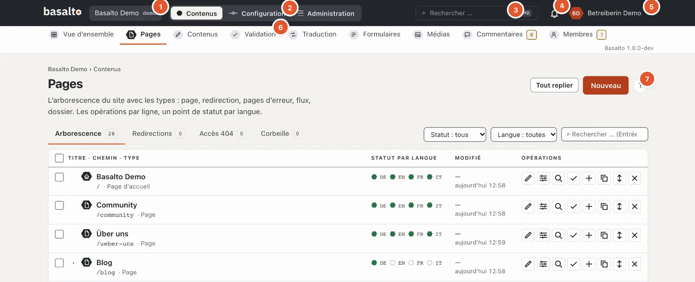
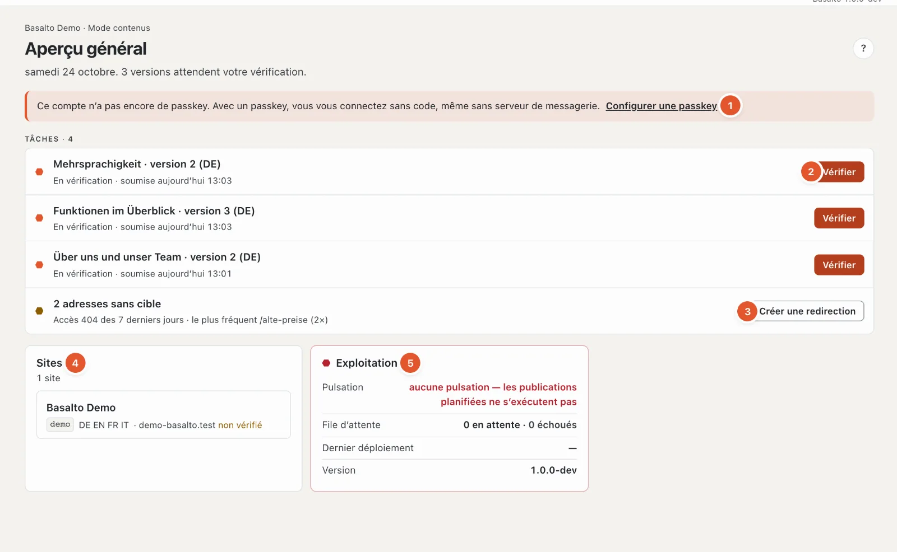
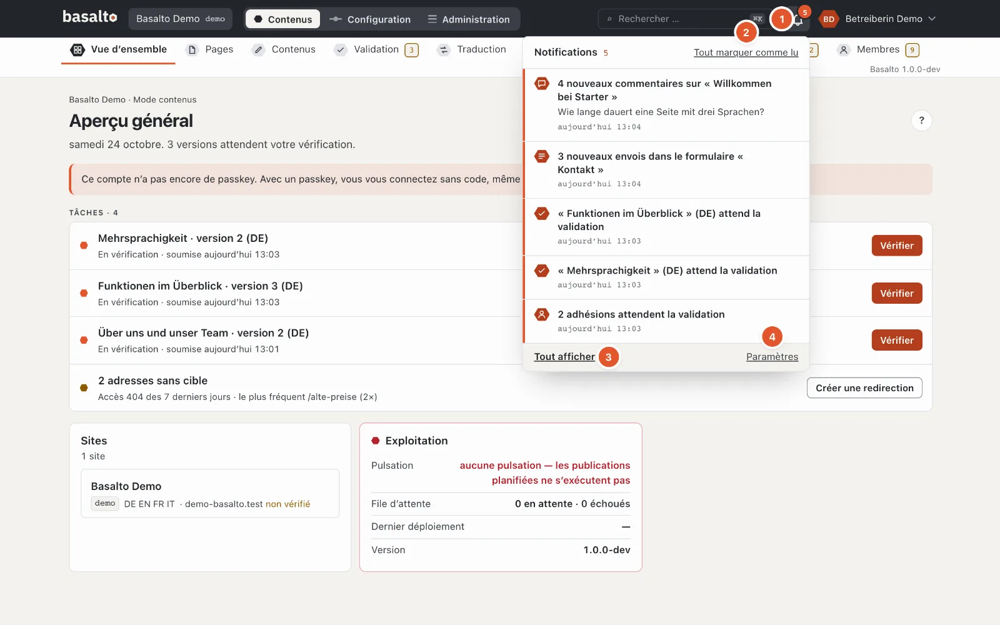
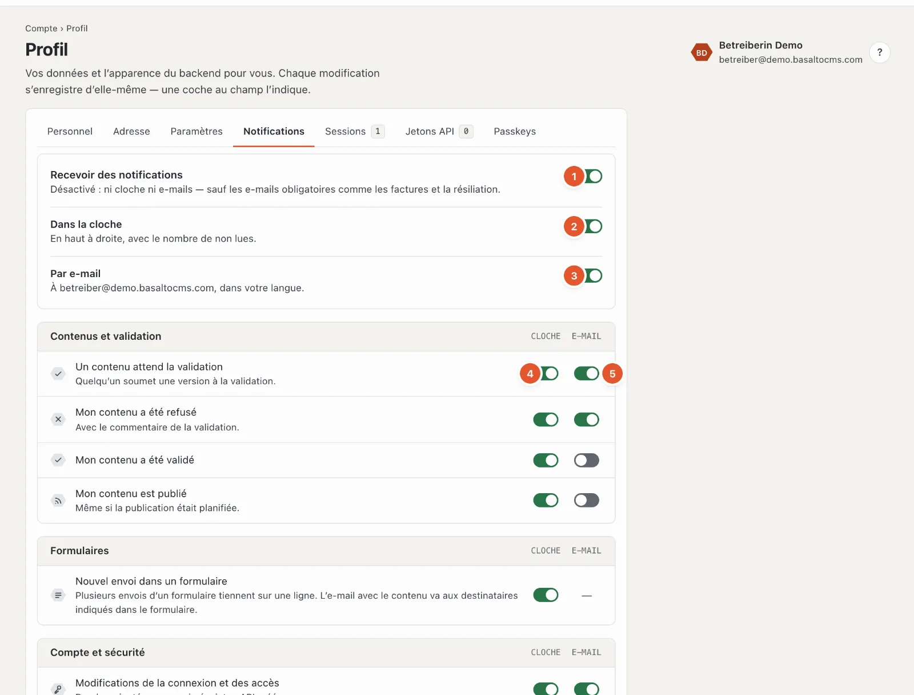
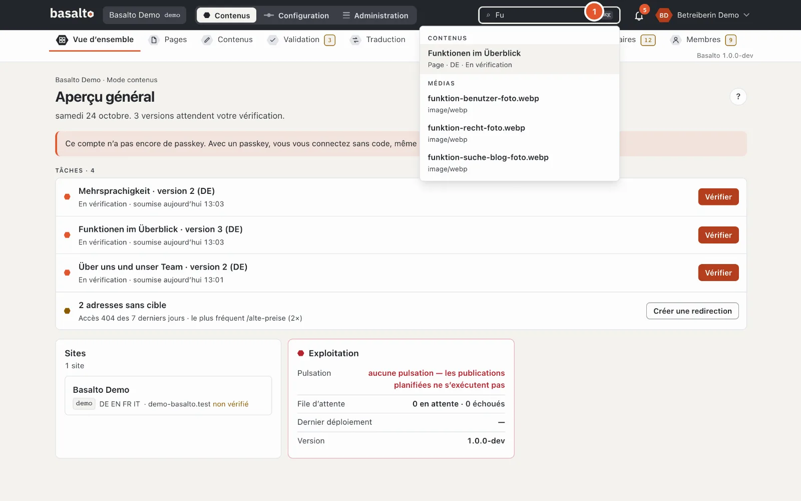

# Aide pour la rédaction

Cette aide explique le travail quotidien dans le backend de Basalto : créer des pages, gérer des textes et des images, traduire, valider et publier. Aucune connaissance technique n’est nécessaire.

Sur presque chaque page du backend, un **« ? »** rond figure en haut à droite. Il ouvre l’aide qui correspond à cette page — sous forme de panneau sur le bord droit ; la page derrière reste utilisable. C’est plus rapide avec la touche **?** ou **F1** ; plus de détails sous [Aide et raccourcis clavier](#aide-et-raccourcis-clavier).

## Ce que contient l’aide

| Page | De quoi il s’agit |
| --- | --- |
| [Pages et arborescence](seiten.md) | Créer, déplacer, copier, supprimer des pages ; corbeille, redirections et erreurs 404 |
| [Modifier le contenu avec des blocs](bloecke.md) | Éditeur de blocs, texte courant, collage depuis Word, aperçu, enregistrement automatique, versions |
| [Médias](medien.md) | Médiathèque, téléversement, dossiers, textes alternatifs, variantes d’images, remplacement, corbeille |
| [Traduire](uebersetzen.md) | Traduction depuis la langue par défaut, langues obligatoires, langue de repli, vue « Traduction » |
| [Validation et publication](freigabe.md) | Soumettre, valider, refuser, planifier, publier, mettre hors ligne ; principe des quatre yeux |
| [Formulaires](formulare.md) | Créer des formulaires, consulter, exporter et supprimer les envois, e-mail aux destinataires |
| [Commentaires](kommentare.md) | Modérer des commentaires, y répondre, les marquer comme spam, les supprimer |
| [Membres](mitglieder.md) | Pages réservées aux membres, connexion sans mot de passe, validation, blocage, invitation |
| [Modifier sur la page](frontend-editor.md) | Modifier des textes directement sur le site web — comme brouillon |
| [Suggestions IA](ki.md) | Faire améliorer et traduire un texte, faire proposer des données SEO et des textes alternatifs — seulement sur clic, comme brouillon |

## Rôles

Ce que vous pouvez faire dans le backend dépend de votre rôle dans le site. Le rôle est attribué par une administratrice ou un administrateur sous « Administration › Utilisateurs ». Voici le réglage des modèles — votre installation peut les avoir adaptés ou avoir créé ses propres rôles :

| Rôle | Peut |
| --- | --- |
| **Rédacteur** | Créer, modifier et supprimer des pages et des contenus, gérer les médias, gérer les formulaires et les envois, modérer les commentaires, soumettre des versions. La validation, la publication, la configuration et l’administration n’en font pas partie. |
| **Approbateur** | Vérifier les versions soumises, les valider ou les refuser, planifier des publications, publier et mettre hors ligne. |
| **Traducteur** | Traduire les contenus dans les autres langues du site — la langue source reste verrouillée. |
| **Administrateur** | Tout dans le site, y compris la configuration, les utilisateurs, les rôles et les paramètres. |
| **Exploitant** | Tout ; le rôle est immuable, chaque site a au moins un exploitant. |

Ce que votre rôle ne peut pas faire n’apparaît pas dans le menu. S’il vous manque un droit au sein d’une page, le backend en indique la raison directement sur le bouton verrouillé — par exemple « Votre rôle ne valide pas ». La façon de configurer les rôles est décrite dans le manuel d’exploitation sous « Rôles et droits ».

## Structure du backend

### L’en-tête

1. **Site** — si vous travaillez dans plusieurs sites, choisissez ici le site.
2. **Contenus · Configuration · Administration** — le sélecteur entre les modes ; vous ne voyez que ceux dont votre rôle a besoin.
3. **Rechercher …** — la recherche (voir [Recherche](#recherche)).
4. La **cloche** — vos notifications (voir [Notifications](#notifications)).
5. Votre **photo de profil** et votre nom — le menu avec le profil, les paramètres, l’aide et « Se déconnecter ».
6. Les **stations** du mode, ici avec un nombre (voir ci-dessous).
7. Le **« ? »** rond — l’aide pour cette page.

### Mode « Contenus »

C’est ici que se déroule le travail de rédaction. Sous l’en-tête figurent les stations :

- **Aperçu général** — vos tâches : versions à vérifier, éléments refusés, traductions manquantes dans les langues obligatoires, adresses sans cible et avis comme des textes alternatifs manquants. S’il n’y a rien à faire, vous lisez « Rien ne vous attend ».
- **Pages** — l’arborescence du site web.
- **Contenus** — des entrées sans place fixe dans l’arborescence, par exemple des articles de blog ou des personnes.
- **Validation** — tout ce qui attend une vérification ou une publication.
- **Traduction** — ce qui manque ou est obsolète dans d’autres langues.
- **Formulaires** — les formulaires et leurs envois.
- **Médias** — la médiathèque.
- **Commentaires** et **Membres** — n’apparaissent que si le module concerné est activé pour le site.

Un nombre en **ambre** à côté d’une station signifie : quelque chose vous y attend — pour « Validation », des versions à vérifier, pour « Traduction », des lacunes, pour « Formulaires », de nouveaux envois, pour « Commentaires » et « Membres », des éléments en attente. Un nombre **gris** est purement informatif. Les nombres sont recomptés toutes les 30 secondes.

### L’aperçu général

En haut figurent la date et, en une phrase, ce qui est à faire.

1. **Avis** — par exemple que votre compte n’a pas encore de passkey, que des images sans texte alternatif sont intégrées, que l’e-mail d’un envoi de formulaire n’a pas été distribué, qu’une tâche d’arrière-plan a échoué (avec « Réessayer » et « Écarter », si vous gérez l’exploitation) ou que l’installation n’a pas encore de licence.
2. **Tâches** avec le bouton adéquat :
   - **En vérification** — versions d’autres personnes que vous pouvez valider : « Vérifier ».
   - **Validé** — attend la publication ; **Planifié** — passe en ligne à l’heure fixée.
   - **Refusé** — uniquement vos propres versions, avec « Retravailler ».
   - **Traduction** — traductions manquantes ou obsolètes dans les langues obligatoires (parmi les 100 contenus modifiés en dernier, 30 tâches au plus).
3. **Adresses sans cible** — erreurs 404 des 7 derniers jours avec l’adresse la plus fréquente et « Créer une redirection » ; seulement si vous pouvez publier.
4. **Sites** — les sites dans lesquels vous travaillez, avec les langues et le domaine.
5. **Exploitation** — pulsation (le planificateur tourne-t-il ?), file d’attente, dernier déploiement et version. Rouge signifie : quelque chose ne va pas — par exemple, sans pulsation, les publications planifiées ne s’exécutent pas.

S’il n’y a rien à faire, vous lisez « Rien ne vous attend ».

### Mode « Configuration »

C’est ici que le site est conçu et construit. Sous l’en-tête figure le **parcours** : neuf stations dans
l’ordre dans lequel un site prend forme — chacune avec la question à laquelle elle répond, et le terme technique en dessous :

| Station | Terme technique |
| --- | --- |
| Qu’est-ce que le site ? | Site |
| À quoi ressemble-t-il ? | Thème · Design — en dessous, le point de correspondance vers les **Thèmes** |
| Comment est-il construit ? | Mises en page · Modèles |
| Comment s’y retrouver ? | Menus |
| Que peut-on gérer ? | Types de contenu |
| De quoi se composent les pages ? | Blocs · Éléments |
| Que peuvent envoyer les visiteurs ? | Formulaires |
| Avec quoi démarre-t-il ? | Contenus de départ |
| Prêt pour la mise en ligne ? | Publier |

Un clic sur une station ouvre une carte : ce que signifie la station, son état (la même vérification que
`basalto:check`) et les pages correspondantes. Un ✗ rouge ou un ! jaune sur une station indique où quelque chose manque ; un
anneau gris en pointillés signifie que la station est encore en attente. **Échap** ferme la carte. À la fin bifurque **« Code »** —
l’éditeur de thème pour celles et ceux qui écrivent eux-mêmes le thème. Sur le téléphone, le parcours se déplie en liste. Tout cela est décrit dans
l’aide dédiée à la configuration : [Configuration](../einrichtung/README.md).

### Mode « Administration »

« Sites », « Modules », « Utilisateurs », « Rôles », « Paramètres », « Licence », « Exploitation », « Journal », « Passkeys » et ce que les modules
y ajoutent. Ces domaines relèvent surtout des administratrices et administrateurs ; ils ont leur propre aide :
[Administration](../verwaltung/README.md).

## Votre compte : profil et paramètres

En haut à droite figure votre **photo de profil** (ou vos initiales). Un clic ouvre le menu avec **« Profil »**, **« Paramètres »**, **« Aide et raccourcis clavier »** et **« Se déconnecter »** ; au clavier, vous choisissez avec **↑ ↓** (Début et Fin sautent à la première et à la dernière entrée), **Échap** ferme.

Le profil comporte ces onglets :

- **Personnel :** prénom et nom, téléphone (vous choisissez l’indicatif via le drapeau) et une **photo de profil** (JPEG, PNG ou WebP jusqu’à 5 Mo, recadrée en carré). Sans photo, vos initiales apparaissent. L’**adresse e-mail** est modifiée par l’administration.
- **Adresse :** rue, code postal, localité et pays.
- **Paramètres :** langue de l’interface, fuseau horaire, format de date et d’heure, **page d’accueil après la connexion** (Aperçu général, Pages, Validation, Traduction ou Médias), **apparence** (claire, sombre ou comme dans le système d’exploitation), **éléments par page** (25, 50 ou 100 — pour les contenus, les médias, les envois de formulaires et le journal), **tri des listes** (les plus récents ou les plus anciens d’abord, par titre) et les **raccourcis clavier de l’aide** (activer ou désactiver).
- **Notifications :** voir [Notifications](#notifications).
- **Sessions :** où vous êtes connecté — navigateur, adresse IP et « dernière activité » ; « cette session » est celle dans laquelle vous travaillez en ce moment. « Se déconnecter » met fin à une session, **« Fermer toutes les autres »** à toutes sauf celle-ci. Pratique si vous ne vous êtes pas déconnecté sur un appareil étranger.
- **Jetons API :** pour les programmes qui travaillent avec Basalto via l’interface (par exemple un import). **« Nouveau jeton »** : nom, site, **capacités** (lire, écrire — jamais plus que ce que votre rôle permet) et, si vous le souhaitez, une date d’expiration, puis « Créer le jeton ». Le jeton n’apparaît **qu’une seule fois** — copiez-le immédiatement. La liste indique quand un jeton a été créé et utilisé pour la dernière fois ; « Révoquer » le bloque immédiatement après une confirmation.
- **Passkeys :** mène à la gestion de vos passkeys (connexion sans code, avec empreinte digitale, visage ou verrouillage de l’appareil). Vous y trouvez aussi **« Télécharger mes données (JSON) »** — tout ce que Basalto enregistre sur votre compte.

Chaque modification s’enregistre d’elle-même et ne vaut que pour vous.

## Notifications

La **cloche** (1) en haut à droite indique en lave combien de notifications sont non lues (à partir de 100, « 99+ »). Un clic ouvre les huit plus récentes ; les non lues portent la ligne rouge à gauche. Un clic sur une notification ouvre ce dont il s’agit — si elle provient d’un autre site, le backend y bascule. Avec la coche sur le bord, vous en marquez une comme lue (un second clic la rend de nouveau non lue), **« Tout marquer comme lu »** (2) les règle toutes d’un coup, **Échap** ferme. La cloche vérifie chaque minute si quelque chose s’est ajouté — seulement tant que la fenêtre est visible —, puis oscille brièvement. Si vous avez entièrement désactivé les notifications, la cloche affiche **« Activer »**.

**« Tout afficher »** (3) ouvre le **centre** : toutes les notifications par jour, avec les filtres « Non lues » et par groupe, sur chaque ligne « Marquer comme lu » ou « Non lu » et « Retirer », en haut « Tout marquer comme lu » et « Supprimer les lues ».

Ce que vous recevez dépend de votre rôle — par exemple :

| Notification | Qui la reçoit |
| --- | --- |
| Un contenu attend la validation | Qui peut valider |
| Mon contenu a été refusé, validé, publié | Qui a soumis la version |
| Nouvel envoi dans un formulaire | Qui voit les formulaires et les envois — plusieurs envois d’un même formulaire figurent sur une seule ligne |
| Nouveau commentaire | Qui modère les commentaires — regroupés par contenu |
| Une nouvelle adhésion attend la validation | Qui gère les membres |
| Le support de l’éditeur accède au site | Qui administre le site |
| Modifications de la connexion et de l’accès | Vous-même (nouvelle passkey, nouveau jeton API) |
| Abonnement, factures, période d’essai, domaine, export | Propriété et facturation du compte (seulement avec l’abonnement) |

Ce qui arrive dans la cloche et ce qui arrive par e-mail se règle dans le profil sous **« Notifications »** (aussi via « Paramètres » (4) en bas de la cloche) : un **interrupteur principal** (1), un interrupteur chacun pour **Cloche** (2) et **E-mail** (3) et, en dessous, chaque notification individuellement, par groupes, avec les colonnes **Cloche** (4) et **E-mail** (5). Si vous travaillez aussi dans l’extranet de l’éditeur, une colonne **« Extranet »** s’ajoute. Les **e-mails obligatoires** comme les factures et la résiliation arrivent toujours — seule la cloche peut y être désactivée. Là où figure un tiret au lieu d’un interrupteur, l’e-mail se règle ailleurs : pour les formulaires sur le formulaire (destinataires), pour les commentaires sur le bloc de commentaires. « Rétablir les valeurs par défaut » en bas remet toutes les notifications individuelles à leur valeur par défaut ; les trois interrupteurs principaux restent tels quels.

## Recherche

Vous ouvrez aussi le champ **« Rechercher … »** de l’en-tête avec la combinaison de touches **⌘K** (Mac) ou **Ctrl+K** (Windows). Saisissez au moins deux caractères. La recherche trouve, avec au plus six résultats par groupe :

- les **contenus** et les pages par leur titre — y compris les brouillons, avec le type, la langue et le statut,
- les **médias** par nom de fichier ou titre — un résultat ouvre la médiathèque avec ce terme de recherche,
- les **utilisateurs** par nom ou adresse e-mail, si vous pouvez gérer les utilisateurs.

Avec les touches fléchées, vous choisissez un résultat, **Entrée** l’ouvre, **Échap** ferme la recherche. Sur le téléphone, la recherche est masquée.

## Aide et raccourcis clavier

Le panneau d’aide affiche la page qui correspond à votre travail et parcourt toute la documentation : cette aide pour la rédaction, l’exploitation, la documentation pour les développeurs et le Marketplace. Tapez un mot-clé en haut du panneau ; un résultat mène directement à la section correspondante. Les liens dans le texte ouvrent la page d’aide suivante dans le panneau lui-même. **« Ouvrir comme page »** affiche la page en pleine largeur, avec toutes les pages d’aide à gauche.

**Largeur du panneau :** faites glisser le bord gauche du panneau avec la souris vers la gauche ou la droite. Au clavier, cela se fait sur la poignée avec **← →** (avec la touche Maj par pas plus grands), **Début** et **Fin** sautent à la plus grande et à la plus petite largeur. Basalto mémorise la largeur dans votre profil — à la prochaine ouverture, même sur un autre appareil, elle est de nouveau la même. Sur les écrans étroits, le panneau occupe toute la largeur.

**Images :** un clic sur une image de l’aide l’affiche en grand, l’arrière-plan devient flou. **Échap**, un clic à côté ou **×** la ferment.

| Touche | Effet |
|---|---|
| **?** ou **F1** | Ouvrir ou fermer l’aide |
| **/** | Rechercher dans l’aide ouverte |
| **Échap** | Fermer l’aide |
| **⌘K** ou **Ctrl+K** | Rechercher dans le backend |
| **↑ ↓** et **Entrée** | Choisir et ouvrir un résultat |

Dans les champs de saisie et les éditeurs — y compris l’éditeur de code —, **?** et **/** sont des caractères normaux ; là, seule la touche **F1** ouvre l’aide. La liste des touches figure aussi dans le panneau sous **« Raccourcis clavier »**.

## Termes importants

- **Version** — chaque langue d’un contenu a des versions numérotées. Ce qui est en ligne sur le site web est toujours une version précise. Les modifications aboutissent dans un brouillon ; la version en ligne reste intacte jusqu’à ce qu’une nouvelle soit publiée.
- **Statut d’une version** — « Brouillon », « En vérification », « Validé », « Planifié », « Publié », « Archivé ». Plus de détails sous [Validation et publication](freigabe.md).
- **Langue par défaut** — la langue principale du site. Les traductions en découlent.
- **Langue obligatoire** — une langue sans la version de laquelle rien n’est validé.
- **Enregistrement automatique** — dans l’éditeur, il n’y a pas de bouton d’enregistrement ; les modifications s’enregistrent d’elles-mêmes après une courte pause.

## Questions fréquentes

**J’ai modifié quelque chose, mais je ne le vois pas sur le site web.**
Les modifications sont enregistrées comme brouillon. Elles ne deviennent visibles qu’une fois la version soumise, validée et publiée. Voir [Validation et publication](freigabe.md).

**Je ne vois pas le bouton « Publier » ou il est verrouillé.**
Les rôles « Approbateur », « Administrateur » et « Exploitant » peuvent publier. En tant que rédacteur, vous soumettez la version.

**Où trouver les pages ou les images supprimées ?**
Dans l’onglet « Corbeille » sous « Pages » ou dans la « Corbeille » de la médiathèque. Voir [Pages et arborescence](seiten.md) et [Médias](medien.md).

## Pour continuer

- [Pages et arborescence](seiten.md)
- [Modifier le contenu avec des blocs](bloecke.md)
- [Médias](medien.md)
