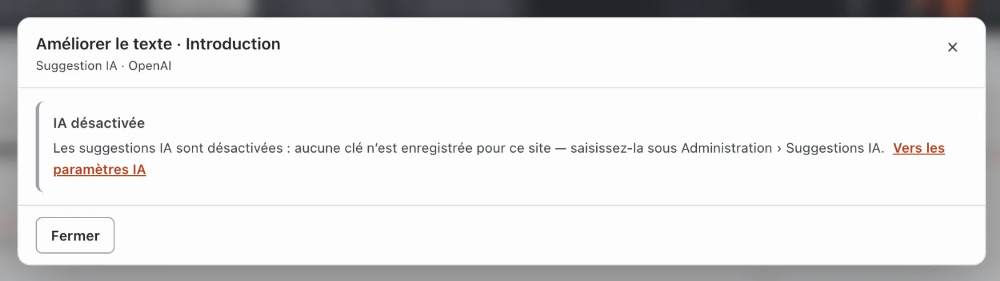
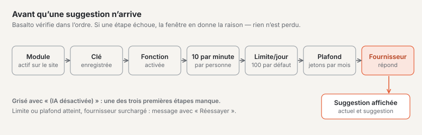
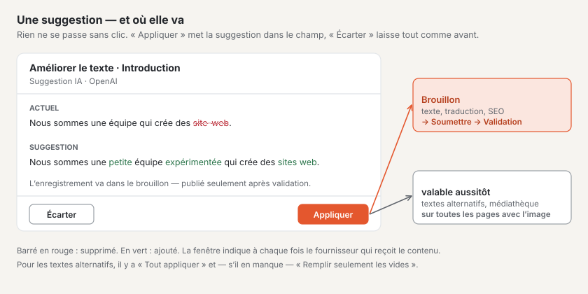
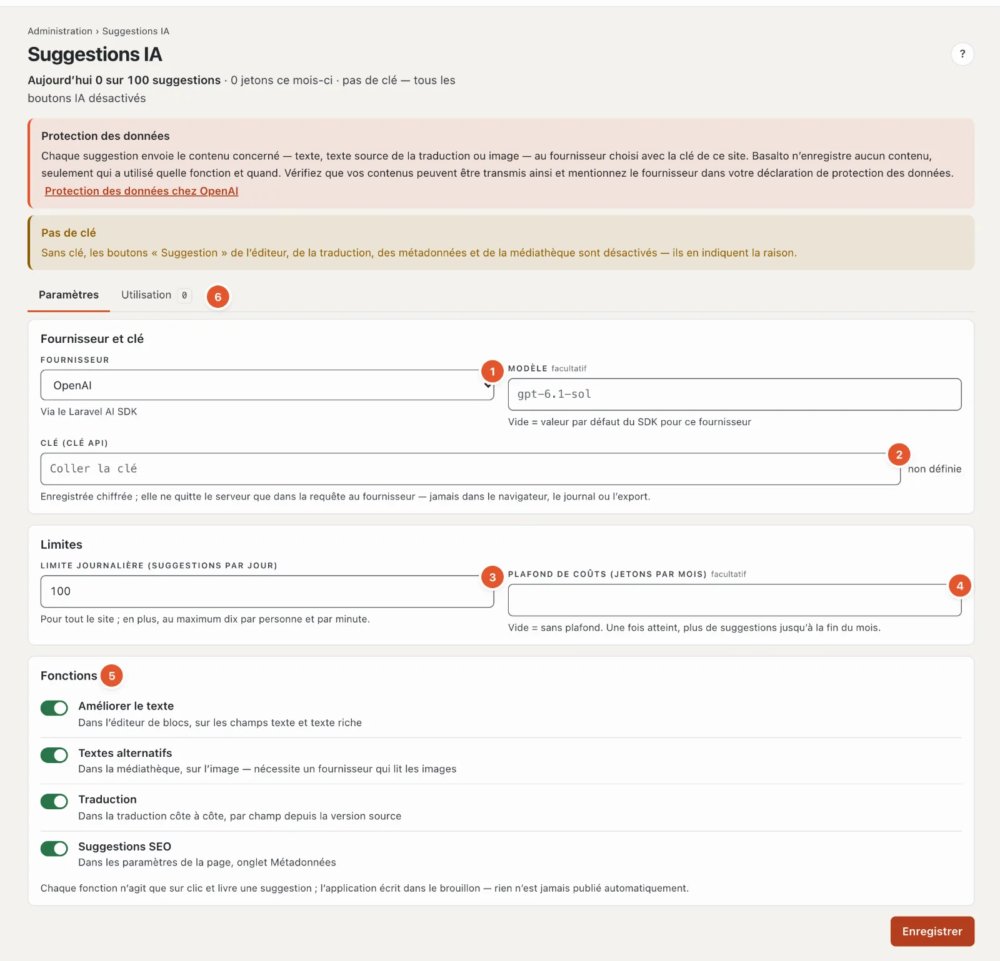

# Suggestions IA

Avec le module « Suggestions IA », une intelligence artificielle vous propose comment un texte peut mieux sonner, quel texte alternatif une image nécessite, comment un champ pourrait être traduit ou quels titre de page et description conviennent aux résultats de recherche. Trois règles s’appliquent toujours :

- **Rien ne se passe sans clic.** L’IA ne travaille que lorsque vous cliquez sur **« ✦ Suggestion »** — jamais en arrière-plan, jamais à l’ouverture d’une page.
- **C’est toujours une suggestion.** Vous la voyez à côté du texte actuel et décidez : **« Appliquer »** ou **« Écarter »**.
- **La reprise se fait dans le brouillon.** Une suggestion n’est jamais publiée automatiquement — elle suit le même chemin que toute modification : brouillon, soumission, validation. La seule exception concerne les textes alternatifs dans la médiathèque (voir ci-dessous).

## Où se trouvent les boutons

| Fonction | Où | Qui peut |
| --- | --- | --- |
| **Améliorer le texte** | Dans l’éditeur de blocs sous chaque champ de texte, de zone de texte et de texte courant, y compris sous l’introduction | Rédacteur, Administrateur, Exploitant |
| **Traduction** | Lors de la traduction côte à côte sous chaque champ traduisible — le quatrième bouton à côté de « → reprendre » | toutes les personnes qui peuvent traduire |
| **Suggestion SEO** | Dans les paramètres de la page, onglet « Métadonnées », pour chaque langue | Rédacteur, Administrateur, Exploitant |
| **Suggérer des textes alternatifs** | Dans la médiathèque, dans le détail d’une image, sous les textes alternatifs | toutes les personnes qui peuvent modifier les médias |

Les boutons n’apparaissent que si le module est activé pour le site. Les champs vides n’ont pas de bouton — sans texte, il n’y a rien à améliorer.

Pour le **texte alternatif**, le bouton n’existe que pour les images matricielles (JPG, PNG, WebP, GIF) — pas pour SVG et PDF — et seulement si le fournisseur choisi sait lire les images (DeepSeek et Groq ne le peuvent pas).

**Grisé avec « (IA désactivée) »** signifie : aucune clé n’est enregistrée pour le site ou la fonction est désactivée. Un clic en indique la raison — la fenêtre n’a alors que « Fermer » et le lien **« Vers les paramètres IA »**.

## Comment procéder

1. Cliquez sous le champ sur **« ✦ Améliorer le texte »** (ou « Suggestion », « Suggestion SEO », « Suggérer des textes alternatifs »).
2. Une fenêtre s’ouvre : « Suggestion en cours … ». Après quelques secondes, **Actuel** et **Suggestion** figurent côte à côte ; les mots supprimés en rouge, les nouveaux en vert.
3. **« Appliquer »** place la suggestion dans le champ. Vous pouvez ensuite la modifier comme n’importe quel texte.
4. **« Écarter »** ferme la fenêtre — rien ne change.

Dans le brouillon ouvert, l’enregistrement automatique enregistre le texte repris comme s’il avait été tapé. Si l’éditeur affiche une version publiée, le brouillon n’est créé qu’avec **« Enregistrer comme nouveau brouillon »** ; la version publiée reste telle quelle.

### Améliorer le texte

L’IA corrige l’orthographe, la grammaire et la ponctuation et rend le texte plus clair — dans la même langue, avec le même message et à peu près la même longueur. Dans le texte courant, les titres, les listes, les liens et les mises en évidence sont conservés. Si un texte courant contient des **images, des tableaux, des listes de tâches ou des intégrations**, l’IA ne fait aucune suggestion — ces éléments se perdraient en chemin.

### Traduction

Lors de la traduction côte à côte, l’IA prend toujours le texte de la **version source** dans la langue par défaut — et non ce qui figure dans le champ cible. « Appliquer au champ cible » place la traduction dans le champ de la langue cible ; l’enregistrement se fait dans le brouillon de cette langue. Vérifiez les termes techniques et les noms.

### Suggestion SEO

À partir du contenu de la version la plus récente, l’IA propose un **titre de page** (60 à 70 caractères au plus) et une **description** (160 caractères au plus). « Appliquer » remplit les deux champs ; l’aperçu du résultat de recherche en dessous montre aussitôt le rendu.

S’il n’existe pas encore de version dans la langue, la mention est « d’abord le contenu, puis les métadonnées » ; si la page n’a pas encore de texte, il n’y a pas de suggestion.

### Textes alternatifs

L’IA regarde l’image et propose un texte alternatif pour **chaque langue du site**. **« Tout appliquer »** remplit toutes les langues. S’il ne manque que quelques textes alternatifs, il y a en plus **« Remplir seulement les vides »** — les textes existants restent alors tels quels.

**Attention :** les médias n’ont pas de versions. Les textes alternatifs repris s’enregistrent immédiatement et s’appliquent aussitôt sur toutes les pages qui affichent l’image. La reprise figure au journal. Vérifiez donc soigneusement la suggestion — l’IA ne connaît ni les noms des personnes ni le contexte.

## Protection des données

Chaque suggestion envoie le contenu concerné au fournisseur que votre site a choisi (par exemple OpenAI, Anthropic ou Mistral) : le texte du champ, le texte source d’une traduction, le contenu d’une page pour la suggestion SEO ou l’image. La fenêtre nomme le fournisseur à chaque fois. N’envoyez rien qui ne doive pas quitter la maison.

Basalto lui-même n’enregistre **aucun contenu** : le journal indique seulement qui a utilisé quelle fonction, quand et sur quel contenu, et si la suggestion a été reprise.

## Activation et limites

Une administratrice ou un administrateur configure l’IA sous **Administration › Suggestions IA**. En haut figurent le nombre de suggestions déjà faites aujourd’hui et le nombre de tokens consommés ce mois-ci.

1. **Fournisseur** — OpenAI, Anthropic (Claude), Google Gemini, Mistral AI, xAI (Grok), DeepSeek, Groq ou OpenRouter. Le **modèle** est facultatif ; vide, c’est la valeur par défaut du fournisseur qui s’applique.
2. **Clé (clé API)** — fournie par le fournisseur. Elle est enregistrée chiffrée et ne quitte le serveur que dans la requête au fournisseur ; ensuite, seule la mention « définie ✓ » avec les derniers caractères figure ici. « Retirer la clé » désactive tous les boutons IA du site.
3. **Limite journalière** — suggestions par jour pour tout le site, par défaut 100 (1 à 10 000). Lorsqu’elle est atteinte, la fenêtre le signale ; le lendemain, cela reprend.
4. **Plafond de coûts** — tokens par mois (à partir de 1000), vide signifie sans plafond. Lorsqu’il est atteint, il n’y a plus de suggestions jusqu’à la fin du mois.
5. **Fonctions** — un interrupteur chacune pour Améliorer le texte, Textes alternatifs, Traduction et Suggestions SEO.
6. **Utilisation** — par mois, le nombre de suggestions, combien ont été reprises et combien ont échoué, les tokens et la répartition par fonction. Aucun contenu n’y figure.

En outre, s’applique toujours :

- **Dix suggestions par minute au plus par personne.**
- **12 000 caractères au plus** sont envoyés au fournisseur ; un texte plus long ne reçoit pas de suggestion.
- **Les erreurs du fournisseur** (surchargé, crédit épuisé, clé refusée) apparaissent sous forme de message compréhensible avec **« Réessayer »**. Rien ne se perd.

## Questions fréquentes

**Je ne vois pas de bouton « Suggestion ».**
Le module n’est pas activé pour le site, ou le champ est vide. Les personnes qui traduisent ne voient pas « Améliorer le texte » ni « Suggestion SEO ».

**Le bouton est grisé et s’appelle « (IA désactivée) ».**
La clé manque ou la fonction est désactivée. Adressez-vous à l’administration du site.

**La suggestion est-elle déjà sur le site web ?**
Non. Sauf pour les textes alternatifs, elle arrive dans le brouillon et nécessite, comme toute modification, une soumission, une validation et une publication.

## Pour continuer

- [Modifier le contenu avec des blocs](bloecke.md)
- [Configurer les suggestions IA](../betrieb/ki.md)
