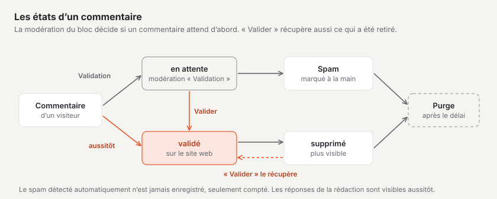
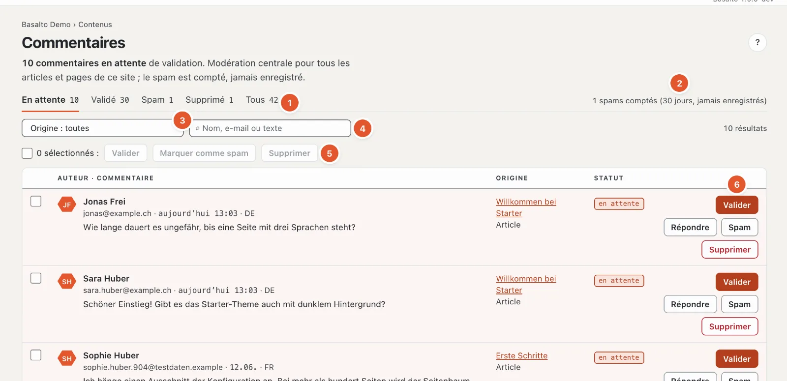
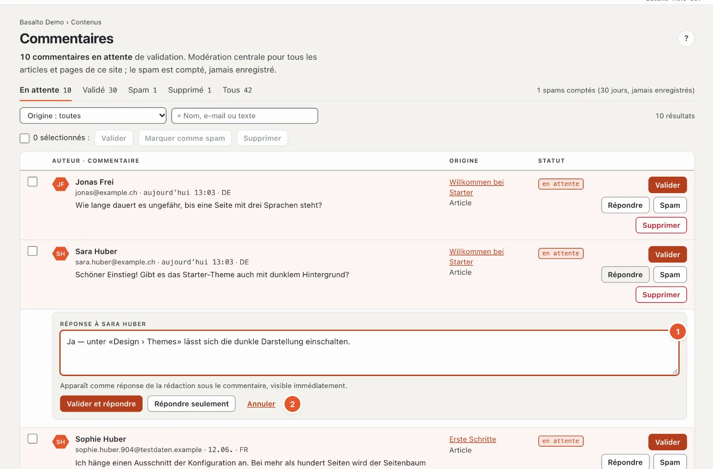

# Commentaires

Avec le module « Commentaires », les visiteuses et visiteurs peuvent commenter des articles et des pages — sans compte. Dans le backend, vous modérez tous les commentaires du site en un seul endroit.

## Où

Mode « Contenus » › **Commentaires**. L’entrée de menu n’apparaît que si le module est activé pour le site (c’est le travail d’une administratrice ou d’un administrateur sous « Administration › Sites », onglet « Modules »). Le nombre sur l’entrée de menu indique combien de commentaires attendent une validation.

Peuvent modérer toutes les personnes qui peuvent modifier des contenus : Rédacteur, Administrateur et Exploitant.

## Comment les commentaires arrivent sur une page

Les commentaires apparaissent là où le **bloc « Commentaires »** figure sur une page. Dans le thème de départ, le bloc a ces paramètres :

| Paramètre | Effet |
| --- | --- |
| Modération | « Validation » : chaque commentaire attend dans la modération · « immédiatement » : visible jusqu’à ce que quelqu’un le retire |
| Tri | les plus anciens ou les plus récents d’abord |
| Nombre par page | combien de commentaires apparaissent à la fois (1 à 100, par défaut 20) |
| Réponses | les visiteurs peuvent répondre sur un niveau, ou pas du tout |
| Notification | e-mail lors d’un nouveau commentaire à la rédaction, à l’autrice ou à l’auteur de l’article, ou désactivé |
| Fermer les commentaires | plus de nouveaux commentaires ; les commentaires existants restent visibles |

Vous modifiez les paramètres comme pour tout autre bloc dans l’éditeur de la page ; comme toute autre modification, celle-ci ne prend effet qu’avec la publication.

Si la modération est réglée sur « Validation », les réponses des visiteurs attendent aussi une validation. La personne qui commente voit après l’envoi « Votre commentaire attend une validation. ». Le nom, l’e-mail et le commentaire sont obligatoires, un site web personnel est facultatif ; l’adresse e-mail n’est jamais publiée.

## La modération

1. **Statut** — « En attente », « Validé », « Spam », « Supprimé » ou « Tous », chacun avec le nombre. Si des commentaires attendent, la page s’ouvre directement sur « En attente ».
2. **Compteur de spam** — combien de spam a été refusé au cours des 30 derniers jours. Le total depuis le début figure en bas dans la barre de pied de page.
3. **Origine** — uniquement les commentaires d’une page ou d’un article.
4. **Recherche** par nom, e-mail ou texte.
5. **Plusieurs à la fois** — voir ci-dessous.
6. **Les actions** pour chaque commentaire.

Les formulaires de commentaires utilisent la même protection anti-spam que les [formulaires](formulare.md), avec la tâche de calcul pour le navigateur. Si **« Interroger Stop Forum Spam »** est activé sous Administration › Réglages › Protection anti-spam, les commentaires d’expéditeurs de spam connus arrivent directement sous « Spam » — une erreur peut y être approuvée.

Chaque ligne affiche l’autrice ou l’auteur avec l’e-mail (et le site web, s’il est indiqué), la date et la langue, le texte, pour les réponses « ↳ Réponse à … », l’origine avec un lien et le statut. Les réponses de la rédaction portent la marque « Rédaction ». 50 commentaires figurent par page ; vous feuilletez les suivants en bas.

Les actions — seules apparaissent celles qui correspondent au statut :

- **« Valider »** — le commentaire apparaît sur le site web. Pour tous ceux qui ne sont pas déjà validés.
- **« Répondre »** — ouvre un champ de réponse (voir ci-dessous). Pour les commentaires en attente et validés.
- **« Spam »** — marque le commentaire comme spam ; il disparaît immédiatement du site web. Les réponses de la rédaction ne peuvent pas être marquées comme spam, seulement supprimées.
- **« Supprimer »** — retire immédiatement le commentaire du site web.

Les commentaires supprimés et marqués comme spam restent encore un certain temps dans la modération (filtre « Supprimé » ou « Spam »). Avec « Valider », vous récupérez un commentaire retiré par erreur.

## Répondre

1. Cliquez sur **« Répondre »** à côté du commentaire et écrivez votre réponse dans le champ **« Réponse à … »** (2 à 5000 caractères).
2. Si le commentaire est encore en attente, choisissez **« Valider et répondre »** (les deux en une étape) ou **« Répondre seulement »** — le commentaire reste alors en attente. Pour les commentaires validés, le bouton s’appelle simplement « Répondre ». « Annuler » ferme le champ.

Sur le téléphone, il n’y a que « Valider et répondre » ou « Répondre ».

Votre réponse apparaît **immédiatement** sous le commentaire, marquée comme réponse de la rédaction, avec votre nom. Les réponses existent sur un seul niveau : si vous répondez à une réponse, la vôtre figure sous le même commentaire d’origine.

## Plusieurs commentaires à la fois

Cochez les cases devant les commentaires (ou en haut « Tout sélectionner sur cette page ») et choisissez **« Valider »**, **« Marquer comme spam »** ou **« Supprimer »**.

## Spam

Le spam détecté automatiquement — par exemple provenant de programmes qui remplissent des formulaires en masse — n’est **jamais enregistré**, seulement compté. La protection est la même que pour les formulaires : un champ invisible, un contrôle du temps et une limite par adresse IP. Le nombre figure en haut de la modération. Ce qui passe malgré tout, vous le marquez à la main avec « Spam » ; c’est également compté.

## Notification

La cloche en haut à droite signale les nouveaux commentaires (plusieurs commentaires sur un même contenu figurent sur une seule ligne). Vous ne réglez pas l’e-mail correspondant dans le profil, mais sur le bloc « Commentaires » (paramètre « Notification »).

## Protection des données

En bas de la page, l’encadré « Protection des données » résume ce qui est enregistré :

- **Adresse IP** — uniquement sous forme de somme de contrôle, pour la limite par IP ; l’adresse elle-même n’est pas enregistrée.
- **Adresse e-mail** — enregistrée, mais jamais publiée.
- **Suppression** — un nettoyage nocturne supprime définitivement les commentaires supprimés et le spam après le délai configuré, par défaut **365 jours**. Une administratrice ou un administrateur modifie le délai sous « Administration › Paramètres », groupe « Conservation », « Conserver les commentaires supprimés et le spam ». Les commentaires validés et en attente sont conservés.
- **Sur demande** — l’administration se charge des renseignements et de la suppression par adresse e-mail sous « Administration › Utilisateurs ».

La personne qui commente consent expressément à la publication de son nom et de son commentaire.

## Questions fréquentes

**Un commentaire n’est pas visible sur le site web.**
Vérifiez le statut dans la modération. « en attente » signifie : il doit encore être validé. Si l’intégration est réglée sur « immédiatement », il apparaît sans validation.

**Je ne souhaite plus de nouveaux commentaires sur un article.**
Dans le bloc « Commentaires » de cet article, cochez « Fermer les commentaires ». Les commentaires existants restent visibles.

**J’ai supprimé un commentaire par erreur.**
Filtrez par « Supprimé » et cliquez sur « Valider » à côté du commentaire.

## Pour continuer

- [Membres](mitglieder.md)
- [Aide pour la rédaction](index.md)
