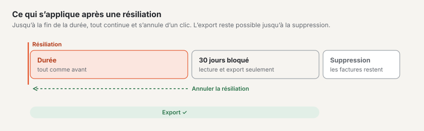

# Export et résiliation

Sous **Administration › Compte › Export et résiliation**, vous récupérez vos données et résiliez votre abonnement. L’onglet est visible pour
le propriétaire, l’administration et la facturation du compte ; seul le **propriétaire** peut résilier.

## Export

« Vos données restent les vôtres » : vous pouvez créer l’export complet **à tout moment** — pas seulement lorsque vous partez.

1. Sous « Contenu », choisissez **Compte entier** (propriétaire uniquement) ou **un site**.
2. Choisissez « Créer un nouvel export ». L’export se crée en arrière-plan ; la barre indique son avancement. Vous pouvez
   quitter la page.
3. Lorsqu’il est terminé, vous recevez un **e-mail avec un lien**. Le lien est valable **7 jours** ; pour télécharger, vous vous connectez.
   Ensuite, nous supprimons le fichier — si nécessaire, créez-en simplement un nouveau.

Ce qu’il contient : les contenus en JSON avec toutes les versions et toutes les langues, les médias avec leurs variantes d’image, le thème, la navigation,
les formulaires, les paramètres et les utilisateurs avec leurs rôles. Les envois de formulaires (données personnelles) ne sont pas inclus. L’export a
le même format que l’import : **export → installation vide → import** donne le même site, y compris sur votre propre
serveur.

Un seul export s’exécute à la fois. Peuvent exporter le propriétaire (site ou compte entier) ainsi que l’administration
du compte et l’exploitant d’un site (uniquement le site).

## Résilier

1. L’encadré « Résilier l’abonnement » présente vos données : **durée jusqu’au**, ce qui s’applique **après** et le jour de la **suppression**.
2. Saisissez le **nom du compte** exactement tel qu’il apparaît, et cochez « J’ai créé l’export ou je n’en ai pas
   besoin ».
3. Choisissez « Confirmer la résiliation ». Vous recevez un e-mail avec toutes les données.

Ce qui s’applique ensuite :

| Période | Ce qui s’applique |
| --- | --- |
| Jusqu’à la fin de la durée | Tout comme avant. La durée se termine avec la période payée ; pendant la **période d’essai, immédiatement**. Aucune autre facture n’arrive. |
| 30 jours après | **Bloqué :** votre site web n’affiche plus que « Ce site n’est plus disponible. » Vous-même pouvez tout lire et exporter dans le backend, mais plus rien modifier. Les autres utilisateurs n’y ont plus accès. |
| Le jour de la suppression | Nous supprimons définitivement les sites, les médias et les utilisateurs. Votre compte et vos **factures restent**, parce que la loi l’exige. Votre alias est ensuite de nouveau libre. |

Nous vous le rappelons par e-mail **sept jours** et **un jour** avant la suppression.

Pendant la durée, un bandeau figure en haut du backend : « Résilié · durée jusqu’au … · ensuite 30 jours de blocage · suppression
le … ».

## Annuler la résiliation

Jusqu’à la fin de la durée, un clic suffit : **« Annuler la résiliation »** dans le bandeau du haut ou dans l’encadré « Ce qui s’applique maintenant ».
Votre abonnement continue alors simplement, comme si de rien n’était. Après la fin de la durée, ce n’est plus possible — le site
est bloqué et sera supprimé.

## Transfert lors d’un changement de plan

Si vous passez de **Start** à **Standard** ou **Pro** (ou inversement), vos sites sont transférés sur une autre plateforme. Cela
se fait tout seul :

- Pendant le transfert (le plus souvent quelques minutes), vous pouvez lire dans le backend, mais rien enregistrer. Un bandeau l’indique.
- Votre site web reste accessible pendant tout ce temps, et ses **adresses restent les mêmes** — alias et domaines propres.
- Ensuite, vous recevez un e-mail. Connectez-vous avec le code reçu par e-mail ; configurez de nouveau les **passkeys** et la **connexion à deux facteurs**.
- Vérifiez vos sites et choisissez sous « Export et résiliation » **« Terminer le transfert »**. Ce n’est qu’alors que nous supprimons
  l’ancienne copie.

## Questions fréquentes

**Puis-je poursuivre plus tard mon site sur mon propre serveur ?**
Oui. Créez un export du site et importez-le dans une installation Basalto (`basalto:import`).

**Je ne retrouve plus le lien de l’e-mail.**
Sous « Export et résiliation », l’export figure avec « Télécharger » tant qu’il est disponible.

**J’ai résilié — puis-je encore exporter ?**
Oui, jusqu’à la suppression : pendant la durée et pendant les 30 jours de blocage.

**Pourquoi le bouton « Résilier l’abonnement » n’est-il pas là ?**
Seul le propriétaire du compte peut résilier. Vous voyez le rôle en haut du compte (« Propriétaire », « Administration », « Facturation »).

## Pour continuer

- [Domaines](domains.md)
- [Sites](../verwaltung/sites.md)
