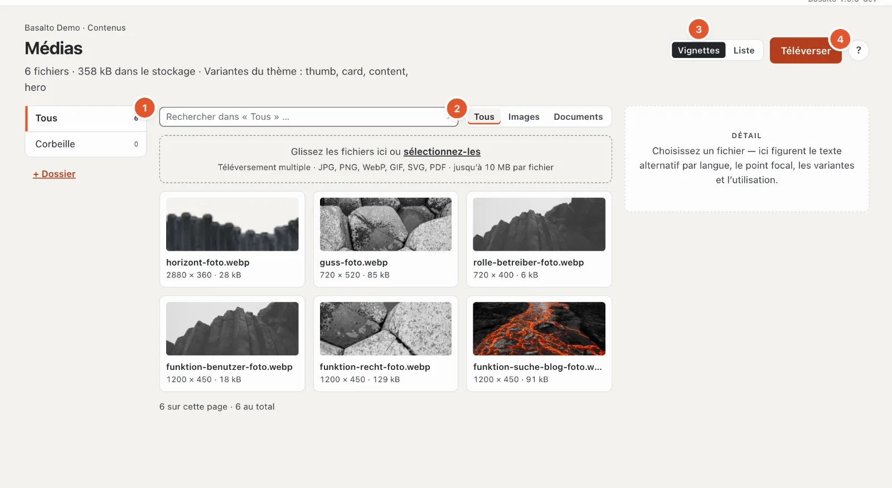
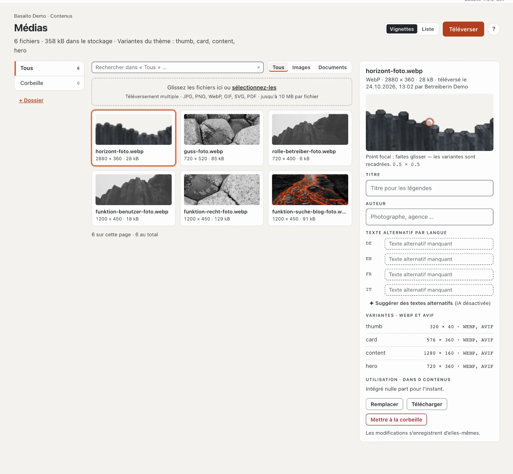
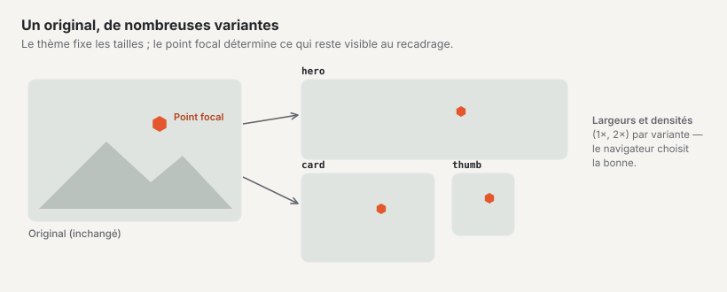
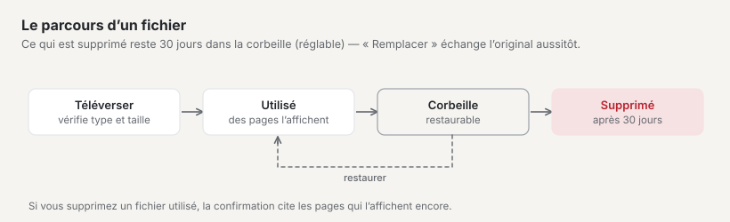

# Médias

La médiathèque contient toutes les images et tous les documents du site. C’est à partir d’ici que vous les intégrez dans les pages et les contenus. Vous téléversez une image une seule fois — Basalto en tire lui-même les tailles adaptées à chaque appareil.

## Où

Mode « Contenus » › **Médias**.

L’en-tête indique le nombre de fichiers, l’espace de stockage occupé et les **variantes du thème** (les tailles que Basalto découpe dans chaque image). À gauche figurent les dossiers (1), au milieu les fichiers, à droite le **détail** du fichier choisi. En haut, vous recherchez et filtrez par type (2 : « Tous », « Images », « Documents ») et basculez l’affichage entre « Vignettes » et « Liste » (3).

- **Recherche :** sur le nom de fichier, le titre et l’auteur — uniquement dans le dossier ouvert (« Rechercher dans ‹Tous› » parcourt tout) ; Entrée la lance.
- **Liste :** colonnes dimensions (pour SVG « Vectoriel »), taille, état (par exemple « Texte alternatif manquant ») et téléversé. L’ordre et le nombre par page proviennent de votre profil.
- **Vide :** « Aucun fichier pour l’instant » (toute la surface est alors une zone de dépôt), « Ce dossier est vide », « Aucun résultat » ou « La corbeille est vide ».

## Téléverser des fichiers

1. Ouvrez à gauche le dossier auquel les fichiers appartiennent (ou « Tous »).
2. Faites glisser les fichiers dans la zone **« Glissez les fichiers ici ou choisissez-les »** — ou cliquez sur **« Téléverser »** (4).
3. Basalto affiche pour chaque fichier l’état — en attente, en cours, terminé ou refusé — et en haut, par exemple, « 2 sur 3 terminés · 1 refusé ». Pour les images apparaît ensuite brièvement « Génération des variantes … ». Tant qu’un téléversement est en cours, un second est bloqué.

Sont autorisés **JPG, PNG, WebP, GIF, SVG et PDF jusqu’à 10 Mo par fichier** ; plusieurs fichiers à la fois sont possibles. Un fichier est refusé avec une raison : type incorrect, trop volumineux ou SVG contenant un script (pour des raisons de sécurité). Si votre site a un **quota de stockage**, la médiathèque avertit à partir de 90 % et signale, lorsque le stockage est plein, « Stockage plein — téléversement bloqué. » Lors d’un remplacement, l’ancien fichier n’est pas compté.

Les rôles disposant de « Médias · modifier » peuvent téléverser et gérer les indications ; les dossiers, le remplacement et la corbeille exigent « Médias · supprimer ».

Les images que vous collez dans l’éditeur depuis Word ou une page web arrivent également ici (voir [Modifier le contenu avec des blocs](bloecke.md)).

## Dossiers

- **« + Dossier »** crée un nouveau dossier — à l’intérieur du dossier ouvert (6 niveaux au plus, noms jusqu’à 120 caractères). Saisir le nom, « Créer ».
- **✎** renomme un dossier, **✕** le supprime — les deux apparaissent lorsque vous survolez le dossier avec la souris. Les fichiers qu’il contient (y compris ceux des sous-dossiers) ne sont pas perdus, ils passent dans « Tous ».
- Vous déplacez un fichier dans le détail avec le champ **« Dossier »**.

## Le détail d’un fichier

Cliquez sur un fichier. À droite, vous voyez le type, les dimensions, la taille, quand et par qui il a été téléversé, ainsi que :

- **Aperçu avec point focal** — faites glisser le point sur l’élément le plus important de l’image (par exemple un visage). Les variantes recadrées sont alors découpées de façon que cette zone reste visible. L’enregistrement se fait au relâchement ; les nombres en dessous (0 à 1 par axe, 0.5 × 0.5 est le centre) indiquent la position. Seules les images matricielles sont redécoupées.
- **Titre** et **auteur** (par exemple une photographe ou une agence).
- **Texte alternatif par langue** (voir ci-dessous).
- **Dossier**.
- **Variantes** — les tailles que Basalto a générées pour le thème, chacune avec largeur × hauteur et formats (par exemple « 576 × 360 · WEBP, AVIF ») ; « en attente » tant qu’elles sont encore en cours de création.
- **Utilisation** — les contenus dans lesquels le fichier est intégré.

Toutes les indications **s’enregistrent d’elles-mêmes** ; un « ✓ enregistré » le confirme. « Télécharger » télécharge l’original.

## Texte alternatif

Le texte alternatif décrit une image pour les personnes qui ne peuvent pas la voir, et pour les moteurs de recherche. Décrivez brièvement ce que l’on voit sur l’image et à quoi elle sert — un texte propre pour chaque langue du site.

**« Suggérer des textes alternatifs »** fait rédiger par l’IA un texte alternatif par langue, si le module « Suggestions IA » est configuré — les suggestions apparaissent immédiatement dans le champ ; vérifiez-les (voir [Suggestions IA](ki.md)). Sinon, la mention « (IA désactivée) » s’affiche.

Si l’**obligation de texte alternatif** est activée dans votre site :

- Dans le détail, la marque « Obligatoire » figure à côté de « Texte alternatif par langue ».
- Dans la vue d’ensemble, les images sans texte alternatif portent l’indication « Texte alternatif manquant » avec les langues concernées.
- Un contenu qui contient une image sans texte alternatif dans sa langue **ne peut pas être publié**. La validation nomme les images concernées.
- Dans l’« Aperçu général », un avis apparaît avec le nombre d’images intégrées sans texte alternatif.

Une administratrice ou un administrateur active l’obligation sous « Administration › Sites », ouvrir le site, onglet « Général », **« Texte alternatif obligatoire »** (voir [Le site](../einrichtung/site.md)). Certains thèmes exigent d’eux-mêmes des textes alternatifs — c’est le cas du thème de départ.

## Variantes d’image

Lors du téléversement, Basalto génère à partir de chaque image les tailles prévues par le thème — par exemple une petite vignette, une image de carte et une grande image de scène — au format moderne WebP, selon le thème aussi en AVIF et en double résolution pour les écrans haute résolution. Le site web livre à chaque appareil la taille adaptée. Vous n’avez rien à faire pour cela ; il n’est pas nécessaire de réduire les images au préalable.

Il n’y a pas de variantes pour les graphiques SVG et les documents PDF.

## Remplacer un fichier

Avec **« Remplacer »** dans le détail, vous téléversez un nouveau fichier à la place de l’ancien — par exemple une photo actualisée ou une nouvelle liste de prix. Toutes les pages qui utilisent le fichier affichent ensuite le nouveau ; vous n’avez rien à réintégrer. Les variantes sont régénérées, et le nom de fichier devient celui du nouveau fichier.

**Attention :** l’ancien original et ses variantes sont alors **supprimés immédiatement** — sans corbeille. Si vous avez encore besoin de l’ancien fichier, téléchargez-le d’abord.

## Corbeille

**« Mettre à la corbeille »** dans le détail met un fichier dans la corbeille. S’il est encore intégré, la question de confirmation nomme les contenus ; vous confirmez avec « Mettre quand même à la corbeille ». S’il n’est intégré nulle part, une brève confirmation suffit. Le détail d’un fichier supprimé indique « Dans la corbeille depuis le … ».

- Le dossier **« Corbeille »** à gauche affiche tous les fichiers supprimés.
- **« Restaurer »** dans le détail récupère un fichier.
- Après **30 jours** dans la corbeille, un nettoyage nocturne supprime définitivement le fichier — original et variantes. Le délai peut être modifié sous « Administration › Paramètres » (groupe « Médias », « Corbeille de la médiathèque »).

Jusqu’à la suppression définitive, les pages qui utilisent encore l’image affichent une variante déjà générée ; ensuite, l’emplacement reste vide. Vérifiez donc l’« Utilisation » avant de supprimer.

## Choisir des images dans l’éditeur

Un champ d’image dans l’éditeur ouvre avec **« Choisir »** la médiathèque sous forme de fenêtre : recherche par nom ou par numéro (#12), dossiers, **« Téléverser »** directement ici (uniquement des images matricielles, dans « Tous »), la marque « Texte alternatif manquant » sur les images sans texte alternatif (elle bloquera plus tard la publication si l’obligation s’applique). Pour les galeries, vous choisissez plusieurs images ; vous en réglez ensuite l’ordre dans le champ.

## Sur le téléphone

Les dossiers figurent en haut sous forme de liste de sélection, le détail s’ouvre comme feuille sur toute la surface, et une barre fixe en bas porte « Téléverser ».

## Questions fréquentes

**Je ne retrouve plus une image.**
Recherchez le nom de fichier en haut de la médiathèque ou dans la recherche de l’en-tête. Choisissez alors « Tous » à gauche pour que tous les dossiers soient parcourus. Regardez aussi dans la « Corbeille ».

**Pourquoi ne puis-je pas publier ma page ?**
Si la validation indique « Texte alternatif manquant », complétez ici, dans la médiathèque, le texte alternatif des images nommées — dans la langue de la page.

**Dois-je réduire les images avant de les téléverser ?**
Non. Téléversez l’image en bonne qualité (jusqu’à 10 Mo) ; Basalto génère lui-même les tailles.

## Pour continuer

- [Modifier le contenu avec des blocs](bloecke.md)
- [Apparence : thèmes, design et variantes d’image](../einrichtung/aussehen.md)
