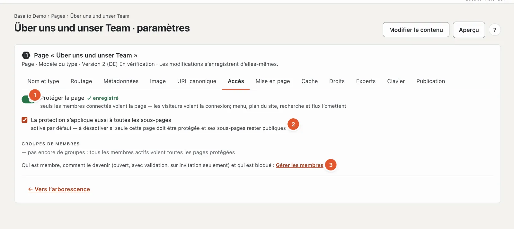
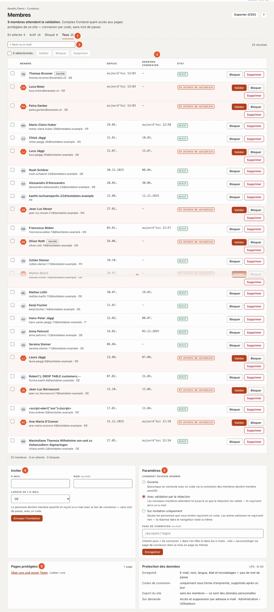

# Membres

Avec le module « Membres », vous rendez des pages visibles uniquement pour les membres connectés — un espace d’association, des documents pour des partenaires, des procès-verbaux. Les membres se connectent **sans mot de passe** : ils saisissent leur adresse e-mail et reçoivent un code par e-mail. Dans le backend, vous voyez tous les membres du site, validez les nouveaux, bloquez et invitez.

## Où

- Mode « Contenus » › **Membres** — la liste, les invitations, les paramètres et les pages protégées d’un coup d’œil. Le nombre sur l’entrée de menu indique combien de membres attendent une validation.
- Dans les paramètres de chaque page, onglet **« Accès »** — c’est là que vous protégez une page.

L’entrée de menu n’apparaît que si le module est activé pour le site (mode « Administration » › « Sites », ouvrir le site, onglet **« Modules »** ; désactivé par défaut — voir [Le site](../einrichtung/site.md#onglet-modules)).

| Rôle | Peut |
| --- | --- |
| Rédacteur | Consulter, valider, bloquer, inviter des membres ; protéger des pages |
| Administrateur, Exploitant | en plus supprimer des adhésions, exporter la liste (CSV) et modifier les paramètres |

## Protéger une page

Ouvrez les paramètres de la page (dans l’arborescence « Paramètres »), onglet **« Accès »**.

1. Activez **« Protéger la page »**. La modification s’enregistre d’elle-même et s’applique immédiatement — y compris à la version déjà publiée.
2. **« La protection s’applique aussi à toutes les sous-pages »** est activé par défaut : tout ce qui se trouve sous cette page est alors également réservé aux membres. Désactivez-le si seule cette page doit être protégée.

Il n’y a pas de groupes de membres : tous les membres actifs voient toutes les pages protégées du site (c’est pourquoi « pas encore de groupes » figure sous « Groupes de membres »). Le lien **« Gérer les membres »** (3) mène à la liste.

Un **dossier** peut aussi être protégé — pratique pour tout un espace membres : toutes les pages du dossier sont protégées.

Si une page se trouve sous une page protégée, l’onglet « Accès » indique en haut « Protégée par « … » ». La page est alors protégée, quel que soit votre réglage sur la page elle-même — la protection ne peut être levée que sur l’ancêtre.

### Ce que voient les invités

- Au lieu du contenu, une page **« Connexion requise »** avec le formulaire de connexion — ni le titre ni le texte de la page protégée. Si le site a une page d’erreur « 401 », son texte apparaît au-dessus.
- Les pages protégées manquent dans le **menu**, de même que dans le **sitemap**, la **recherche**, les **listes** et les **flux**. Les membres les voient dans le menu dès qu’ils sont connectés.
- Les moteurs de recherche reçoivent le statut « 401 » et « noindex » ; rien de tout cela n’arrive dans l’index.

Les pages protégées ne sortent jamais du cache de page. Les membres connectés voient toujours la page fraîche, pour eux seuls.

### Si le module est désactivé

Les pages protégées restent protégées — mais personne ne peut se connecter. Les invités voient seulement « Cette page est réservée aux membres ». La rédaction du site voit toujours les pages protégées lorsqu’elle est connectée au backend (aperçu, modification sur la page).

## Comment devenir membre

Sous « Membres » › **Paramètres**, une administratrice ou un administrateur choisit la règle du site :

| Règle | Ce qui se passe |
| --- | --- |
| **Ouverte** | Qui se connecte avec un code via la connexion des membres est immédiatement membre. |
| **Avec validation par la rédaction** (par défaut) | L’adhésion naît à la première connexion, mais attend que la rédaction la valide. Le membre reçoit alors un e-mail. |
| **Sur invitation uniquement** | Seules les adresses invitées reçoivent un code. Pour les autres adresses, rien n’est envoyé — la réponse dans le navigateur reste la même, afin que personne ne puisse tester qui est membre. |

Avec « Avec validation », la cloche en haut à droite signale les nouvelles demandes (« … souhaite devenir membre » ; plusieurs figurent sur une seule ligne).

La connexion figure sur chaque page protégée et sur la page de connexion du site (`/account/login`). Dans le thème de départ, **« Se connecter »** en haut à droite y mène. Sous **« Page de connexion »**, vous pouvez indiquer à la place votre propre page, sur laquelle votre thème affiche la connexion — un chemin qui commence par « / », 200 caractères au plus. Il vaut aussi pour les liens dans les e-mails. « Enregistrer » reprend la règle et la page de connexion.

### Inviter

Sous « Membres » › **Inviter** : adresse e-mail, si vous le souhaitez nom, langue de l’e-mail — **« Envoyer l’invitation »**. La personne est immédiatement membre et reçoit un e-mail indiquant comment se connecter ; dans la liste, elle porte la marque « invité ».

- Si l’adresse attend déjà une validation, elle devient immédiatement active avec l’invitation.
- Si elle est déjà active, elle reçoit seulement de nouveau l’e-mail.
- Une adresse bloquée ne reçoit pas d’invitation ; validez-la d’abord de nouveau.

## La liste

1. **État** — « En attente », « Actif », « Bloqué », « Tous », chacun avec le nombre. Si des membres attendent, la page s’ouvre directement sur « En attente ».
2. **Recherche** par nom ou e-mail.
3. **Depuis** — quand l’adhésion est née ; **Dernière connexion** — « — » signifie : jamais connecté.
4. **Inviter** et 5. **Paramètres** (règle et page de connexion), voir ci-dessus.
6. **Pages protégées** — toutes les pages protégées du site avec un lien, et l’encadré **Protection des données**.

50 membres figurent par page ; sur le téléphone, sous forme de cartes les unes sous les autres.

Les actions pour chaque membre :

- **« Valider »** — l’adhésion devient active ; qui a attendu reçoit un e-mail. Vous validez ainsi aussi de nouveau les membres bloqués.
- **« Bloquer »** — la personne ne voit plus aucune page protégée, même si elle se reconnecte.
- **« Supprimer »** (Administrateur, Exploitant) — l’adhésion disparaît. Le compte derrière reste, parce qu’il peut porter par exemple des licences ou des entrées sur le Marketplace ; une personne est entièrement supprimée via la protection des données (voir ci-dessous).

Avec les cases à cocher, vous choisissez plusieurs membres à la fois. **« Exporter (CSV) »** en haut à droite télécharge la liste filtrée (e-mail, nom, langue, état, moments) — avec le point-virgule comme séparateur, de sorte qu’Excel l’ouvre directement. Chaque export figure au journal.

## Protection des données

- Sont enregistrés l’e-mail, le nom, la langue, l’état et les moments — **aucun mot de passe**. Les codes de connexion uniquement sous forme de somme de contrôle ; le nettoyage nocturne les supprime après un jour.
- L’administration se charge des **renseignements et de la suppression** par adresse e-mail sous « Administration › Utilisateurs » (ou `php artisan basalto:privacy`) : le renseignement indique le compte et les adhésions ; la suppression retire les adhésions et anonymise le compte.
- L’**export d’un site** (transfert, modèle) n’emporte pas les membres — ce sont des données personnelles. Les pages protégées, elles, sont emportées.

## Pour les auteurs de thèmes

Les tags ``, `` et `` sont décrits dans [Lava — le langage des thèmes](../entwickler/lava.md#balises-des-membres).

## Questions fréquentes

**Un membre ne voit pas la page.**
Vérifiez l’état dans la liste : « En attente de validation » ou « Bloqué » n’ouvrent aucune page protégée. Et : la personne est-elle connectée dans le même site ? Les comptes valent par site.

**Je vois la page protégée alors que je ne suis pas membre.**
Vous êtes connecté au backend — la rédaction du site voit toujours les pages protégées. Déconnectez-vous ou ouvrez une fenêtre privée pour voir la page comme un invité.

**Aucun code n’arrive.**
Vérifiez le dossier des spams. Si le site est réglé sur « Sur invitation uniquement », seules les adresses invitées reçoivent un code.

## Pour continuer

- [Commentaires](kommentare.md)
- [Communauté](../community/README.md)
