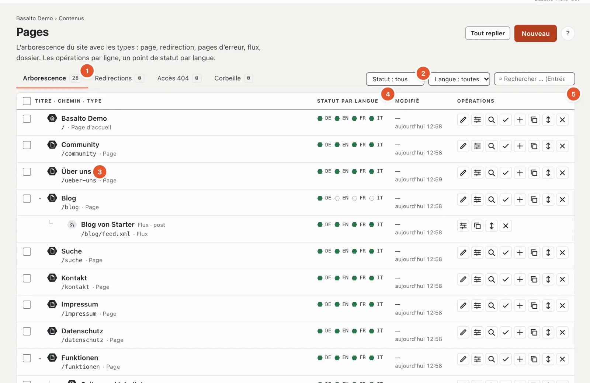
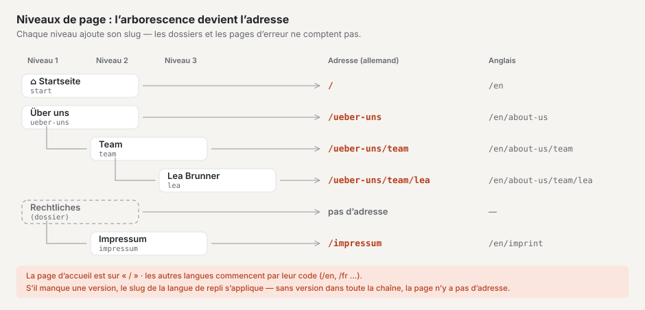
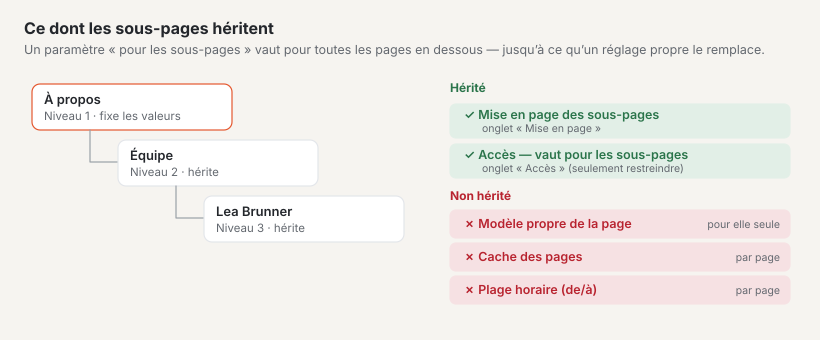
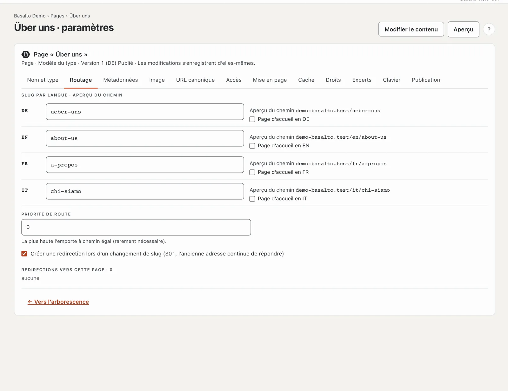
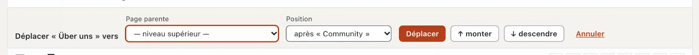

# Pages et arborescence

L’arborescence montre toutes les pages du site web dans leur ordre : en haut les pages principales, en retrait en dessous les
sous-pages. De l’arborescence découlent les **adresses** des pages, les **menus** et le **fil d’Ariane** (« Accueil › À propos
› Équipe »). L’emplacement d’une page dans l’arborescence est donc plus qu’une question d’ordre — il détermine comment les visiteurs la trouvent.

## Où

Mode « Contenus » › **Pages**. La page comporte quatre onglets : « Arborescence », « Redirections », « Accès 404 » et « Corbeille » ; le nombre
à côté indique combien d’entrées il y a.

## L’arborescence

Chaque ligne affiche le **titre**, le **chemin** et le **type** (3), à côté, pour chaque langue, un **point de statut** (4) et à droite les
**opérations** (5). La légende sous l’arborescence explique les points :

| Point | Signification |
| --- | --- |
| vert plein | Publié — les visiteurs voient cette version |
| contour vert | Validé ou planifié — attend la publication |
| contour rouge | En vérification — soumis, attend la validation |
| gris | Brouillon |
| en pointillés | manquant — il n’existe pas encore de version dans cette langue |
| marque « obsolète » | la traduction repose sur une version plus ancienne de la langue par défaut (voir [Traduire](uebersetzen.md)) |

Sous le titre figurent, selon la situation, des indications : « non publié », « Dossier · structure uniquement », « Flux · type » ou, pour une
redirection, « → cible ». La **page d’accueil** porte un symbole de maison.

| Bouton (depuis la gauche) | Ce qu’il fait |
| --- | --- |
| ✎ Modifier le contenu | ouvre l’éditeur de blocs de la page (voir [Modifier le contenu avec des blocs](bloecke.md)) |
| ☰ Paramètres | ouvre le nom, l’adresse, les métadonnées et les autres onglets |
| ⌕ Aperçu | montre la version la plus récente telle qu’elle apparaîtra |
| ✓ Validation | ouvre la validation de cette page (voir [Validation et publication](freigabe.md)) |
| ＋ Sous-page | crée une nouvelle page **sous** celle-ci |
| ⧉ Copier | crée une copie juste après |
| ↕ Déplacer | ouvre la ligne de déplacement (page parente et position) |
| ✕ Supprimer | met la page et ses sous-pages dans la corbeille |

Les dossiers, les flux et les pages d’erreur ont moins de boutons — ils n’ont pas de contenu fait de blocs.

**Filtrer** (2) : par statut et par langue, l’effet est immédiat ; la recherche (sur les titres de toutes les langues et le chemin) se lance avec Entrée.
Les pages parentes d’un résultat restent visibles en pâle, pour que vous voyiez où il se trouve ; le filtre de statut masque les dossiers.
« Réinitialiser le filtre » affiche de nouveau tout. Avec « Tout replier » ou « Tout déplier », vous repliez ou dépliez les sous-pages ;
la flèche devant une ligne ne replie que ses sous-pages.

## Niveaux de page : comment l’arborescence devient l’adresse

Chaque page se trouve à un **niveau** : les pages sans page parente au niveau 1 (« — niveau supérieur — »), leurs sous-pages au
niveau 2, les sous-pages de celles-ci au niveau 3 — aussi profond que vous le souhaitez ; il n’y a pas de limite. Dans l’arborescence, chaque niveau est
un peu plus en retrait et rattaché à la page parente par « └ ».

L’**adresse** (le chemin) d’une page se compose des slugs de toutes les pages parentes et de son propre slug, séparés par
« / ». Le slug est la partie de l’adresse que vous saisissez par langue dans l’onglet « Routage ».

- Seuls les **pages, redirections et flux** contribuent à l’adresse. Les **dossiers** et les **pages d’erreur** sont
  ignorés : les mentions légales dans le dossier « Juridique » se trouvent sous `/impressum`, et non sous `/rechtliches/impressum`.
- La **page d’accueil** se trouve sur `/` ; ses sous-pages s’y rattachent directement (`/kontakt`, et non `/start/kontakt`).
- Les **autres langues** commencent par leur code : `/en/about-us/team`. Chaque langue a ses propres slugs.
- **S’il manque une version** dans une langue, c’est le slug de la langue de repli qui s’applique (voir [Traduire](uebersetzen.md#langue-de-repli)) ;
  s’il n’existe aucune version dans toute la chaîne, la page n’a pas d’adresse dans cette langue — l’aperçu du chemin indique alors
  « Le chemin … n’est pas encore connu ».

À quoi servent les niveaux :

- **Des adresses parlantes :** `/leistungen/laravel` indique aux visiteurs et aux moteurs de recherche où ils se trouvent.
- Les **menus** découlent de l’arborescence (voir ci-dessous), le **fil d’Ariane** aussi.
- Les **paramètres se transmettent** vers le bas (voir [Ce dont héritent les sous-pages](#ce-dont-héritent-les-sous-pages)).

Pour créer une page un niveau plus bas, cliquez sur **« ＋ Sous-page »** dans la ligne de la future page parente
ou choisissez la **page parente** lors de la création. Vous amenez une page existante à un autre niveau avec **« Déplacer »**.
Si l’adresse change de ce fait, Basalto redirige automatiquement l’ancienne adresse.

### La page d’accueil

Il y a exactement une page d’accueil par langue. Vous la définissez dans l’onglet « Routage » avec « Page d’accueil en DE » (ou EN …) ;
une nouvelle page d’accueil remplace l’ancienne. Si aucune n’est choisie, c’est la page d’accueil de la langue par défaut qui s’applique dans une autre langue,
sinon la première page du niveau supérieur.

### Ce dont héritent les sous-pages

- **« Mise en page des sous-pages »** (onglet « Mise en page ») s’applique à toutes les pages en dessous, jusqu’à ce qu’une page choisisse elle-même
  autre chose.
- **Accès :** si vous protégez une page avec « s’applique aux sous-pages », toutes les pages en dessous sont aussi protégées ; une
  sous-page ne peut pas lever la protection (voir [Membres](mitglieder.md)).
- Ne sont **pas** transmis le modèle propre d’une page, son cache de page et sa plage horaire.

### Menus et fil d’Ariane

Les niveaux qu’affiche un menu sont définis par le thème : à partir de quel niveau (niveau de départ) et sur combien de niveaux (le plus souvent un).
Seules les pages que les visiteurs peuvent voir apparaissent dans le menu. Ne figurent pas dans le menu :

- les dossiers — leurs sous-pages prennent leur place,
- les pages d’erreur et les flux,
- les pages hors de leur plage horaire et les pages protégées pour les invités,
- les pages avec « Masquer dans le menu (reste accessible) » (onglet « Experts ») — **avec leurs sous-pages**.

Une redirection dans le menu mène directement à sa cible. Le **fil d’Ariane** commence par la page d’accueil, ignore
les dossiers et n’apparaît qu’à partir de deux entrées.

## Créer une page

1. Cliquez en haut à droite sur **« Nouveau »** — ou sur « ＋ Sous-page » dans la ligne de la future page parente.
2. Choisissez le **type**. Il détermine quels onglets existent et ne peut plus être modifié ensuite :
   - **Page** — une page normale avec un contenu fait de blocs (12 onglets).
   - **Redirection** — redirige vers une autre page du site (« interne ») ou vers une adresse extérieure (« externe »)
     (4 onglets). Pour une redirection externe, chaque langue supplémentaire peut avoir sa propre adresse, par exemple
     la version anglaise d’un site partenaire ; un champ vide signifie « comme la langue principale ».
   - **Page d’erreur 401, 403, 404, 503** — la page que les visiteurs voient pour ce code d’erreur — par exemple 404 lorsqu’une
     adresse est introuvable (5 onglets).
   - **Flux** — une liste des entrées les plus récentes d’un type de contenu au format RSS 2.0 ou Atom 1.0 (6 onglets).
   - **Dossier** — structure l’arborescence, n’a lui-même ni adresse ni contenu (3 onglets : nom, accès, droits).
3. Dans l’onglet « Nom et type », saisissez le **nom par langue** (200 caractères au plus) et choisissez la
   **page parente**. Le nom apparaît dans l’arborescence et dans les menus.
4. Cliquez sur **« Enregistrer »** (ou « Enregistrer et nouveau » pour la page suivante, « Enregistrer et fermer » pour revenir
   à l’arborescence).

L’enregistrement crée la première version — comme brouillon dans chaque langue pour laquelle vous avez saisi un nom.
Vous rédigez ensuite le contenu proprement dit via « ✎ Modifier le contenu » dans l’éditeur de blocs. Si quelque chose ne va pas, le haut de la page indique
« N indications sont incorrectes » avec la liste des onglets concernés ; un clic y mène.

Lors de la modification ultérieure des paramètres, il n’y a plus de bouton d’enregistrement : **les modifications s’enregistrent d’elles-mêmes.**
Une coche « ✓ enregistré » le confirme.

### Règles pour le slug

- Sont autorisés les minuscules a–z, les chiffres et « - » (pas au début), 200 caractères au plus ; pour les flux et les sitemaps,
  il peut se terminer par `.xml`.
- Si vous le laissez vide, Basalto le forme à partir du nom (« Über uns » → `ueber-uns`).
- Si l’adresse est déjà prise dans cette langue, Basalto en propose une libre (« …-2 »).

## Les onglets des paramètres

| Onglet | Contenu |
| --- | --- |
| Nom et type | Nom par langue, page parente ; pour une redirection et un flux, leur cible ou leur source |
| Routage | Slug par langue avec **aperçu du chemin**, page d’accueil par langue, priorité de route, redirection lors d’un changement de slug, redirections vers cette page |
| Métadonnées | Titre de la page (70 caractères au plus) et description (160) par langue avec aperçu du résultat de recherche, robots |
| Image | Image de la page pour le partage sur les réseaux sociaux et pour les listes, avec point focal et texte alternatif |
| URL canonique | automatique ou une adresse propre |
| Accès | Protéger la page — uniquement pour les membres connectés, si vous le souhaitez avec les sous-pages (module « Membres », voir [Membres](mitglieder.md)) |
| Mise en page | Modèle de la page (issu du type ou un modèle propre) et « Mise en page des sous-pages » |
| Cache | Cache de page activé ou désactivé pour cette page, durée dans le navigateur et dans les caches intermédiaires (0 à 31 536 000 secondes) |
| Droits | personne responsable et rôles de la page — ce sont toujours les rôles du site qui font foi pour les autorisations |
| Experts | Visibilité dans le sitemap HTML, l’index de recherche et le menu ; classe CSS |
| Clavier | un caractère (a–z ou 0–9, unique par site) : les visiteurs sautent à la page avec Alt ou Ctrl+Alt + caractère |
| Publication | Statut de la version par langue ; plage horaire « Afficher à partir du » et « Afficher jusqu’au » (format AAAA-MM-JJ HH:MM) |

**Priorité de route :** si deux contenus mènent à la même adresse — par exemple une page et un contenu avec sa propre
route —, celui qui a le nombre le plus élevé l’emporte ; en cas d’égalité, le premier dans l’arborescence. Rarement nécessaire.

**Plage horaire :** hors de la plage horaire, la page répond par « introuvable » et manque dans les menus, le sitemap et
la recherche — la version reste toutefois publiée.

## Déplacer

- **Glisser :** saisissez une ligne n’importe où et faites-la glisser au nouvel emplacement. L’endroit où vous relâchez est décisif :
  dans le **tiers supérieur** d’une ligne, la page se place **avant**, dans le **tiers inférieur** **après**, au **milieu**,
  elle devient **sous-page** de cette ligne (seulement pour les pages et les dossiers).
- **Avec « ↕ Déplacer » :** la ligne s’ouvre. Choisissez la nouvelle **page parente** et la **position** (« au début »
  ou « après … ») et confirmez avec « Déplacer ». Pour les petits pas, il y a « ↑ monter » et « ↓ descendre » ;
  « Annuler » ferme la ligne.

Il n’est pas possible de placer une page sous elle-même ou sous l’une de ses sous-pages, sous une redirection, un
flux ou une page d’erreur (les pages parentes ne peuvent être que des pages et des dossiers) — ni sans droit sur la langue par défaut.

Si l’adresse d’une page change de ce fait, Basalto crée automatiquement une **redirection** de l’ancienne vers la nouvelle
adresse — aussi pour toutes les sous-pages. Il en va de même lorsqu’une page est publiée avec un nouveau slug.
Vous pouvez le désactiver par page dans l’onglet « Routage » (« Créer une redirection lors d’un changement de slug »).

## Copier

« ⧉ Copier » demande « Créer une copie ? ». Avec « Oui », une page du même type avec les mêmes
paramètres est créée juste sous l’original. Le titre reçoit le suffixe « (copie) », le slug se termine par « -kopie » et chaque langue commence comme
brouillon. **Les sous-pages ne sont pas copiées.**

## Supprimer et corbeille

« ✕ Supprimer » demande confirmation et met la page **avec toutes ses sous-pages** dans la corbeille. Sur le site web, elles ne sont ensuite
plus accessibles.

Dans l’onglet **« Corbeille »** figure chaque page supprimée avec son type, sa date de suppression et — si elle avait des sous-pages — « avec N
sous-pages ». **« Restaurer »** remet la page avec ces sous-pages à son ancienne place dans l’arborescence. Une
sous-page que vous aviez déjà supprimée individuellement auparavant reste dans la corbeille jusqu’à ce que vous la restauriez vous-même.

## Plusieurs pages à la fois

Cochez les cases devant les lignes souhaitées (uniquement les lignes de type « Page », 500 au plus ; la case de l’en-tête les sélectionne
toutes). L’action groupée apparaît en haut :

- **« Soumettre pour validation »** — envoie tous les brouillons des pages choisies en validation (seulement si tous les champs obligatoires
  sont remplis).
- **« Publier »** — publie les versions déjà validées ou planifiées. Si votre rôle ne le permet pas,
  le backend vous le signale.
- **« Supprimer »** — met les pages dans la corbeille.
- « Annuler la sélection » retire toutes les coches.

Ce qui n’a pas été possible est indiqué ensuite dans le message avec le titre (les cinq premiers).

## Redirections

L’onglet **« Redirections »** liste les redirections depuis d’anciennes adresses (les 500 plus récentes). La colonne « Origine »
indique comment elles sont nées : « automatique » (lors d’un déplacement ou d’un changement de slug), « à la main » ou « Import ».

**Créer une redirection à la main :**

1. Sous **« Ancienne adresse »**, saisissez le chemin, par exemple « /alte-seite ».
2. Sous **« Cible »**, saisissez la nouvelle adresse (« /neue-seite » ou une adresse complète avec https://).
3. Choisissez le statut : **301 permanente**, **302 temporaire** ou **410 supprimée** (sans cible — l’adresse signale
   alors « n’existe plus »).
4. Cliquez sur **« Créer »**. S’il existe déjà une redirection pour l’ancienne adresse, elle est remplacée.

Vous reprenez de nombreuses redirections à la fois avec **« Importer un CSV … »** : par ligne « ancienne adresse; cible; statut »
(point-virgule, virgule ou tabulation ; un statut vide signifie 301), 2 Mo et 5000 lignes au plus. Les lignes erronées sont indiquées
ensuite dans le message (les 50 premières). Basalto résout lui-même les chaînes (A → B → C) : A mène directement à C.

Vous modifiez les redirections existantes directement dans la ligne avec « Modifier » : Entrée ou la sortie du champ enregistre, Échap
annule. « Retirer » supprime la redirection — l’ancienne adresse répond ensuite par « introuvable ». La colonne
« Accès » indique combien de fois une redirection a déjà servi.

## Accès 404

L’onglet **« Accès 404 »** montre les adresses que des visiteurs ont appelées mais qui n’existent pas — les plus fréquentes
d’abord (jusqu’à 200), avec le nombre, le premier et le dernier accès et la page d’où ils venaient.

- **« Créer une redirection »** — saisissez la cible ; la ligne est ainsi réglée.
- **« Écarter »** — retire la ligne. Si l’adresse est de nouveau appelée, elle est recomptée.

Les adresses sans nouvel accès sont supprimées par un nettoyage nocturne après 90 jours (le délai peut être modifié sous « Administration ›
Paramètres », groupe « Conservation »). S’il y a des accès 404 ouverts, une tâche correspondante apparaît dans l’« Aperçu général ».

## Questions fréquentes

**Je ne trouve pas le slug dans l’éditeur.**
Le slug, les métadonnées et la visibilité d’une page se trouvent dans les paramètres (« ☰ Paramètres », onglets « Routage » et
« Métadonnées »), et non dans l’éditeur de blocs.

**Puis-je changer le type d’une page ?**
Non, le type reste fixé après la création. Créez une nouvelle page avec le type souhaité et déplacez les
sous-pages.

**J’ai déplacé une page — les anciens liens sont-ils cassés ?**
Non. La redirection automatique mène les visiteurs et les moteurs de recherche à la nouvelle adresse. Vous la voyez dans l’onglet
« Redirections ».

**Pourquoi ma page ne figure-t-elle pas dans le menu ?**
Vérifiez : se trouve-t-elle à un niveau qu’affiche le menu du thème ? « Masquer dans le menu (reste accessible) » est-il coché — pour elle ou
pour une page parente ? Est-elle publiée et dans sa plage horaire ? Est-elle protégée et regardez-vous en tant qu’invité ?

**Pourquoi des dossiers plutôt que des pages ?**
Un dossier regroupe des pages dans l’arborescence sans allonger l’adresse — idéal pour « Juridique » avec les mentions légales et
la protection des données, qui doivent malgré tout se trouver sous `/impressum` et `/datenschutz`.

## Pour continuer

- [Modifier le contenu avec des blocs](bloecke.md)
- [Validation et publication](freigabe.md)
- [Menus](../einrichtung/menues.md)
