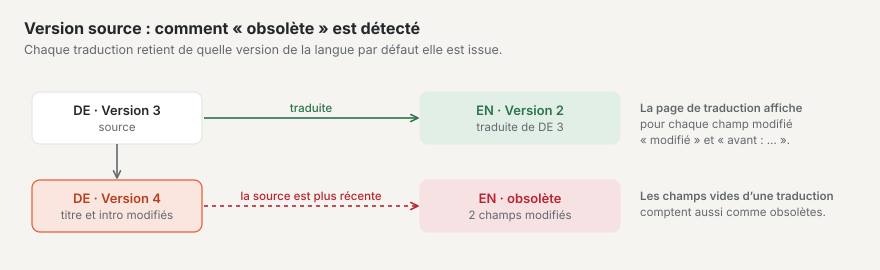
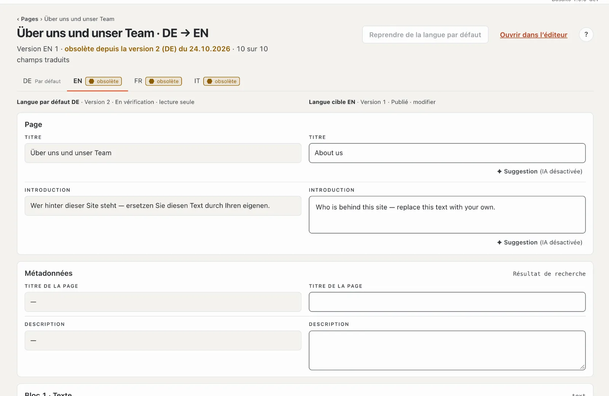
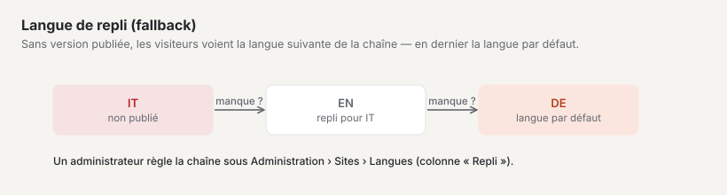
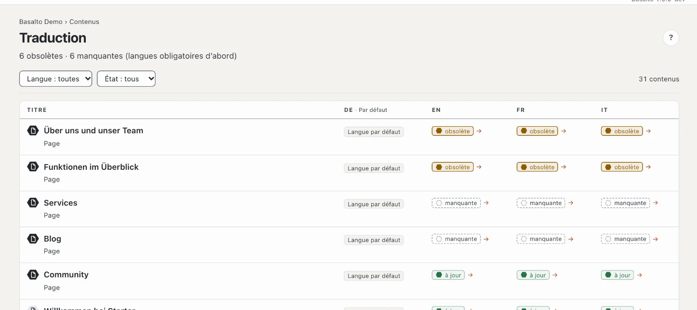

# Traduire

Si votre site a plusieurs langues, chaque traduction est issue de la **langue par défaut**. Basalto mémorise sur quelle version de la langue par défaut repose une traduction et vous signale si quelque chose y a changé depuis.

## Où

- Mode « Contenus » › **Traduction** — la liste de tous les contenus dont les traductions manquent ou sont obsolètes.
- Dans l’éditeur d’un contenu dans une autre langue que la langue par défaut : **« Traduire côte à côte »**.

## Ce qui est traduit

Sont traduits les textes : titre, introduction, titre de la page et description, ainsi que les champs de texte et de texte courant que le thème marque comme traduisibles.

Tout le reste — par exemple les images, les nombres ou les champs de sélection — est **partagé** : cela vaut pour toutes les langues et n’est géré que dans la langue par défaut. Ces champs portent la marque « partagé ».

## L’état d’une traduction

| État | Signification |
| --- | --- |
| **à jour** | la traduction correspond à la version la plus récente de la langue par défaut, et tous les champs traduisibles sont remplis |
| **obsolète** | un champ traduisible de la langue par défaut a changé depuis la traduction — ou des champs sont vides dans la traduction alors qu’ils contiennent du texte dans la langue par défaut |
| **manquante** | il n’existe pas encore de version dans cette langue |

Une nouvelle image à elle seule ne rend pas une traduction obsolète — seul un texte modifié le fait.

## Créer une traduction

1. Ouvrez la traduction — via la liste « Traduction » (un clic sur l’état de la langue dans la ligne) ou dans l’éditeur via « Traduire côte à côte ».
2. S’il n’existe pas encore de version dans la langue cible, cliquez sur **« Créer la traduction depuis … »**. Basalto crée un brouillon qui repose sur la version actuelle de la langue par défaut. Sans droit sur cette langue ou sans version de la langue par défaut, le bouton est verrouillé.
3. Traduisez champ par champ : **à gauche** le texte de la langue par défaut (en lecture seule), **à droite** votre champ dans la langue cible. Les en-têtes de colonne indiquent la langue, la version, le statut et « lecture seule » ou « modifier ». Les champs sont structurés en sections : page (titre, introduction), métadonnées (titre de la page, description) et une section par bloc. En dessous de 1024 px de large, la source et la cible figurent l’une sous l’autre.
4. L’enregistrement est automatique une bonne seconde après la dernière saisie, dès que le titre est traduit. Un « ✓ enregistré » sur le champ le confirme. Les champs de texte contiennent 300 caractères au plus, les zones de texte 5000 ; si quelque chose ne va pas, le haut de la page indique « N champs sont incorrects ». Basalto vérifie à l’enregistrement si vous pouvez modifier la langue.

Un champ cible vide a une bordure en pointillés et l’indication « Traduction manquante … ».

Utile :

- **« → reprendre »** sur un champ vide copie le texte de la langue par défaut dans votre champ — pratique pour les noms ou les termes techniques qui restent identiques.
- **« Reprendre de la langue par défaut »** en haut remplit tous les champs encore vides avec le texte de la langue par défaut.
- **« Suggestion »** sur un champ fait traduire par l’IA, si le module « Suggestions IA » est configuré (voir [Suggestions IA](ki.md)) ; sinon, la mention « (IA désactivée) » s’affiche.
- Le compteur « … sur … champs traduits » montre où vous en êtes ; les champs vides dans la langue par défaut ne sont pas comptés.

## Mettre à jour une traduction obsolète

Si une traduction est obsolète, la page de traduction indique en haut « obsolète depuis la version … du … ». Les champs modifiés portent la marque **« modifié »** et affichent sous « avant : » l’ancien texte de la langue par défaut. Vous voyez ainsi exactement ce qui est nouveau et n’adaptez que ces passages.

## Soumettre et valider

Chaque langue a ses propres versions et passe la validation séparément. Lorsque la traduction est terminée, soumettez-la — via « Ouvrir dans l’éditeur », puis « Soumettre pour validation ». Si la version de la langue cible est déjà soumise ou publiée, l’enregistrement crée un nouveau brouillon ; la version en ligne reste en ligne. Plus de détails sous [Validation et publication](freigabe.md).

## Langues obligatoires

Une **langue obligatoire** doit être présente avant qu’un contenu puisse être validé. La langue par défaut est toujours obligatoire. S’il manque une langue obligatoire, la validation est verrouillée avec l’indication « Validation seulement avec toutes les langues obligatoires — il manque : … ». Une langue est considérée comme présente dès qu’elle est au moins soumise.

Dans les onglets de langue en haut, les langues obligatoires portent la mention « Obligatoire ». Les traductions manquantes ou obsolètes dans les langues obligatoires apparaissent en outre comme tâches dans l’« Aperçu général ».

## Langue de repli

S’il manque la version publiée dans une langue, les visiteuses et visiteurs voient la version de la **langue de repli** — et si elle n’existe pas non plus, la suivante dans la chaîne jusqu’à la langue par défaut. La page de traduction le signale (« les visiteurs voient la langue de repli … »).

Une administratrice ou un administrateur définit quelles langues sont obligatoires et quelle langue de repli s’applique : « Administration › Sites », ouvrir le site, onglet **« Langues »** (colonnes « Par défaut », « Obligatoire » et « Repli »).

## La vue « Traduction »

En haut figure « N obsolètes · N manquantes ». La liste montre pour chaque contenu (pages et contenus, jusqu’à 500) l’état dans chaque langue : d’abord les contenus avec des lacunes dans les **langues obligatoires**, puis ceux avec des lacunes dans d’autres langues, puis le reste — à chaque niveau, les derniers modifiés d’abord. L’en-tête de chaque colonne indique « Par défaut » ou « Obligatoire » ; un hexagone devant le titre distingue page et contenu. Filtrez par **langue** (la langue par défaut ne peut pas être choisie) et par **état** (« obsolète » ou « manquante ») ; « Réinitialiser le filtre » affiche de nouveau tout. Un clic sur l’état d’une langue ouvre la traduction. Lorsque tout est fait, vous lisez « Tout est traduit », et pour un filtre sans résultat « Aucun résultat ».

Le nombre à côté de « Traduction » dans le menu indique ce qui reste à faire.

## Questions fréquentes

**Puis-je aussi traduire directement dans l’éditeur normal ?**
Oui. Dans l’éditeur de la langue cible, « Créer la traduction depuis … » crée un brouillon avec les blocs de la langue par défaut, que vous écrasez ensuite. La vue « Traduire côte à côte » est toutefois plus claire, car le texte de départ figure directement au-dessus de votre champ.

**Je ne peux pas modifier un champ.**
Si la mention « S’applique à toutes les langues — géré dans la langue par défaut » apparaît, le champ est partagé. Modifiez-le dans l’éditeur de la langue par défaut. Si l’en-tête de colonne indique « lecture seule », votre rôle ne permet pas cette langue (les rôles peuvent être limités à certaines langues).

**Pourquoi ma traduction est-elle « obsolète » alors que je n’ai rien modifié ?**
Quelqu’un a modifié un texte traduisible dans la langue par défaut — la marque « modifié » vous montre quel champ. Ou bien un champ est vide dans votre traduction alors qu’il contient du texte dans la langue par défaut.

## Pour continuer

- [Validation et publication](freigabe.md)
- [Le site](../einrichtung/site.md)
