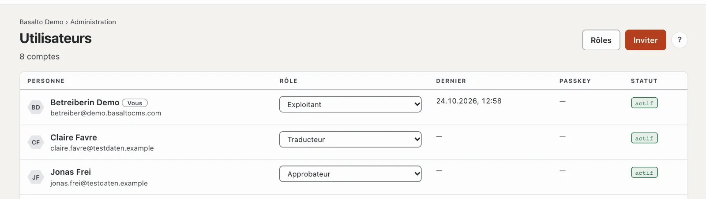
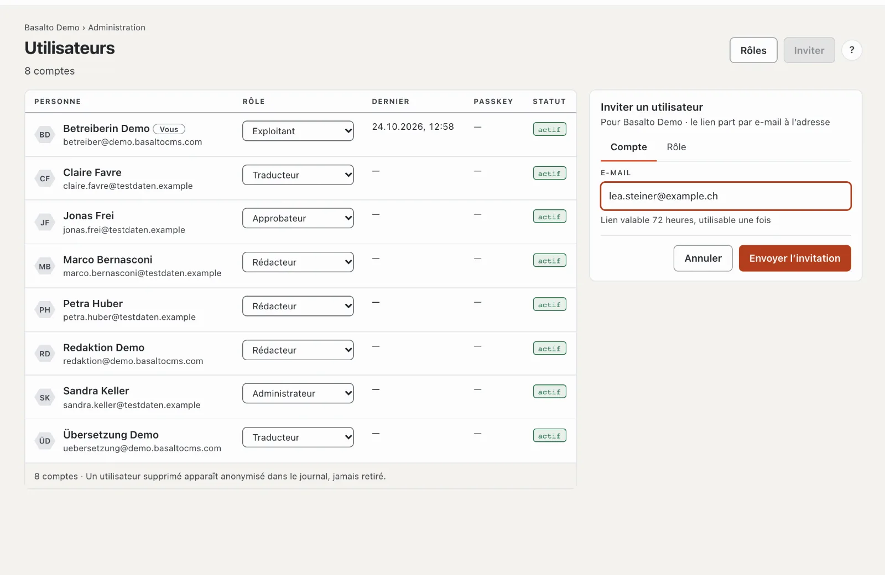
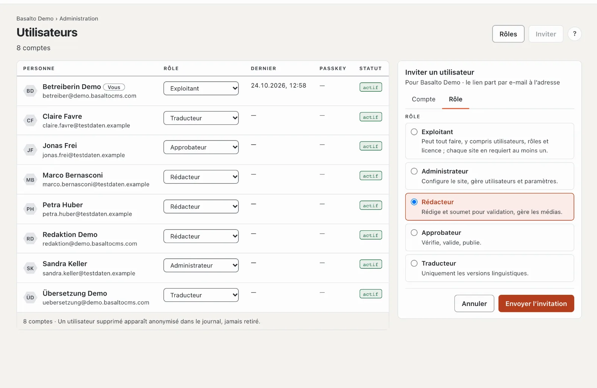
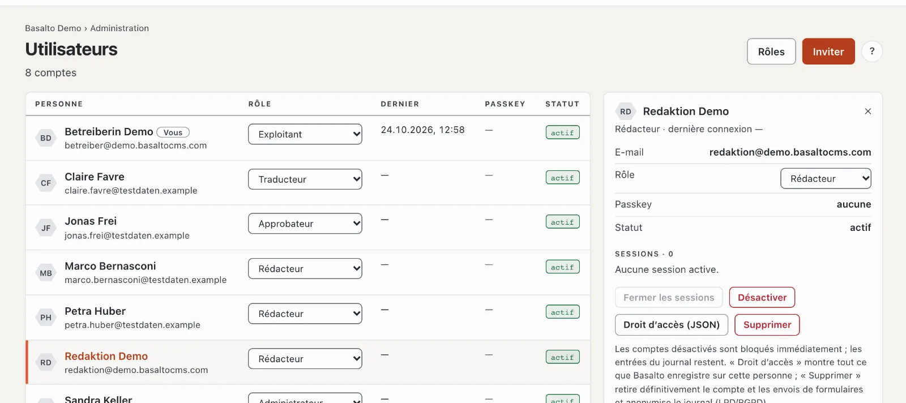

# Utilisateurs

Sous **Utilisateurs**, vous voyez toutes les personnes qui ont accès au site actuel, vous en invitez de nouvelles et vous attribuez des rôles. C’est ici que vous désactivez des comptes, fermez des sessions et répondez aux demandes d’accès et de suppression.

## Où

Mode « Administration » › **Utilisateurs**.

Une ligne par personne avec le nom et l’e-mail (« Vous » marque votre propre compte), le **Rôle** dans ce site, **Dernier** (dernière connexion), **Passkey** (combien) et le **Statut** (« actif », « désactivé », « invité »). Un clic sur une ligne ouvre la fiche de la personne à droite. En haut, **« Rôles »** mène à la [matrice des rôles](rollen.md).

## Inviter quelqu’un

1. **« Inviter »** ouvre à droite la fiche « Inviter un utilisateur » pour le site actuel.
2. Onglet **Compte** : l’**adresse e-mail**. Le lien de l’invitation est **valable 72 heures et utilisable une seule fois** (vous réglez ce délai sous [Paramètres](einstellungen.md), groupe « Connexion »).
3. Onglet **Rôle** : choisir le rôle — chacun avec une phrase qui dit ce qu’il permet.
4. **« Envoyer l’invitation »**.

La personne ouvre le lien et se trouve ainsi connectée ; à l’avenir, elle se connecte avec un code par e-mail ou une passkey. D’ici là, elle figure dans la liste avec « invité », avec « valable jusqu’au … » et « invité par … ». Une nouvelle invitation à la même adresse remplace celle qui est en attente.

Pour une invitation en attente :

- **« Renvoyer »** — un nouveau lien, le délai recommence.
- **« Retirer »** — après la question « Retirer ? » et « Oui », le lien n’est plus valable.
- Si le délai est écoulé, la liste indique « invité · expiré ». Renvoyez l’invitation.

Si l’adresse appartient déjà à ce site, Basalto refuse l’invitation — vous modifiez alors le rôle dans la liste. Si la personne a un compte dans un autre site, l’invitation lui donne en plus un rôle dans celui-ci.

## Modifier le rôle

Choisissez un autre rôle dans la colonne **Rôle** — la modification s’applique immédiatement et figure dans le journal. Deux règles s’appliquent :

- **Ne pas offrir de droits :** vous n’attribuez que des rôles qui n’ont pas plus de droits que vous. Seul un exploitant attribue le rôle « Exploitant ».
- **Au moins un exploitant :** personne ne peut rétrograder le dernier exploitant d’un site.

## La fiche de la personne

La fiche montre l’e-mail, le rôle, les passkeys, le statut et les **Sessions** (où la personne est actuellement connectée). En dessous :

- **« Fermer les sessions »** — déconnecte la personne partout, par exemple après la perte d’un appareil.
- **« Désactiver »** — bloque le compte : toutes les sessions se terminent immédiatement, la connexion n’est plus possible. Après la question « … désactiver ? », confirmez avec « Oui, désactiver ». **« Activer »** annule le blocage. Les entrées du journal restent. Votre propre compte ne peut pas être désactivé ; vous fermez vos propres sessions dans le profil.
- **« Droit d’accès (JSON) »** — tout ce que Basalto enregistre sur cette personne, sous forme de fichier : pour une demande selon la LPD/le RGPD.
- **« Supprimer »** — supprime **définitivement** le compte et les envois de formulaires avec cette adresse e-mail ; aucun nom ne reste dans le journal, les entrées apparaissent anonymisées. Cette action est irréversible.

L’**adresse e-mail** d’une personne ne peut pas être modifiée dans le backend pour l’instant ; en cas de changement, créez un nouveau compte et supprimez l’ancien.

## Questions fréquentes

**L’invitation n’arrive pas.**
Vérifiez le dossier de spam et si l’installation peut envoyer des e-mails (voir [Exploitation](betrieb.md)). « Renvoyer » envoie un nouveau lien.

**Je ne peux pas donner le rôle « Administrateur » à une personne.**
Votre propre rôle a moins de droits qu’un administrateur — on n’attribue pas des droits que l’on n’a pas soi-même.

**Désactiver ou supprimer ?**
Désactivez tant que la personne reviendra peut-être ou que ses traces doivent rester compréhensibles. Ne supprimez que sur demande selon la LPD/le RGPD — c’est définitif.

## Pour continuer

- [Rôles](rollen.md)
- [Journal](protokoll.md)
