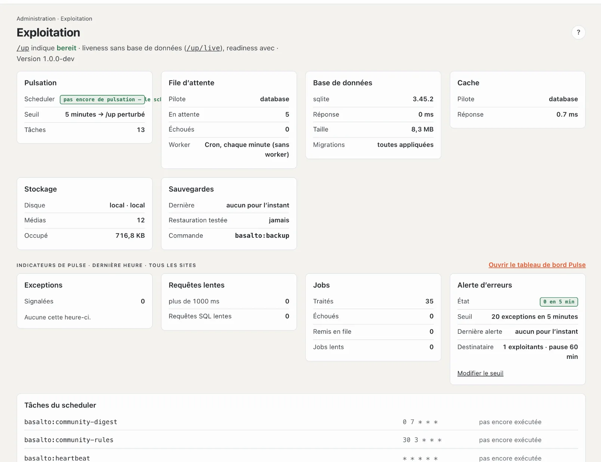

# Exploitation

**Exploitation** montre d’un coup d’œil si l’installation est en bonne santé : le planificateur tourne-t-il, la file d’attente travaille-t-elle, la base de données répond-elle, existe-t-il des sauvegardes, les erreurs s’accumulent-elles ? Rouge signifie : quelque chose ne va pas ici — c’est alors en général l’affaire de la technique.

## Où

Mode « Administration » › **Exploitation**.

En haut figure ce que signale l’adresse de statut `/up` : **« prêt »** signifie que le site fonctionne et que tous les services répondent ; **« perturbé »** signifie qu’il manque quelque chose (par exemple la pulsation). La surveillance externe interroge précisément cette adresse. S’y ajoute la version de Basalto.

## Les fiches

| Fiche | Ce qu’elle montre | Rouge signifie | Que faire |
| --- | --- | --- | --- |
| **Pulsation** | si le planificateur (scheduler) tourne, le seuil et le nombre de tâches qu’il a | pas de pulsation depuis le seuil — les publications planifiées, la purge et les sauvegardes ne s’exécutent pas | technique : vérifier le scheduler (cron, chaque minute) |
| **File d’attente** | pilote, jobs en attente et en échec, manière dont ils sont traités | au moins un job a échoué | voir ci-dessous |
| **Base de données** | type, version, temps de réponse, taille et si toutes les migrations sont appliquées | pas de connexion ou migrations en attente | technique : après une mise à jour, `php artisan migrate` |
| **Cache** | pilote et temps de réponse | pas de réponse | technique |
| **Stockage** | emplacement des médias, nombre et place occupée | stockage inaccessible | technique |
| **Sauvegardes** | dernière sauvegarde, date du dernier essai de restauration | aucune sauvegarde | « Sauvegarder maintenant » ou technique |

Avec l’abonnement s’ajoute la fiche **Domaines clients** : l’état des domaines propres.

### Jobs en échec

Les jobs sont des travaux en arrière-plan — découper les variantes d’image, envoyer des e-mails, préchauffer des pages. Si l’un échoue, il figure dans la fiche « File d’attente » avec son nom et la raison, et l’« Aperçu général » le signale aussi. **« Réessayer »** le remet dans la file d’attente ; **« Écarter »** le retire. Les deux actions figurent dans le journal. Si un job échoue encore et encore, la cause est plus profonde — transmettez la raison à la technique.

### Sauvegardes

**« Sauvegarder maintenant »** lance en arrière-plan une sauvegarde de toute l’installation (base de données et médias) ; par défaut, elle s’exécute chaque nuit et les 7 dernières sont conservées (paramètre « Conserver les sauvegardes »). Seule la technique peut **restaurer** (voir [Sauvegarde](../betrieb/backup.md)).

Une sauvegarde protège toute l’installation en cas d’urgence. L’**export** d’un site (sous « Sites ») est autre chose : une copie d’un seul site pour un transfert.

## État de l’installation

En bas à gauche de chaque page du backend et de l’extranet figure en petit l’état : un badge coloré pour l’environnement — **PROD** (rouge),
**TESTING** (ambre), **DEMO** (bleu), **LOCAL** (vert) —, avec la version et le moment de sa livraison. Au survol de la
souris s’affiche le commit. Le site web n’affiche aucun état.

## Indicateurs et alerte d’erreurs

Qui exploite l’installation voit en dessous les **indicateurs de la dernière heure** pour tous les sites — exceptions signalées, requêtes et interrogations lentes, jobs — et **« Ouvrir le tableau de bord Pulse »** pour les détails.

La fiche **Alerte d’erreurs** montre à partir de combien d’erreurs en combien de minutes un e-mail part au propriétaire et à l’administration du compte de l’installation, quand a eu lieu la dernière alarme et qui la reçoit. **« Modifier le seuil »** mène aux [Paramètres](einstellungen.md), groupe « Exploitation ».

## Tâches du scheduler

En bas, la liste de toutes les tâches planifiées avec leur cadence et leur dernière exécution — par exemple pulsation (chaque minute), publications planifiées, sauvegarde (la nuit), purge, vérification de la licence. « pas encore exécutée » partout signifie le plus souvent : le scheduler ne tourne pas.

## Questions fréquentes

**« pas de pulsation » — le site web est-il en panne ?**
Non, le site web fonctionne. Mais tout ce qui est planifié est à l’arrêt. La technique doit configurer le scheduler (voir [Installation](../betrieb/installation.md)).

**Je ne vois pas les indicateurs de Pulse.**
Ils sont réservés aux exploitants de l’installation.

## Pour continuer

- [Surveillance](../betrieb/monitoring.md)
- [Mises à jour](updates.md)
