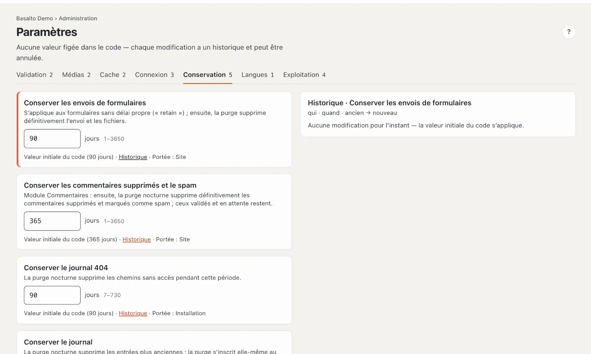
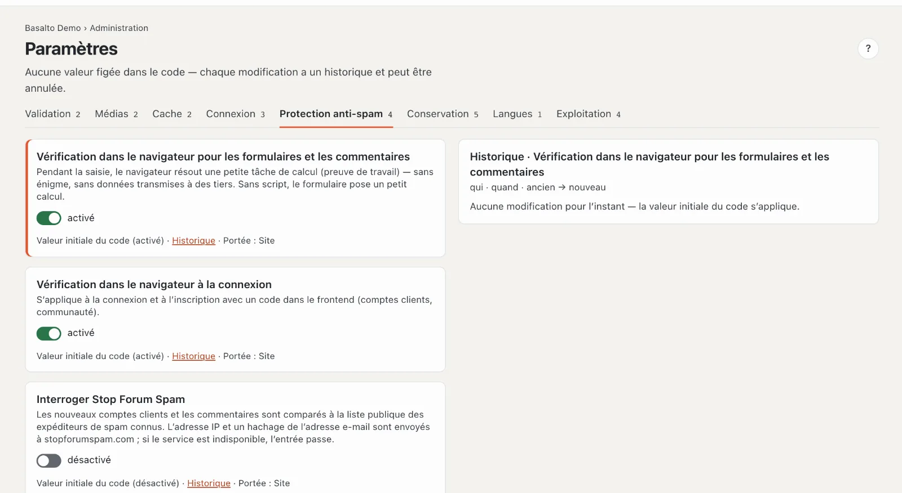

# Paramètres

Sous **Paramètres** figurent les délais, interrupteurs et limites de Basalto — aucune valeur fixe dans le code. Chaque modification a un **historique** et peut être annulée.

## Où

Mode « Administration » › **Paramètres**. En haut, un onglet par groupe avec le nombre de ses valeurs : Validation, Médias, Cache, Connexion, Conservation, Langues, Exploitation.

Une fiche par valeur :

- **Nom** et effet de la valeur.
- Le **champ** — un interrupteur ou un nombre avec son unité et sa plage autorisée (par exemple « jours 1–3650 »).
- En dessous : **« Valeur initiale du code (…) »** tant que personne ne l’a modifiée, sinon **« Modifié par … le … »** ; **« Historique »** ; et **« Portée »** — si la valeur vaut pour toute l’**installation** ou seulement pour ce **site**.

Les modifications s’enregistrent d’elles-mêmes (« enregistrement … », puis « enregistré »). Si une valeur sort de la plage, l’erreur s’affiche au champ et rien n’est enregistré. Sans droit de modification, les champs sont verrouillés (« lecture seule »).

## Historique et annulation

**« Historique »** montre à droite chaque modification de cette valeur : qui, quand, ancien → nouveau. **« Restaurer »** sur une entrée ramène la valeur à cet état antérieur — cela aussi figure ensuite dans l’historique et dans le [journal](protokoll.md). Sans modification, la mention est « Aucune modification pour l’instant — la valeur initiale du code s’applique ».

## Toutes les valeurs

| Groupe | Paramètre | Défaut | Plage | Vaut pour | Effet |
| --- | --- | --- | --- | --- | --- |
| Validation | Principe des quatre yeux | désactivé | — | Site | Les personnes qui soumettent ne peuvent pas valider leur propre version. |
| Validation | Conserver les versions archivées | 50 | 0–1000 | Site | par contenu et par langue ; la purge supprime les versions archivées plus anciennes ; 0 = tout conserver |
| Médias | Texte alternatif obligatoire | désactivé | — | Site | La publication sans texte alternatif dans une langue est refusée (aussi dans les paramètres du site). |
| Médias | Corbeille de la médiathèque | 30 jours | 1–365 | Installation | ensuite, la purge supprime définitivement l’original et les variantes |
| Cache | Cache des pages | activé | — | Site | Les pages sortent toutes prêtes du cache ; chaque publication l’invalide et préchauffe la page. Vous excluez certaines pages dans l’onglet « Cache » de la page. |
| Cache | Pages dans le cache au maximum | 24 heures | 1–168 | Site | ensuite, la requête suivante refait le rendu, même sans modification |
| Connexion | Validité du code de connexion | 10 minutes | 2–60 | Installation | durée de validité du code reçu par e-mail |
| Connexion | Validité des liens à usage unique | 60 minutes | 5–1440 | Installation | liens de l’installateur et de la console |
| Connexion | Validité d’une invitation | 72 heures | 1–720 | Installation | voir [Utilisateurs](benutzer.md) |
| Protection anti-spam | Vérification dans le navigateur pour les formulaires et les commentaires | activée | oui/non | Site | tâche de calcul en arrière-plan (preuve de travail), sans énigme ; sans script, un petit calcul |
| Protection anti-spam | Vérification dans le navigateur à la connexion | activée | oui/non | Site | connexion et inscription avec un code dans le frontend |
| Protection anti-spam | Interroger Stop Forum Spam | désactivée | oui/non | Site | nouveaux comptes clients et commentaires comparés à la liste publique des expéditeurs de spam connus ; l’adresse IP et un hachage de l’adresse e-mail sont envoyés à stopforumspam.com |
| Protection anti-spam | Stop Forum Spam : correspondance à partir de | 80 pour cent | 1–100 | Site | niveau de confiance de la liste à partir duquel une entrée est considérée comme du spam |
| Statistiques | Compter les visites | activé | activé/désactivé | Site | compter les pages vues et afficher les paramètres des cookies ; visiteurs et sessions uniquement avec consentement (voir [Statistiques](statistik.md)) |
| Conservation | Conserver les envois de formulaires | 90 jours | 1–3650 | Site | pour les formulaires sans délai propre ; ensuite, la purge supprime l’envoi et ses fichiers |
| Conservation | Conserver les commentaires supprimés et le spam | 365 jours | 1–3650 | Site | module Commentaires ; les commentaires validés et en attente restent |
| Conservation | Conserver le journal 404 | 90 jours | 7–730 | Installation | les chemins sans résultat pendant cette durée disparaissent |
| Conservation | Conserver le journal | 365 jours | 30–3650 | Installation | la purge supprime les entrées plus anciennes |
| Conservation | Conserver les statistiques | 400 jours | 30–1095 | Installation | le nettoyage supprime les pages vues plus anciennes |
| Conservation | Conserver les sauvegardes | 7 | 1–365 | Installation | les sauvegardes plus anciennes du même dossier disparaissent |
| Langues | Langues obligatoires avant la validation | — | — | Site | un renvoi : les langues obligatoires et la langue de repli se trouvent dans les langues du site (« Ouvrir → ») |
| Exploitation | Seuil de pulsation | 5 minutes | 2–60 | Installation | si la dernière pulsation est plus ancien, l’adresse de statut indique « perturbé » |
| Exploitation | Alerte d’erreurs à partir de | 20 exceptions | 0–100'000 | Installation | ce nombre d’erreurs dans la fenêtre déclenche un e-mail au propriétaire et à l’administration du compte de l’installation ; 0 = pas d’alerte |
| Exploitation | Fenêtre de l’alerte d’erreurs | 5 minutes | 1–60 | Installation | sur quelle durée le comptage a lieu |
| Exploitation | Pause après une alerte d’erreurs | 60 minutes | 5–1440 | Installation | pendant cette durée, aucun autre e-mail n’est envoyé |
| Exploitation | Données d’utilisation pour l’éditeur | activé | activé/désactivé | Installation | la vérification des mises à jour envoie un identifiant aléatoire, la version, PHP et le type de base de données — aucune adresse, aucun contenu (voir [Mises à jour](updates.md)) |

La **purge** s’exécute chaque nuit et supprime ce qui a atteint les délais — définitivement. Elle s’inscrit elle-même dans le journal.

## Questions fréquentes

**Une valeur vaut pour l’installation — pourquoi la vois-je dans chaque site ?**
Les valeurs avec « Portée : Installation » valent de la même manière pour tous les sites ; une modification agit partout.

**J’ai modifié quelque chose par erreur.**
Ouvrez l’« Historique » et choisissez « Restaurer » pour l’état antérieur.

## Pour continuer

- [Journal](protokoll.md)
- [Exploitation](betrieb.md)
