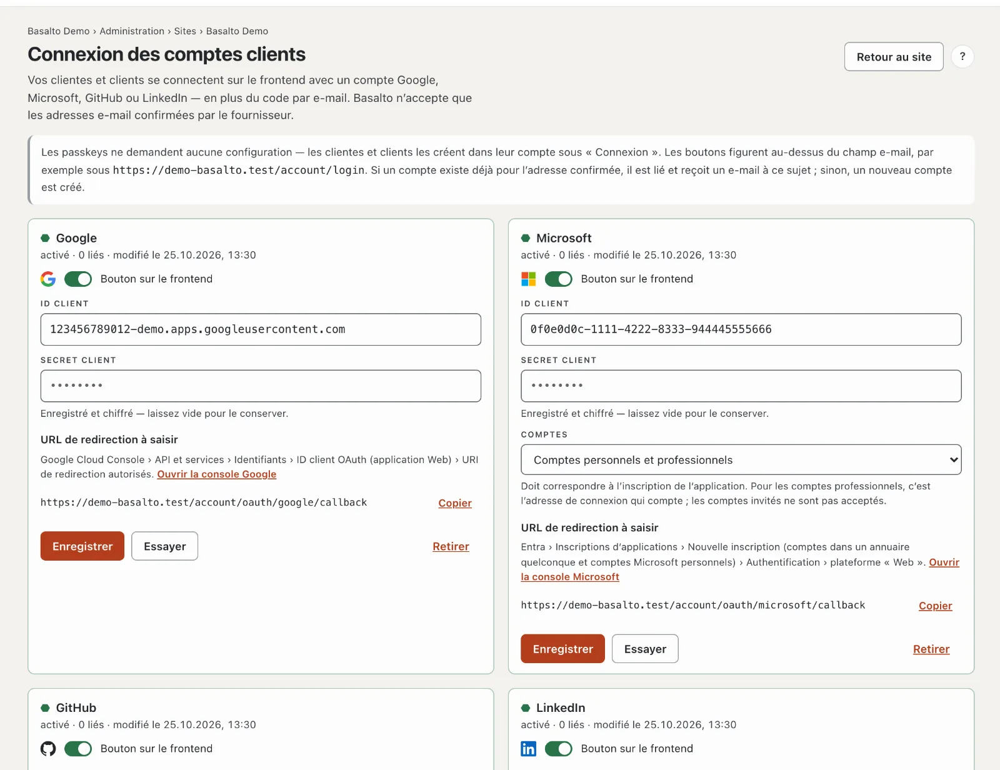
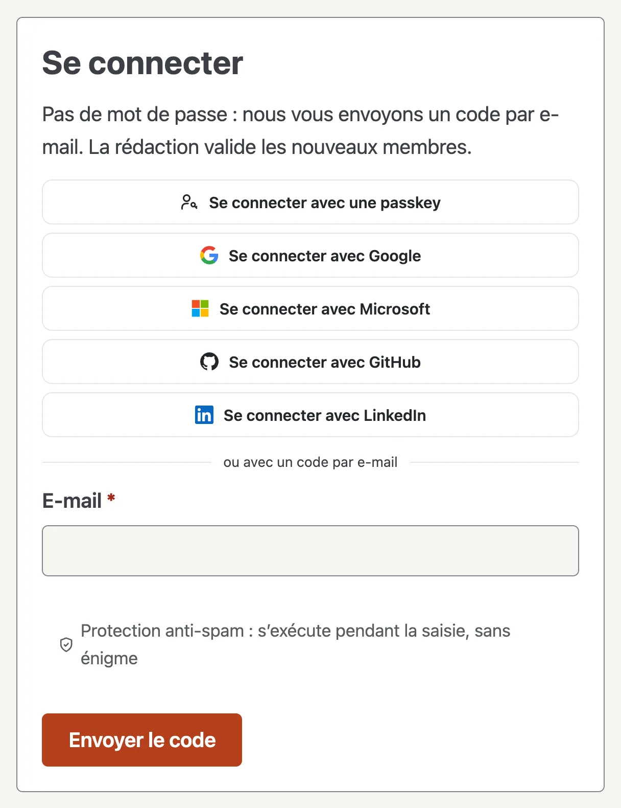

# Connexion des comptes clients

Vos clientes et clients se connectent sur le frontend avec une passkey ou avec un compte Google, Microsoft, GitHub ou LinkedIn — en plus du code par e-mail. Cela vaut partout où le compte client intervient : forum, membres, vente de licences et place de marché.

## À quoi cela ressemble sur le frontend

« Se connecter avec une passkey » et les boutons des fournisseurs activés figurent au-dessus du champ e-mail, suivis de « ou avec un code par e-mail ».

- **Si un compte client existe déjà pour l’adresse,** Basalto y connecte la personne et, la première fois, lie le compte du fournisseur. Le compte client reçoit un e-mail à ce sujet (« Nouvelle connexion avec Google »). Ensuite, c’est l’identifiant chez le fournisseur qui compte — si quelqu’un y change son adresse, la connexion continue de fonctionner.
- **Sinon, un nouveau compte client est créé** — mais seulement si le site accepte de nouveaux comptes. Si les membres sont réglés sur « uniquement sur invitation », seuls les comptes existants peuvent se connecter via un fournisseur.
- **Dans le compte,** la section **« Connexion »** affiche les comptes liés. **Lier** fonctionne aussi avec un compte dont l’adresse est différente ; **Déconnecter** supprime le lien. Le code par e-mail fonctionne toujours.

## Code par e-mail

Qui saisit son adresse e-mail reçoit un code à six chiffres. L’e-mail l’affiche en grand dans des cases et, dessous, en petit sous forme de suite de chiffres — un double-clic sélectionne tout le code pour le copier.

- **Une case par chiffre.** La saisie passe à la case suivante, la touche de retour revient en arrière ; un collage ou le remplissage automatique du téléphone répartit tout le code.
- **Aucun bouton nécessaire.** Dès que les six chiffres sont là, la connexion se poursuit d’elle-même. Un code erroné vide les cases.
- **« Renvoyer le code »** décompte après chaque code et se libère ensuite. La durée se règle sous [Paramètres](einstellungen.md) : groupe « Connexion », **« Nouveau code au plus tôt après »** (30 secondes par défaut).
- Sans JavaScript, il reste un seul champ avec « Se connecter ».

## Passkeys

Les passkeys ne demandent aucune configuration. Une fois connecté, on en crée une dans le compte sous **« Connexion » › Ajouter un passkey** — confirmée par empreinte digitale, visage ou verrouillage de l’appareil. Ensuite, **« Se connecter avec une passkey »** suffit, sans aucun code.

- **Le bouton n’apparaît** que si le navigateur prend en charge les passkeys ; sinon, le code par e-mail reste.
- **Une passkey vaut pour le domaine** sur lequel elle a été créée. Si le site a plusieurs domaines, vos clientes et clients la créent de préférence sur l’adresse principale.
- **Chaque nouvelle passkey** déclenche un e-mail au compte. **Supprimer** dans le compte l’efface sur le site ; sur l’appareil, la personne la supprime elle-même.

## Configurer

1. Ouvrez **Administration › Sites ›** votre site **› Connexion des comptes clients**.
2. Créez une application chez le fournisseur (instructions ci-dessous) et saisissez-y l’**URL de redirection** de Basalto — **Copier** la reprend exactement.
3. Dans Basalto, saisissez l’**ID client** et le **Secret client**, activez **Bouton sur le frontend** et cliquez sur **Enregistrer**.
4. **Essayer :** vous vous connectez une fois réellement chez le fournisseur. Le résultat s’affiche ensuite en haut, par exemple « Google a confirmé le compte … ». Aucun compte client n’est créé.

Peuvent configurer : l’exploitant du site ainsi que le propriétaire et l’administration du compte. Les boutons n’apparaissent que si un module du site utilise le compte client (forum, membres, vente de licences ou place de marché).

## Google

1. Dans la [Google Cloud Console](https://console.cloud.google.com), choisissez ou créez un projet.
2. **API et services › Écran de consentement OAuth :** type d’utilisateur **Externe**, nom de l’application, adresse d’assistance et logo. Champs d’application : `openid`, `email`, `profile`. Ensuite, **publiez** l’application — en mode test, seuls les utilisateurs de test inscrits peuvent se connecter.
3. **Identifiants › Créer des identifiants › ID client OAuth**, type d’application **Application Web**.
4. **URI de redirection autorisés :** les URL de redirection de Basalto.
5. Saisissez l’**ID client** (se termine par `.apps.googleusercontent.com`) et le **code secret du client** dans Basalto.

## Microsoft

1. Dans le [centre d’administration Microsoft Entra](https://entra.microsoft.com), allez dans **Inscriptions d’applications › Nouvelle inscription**.
2. **Types de comptes pris en charge :** « Comptes dans un annuaire d’organisation et comptes Microsoft personnels » — choisissez alors « Comptes personnels et professionnels » sous **Comptes** dans Basalto. Ou « Comptes Microsoft personnels uniquement » — alors « Comptes personnels uniquement » dans Basalto. Les deux doivent correspondre.
3. **URI de redirection :** plateforme **Web**, l’URL de redirection de Basalto. D’autres adresses sous **Authentification**.
4. Reprenez l’**ID d’application (client)** de la vue d’ensemble. Sous **Certificats et secrets › Nouveau secret client**, copiez la **valeur** (pas l’ID) et saisissez-la. Notez la date d’expiration et saisissez un nouveau secret à temps.
5. **Autorisations d’API :** Microsoft Graph, déléguées : `openid`, `profile`, `email`, `User.Read`.

**Quelle adresse compte :** pour les comptes personnels, l’adresse du compte Microsoft ; pour les comptes professionnels, le nom de connexion (UPN) — pas le champ « E-mail », que l’administration d’un annuaire peut définir librement. Les comptes invités (`…#EXT#@…`) sont refusés.

## GitHub

1. **GitHub › Settings › Developer settings › OAuth Apps › New OAuth App** — pour une organisation, dans ses paramètres.
2. **Homepage URL :** l’adresse du site. **Authorization callback URL :** l’URL de redirection de l’adresse principale — GitHub n’accepte qu’une adresse par application.
3. Reprenez le **Client ID**, cliquez sur **Generate a new client secret** et saisissez le secret.

Avec GitHub, Basalto n’accepte que l’adresse principale confirmée du compte.

## LinkedIn

1. Sur [LinkedIn Developers](https://www.linkedin.com/developers/apps), cliquez sur **Create app** — il faut pour cela une page LinkedIn de votre entreprise.
2. Sous **Products**, ajoutez « Sign In with LinkedIn using OpenID Connect ».
3. **Auth › Authorized redirect URLs :** l’URL de redirection de Basalto. Saisissez le **Client ID** et le **Primary Client Secret**.

## Sécurité et protection des données

- **Seules les adresses confirmées comptent.** Si le fournisseur n’indique pas que l’e-mail est confirmé, Basalto refuse la connexion — sinon, quelqu’un pourrait reprendre un compte existant avec l’adresse d’une autre personne.
- **Aucun fournisseur n’apprend quoi que ce soit avant le clic :** les boutons sont de simples liens ; rien n’est chargé depuis Google et consorts. La redirection utilise `state`, avec Google et Microsoft aussi PKCE ; le retour n’est valable qu’avec la session correspondante.
- **Protection anti-spam :** si Stop Forum Spam est activé (voir [Paramètres](einstellungen.md)), Basalto vérifie aussi les nouveaux comptes créés via un fournisseur.
- **Le secret client** est enregistré chiffré dans la base de données, ne va jamais au navigateur, jamais dans le journal et pas dans l’export d’un site. Le journal consigne « Connexion des comptes clients configurée » et « … supprimée ».
- **L’accès aux données et l’effacement** indiquent ou suppriment les liens et les passkeys d’un compte client.
- **Politique de confidentialité :** si vous activez des fournisseurs, mentionnez-les dans la politique de confidentialité du site comme destinataires lors de la connexion.

### Protection des données dans le compte client

Le compte client contient la section **Protection des données** — les droits selon le RGPD et la LPD à exercer
soi-même, toujours uniquement pour ce site :

- **Télécharger les données** (accès, portabilité) : tout ce qui concerne le compte sur ce site sous forme de fichier
  JSON — compte, comptes liés, passkeys, communauté, commentaires, envois de formulaires, licences et achats. Les
  comptes avec la même adresse sur d'autres sites et le compte du backend n'en font pas partie.
- **Rectifier les indications :** nom, entreprise et adresse ; l'équipe modifie l'adresse e-mail sur demande.
- **Consentements :** paramètres des cookies et accord aux conditions de la communauté, chacun avec retrait.
- **Demandes** (rectification, limitation, opposition, autre) : arrivent avec un délai d'un mois sous
  **Administration › Protection des données** ; cloche et e-mail vont à toutes les personnes qui voient le domaine
  « Demandes relatives à la protection des données ». « Traiter et répondre » envoie la réponse par e-mail ; le nombre
  dans le menu indique les demandes ouvertes.
- **Supprimer le compte :** confirmé avec l'adresse e-mail — pas tant qu'un contrat est en cours (abonnement SaaS,
  licence Agence). Les factures restent sans la personne, les messages de la communauté sans nom ; la confirmation
  arrive par e-mail.

Les résiliations sans connexion passent par « Résilier des contrats ici » au pied de page du site.

## En cas de problème

| Signe | Cause | Solution |
| --- | --- | --- |
| `redirect_uri_mismatch` (Google), AADSTS50011 (Microsoft), « redirect_uri is not associated » (GitHub) | L’URL de redirection manque chez le fournisseur ou diffère | Saisir l’adresse de Basalto exactement ; derrière un proxy, vérifier `https` |
| « … n’a pas confirmé votre adresse e-mail » | L’adresse n’est pas confirmée chez le fournisseur (GitHub : pas d’adresse principale confirmée) | La confirmer chez le fournisseur ou se connecter avec le code par e-mail |
| « Les comptes invités d’un autre annuaire ne sont pas acceptés » | Compte invité Microsoft | Se connecter avec son propre compte |
| « … uniquement sur invitation » | Le site ne crée pas de nouveaux comptes | Inviter la personne — ensuite, cela fonctionne |
| « La connexion a expiré » | Retour sur un autre hôte, cookie bloqué ou attente trop longue | Recommencer depuis la même adresse |
| « Ce site ne connaît pas cette passkey » | Passkey supprimée du compte ou créée sur un autre domaine | Se connecter avec le code par e-mail et recréer la passkey |
| Aucun bouton visible | Fournisseur désactivé ou aucun module n’utilise le compte client | Vérifier le commutateur, activer le module |

## Pour continuer

- [Sites](sites.md)
- [SSO pour les utilisateurs du backend](../betrieb/sso.md)
- [Paramètres](einstellungen.md)
- [Profils et conversations](../community/profile.md)
