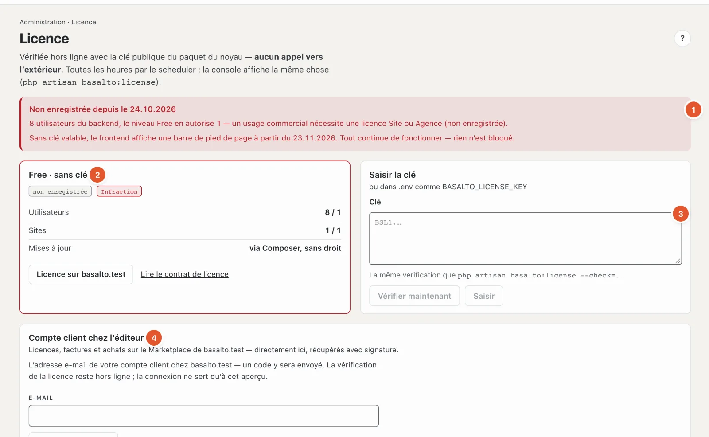

# Licence

Sous **Licence**, vous voyez à quel niveau fonctionne l’installation et si elle respecte les limites, et vous saisissez la clé. Basalto vérifie la licence **hors ligne** — sans appel vers l’éditeur — et ne **bloque jamais** une fonction.

## Où

Mode « Administration » › **Licence**.

1. **Avis en haut** — si l’installation n’est pas enregistrée, vous voyez ici depuis quand et pourquoi, par exemple « 3 utilisateurs du backend, le niveau Free en autorise 1 », et à partir de quand le frontend affiche un bandeau en pied de page. « Tout continue de fonctionner — rien n’est bloqué. »
2. **La fiche de licence** — niveau (par exemple « Free · sans clé »), marques **« enregistrée »/« non enregistrée »** et **« conforme »/« Infraction »**, puis **Utilisateurs** et **Sites** (utilisés / autorisés), **Mises à jour** (jusqu’à quand les nouvelles versions sont comprises). Avec une clé s’ajoutent le titulaire de la licence, les domaines, la date d’émission et l’identifiant de la clé ; pour une sous-licence d’agence, le client. Les liens « Licence sur … » (acheter ou prolonger) et « Lire le contrat de licence ».
3. **Saisir la clé** — collez la clé ; **« Vérifier maintenant »** affiche le résultat sans rien saisir ; **« Saisir »** l’enregistre. Une clé non valable n’est pas enregistrée. **« Retirer la clé »** ramène à Free. Seuls les exploitants saisissent des clés. Si la clé figure dans le fichier `.env` de l’installation, la fiche l’indique — la saisie dans le backend a la priorité.
4. **Compte client chez l’éditeur** — voir ci-dessous.

## Niveaux

| Niveau | En bref |
| --- | --- |
| **Free** | sans clé : un site, un utilisateur du backend, tous les modules — pour le développement, les tests et l’usage privé |
| **Site** | un domaine de production, jusqu’à trois sites dans une installation ; nouvelles versions pendant un an à partir de l’achat |
| **Agence** | tous les sites et installations pour vous et vos clients ; une clé de sous-licence par client, sur demande sans la marque Basalto dans le backend |

**Infraction** signifie : l’installation dépasse son niveau — plus d’utilisateurs ou de sites qu’autorisé, ou un domaine qui ne figure pas dans la clé. Elle est alors considérée comme non enregistrée. Après **30 jours** sans enregistrement, le frontend affiche un étroit bandeau en pied de page ; rien de plus ne se passe. Si le droit aux mises à jour a expiré, le logiciel continue de fonctionner ; les nouvelles versions demandent une prolongation.

## Compte client chez l’éditeur

Qui a acheté une licence sur basaltocms.com voit ses clés, ses factures et ses achats sur le Marketplace directement ici (exploitants seulement) :

1. Saisissez l’**adresse e-mail** du compte client, puis **« Demander un code »**. Si un compte existe, un code à six chiffres arrive à cette adresse.
2. Saisissez le **code** — une case par chiffre ; un collage remplit tout le code. Dès que les six chiffres sont là, Basalto se connecte de lui-même. Si rien n’est arrivé, **« Renvoyer le code »** se libère après un court délai (voir [Paramètres](einstellungen.md), « Nouveau code au plus tôt après »).
3. Une fois connectée, la fiche montre les **Licences** (avec « Utiliser cette clé »), les **Factures** en PDF et les **Achats sur le Marketplace**. « Actualiser » récupère l’état le plus récent, « Déconnecter » coupe la connexion.

La vérification de la licence reste hors ligne ; la connexion ne sert qu’à cet aperçu. Détails pour la technique : [Licence](../betrieb/lizenz.md).

## Questions fréquentes

**Dois-je acheter une licence tout de suite ?**
Non. Pour le développement, les tests et l’usage privé, Free suffit. Pour un usage commercial avec plus de personnes ou de sites, il faut une licence Site ou Agence ; d’ici là, le bandeau en pied de page apparaît après 30 jours.

**« Saisir » est verrouillé.**
Seuls les exploitants saisissent des clés — ou le champ est encore vide.

## Pour continuer

- [Licence](../betrieb/lizenz.md)
- [Mises à jour](updates.md)
