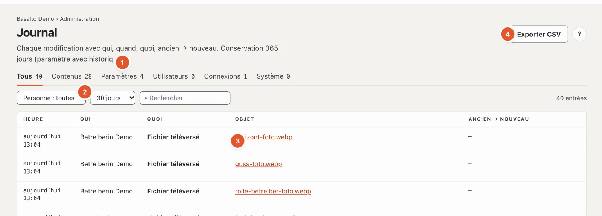

# Journal

Le **journal** consigne qui a modifié quoi et quand — avec la valeur avant et après. Ainsi, chaque modification reste compréhensible, même après des mois.

## Où

Mode « Administration » › **Journal**. En haut figure la durée de conservation des entrées (par défaut 365 jours, paramètre « Conserver le journal »).

1. **Types** — « Tous », « Contenus », « Paramètres », « Utilisateurs », « Connexions », « Système », chacun avec le nombre d’entrées.
2. **Personne** — seulement les entrées d’une personne ; **Période** — 1, 7, 30, 90 ou 365 jours ou « tout » ; **Rechercher** dans le texte des entrées.
3. **Les entrées** — Heure, Qui, Quoi, Objet (avec « ouvrir » là où l’objet existe encore) et **ancien → nouveau**.
4. **« Exporter CSV »** — les entrées avec les filtres choisis, sous forme de tableau.

Vous parcourez les longues listes avec « Plus récentes » et « Plus anciennes ». « Réinitialiser le filtre » affiche de nouveau tout.

## L’historique d’un contenu

Le lien **« Historique »** sur un contenu ou un paramètre ouvre le journal filtré sur cet objet — en haut figure alors **« seulement : … »**. Avec « Retirer le filtre de contenu » (×), vous voyez de nouveau toutes les entrées.

## Ce qui est consigné

- **Contenus** — créer, modifier, soumettre, valider, publier, supprimer, restaurer.
- **Paramètres** — chaque modification d’une valeur, thèmes, rôles, modules.
- **Utilisateurs** — invitations, rôles, désactivation, suppression, droit d’accès.
- **Connexions** — connexions réussies et sessions.
- **Système** — purge, publications, sauvegardes, jobs.

Si une personne est supprimée, ses entrées restent — **anonymisées** : à la place du nom figure un substitut. Rien n’est retiré du journal, sauf par le délai de conservation.

## Questions fréquentes

**Une entrée manque.**
Vérifiez la période — par défaut, la liste montre les 30 derniers jours. « tout » montre tout ce qui est encore conservé.

## Pour continuer

- [Utilisateurs](benutzer.md)
- [Paramètres](einstellungen.md)
