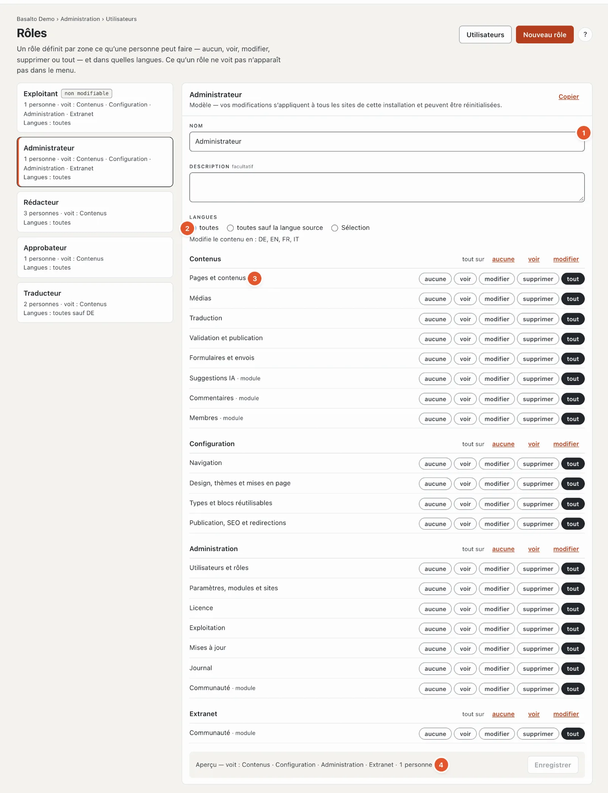

# Rôles

Un **rôle** définit ce qu’une personne peut faire dans le backend — un **niveau** par **domaine**, ainsi que les **langues** dans lesquelles elle peut modifier des contenus. Une personne a exactement un rôle par site ; les rôles eux-mêmes valent pour tous les sites de l’installation.

## Où

Mode « Administration » › **Rôles** (ou, sous « Utilisateurs », le bouton « Rôles »).

À gauche figurent les rôles — pour chacun, combien de personnes l’ont, quels modes il voit (« voit : Contenus · Configuration · Administration ») et quelles langues. Des marques indiquent **« non modifiable »** (Exploitant), **« personnalisé »** (un modèle avec vos propres modifications) ou **« la vôtre »** (créé par vous). À droite, le rôle sélectionné :

1. **Nom** et **Description** (facultative) — la description apparaît sous le rôle lors de l’invitation.
2. **Langues** : **toutes**, **toutes sauf la langue source** ou une **Sélection**. En dessous figure dans quelles langues le rôle peut modifier des contenus. Créer, supprimer et déplacer des pages et modifier leurs paramètres exige la langue source.
3. **La matrice** — un niveau par domaine, selon les groupes Contenus, Configuration et Administration. **« tout sur »** règle tout un groupe sur « aucune », « voir » ou « modifier ». Les domaines venant de modules portent la mention « module ».
4. **Aperçu** en bas — ce que le rôle voit et combien de personnes l’ont. Chaque modification s’enregistre d’elle-même et vaut dès la requête suivante ; elle figure dans le [journal](protokoll.md).

| Niveau | Signifie |
| --- | --- |
| **aucune** | Le domaine est absent du menu. |
| **voir** | lire, sans rien modifier |
| **modifier** | créer et modifier |
| **supprimer** | en plus, supprimer |
| **tout** | en plus, les paramètres sensibles du domaine — par exemple le webhook d’un formulaire ou la clé des suggestions IA |

Si un rôle ne voit aucun domaine dans un groupe, le mode correspondant est lui aussi absent (par exemple « Configuration »).

## Les modèles

| Modèle | Peut |
| --- | --- |
| **Exploitant** | tout ; non modifiable, pour qu’aucun site ne se retrouve verrouillé. Chaque site garde au moins un exploitant. |
| **Administrateur** | tout, sauf attribuer le rôle Exploitant |
| **Rédacteur** | pages, médias et formulaires jusqu’à « supprimer », traduction, commentaires, membres et suggestions IA « modifier » ; pas de configuration, pas d’administration, pas de validation |
| **Approbateur** | validation et publication « tout » ; pages, médias, traduction, formulaires et commentaires « voir » |
| **Traducteur** | pages et traduction « modifier », médias « voir », suggestions IA « modifier » — dans toutes les langues sauf la langue source |

**« Réinitialiser »** ramène un modèle personnalisé à son état d’origine (sauf Exploitant).

## Rôles personnalisés

- **« Nouveau rôle »** crée un rôle vide (il n’a aucun droit) — ou une copie d’un rôle existant. **« Copier »** en haut à droite copie le rôle sélectionné.
- **« Supprimer »** retire un rôle personnalisé, tant que personne ne l’a et qu’aucune invitation en attente ne le désigne.

## Des règles que personne ne contourne

- Modifier des rôles exige « Utilisateurs et rôles · tout » ; pour les voir, « voir » suffit.
- Qui attribue un rôle a besoin, dans chaque domaine, d’au moins le même niveau et de chacune de ses langues.
- Les jetons API agissent avec les droits de leur personne.
- Tout figure dans le [journal](protokoll.md) : créé, modifié (avant et après), réinitialisé, supprimé et chaque attribution.

Plus de contexte pour la technique : [Rôles et droits](../betrieb/rollen.md).

## Pour continuer

- [Utilisateurs](benutzer.md)
- [Rôles et droits](../betrieb/rollen.md)
