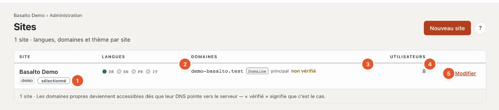

# Sites

Une installation peut faire fonctionner plusieurs sites web — chacun avec ses propres langues, domaines, thème et contenus, gérés dans le même backend.

## Où

Mode « Administration » › **Sites**.

Une ligne par site :

1. **Site** — nom et handle ; « sélectionné » marque le site dans lequel vous travaillez en ce moment.
2. **Langues** — un hexagone par langue : rempli de vert pour la langue par défaut, un anneau vert pour les langues obligatoires, gris pour les langues facultatives. La souris posée dessus indique le rôle et la langue de repli de la langue.
3. **Domaines** — les adresses du site avec leur type (alias, domaine propre, redirection), « principal » pour l’adresse principale et « vérifié » ou « non vérifié ». Vérifié signifie : le DNS du domaine pointe vers le serveur.
4. **Utilisateurs** — combien de personnes ont un rôle dans le site.
5. **« Modifier »** ouvre le site ; **« Changer »** (pour les autres sites) en fait le site actuel dans tout le backend.

**« Nouveau site »** crée un site supplémentaire : nom, handle, langue par défaut et thème, puis « Enregistrer et fermer ». Le nombre de sites autorisés dépend de la [licence](lizenz.md). Avec l’abonnement, le propriétaire et l’administration du compte créent les nouveaux sites sous « Compte › Sites ».

## Modifier un site

Le contenu des quatre onglets « Général », « Langues », « Domaines » et « Modules » est expliqué dans l’aide de la configuration : [Le site](../einrichtung/site.md). En plus, en haut à droite :

- **« Connexion via SSO »** — configurer la connexion via Microsoft Entra ID ou Google Workspace (voir [SSO](../betrieb/sso.md)).
- **« Connexion des comptes clients »** — les clientes et clients se connectent sur le frontend avec Google, Microsoft, GitHub ou LinkedIn (voir [Connexion des comptes clients](kundenanmeldung.md)).
- **« Télécharger l’export »** — tout le site sous forme de ZIP : les contenus en JSON et tous les médias, dans le même format que l’import ; sans les envois de formulaires ni les membres (données personnelles). Pour une copie ou un transfert vers une autre installation. Un export ne remplace pas une sauvegarde de toute l’installation (voir [Exploitation](betrieb.md#sauvegardes)).

## Questions fréquentes

**Je ne vois pas « Nouveau site ».**
Votre rôle ne permet pas de modifier le domaine « Paramètres, modules et sites » — ou l’installation fonctionne en abonnement ; c’est alors le compte qui crée les nouveaux sites.

**Comment supprimer un site ?**
Ce n’est pour l’instant possible ni dans le backend ni dans la console. Si vous ne voulez plus faire fonctionner un site, retirez ses domaines et, par sécurité, téléchargez l’export.

## Pour continuer

- [Le site](../einrichtung/site.md)
- [Utilisateurs](benutzer.md)
