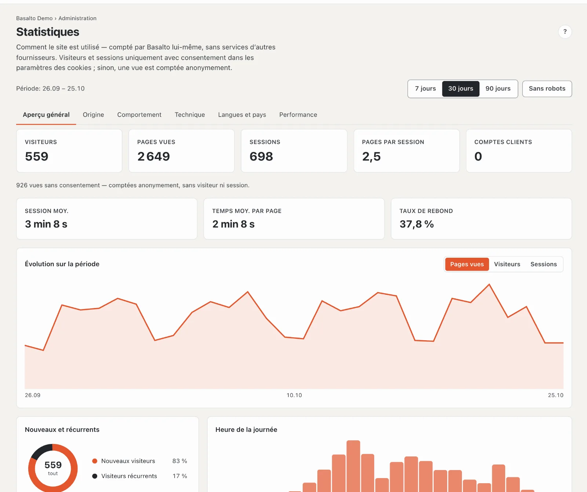
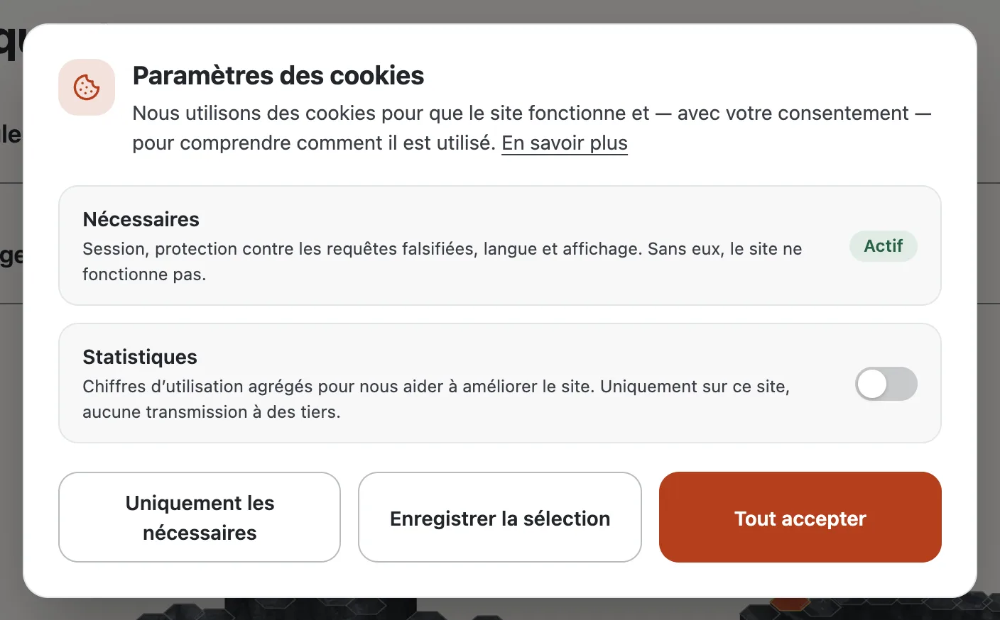

# Statistiques

Basalto compte lui-même comment votre site est utilisé — sans services d’autres fournisseurs, sans script provenant d’autres serveurs et sans adresses IP. Sous **Administration › Statistiques**, vous voyez les visiteurs, les pages vues, la provenance, les pages les plus visitées, la technique, les langues et les temps de réponse du site choisi.

## Ce qui est compté

- **Chaque page vue** du site compte — y compris les pages servies rapidement depuis le cache. Ne sont pas comptés : le préchargement du navigateur, les pages d’erreur et les personnes connectées au backend (vous et votre équipe).
- **Sans consentement**, une vue est comptée **anonymement** : page, lien entrant (hôte uniquement), navigateur, système, appareil et langue — sans cookie ni identifiant. Les pages vues sont exactes, mais les visiteurs et les sessions manquent.
- **Avec consentement** dans les paramètres des cookies, le navigateur crée deux identifiants aléatoires : un pour le visiteur (un an) et un pour la session (30 minutes sans activité). Basalto compte alors les visiteurs, les sessions, la durée, les rebonds ainsi que les pages d’entrée et de sortie. Un navigateur avec « Global Privacy Control » est toujours compté anonymement.
- **Aucune adresse IP** et **aucun paramètre** de l’adresse ne sont enregistrés — de `?utm_source=…`, Basalto ne reprend que la source, le support et la campagne.
- **Le pays** n’apparaît que si un service en amont, comme Cloudflare, le transmet.

## Lire les statistiques

En haut, vous choisissez la **période** (7, 30 ou 90 jours) et si les **robots** comptent. Un clic sur une page, un lien entrant, un navigateur, un appareil, un pays ou une langue **filtre tout le rapport** ; la sélection s’affiche en haut et se supprime élément par élément.

| Onglet | Contenu |
| --- | --- |
| **Vue d’ensemble** | Visiteurs, pages vues, sessions, pages par session, comptes clients ; session moy., temps moy. par page, taux de rebond ; évolution sur la période, nouveaux visiteurs et visiteurs récurrents, heure de la journée |
| **Provenance** | Canaux (direct, moteurs de recherche, réseaux sociaux, campagnes, liens entrants), liens entrants et campagnes (UTM) |
| **Comportement** | Pages les plus visitées, pages d’entrée et de sortie, dernières vues |
| **Technique** | Appareils, navigateurs et systèmes d’exploitation |
| **Langues et pays** | Langue des pages consultées et pays |
| **Performance** | Temps de réponse du serveur (moy., p50, p90, p99), pages les plus lentes et robots |

Les jours et les heures suivent le fuseau horaire du site.

## Paramètres des cookies

Si un site compte les visites, les **paramètres des cookies** demandent le consentement lors de la première visite :

- **Nécessaires** est toujours actif (session, protection contre les requêtes falsifiées, langue, affichage).
- **Statistiques** est désactivé par défaut — un consentement précoché ne serait pas valable. Si le thème intègre des services d’autres fournisseurs, **Contenus externes** s’ajoute.
- **Uniquement les nécessaires**, **Enregistrer la sélection** et **Tout accepter** ont la même taille et sont aussi faciles à atteindre.
- Le choix vaut un an. Les visiteurs le modifient à tout moment via **Paramètres des cookies** dans le pied de page ; « En savoir plus » mène à la politique de confidentialité du site dans la langue de la page — la page que le thème désigne sous `publish { legal { datenschutz: … } }` (sinon la page sous `/datenschutz`), à l’adresse qu’elle a dans cette langue. Si elle n’est pas publiée, le lien est omis.

## Activer, désactiver, conserver

- **Administration › Paramètres › Statistiques › Compter les visites** — par site, activé par défaut. Désactivé, aucune vue ne s’ajoute et les paramètres des cookies n’apparaissent plus que si le thème intègre des services d’autres fournisseurs.
- **Administration › Paramètres › Conservation › Conserver les statistiques** — 400 jours par défaut ; le nettoyage nocturne supprime les vues plus anciennes.
- **Qui voit les statistiques** dépend du rôle (domaine « Statistiques ») ; par défaut l’exploitant et l’administrateur.
- **L’accès aux données et l’effacement** d’une personne détachent ses vues du compte client ; les chiffres restent anonymes. L’export d’un site n’inclut pas les statistiques.
- **Politique de confidentialité :** mentionnez vos propres statistiques et les paramètres des cookies dans la politique de confidentialité du site.

## Pour les thèmes

Un lien vers `#cookie-einstellungen` ouvre les paramètres des cookies depuis n’importe où. Les thèmes fournis le placent dans le pied de page, masqué jusqu’à ce que les paramètres figurent sur la page (`data-cookie-link hidden`). Les scripts d’autres fournisseurs se trouvent dans le thème sous la forme `<script type="text/plain" data-consent …>` et `publish { cookie: consent }` les déclare — ils ne s’exécutent qu’après consentement aux « Contenus externes ».

## Pour continuer

- [Paramètres](einstellungen.md)
- [Rôles](rollen.md)
- [Connexion des comptes clients](kundenanmeldung.md)
- [Lava](../entwickler/lava.md)
