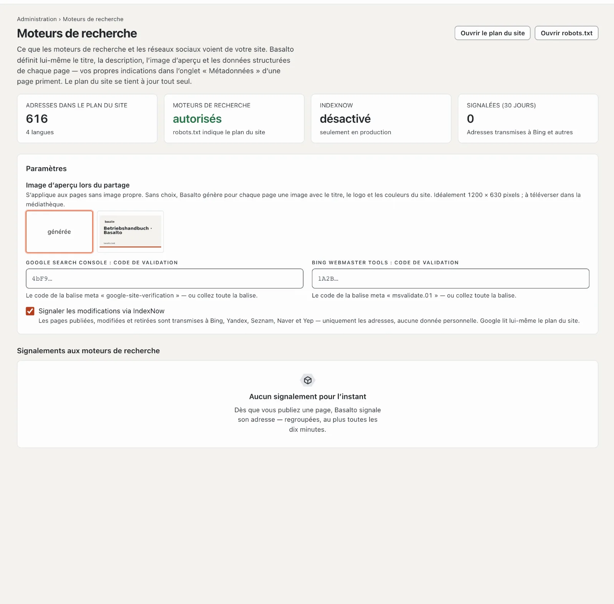

# Moteurs de recherche

Basalto prépare lui-même chaque page publique pour que les moteurs de recherche et les réseaux sociaux la comprennent :
titre, description, image d’aperçu, versions linguistiques, données structurées et plan du site. Sous **Administration ›
Moteurs de recherche**, vous voyez ce qui arrive et vous définissez les quelques indications que Basalto ne peut pas
connaître lui-même.

## Ce que Basalto définit lui-même sur chaque page

Vous n’avez rien à faire pour cela — ni dans la rédaction ni dans le thème. Ce que vous indiquez vous-même dans les
paramètres d’une page, onglet **Métadonnées**, prime toujours.

| Indication | D’où elle vient |
| --- | --- |
| **Titre** | titre de la page avec le complément du thème (par exemple « · Nom du site ») — sans complément si le nom figure déjà dans le titre |
| **Description** | votre propre description, sinon l’introduction, sinon le premier paragraphe du contenu — raccourcie à environ 160 caractères à la fin d’un mot |
| **Image d’aperçu** | image de la page, sinon la première image du contenu, sinon l’image d’aperçu du site, sinon une image que Basalto génère lui-même |
| **Adresse canonique** | l’adresse de la page dans cette langue ; les vues avec un contenu propre (une fiche de la place de marché) gardent leur paramètre |
| **Versions linguistiques** | chaque langue avec sa propre version, et la langue par défaut comme valeur par défaut (`hreflang`) |
| **Données structurées** | site web et organisation avec logo sur la page d’accueil, page et fil d’Ariane partout, article avec date et auteur pour les articles ; les modules ajoutent les leurs (événement, poste, message du forum, logiciel de la place de marché) |
| **Plan du site** | `/sitemap.xml` avec un plan par langue, chaque adresse avec sa dernière modification, ses versions linguistiques et l’image de la page — à jour tout seul |
| **robots.txt** | autorise tout aux moteurs de recherche sauf l’administration et indique le plan du site |

Les pages réservées aux membres, les brouillons, les redirections et les pages « noindex » ne figurent ni dans le plan
du site ni dans l’index.

## L’image d’aperçu des liens partagés

Lorsque quelqu’un partage un lien vers votre site — dans un message, sur LinkedIn ou Facebook —, l’aperçu montre une
image. Si une page n’a pas d’image propre, Basalto prend l’**image d’aperçu lors du partage** du site. Si aucune n’est
choisie non plus, Basalto en génère une par page : 1200 × 630 pixels avec le titre de la page, le logo et l’adresse dans
les couleurs de votre thème.

1. Téléversez une image dans la **Médiathèque** — idéalement 1200 × 630 pixels, en JPEG, PNG ou WebP.
2. Ouvrez **Administration › Moteurs de recherche** et choisissez-la sous **Image d’aperçu lors du partage**. Elle
   s’enregistre toute seule.

## S’inscrire auprès de Google

Google trouve lui-même le plan du site via `robots.txt`. Dans la **Google Search Console**, vous voyez en plus quelles
pages sont dans l’index, avec quels termes de recherche les visiteurs arrivent et si Google signale des erreurs.

1. Ouvrez la Google Search Console et ajoutez une **propriété** de type **Préfixe de l’URL** — l’adresse de votre
   site, par exemple `https://www.exemple.ch/`.
2. Choisissez **Balise HTML** comme méthode de validation et copiez la balise.
3. Collez-la dans Basalto sous **Administration › Moteurs de recherche › Google Search Console : code de validation** —
   la balise entière ou seulement le code de `content="…"`.
4. Cliquez sur **Valider** dans la Search Console.
5. Sous **Sitemaps**, envoyez l’adresse `sitemap.xml`.

Il en va de même pour **Bing Webmaster Tools** avec la balise `msvalidate.01` ; Bing peut aussi reprendre un site
validé depuis la Search Console.

## Signaler les modifications avec IndexNow

Lorsque vous publiez une page, la modifiez ou la retirez, Basalto signale son adresse via **IndexNow** à Bing, Yandex,
Seznam, Naver et Yep — regroupées, au plus toutes les dix minutes. Seules les adresses sont transmises, aucune donnée
personnelle. Basalto génère lui-même la clé qu’exige IndexNow et la met à disposition à l’adresse du site. La liste
**Signalements aux moteurs de recherche** montre ce qui a été signalé.

IndexNow ne signale que si le site est **en ligne**, que les moteurs de recherche sont autorisés et que Basalto tourne
**en production** — un environnement de test ne signale jamais. Vous pouvez le désactiver sous **Signaler les
modifications via IndexNow**. Google n’utilise pas IndexNow ; Google lit le plan du site.

## Comment les moteurs de recherche utilisent votre site

Combien de visites viennent des moteurs de recherche, par quelles pages elles entrent et à quelle fréquence Googlebot et
d’autres robots passent, l’onglet **Moteurs de recherche** sous [Statistiques](statistik.md) le montre.

## En cas de problème

| Signe | Cause | Solution |
| --- | --- | --- |
| **Moteurs de recherche : non autorisés** | Le thème bloque les moteurs de recherche (`publish { robots: disallow }`) ou c’est un environnement de test | adapter le thème ; les environnements de test restent bloqués exprès |
| **IndexNow : désactivé — seulement en production** | Basalto tourne en local ou dans un environnement de test | voulu ; en production, il signale tout seul |
| La Search Console ne trouve pas la balise | code pas encore enregistré, ou la page vient encore d’un cache | vérifier le code, attendre une minute, valider à nouveau |
| L’aperçu montre une ancienne image | les réseaux gardent les aperçus un certain temps | les faire récupérer à nouveau dans l’outil du réseau (par ex. le « Sharing Debugger » de Facebook) |

## Pour continuer

- [Statistiques](statistik.md)
- [Pages et arborescence](../redaktion/seiten.md)
- [Mise en ligne](../einrichtung/live-gehen.md)
- [Paramètres](einstellungen.md)
