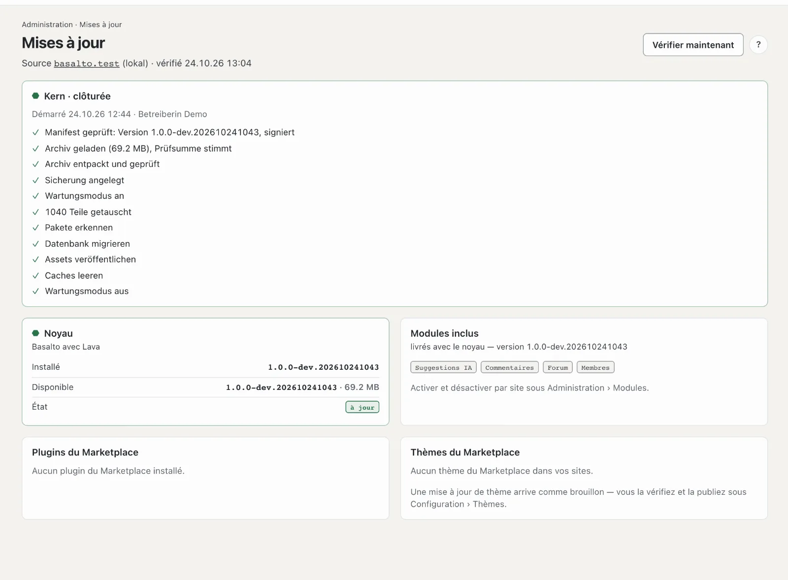

# Mises à jour

**Mises à jour** montre si Basalto est à jour : le noyau, les modules inclus, les plugins et les thèmes de la
marketplace. S’il y a du nouveau, vous l’installez d’ici — avec sauvegarde et retour en arrière.

## Où

Mode « Administration » › **Mises à jour**. Le nombre à côté de l’entrée indique les mises à jour disponibles lors de la dernière vérification.

En haut figure la **Source**, c’est-à-dire l’éditeur auprès duquel Basalto se renseigne :
- `basaltocms.com` pour la production et la démo,
- `testing.basaltocms.com` dans les environnements de test,
- `basalto.test` dans le développement local.

Basalto vérifie de lui-même une fois par jour. **« Vérifier maintenant »** récupère l’état immédiatement. S’il y a du nouveau, une
notification arrive dans la cloche et, si c’est configuré, par e-mail — une fois pour chaque nouvel état.

Avec la vérification, Basalto envoie des **données d’utilisation** à l’éditeur : un identifiant aléatoire de cette
installation, la version, la version de PHP et le type de base de données. Aucune adresse, aucun contenu ni aucune
donnée personnelle ne sont transmis ; l’éditeur ne conserve qu’une empreinte de l’identifiant et compte ainsi les
installations actives et les versions. Pour désactiver : **Paramètres** › Exploitation › « Données d’utilisation pour
l’éditeur » — la vérification des mises à jour se fait alors sans ces données.

## Les fiches

| Fiche | Ce qu’elle montre | Que faire |
| --- | --- | --- |
| **Noyau** | version installée et version disponible, taille, « Quoi de neuf ? » | « Mettre à jour vers … » |
| **Modules inclus** | Forum, Commentaires, Membres, IA … — ils arrivent avec le noyau | activer et désactiver par site sous **Modules** |
| **Plugins du Marketplace** | version installée et nouvelle version par plugin | « Actualiser » |
| **Thèmes du Marketplace** | par site, le thème avec sa version installée et sa nouvelle version | « Charger comme brouillon » |

## Mettre à jour le noyau

Après « Mettre à jour vers … », vous confirmez. Basalto travaille alors dans l’ordre ; la page montre chaque étape :

1. Télécharger l’archive et vérifier la signature — uniquement les versions signées par l’éditeur
2. Sauvegarde de la base de données et des médias
3. Mode maintenance — le site web affiche brièvement une page de maintenance, vous continuez à travailler
4. Remplacer les fichiers, migrer la base de données, renouveler les assets et les caches
5. Mode maintenance désactivé

**Si une étape échoue, les anciens fichiers reviennent.** La base de données reste telle quelle — les
migrations de Basalto sont conçues pour que l’ancien état fonctionne aussi avec elle.

Restent intacts : `.env`, le stockage (médias, sauvegardes, journaux), le fichier de base de données et les thèmes personnels.

## Thèmes

Une mise à jour de thème arrive **comme brouillon** : vous examinez les modifications dans l’aperçu sous Configuration › Thèmes et
ne publiez qu’ensuite. Un thème payant exige l’e-mail et le jeton de votre compte client chez l’éditeur.

## Plugins

Basalto installe les plugins du Marketplace exactement comme le noyau : archive signée, sauvegarde, remplacement, migrations,
retour en arrière. Il faut pour cela l’e-mail et le jeton de votre compte client chez l’éditeur (comme pour Composer).

## Si « Installer » manque

- **Copie de travail Git ou Composer :** si Basalto a été installé avec Git ou Composer, la page se contente de vérifier. Elle affiche
  en plus la commande de mise à jour à lancer sur le serveur.
- **Abonnement (SaaS) :** avec l’abonnement, l’exploitant installe le noyau et les plugins. Vous ne voyez ici que les thèmes de votre site.
- **Pas de droits d’écriture :** la page indique le dossier — la technique configure les droits.

## Droit aux mises à jour

Si le droit aux mises à jour de votre licence a expiré, un avis figure sur la page. Basalto continue de fonctionner et rien
n’est bloqué ; les nouvelles versions font partie de la prolongation (voir [Licence](lizenz.md)).

Le côté technique — commande `basalto:update`, source par environnement, retour en arrière manuel — figure dans la
[documentation d’exploitation](../betrieb/updates.md).

## Pour continuer

- [Mises à jour](../betrieb/updates.md)
- [Sauvegarde](../betrieb/backup.md)
