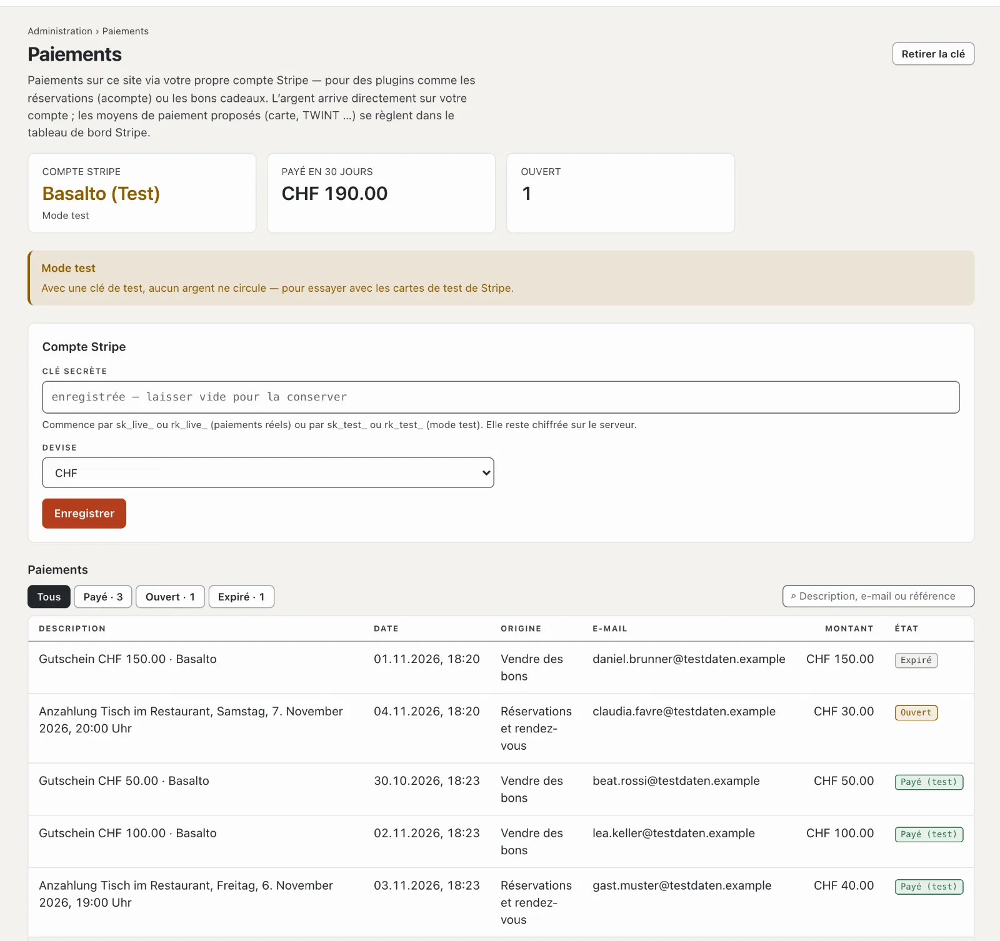

# Paiements

Des plugins comme « Réservations et rendez-vous » (acompte) et « Vendre des bons » encaissent des paiements — via
votre propre compte Stripe. Sous **Administration › Paiements**, vous le connectez et voyez tous les paiements du site.
L’argent arrive directement sur votre compte ; Basalto n’y participe pas.

## Connecter le compte Stripe

1. Ouvrez un compte chez Stripe (ou prenez votre compte existant) et copiez la **clé secrète** dans le tableau de bord
   Stripe sous **Développeurs › Clés API** — elle commence par `sk_live_`. Une clé restreinte (`rk_live_`) avec droit
   d’écriture sur « Checkout Sessions » suffit.
2. Collez-la sous **Administration › Paiements**, choisissez la **devise** (CHF ou EUR), **« Enregistrer »**.
3. Basalto demande aussitôt à Stripe si la clé est valable et affiche le nom du compte.

La clé reste chiffrée sur le serveur et ne retourne jamais au navigateur ; laissée vide, celle enregistrée est
conservée. **« Retirer la clé »** déconnecte le compte — les nouveaux paiements ne sont alors plus possibles, les
paiements existants restent dans la liste.

## Essayer en mode test

Avec une clé de test (`sk_test_…`), aucun argent ne circule ; vous payez avec les cartes de test de Stripe. La page
affiche **« Mode test »**, et les paiements effectués apparaissent comme **« Payé (test) »**. Pour l’exploitation
réelle, vous remplacez la clé par la `sk_live_…`.

## Comment se déroule un paiement

1. Un hôte réserve ou achète ; Basalto crée le paiement et redirige vers Stripe.
2. Il y paie avec les moyens de paiement que vous avez activés dans le tableau de bord Stripe — carte, TWINT et
   d’autres.
3. De retour sur votre site, Basalto demande l’état à Stripe. Si l’hôte ferme la fenêtre avant, Basalto récupère
   l’état lui-même toutes les cinq minutes — il faut pour cela la planification de l’installation
   ([Exploitation](betrieb.md)).
4. Si un paiement Stripe expire sans paiement, le plugin libère la place ou la commande.

Vous traitez les remboursements et les versements dans le tableau de bord Stripe.

## La liste des paiements

En haut figurent le compte (paiements réels ou mode test), ce qui a été payé ces 30 derniers jours et combien de
paiements sont ouverts. La liste affiche date, description, origine (le plugin), e-mail, montant et état — **Payé**,
**Ouvert** ou **Expiré** —, avec recherche et filtre.

## Qui voit les paiements

Le domaine s’appelle **« Paiements »** ([Rôles](rollen.md)) ; par défaut, l’exploitant et l’administrateur y ont accès.

## Pour continuer

- [Plugin « Réservations et rendez-vous »](../marktplatz/plugin-reservierungen.md)
- [Plugin « Vendre des bons »](../marktplatz/plugin-gutscheine.md)
- [Rôles](rollen.md)
