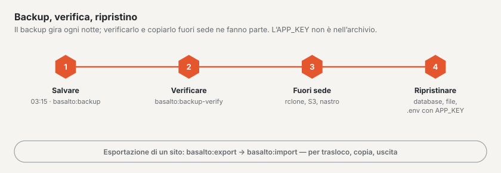

# Backup

Basalto esegue ogni notte il backup dell’intera installazione, su richiesta lo verifica e, in caso di emergenza, lo
ripristina. Per un singolo sito c’è inoltre l’esportazione — per un trasloco, una copia o un’uscita.



Due strumenti con scopi diversi:

| | Backup | Esportazione |
| --- | --- | --- |
| Comando | `basalto:backup` | `basalto:export` |
| Contenuto | intera installazione: dump del database e file di tutti i siti | un sito: contenuti, media, impostazioni come JSON e file |
| Scopo | emergenza: server, database o spazio di archiviazione persi | trasloco, copia, uscita |
| Ritorno | ripristinare il database, ricopiare i file | `basalto:import` |

## Eseguire il backup

```sh
php artisan basalto:backup                          # in storage/app/backups
php artisan basalto:backup --path=/srv/sicherung    # altra cartella
```

L’archivio `basalto-backup-JJJJMMTT-HHMMSS.zip` (ora in UTC) contiene il dump del database, la mediateca di ogni
disk, i file provenienti dai moduli e un `manifest.json` con SHA-256 e dimensione di ogni file.

- **SQLite** viene copiato tramite `VACUUM INTO`, **MariaDB/MySQL** con `mariadb-dump` o `mysqldump`, **PostgreSQL**
  con `pg_dump`. Lo strumento deve corrispondere al server. Se non si trova nel percorso di ricerca, imposti nel `.env`
  `BASALTO_BACKUP_MYSQL_DUMP` o `BASALTO_BACKUP_PG_DUMP` sul percorso.
- **Non nell’archivio:** il `.env` e quindi l’`APP_KEY`. La conservi separatamente e in modo sicuro (gestore di
  password), mai accanto all’archivio — senza la stessa chiave le colonne cifrate non si possono leggere.
- Un backup sullo stesso disco protegge solo dagli errori di utilizzo. Copi l’archivio anche **fuori sede**, ad
  esempio dopo le 03:15 con `rclone copy storage/app/backups remote:basalto`.

### Pianificazione e conservazione

| Che cosa | Quando o dove |
| --- | --- |
| `basalto:backup` | ogni giorno alle **03:15 UTC** tramite lo scheduler, su un solo server (dopo `basalto:cleanup` alle 03:00, prima di `basalto:media-purge` alle 03:30) |
| «Backup ora» | manualmente in **Amministrazione › Esercizio**; avvia lo stesso comando nella coda |
| Conservazione | dopo ogni esecuzione restano nella cartella i backup più recenti, predefinito **7**; impostabile in **Amministrazione › Impostazioni › Conservazione › «Conservare i backup»** (`backup.keep`, da 1 a 365) |

La pianificazione richiede la voce cron descritta in [Hosting](hosting.md). Lo stato dell’ultimo backup e
dell’ultima verifica è visibile in Amministrazione › Esercizio.

## Verifica

```sh
php artisan basalto:backup-verify                                   # backup più recente nella cartella standard
php artisan basalto:backup-verify --path=/srv/sicherung             # backup più recente in questa cartella
php artisan basalto:backup-verify /srv/sicherung/basalto-backup-20261016-031500.zip
```

Vengono verificati nomi, manifest, dimensione e SHA-256 di ogni file. Con SQLite il comando ripristina il database in
un file temporaneo (`PRAGMA integrity_check`, conteggio a campione); con MariaDB/MySQL e PostgreSQL legge il dump per
verificarne la completezza. La vera prova di ripristino in un database vuoto è lì un’operazione manuale — almeno prima
di ogni aggiornamento e ogni trimestre.

## Ripristino

Prima: modalità manutenzione (`php artisan down`), fermare scheduler e worker, salvare inoltre il database e lo spazio
di archiviazione **attuali** — nel caso in cui il ripristino stesso non riesca.

1. **Verificare l’archivio:** `php artisan basalto:backup-verify <archiv>` — proseguire solo con «Wiederherstellung
   geprüft» (ripristino verificato).
2. **Estrarre** in una cartella di lavoro vuota: `mkdir /tmp/wieder && cd /tmp/wieder && unzip <archiv>`.
3. **Ripristinare il database:**
   - SQLite: fermare l’applicazione, `cp database/database.sqlite <pfad aus DB_DATABASE>`.
   - MariaDB/MySQL: creare un database vuoto e importarvi il dump —
     `mariadb -h <host> -u <benutzer> -p -e "CREATE DATABASE basalto_neu CHARACTER SET utf8mb4 COLLATE utf8mb4_unicode_ci"`,
     poi `mariadb -h <host> -u <benutzer> -p basalto_neu < database/database.sql`; impostare `DB_DATABASE` su
     `basalto_neu` (oppure svuotare il vecchio database e importarvi il dump).
   - PostgreSQL: `createdb basalto_neu`, poi `psql -h <host> -U <benutzer> -d basalto_neu -f database/database.sql`.
4. **Ricopiare i file:** `files/<disk>/…` sul disk con lo stesso nome — in locale ad esempio
   `rsync -a files/local/ storage/app/private/`; con S3 o R2 `aws s3 sync files/s3/ s3://<bucket>/` o `rclone copy`.
5. **`.env` e `APP_KEY`** dell’installazione salvata — la stessa chiave usata per il backup.
6. **Operazioni successive:**

```sh
php artisan migrate --force                 # se Basalto è più recente del backup
php artisan optimize:clear
php artisan basalto:search-index
php artisan basalto:page-cache clear        # se la cache delle pagine è attiva
php artisan basalto:page-cache warm
php artisan up
```

7. **Controllo:** `/up` segnala «bereit» (pronto), l’accesso al backend funziona, aprire una pagina con immagini e la
   mediateca. Poi riavviare scheduler e worker.

## Esportazione e importazione di un sito

```sh
php artisan basalto:export <handle>                         # in storage/app/exports
php artisan basalto:export <handle> --path=/tmp/site.zip    # file o cartella
php artisan basalto:export <handle> --with-submissions      # con gli invii dei moduli (dati personali)
php artisan basalto:import /tmp/site.zip                    # con l’handle dell’esportazione
php artisan basalto:import /tmp/site.zip --handle=kopie     # con un altro handle
```

Nel backend: **Amministrazione › Siti** › aprire il sito › **«Scarica l’esportazione»** — per i gestori del sito e per
proprietario o amministrazione del relativo account, senza invii dei moduli.

### Che cosa contiene l’esportazione

Lo ZIP contiene `site.json` (versione del formato 1), `manifest.json` con SHA-256 per ogni file, i file multimediali
in `media/` e — con `--with-submissions` — i file degli invii in `submissions/`. In `site.json` figurano il sito
(handle, nome, lingue, fuso orario, tema, impostazioni), i domini, i membri con il loro ruolo (inviti aperti come
«in sospeso»), le impostazioni, il tema dal database con bozze e versioni, cartelle e dati dei media, tutti i contenuti
con le loro versioni per lingua, reindirizzamenti, menu e moduli. I riferimenti tra contenuti, media e persone vengono
riscritti durante l’importazione sui nuovi identificativi.

**Volutamente esclusi:** il registro, i riscontri 404, l’indice di ricerca (viene ricostruito), i token API, i
commenti, il segreto dei webhook dei moduli (da rigenerare nel backend dopo l’importazione e comunicare al
destinatario) e i checksum degli indirizzi IP degli invii.

### Che cosa fa l’importazione

Basalto verifica l’archivio per intero (percorsi, manifest, checksum, versione del formato) e crea poi il sito in **un
solo** passaggio; se qualcosa va storto, scompaiono anche i file già scritti. Le persone con un account
nell’installazione (stessa e-mail) diventano membri; per tutte le altre nasce un invito **senza e-mail** — da inviare
in «Utenti» con «Invia di nuovo». I domini già occupati vengono tralasciati e segnalati.

## Laravel Cloud

Su Laravel Cloud vale il backup della piattaforma: backup automatici del database e — se li attiva — versioning del
bucket. Lì `basalto:backup` scrive sul disco volatile dell’istanza; usi il comando solo con `--path` verso uno spazio
di archiviazione persistente. Un singolo sito non si recupera dal backup della piattaforma, bensì tramite
l’esportazione.

## Per continuare

- [Aggiornamenti](updates.md)
- [Monitoraggio](monitoring.md)
- [Siti](../verwaltung/sites.md)
