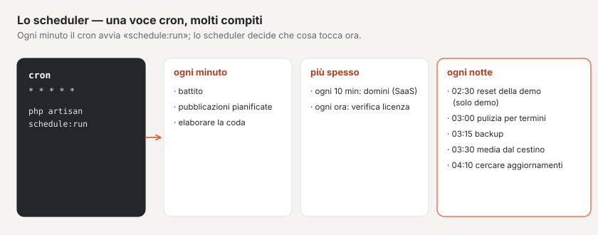

# Comandi

Tutti i comandi di Basalto si trovano nel namespace `basalto`. L’elenco attuale lo mostra `php artisan list basalto`,
le opzioni di un comando `php artisan <befehl> --help`. La maggior parte dei comandi proviene dal core
(`packages/core`); `basalto:check`, `basalto:lava-import` e `basalto:lsp` da Lava (`packages/lava`),
`basalto:tests-sync` dal modulo Gestione test, `basalto:licensing-revocations` dal modulo Vendita licenze.

## Configurazione e accesso

| Comando | Scopo | Argomenti e opzioni principali |
| --- | --- | --- |
| `basalto:install` | eseguire le migrazioni del database, creare il primo sito e il primo account, restituire un link monouso; si può eseguire più volte senza rischi | `--site`, `--name`, `--locale` (predefinito `de`), `--timezone` (predefinito `Europe/Zurich`), `--user`, `--email`, `--minutes` (predefinito 60) |
| `basalto:login-link` | link monouso per l’accesso di un account | `<email>`, `--minutes` (predefinito 15) |

## Siti e contenuti

| Comando | Scopo | Argomenti e opzioni principali |
| --- | --- | --- |
| `basalto:publish` | verificare il sito (link, immagini, testi alternativi, lingue obbligatorie, pagine legali, moduli, reindirizzamenti), preriscaldarlo e metterlo online | `<site>`, `--dry-run` (solo verificare), `--ohne-seed` (non caricare il seed) |
| `basalto:seed` | caricare i contenuti iniziali dal `seed` del tema (idempotente); `--auffrischen` ricarica ciò che non è stato modificato | `<site>`, `--auffrischen` |
| `basalto:legal` | creare note legali o informativa sulla privacy come bozza a partire da un modello | `<site>`, `<art>` (`impressum` o `datenschutz`) |
| `basalto:publish-scheduled` | pubblicare le versioni pianificate il cui momento è arrivato | — (gira nello scheduler) |
| `basalto:page-cache` | preriscaldare o svuotare la cache delle pagine | `<aktion>` (`warm` o `clear`), `--site` (altrimenti tutti) |
| `basalto:search-index` | ricostruire l’indice di ricerca, ad esempio dopo un’importazione o un cambio di driver | `--site` (altrimenti tutti) |
| `basalto:docs-import` | creare o aggiornare la documentazione Markdown (`docs/**/*.md`, traduzioni da `docs/<sprache>/`) come pagine di un tipo — per basaltocms.com; solo ciò che è cambiato riceve una nuova versione, i testi legali restano esclusi | `<site>`, `--path` (predefinito `docs`), `--type` (predefinito `doc`) |

## Temi e Lava

| Comando | Scopo | Argomenti e opzioni principali |
| --- | --- | --- |
| `basalto:check` | verificare un tema Lava e mostrare la linea rossa A–Z | `--theme` (cartella, predefinito `themes/nguyen-development`), `--site` (tema dal database), `--json` |
| `basalto:lava-import` | trasferire un tema Lava da file nella tabella `lava_sources` | `<site>`, `--theme`, `--scope` (`theme` o `site`) |
| `basalto:tokens` | restituire i design token come variabili CSS | `[<site>]` (altrimenti il sito standard), `--tailwind` (come `@theme` per Tailwind 4) |
| `basalto:theme-pack` | impacchettare un tema come pacchetto con manifest e firma facoltativa | `<name>` (cartella sotto `themes/`), `--output` (altrimenti `storage/app/themes`), `--key` |
| `basalto:theme-verify` | verificare un pacchetto di tema rispetto a manifest e firma | `<path>`, `--public-key` |
| `basalto:lsp` | servizio linguistico per Lava (Language Server Protocol) per VS Code e PhpStorm | `--stdio` (predefinito) |

## Esercizio

| Comando | Scopo | Argomenti e opzioni principali |
| --- | --- | --- |
| `basalto:heartbeat` | scrivere un timestamp nella cache — prova che lo scheduler è in esecuzione (`/up`) | — (gira nello scheduler) |
| `basalto:cleanup` | eliminare registro e versioni archiviate secondo i termini di conservazione | — (gira nello scheduler) |
| `basalto:media-purge` | eliminare definitivamente i media che si trovano nel cestino da più tempo del termine | `--days` (predefinito 30) |
| `basalto:error-alarm` | avvisare i gestori via e-mail quando le eccezioni segnalate si accumulano (con limitazione) | — (gira nello scheduler; soglie in Amministrazione › Impostazioni › Esercizio) |
| `basalto:db-zeitzone` | verificare il fuso orario del database e convertire una volta le date e ore scritte prima della connessione in UTC (solo MariaDB/MySQL, [Fuso orario del database](installation.md#fuso-orario-del-database)) | `--umrechnen`, `--von=<zona>` (altrimenti quella del server), `--force` |

## Backup e trasloco

| Comando | Scopo | Argomenti e opzioni principali |
| --- | --- | --- |
| `basalto:backup` | eseguire il backup di database e media, con manifest e checksum | `--path` (altrimenti `storage/app/backups`) |
| `basalto:backup-verify` | verificare un backup (checksum, prova di ripristino con SQLite) | `[<archiv>]` (altrimenti il più recente), `--path` |
| `basalto:export` | esportare un sito per intero (JSON e media) | `<site>`, `--path` (file o cartella, altrimenti `storage/app/exports`), `--with-submissions` |
| `basalto:import` | creare un sito da un’esportazione | `<zip>`, `--handle` (altrimenti l’handle dell’esportazione) |

Dettagli in [Backup](backup.md).

## Licenza e protezione dei dati

| Comando | Scopo | Argomenti e opzioni principali |
| --- | --- | --- |
| `basalto:license` | mostrare e registrare lo stato della licenza, verificare chiavi; per basaltocms.com anche emetterle e bloccarle | `--check=<schlüssel>`; per l’emissione `--keypair`, `--issue`, `--revoke` e altre, vedi [Licenza](lizenz.md) |
| `basalto:privacy` | fornire informazioni su una persona o eliminarne i dati (LPD/GDPR) | `<email>`, `--export=<datei>` (informazioni come JSON), `--delete` (eliminare account e invii), `--force` (senza conferma) |

## Sviluppo e test

Non pensati per l’esercizio corrente.

| Comando | Scopo | Argomenti e opzioni principali |
| --- | --- | --- |
| `basalto:benchmark` | test di carico: crea molti siti, contenuti e media e misura le query principali — **scrive dati di test nel database** | `--sites` (100), `--entries` (1000), `--media` (3334), `--locales` (2), `--runs` (30), `--keep`, `--clean` (rimuovere i dati di bench), `--json` |
| `basalto:load-test` | test di carico HTTP su indirizzi propri: richieste al secondo, p50/p95/p99, errori, riscontri della cache — host estranei solo con `--remote` ([Test di carico](lasttest.md)) | `<url>…`, `--concurrency` (10), `--duration` (30), `--requests`, `--max-p95`, `--max-errors` (1), `--remote`, `--json` |
| `basalto:tests-sync` | allineare i casi di test della gestione test ai criteri di accettazione | `--source` (`auto`, `docs` o `bundled`), `--write` |
| `basalto:demo-reset` | **Elimina l’intero database** e ricrea la demo pubblica: sito demo con il seed del suo tema, tre account per l’accesso rapido (Gestore, Redattore, Traduttore); poi dati di test nella misura di `BASALTO_DEMO_TESTDATA` (predefinito `klein`, `aus` li disattiva); termina con un checksum della consistenza. Gira solo con `BASALTO_DEMO=true` e solo con conferma | `--force` (senza conferma, così nello scheduler) |
| `basalto:update` | verificare gli aggiornamenti (core, plugin, temi presso il produttore dell’ambiente) oppure installare il core o un plugin dall’archivio firmato — con backup, modalità manutenzione e via di ritorno ([Aggiornamenti](updates.md)) | `--kern`, `--plugin=<hersteller/paket>`, `--benachrichtigen` |
| `basalto:testdaten` | molti dati di test diversi per sviluppo, ambienti di test e demo: team del sito e nell’extranet, account cliente (anche con nomi delicati), community, forum, commenti, membri, Marketplace e vendita licenze — a seconda dei moduli attivi. Gli indirizzi terminano con `@testdaten.example`, le e-mail non vanno da nessuna parte; stessa esecuzione, stessa consistenza. In produzione solo in modalità demo ([Ambiente locale](../hersteller/lokal.md#dati-di-test)) | `<site>`, `--umfang` (`klein`, `mittel`, `gross`), `--nur=<bereich>`, `--neu` (rimuovere prima), `--entfernen` |
| `basalto:local` | ambiente locale del produttore con Laravel Herd: sito «basaltocms» su `<ordner>.test` (primario), caricare i contenuti, riscrivere negli stessi gli indirizzi di produzione con quelli locali; rifiuta in produzione | `--herd-config`, `--no-publish` |
| `basalto:release` | costruire l’archivio di release per l’installer web: file versionati senza zavorra di sviluppo, `vendor` senza pacchetti dev, manifest con firma Ed25519 (produttore) | `--release-version`, `--key`, `--out`, `--source`, `--vendor-from`, `--store`, `--notes` (testo o file: «Novità» in Amministrazione › Aggiornamenti) |

## Pianificazione dello scheduler

Basalto pianifica queste attività. Girano finché il cron richiama `php artisan schedule:run` ogni minuto
([Hosting](hosting.md)); tutte su un solo server. Gli orari valgono nel fuso orario dell’applicazione, che è UTC (`config/app.php`): le 03:15 corrispondono in Svizzera alle 04:15
(ora solare) o alle 05:15 (ora legale). Verifica con `php artisan schedule:list`.

| Attività | Cadenza | Cron | A che cosa serve |
| --- | --- | --- | --- |
| `basalto:heartbeat` | ogni minuto | `* * * * *` | segno di vita per `/up` e Amministrazione › Esercizio |
| `basalto:publish-scheduled` | ogni minuto, senza sovrapposizioni | `* * * * *` | pubblicare le versioni pianificate |
| `basalto:error-alarm` | ogni minuto | `* * * * *` | verificare l’accumulo di errori, e-mail con limitazione |
| `queue:work --stop-when-empty --max-time=50 --tries=3` | ogni minuto, senza sovrapposizioni | `* * * * *` | elaborare la coda — solo con `QUEUE_CONNECTION=database` e `BASALTO_QUEUE_VIA_SCHEDULER` diversa da `false` |
| `basalto:license` | ogni ora | `0 * * * *` | aggiornare lo stato della licenza (offline) |
| `basalto:cleanup` | ogni giorno alle 03:00 | `0 3 * * *` | eliminazione secondo i termini di conservazione |
| `basalto:backup` | ogni giorno alle 03:15 | `15 3 * * *` | backup, poi conservazione secondo `backup.keep` |
| `basalto:demo-reset --force` | ogni giorno alle 02:30, solo con `BASALTO_DEMO=true` | `30 2 * * *` | ricreare la demo |
| `basalto:media-purge` | ogni giorno alle 03:30 | `30 3 * * *` | svuotare il cestino della mediateca |
| `basalto:update --benachrichtigen` | ogni giorno alle 04:10, non in modalità SaaS, disattivabile con `BASALTO_UPDATES_CHECK=false` | `10 4 * * *` | verificare se ci sono aggiornamenti; l’amministrazione viene informata una sola volta di ogni nuovo stato |

L’ultima esecuzione di ogni attività con il relativo esito è visibile in Amministrazione › Esercizio.

## Per continuare

- [Installazione](installation.md)
- [Hosting](hosting.md)
