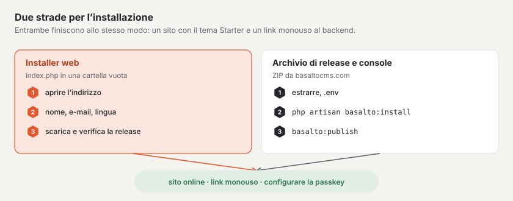

# Installazione

Basalto funziona su qualsiasi spazio web con PHP 8.4 — senza Redis, senza worker e, con SQLite, persino senza un
database proprio. Questa pagina descrive i requisiti, le due vie d’installazione e le chiavi del file `.env`.



## Requisiti

| Che cosa | Valore |
| --- | --- |
| PHP | 8.4 o più recente |
| Estensioni PHP | `pdo_sqlite`, `pdo_mysql` o `pdo_pgsql` a seconda del database, `mbstring`, `intl`, `gd` (varianti delle immagini), `zip` (esportazione, backup, pacchetti di temi), `sodium` (licenza e firme) |
| Database | SQLite, MariaDB 11.4, MySQL 8.4 o PostgreSQL 18 |
| Server web | radice dei documenti su `public/`, HTTPS |
| Cron | una voce per lo scheduler, vedi [Hosting](hosting.md) |
| Non necessario | Redis/Valkey, queue worker, Node.js, server di posta per il primo accesso |

Per il backup Le serve inoltre lo strumento di dump del database (`mariadb-dump`, `mysqldump` o `pg_dump`), vedi
[Backup](backup.md).

## Via 1: l’installer web

Per tutti coloro che vogliono un sito web e non hanno bisogno di un terminale. La procedura passo per passo, con
immagini, si trova in [Installare Basalto](../einstieg/installieren.md); qui l’essenziale per l’esercizio:

1. Scaricare l’installer da basaltocms.com alla voce **Download** — un unico file `index.php`.
2. Metterlo in una cartella **vuota** e aprire l’indirizzo nel browser.
3. Indicare **Nome del sito**, **La Sua e-mail** e **Lingua del sito**, poi «Installa».

L’installer verifica PHP e le estensioni, scarica la release attuale, ne verifica la **firma Ed25519** e il checksum,
estrae i file, scrive il `.env` (nuova chiave dell’applicazione, SQLite, indirizzo preso dal browser), esegue le
migrazioni, crea il sito con il tema Starter e il dominio dell’indirizzo, pubblica i contenuti iniziali e La fa accedere
al backend con un link monouso. Poi si cancella da solo.

- **Avanzate:** MariaDB/MySQL o PostgreSQL al posto di SQLite, chiave di licenza indicata subito.
- **Solo in una cartella vuota** (sono ammessi i file che i provider di hosting creano da sé: `.htaccess`,
  `.user.ini`, `.well-known`, `cgi-bin`, `error_log`).
- **Chi arriva prima:** il primo browser ottiene l’installazione; un secondo vede «già in corso». Per ricominciare:
  eliminare il file `.basalto-install.json` nella cartella.
- **Il server web parte dalla cartella principale invece che da `public/`:** l’installer crea un `.htaccess` che
  instrada tutto attraverso `public/` (Apache). Con nginx impostare la radice su `public/`.

## Via 2: archivio di release e console

Per server con console, per script e per Laravel Cloud. L’archivio contiene tutto ciò di cui Basalto ha bisogno —
anche `vendor/` e il frontend compilato; sul server non servono né Composer né Node.

1. Scaricare l’archivio attuale. Quale file sia attuale lo indica `https://basaltocms.com/_download/latest.json`
   (campo `file`, insieme a `sha256` e alla firma); il file si trova in `https://basaltocms.com/_download/<file>`.
2. Confrontare il checksum ed estrarre:

```sh
curl -fsSO https://basaltocms.com/_download/basalto-1.2.0.zip
sha256sum basalto-1.2.0.zip          # confrontare con «sha256» di latest.json
unzip basalto-1.2.0.zip -d meine-site && cd meine-site
cp .env.example .env
php artisan key:generate
# modificare .env: APP_ENV, APP_DEBUG, APP_URL, database, posta (vedi sotto)
```

3. Installare:

```sh
php artisan basalto:install
```

L’installer esegue le migrazioni del database, chiede handle e nome del sito nonché e-mail e nome del primo account e
restituisce un **link monouso** per il primo accesso (valido 60 minuti, utilizzabile una sola volta) — senza password
e senza server di posta. Il primo account diventa gestore del sito. Si può eseguire più volte senza rischi; ciò che
esiste già resta.

Senza domande, ad esempio in uno script:

```sh
php artisan basalto:install --no-interaction --site=meine-site --name="Meine Site" \
  --email=redaktion@example.ch --locale=de --timezone=Europe/Zurich
```

Altre opzioni: `--user` (nome dell’account), `--minutes` (validità del link, predefinito 60).

Dopo l’accesso configuri una passkey nel backend (Panoramica › «Configurare passkey»). Un nuovo link monouso lo
genera in qualsiasi momento:

```sh
php artisan basalto:login-link redaktion@example.ch              # valido 15 minuti
php artisan basalto:login-link redaktion@example.ch --minutes=60
```

### Installer nel browser su un server preparato

Senza console, l’installer nel browser guida attraverso gli stessi passi (database › sito › account › fine). Si trova
in `/<BASALTO_BACKEND_PATH>/installieren`, quindi per impostazione predefinita in `/admin/installieren`, e alla fine
mostra il link monouso.

- L’installer esiste solo finché non è configurato nulla; dopo, l’indirizzo risponde con 404.
- Se il server è già raggiungibile pubblicamente prima che qualcuno installi, imposti **`BASALTO_INSTALL_TOKEN`** nel
  `.env` su un valore casuale lungo e richiami l’installer con `/admin/installieren?token=<wert>`. Senza il token
  corretto risponde con 404.

## Mettere online il primo sito

Nel `.env`:

```dotenv
BASALTO_DEFAULT_THEME=starter
BASALTO_DEFAULT_SITE=meine-site
```

Poi:

```sh
php artisan basalto:publish meine-site --dry-run   # solo verificare, non scrivere nulla
php artisan basalto:publish meine-site             # caricare i contenuti iniziali, verificare, preriscaldare, mettere online
```

`basalto:publish` carica i contenuti iniziali del tema (`--ohne-seed` li tralascia), verifica link, immagini, testi
alternativi, lingue obbligatorie, pagine legali, moduli e reindirizzamenti, preriscalda la cache delle pagine e mette
online il sito — oppure rifiuta indicandone il motivo. Note legali e informativa sulla privacy si creano come bozza a
partire da un modello:

```sh
php artisan basalto:legal meine-site impressum
php artisan basalto:legal meine-site datenschutz
```

`BASALTO_DEFAULT_SITE` vale per ogni host senza una voce propria. I domini di un sito si inseriscono nel backend in
**Amministrazione › Siti**.

## Chiavi `.env` importanti

### Laravel

| Chiave | Predefinito in `.env.example` | Per l’esercizio |
| --- | --- | --- |
| `APP_ENV` | `local` | `production` |
| `APP_DEBUG` | `true` | `false` |
| `APP_KEY` | vuoto | `php artisan key:generate`; conservare separatamente (vedi [Backup](backup.md)) |
| `APP_URL` | `http://localhost:8000` | indirizzo pubblico con HTTPS |
| `APP_LOCALE`, `APP_FALLBACK_LOCALE` | `de`, `en` | lingua dell’interfaccia |
| `DB_CONNECTION`, `DB_HOST`, `DB_PORT`, `DB_DATABASE`, `DB_USERNAME`, `DB_PASSWORD` | `sqlite` | `mariadb`, `mysql`, `pgsql` o `sqlite` |
| `CACHE_STORE`, `SESSION_DRIVER`, `QUEUE_CONNECTION` | `database` | `database` è sufficiente; su Laravel Cloud Valkey (`redis`) |
| `FILESYSTEM_DISK` | `local` | `local` o `s3` (bucket, con `AWS_*`) |
| `MAIL_MAILER`, `MAIL_HOST`, `MAIL_PORT`, `MAIL_USERNAME`, `MAIL_PASSWORD`, `MAIL_FROM_ADDRESS` | `log` | invio reale per codici di accesso, inviti, moduli e allarme errori |

Le e-mail portano intestazione e piè di pagina del sito a cui appartiene la destinataria (senza sito: il sito del
produttore): in alto il nome del sito, in basso le righe del fornitore dal contenuto globale «Piè di pagina» del tema
(campi `brand`, `owner`, `street`, `city`, `country`, `vat`) e i link alle pagine legali di `publish.legal`. Colori e
carattere stanno nel tema mail `basalto` (`packages/core/resources/views/mail/html/themes/basalto.css`).

### Basalto

Le chiavi sono lette da `config/basalto.php` del core (`packages/core/config/basalto.php`). Non tutte figurano in
`.env.example`; le altre si impostano solo se necessario.

| Chiave | Predefinito | A che cosa serve |
| --- | --- | --- |
| `BASALTO_BACKEND_PATH` | `admin` | percorso del backend |
| `BASALTO_DEFAULT_SITE` | vuoto | sito per gli host senza voce nei domini |
| `BASALTO_DEFAULT_THEME` | vedi testo | cartella del tema sotto `themes/`, se un sito non ne indica uno; imposti `starter` (non in `.env.example`) |
| `BASALTO_THEMES_PATH` | `themes/` dell’installazione | altra cartella per i temi su file (non in `.env.example`) |
| `BASALTO_INSTALL_TOKEN` | vuoto | protegge l’installer nel browser (non in `.env.example`) |
| `BASALTO_PAGE_CACHE` | attivo, tranne con `APP_ENV=local` | attivare o disattivare la cache delle pagine (non in `.env.example`) |
| `BASALTO_PAGE_CACHE_STORE` | store predefinito | store di cache proprio per la cache delle pagine (non in `.env.example`) |
| `BASALTO_MEDIA_QUOTA_MB` | illimitato | quota di spazio per sito in MB (non in `.env.example`) |
| `BASALTO_PASSWORD_LOGIN` | `false` | accesso con password per installazioni senza posta (non in `.env.example`) |
| `BASALTO_PHP_BINARY` | PHP di questo processo | PHP per i passaggi di un aggiornamento, p. es. `/opt/alt/php85/usr/bin/php` con LiteSpeed, vedi [Hosting](hosting.md) (non in `.env.example`) |
| `BASALTO_QUEUE_VIA_SCHEDULER` | `true` | lo scheduler elabora la coda del database, vedi [Hosting](hosting.md) (non in `.env.example`) |
| `BASALTO_BACKUP_MYSQL_DUMP`, `BASALTO_BACKUP_PG_DUMP` | percorso di ricerca | percorso dello strumento di dump, vedi [Backup](backup.md) (non in `.env.example`) |
| `BASALTO_LICENSE_KEY` | vuoto | chiave di licenza, vedi [Licenza](lizenz.md) |
| `BASALTO_LICENSE_BANNER_DAYS` | `30` | giorni «non registrata» prima della barra a piè di pagina nel frontend |
| `BASALTO_LICENSE_PUBLIC_KEY` | chiave di prodotto nel core | solo per test ed emissioni proprie; rimuovere la riga vuota da `.env.example`, vedi [Licenza](lizenz.md) |
| `BASALTO_DEPLOYED_AT` | vuoto | momento dell’ultimo rilascio, compare in Amministrazione › Esercizio |
| `BASALTO_ALIAS_DOMAIN` | `basaltocms.com` | zona alias della SaaS (solo Laravel Cloud) |
| `BASALTO_CLOUD_ENVIRONMENT`, `BASALTO_CLOUD_BINARY`, `LARAVEL_CLOUD_TOKEN` | vuoto, `vendor/bin/cloud`, vuoto | domini dei clienti tramite la CLI di Cloud (solo Laravel Cloud); il token solo come secret, mai in un file |

Per Pulse e Nightwatch vedi [Monitoraggio](monitoring.md).

## Per continuare

- [Hosting](hosting.md)
- [Backup](backup.md)
- [Comandi](befehle.md)
