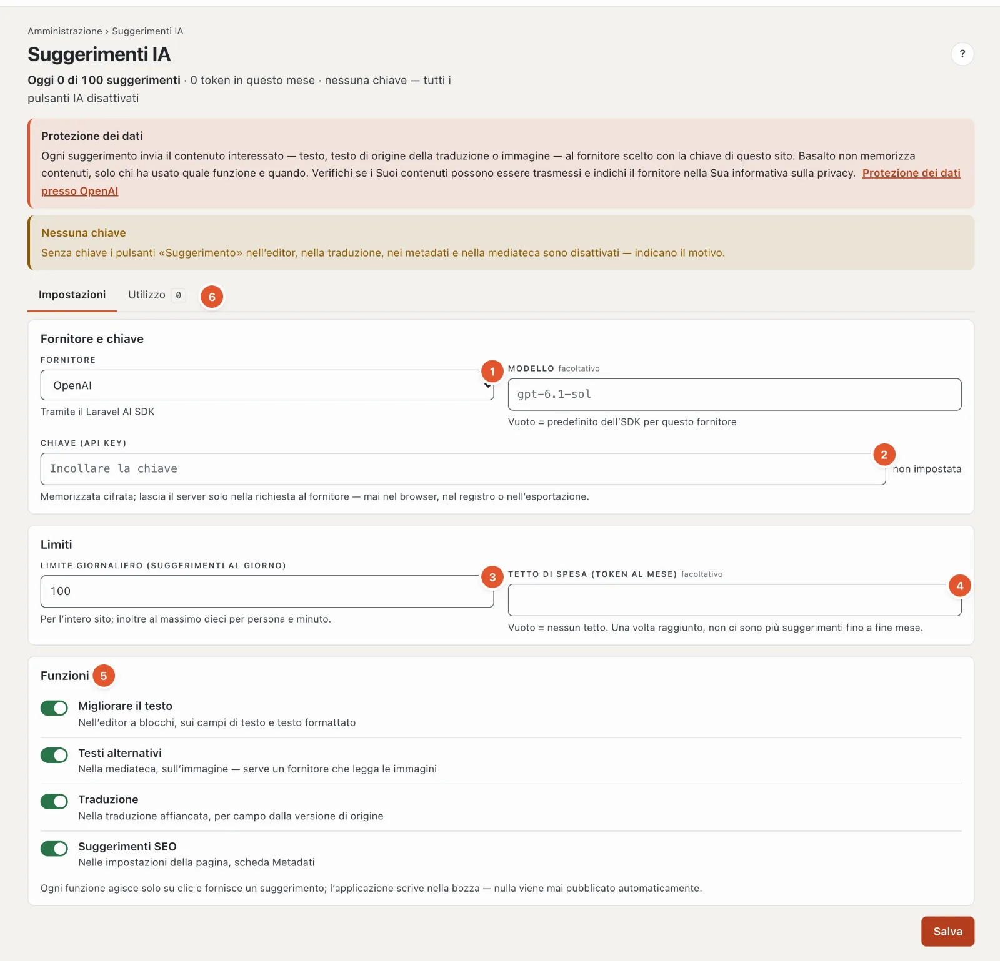

# Configurare i suggerimenti IA

Il modulo fornisce suggerimenti alla redazione con la **chiave del cliente**: migliorare il testo, testi alternativi a
partire dall’immagine, traduzione per campo e dati SEO (titolo della pagina, descrizione). Funziona tramite il
[Laravel AI SDK](https://laravel.com/docs/ai-sdk) (`laravel/ai`) e chiama il fornitore direttamente dall’installazione.

Ciò vale allo stesso modo per le installazioni proprie e per la SaaS.

## Principi

- **Solo su clic, sempre un suggerimento.** Nessuna chiamata in background, nessuna al caricamento di una pagina,
  nessun job. La risposta è un suggerimento; «Applica» lo inserisce nel campo e il salvataggio automatico scrive nella
  **bozza** — mai in una versione pubblicata. Unica eccezione: i testi alternativi valgono subito con il salvataggio (i
  media non hanno versioni); la ripresa compare nel registro (`ai.alt_text.applied`).
- **La chiave appartiene al cliente** ed è memorizzata per ogni sito. È salvata **cifrata** con l’`APP_KEY` in
  `ai_settings.api_key`, non arriva mai al browser (l’interfaccia mostra solo «impostata ✓ · …1234»), mai nel registro e
  non nell’esportazione di un sito. Dopo un trasloco o una nuova `APP_KEY` la inserisca di nuovo.
- **Ogni utilizzo compare nel registro** (`ai_usages`): sito, utente, funzione, contenuto o media, lingua, fornitore,
  modello, token (se il fornitore li comunica), esito o tipo di errore, ripreso sì/no. **Senza** testo, prompt, risposta
  e chiave. I messaggi di errore del fornitore non finiscono nel log, solo il loro tipo (`rate_limited`, `auth` …).
- **Disattivato di fabbrica.** Si attiva in **Amministrazione › Siti › Modifica sito › scheda «Moduli»** ›
  «Suggerimenti IA».

## Configurazione

1. Attivare il modulo per il sito (vedi sopra).
2. **Amministrazione › Suggerimenti IA** (`/admin/ki`) — solo gestori e amministrazione del sito (o proprietario e
   amministrazione dell’account):
   - Scegliere il **Fornitore**: OpenAI, Anthropic (Claude), Google Gemini, Mistral AI, xAI (Grok), DeepSeek, Groq o
     OpenRouter. I testi alternativi richiedono un fornitore che legga le immagini; con DeepSeek e Groq la funzione è
     disattivata.
   - **Modello** — vuoto significa: il valore predefinito dell’SDK per questo fornitore (compare come segnaposto nel
     campo). Un modello proprio (ad esempio uno più economico) lo inserisca con il nome che ha presso il fornitore.
   - Incollare la **Chiave** (API key) — si salva con Invio o uscendo dal campo. Lasciare vuoto mantiene quella attuale; «Rimuovi chiave» disattiva tutti
     i pulsanti IA del sito.
   - **Limite giornaliero** (suggerimenti al giorno per l’intero sito, predefinito 100) e **Tetto di spesa** (token al
     mese, vuoto = nessuno). Vale inoltre in modo fisso: al massimo dieci suggerimenti per persona al minuto.
   - Attivare o disattivare singolarmente le **Funzioni**.
3. Provare una volta nell’editor «✦ Migliorare il testo». Se compare un messaggio invece di un suggerimento, ne indica il
   motivo (chiave rifiutata, credito esaurito, fornitore sovraccarico, modello sconosciuto).

Ogni modifica dell’impostazione compare nel registro del core (`ai.settings.changed`, della chiave solo «impostata di
nuovo»).

## Protezione dei dati

**I contenuti vanno al fornitore.** Ogni suggerimento invia il contenuto interessato, con la chiave del sito, al
fornitore scelto: il testo di un campo, il testo sorgente di una traduzione, il testo di una pagina (SEO) o l’immagine
(testi alternativi; la variante più grande fino a 1600 px, altrimenti l’originale fino a 8 MB). L’interfaccia lo
dichiara in ogni punto: nella pagina delle impostazioni come avviso con link all’informativa sulla privacy del
fornitore e in ogni finestra dei suggerimenti con il nome del fornitore.

Che cosa dovrebbe chiarire:

- **Trattamento dei dati per conto terzi:** con il fornitore sussiste il rapporto contrattuale del cliente (la sua
  chiave, il suo account). Verifichi le sue condizioni su memorizzazione e addestramento con i dati inseriti; molti
  fornitori offrono per gli accessi API un’impostazione senza addestramento e con conservazione breve.
- **Sede:** diversi fornitori trattano i dati negli Stati Uniti. Per i dati personali contenuti nei testi valgono le
  regole sulla comunicazione all’estero (nLPD, GDPR).
- **Informativa sulla privacy del sito:** indicare il fornitore se vengono elaborati contenuti con dati personali.
- **Formare la redazione:** non far elaborare nulla di confidenziale; lo dice anche la guida per la redazione
  ([Suggerimenti IA](../redaktion/ki.md)).

## Gateway o proxy

Se il traffico verso il fornitore passa da un gateway (proxy aziendale, endpoint UE), imposti l’URL di base per l’intera
installazione nel `.env` — le stesse chiavi dell’SDK, ad es. `OPENAI_URL`, `ANTHROPIC_URL`, `GEMINI_URL`. Il modulo le
adotta per ogni sito; la chiave resta quella del sito.

## Sicurezza

- Gli input sono limitati: al massimo 12'000 caratteri per suggerimento; il testo formattato con immagini, tabelle,
  attività o incorporamenti non viene inviato al fornitore (queste parti andrebbero perse).
- Gli output vengono ripuliti: il testo formattato torna come Markdown e passa dal convertitore del core (l’HTML grezzo
  viene eliminato, link solo con http(s), mailto, tel o relativi); testo semplice senza HTML né caratteri di controllo,
  accorciato alla lunghezza del campo.
- Diritti come per la modifica: migliorare il testo e SEO richiedono il diritto di modificare i contenuti,
  la traduzione il diritto sul contenuto, i testi alternativi il diritto sulla mediateca. I siti estranei non vedono e
  non usano nulla.

## Utilizzo e costi

**Amministrazione › Suggerimenti IA › Utilizzo** mostra per ogni mese (gli ultimi dodici) il numero di suggerimenti, di
cui ripresi e falliti, i token e la ripartizione tra le funzioni, inoltre le ultime 50 chiamate con persona, funzione,
contenuto, modello, token ed esito. La fatturazione avviene presso il fornitore, sull’account del cliente — Basalto non
fattura nulla.

## Tabelle

| Tabella | Contenuto | Esportazione di un sito |
| --- | --- | --- |
| `ai_settings` | per ogni sito fornitore, modello, chiave (cifrata), limite giornaliero, tetto di spesa, interruttori | no — segreto |
| `ai_usages` | registro degli utilizzi senza contenuti | no — registro dell’installazione di origine |

## Se qualcosa non funziona

| Messaggio | Causa | Rimedio |
| --- | --- | --- |
| «… ha rifiutato la chiave» | chiave errata, bloccata o senza diritto sul modello | generare una nuova chiave presso il fornitore e inserirla |
| «Il credito dell’account … è esaurito» | credito prepagato esaurito | ricaricarlo presso il fornitore |
| «… sta rallentando» | rate limit del fornitore | riprovare più tardi; se necessario un livello superiore presso il fornitore |
| «… non ha accettato la richiesta — il modello è corretto?» | nome del modello sconosciuto o senza input di immagini | svuotare il modello (valore predefinito dell’SDK) o correggerlo |
| «Il limite giornaliero di … è raggiunto» | limite giornaliero del sito | aumentare il limite o attendere fino a domani |
| «Il tetto di spesa di questo mese è raggiunto …» | token del mese oltre il limite | aumentare il limite o svuotarlo |
| Pulsanti grigi «(IA disattivata)» | nessuna chiave o funzione disattivata | verificare l’impostazione |

## Per continuare

- [Suggerimenti IA](../redaktion/ki.md)
- [Amministrazione](../verwaltung/README.md)
