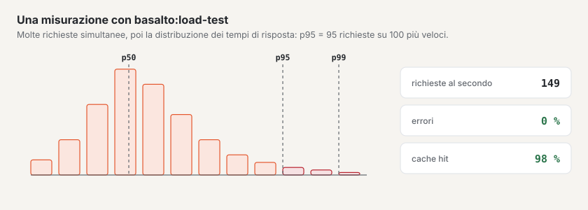

# Test di carico

`php artisan basalto:load-test` richiama indirizzi in parallelo e riporta richieste al secondo, p50/p95/p99, errori,
codici di stato e riscontri della cache delle pagine (intestazione `X-Basalto-Cache: HIT`). Non richiede altri
pacchetti ed è adatto alla propria istanza — rifiuta host estranei senza `--remote`.

| Opzione | Significato |
| --- | --- |
| `url…` | uno o più indirizzi, richiamati a turno |
| `--concurrency` | richieste simultanee (predefinito 10) |
| `--duration` | durata in secondi (predefinito 30), se `--requests` è 0 |
| `--requests` | numero fisso di richieste invece di una durata |
| `--max-p95` | obiettivo per p95 in ms — se superato, exit 1 |
| `--max-errors` | tasso massimo di errori in percentuale (predefinito 1) — se superato, exit 1 |
| `--remote` | host al di fuori di `localhost`, `*.test`, `*.localhost` — solo istanze proprie |
| `--json` | risultato come JSON (per i protocolli) |

## Misurare un’istanza

Così verifica se un’installazione regge i picchi attesi — preferibilmente su una copia, mai su un’istanza con dati dei
clienti:

1. Riempire con dati di test: `php artisan basalto:benchmark --sites=100 --entries=1000` crea i siti `bench-n`;
   `--clean` li rimuove di nuovo.
2. **A freddo** (dopo una pausa, ad esempio quando l’istanza dorme tra una richiesta e l’altra) misurare una volta con
   `--requests=1` e annotare il tempo.
3. **A caldo, con cache delle pagine:**
   `php artisan basalto:load-test https://bench-1.ihre-domain.ch/ https://bench-2.ihre-domain.ch/ --remote --concurrency=30 --duration=300 --max-p95=300 --json`
4. **Senza cache:** la stessa misurazione con pagine che la cache non conserva — con un modulo o la ricerca, ad esempio
   `/kontakt` e `/suche?q=…`.
5. Annotare il risultato con data, dimensione dell’istanza e versione; alla fine `--clean`.

**Valori indicativi:** p95 sotto 300 ms con 30 richieste simultanee con cache delle pagine, sotto 800 ms senza; tasso di
errori sotto l’1 %.

## Per continuare

- [Hosting](hosting.md)
- [Monitoraggio](monitoring.md)
- [Comandi](befehle.md)
