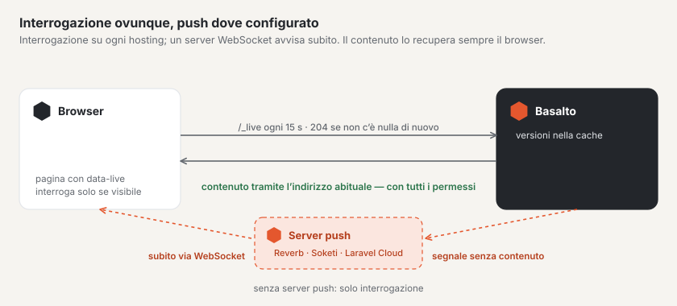

# Configurare l’aggiornamento in tempo reale

Basalto segnala le novità senza ricaricare — nel forum (messaggi, elenchi di discussioni, conversazioni, contatori) e
alla campanella del backend. La base è un’**interrogazione** parsimoniosa, che funziona su qualsiasi hosting e non
richiede nulla. Dove è in funzione un **server WebSocket** secondo il protocollo Pusher, lo stesso segnale arriva subito
via **push**; se questo si guasta, subentra l’interrogazione.

## Interrogazione

Le pagine che attendono novità chiedono ogni 15 secondi sotto `/_live` se è cambiato qualcosa — solo finché la loro
scheda è visibile, subito al ritorno nella scheda e, dopo errori, con pause più lunghe.

- Se nulla è cambiato, Basalto risponde con `204` e senza contenuto; vengono lette solo versioni dalla cache.
  L’interrogazione non avvia alcuna sessione e non imposta cookie.
- Per gli ospiti le pagine del forum continuano a provenire dalla cache delle pagine; l’interrogazione ha un indirizzo
  proprio.
- Ciò che una pagina può osservare è indicato, con firma, nella pagina stessa; i contatori personali esistono solo nelle
  pagine personali.

| Impostazione | Significato | Predefinito |
| --- | --- | --- |
| `BASALTO_LIVE_INTERVAL` | Cadenza dell’interrogazione in secondi (almeno 5) | `15` |
| `BASALTO_LIVE_RATE` | Richieste al minuto per indirizzo — anche per molte schede dietro un indirizzo comune | `600` |

La cache dovrebbe essere una memoria condivisa (Redis, Valkey o database) se più server servono il sito — altrimenti
ogni server vede solo le proprie versioni.

## Push

Il push richiede un server WebSocket che parli il protocollo Pusher: **Laravel Reverb** (su Laravel Cloud come servizio
gestito, oppure come piccola applicazione a sé sul Suo server) o **Soketi**. Basalto invia al server un segnale senza
contenuto; il browser si iscrive al canale tramite `/_live/auth`, senza sessione — anche gli ospiti.

| Variabile | Significato |
| --- | --- |
| `REVERB_APP_ID`, `REVERB_APP_KEY`, `REVERB_APP_SECRET` | Applicazione, chiave pubblica e segreto presso il server |
| `REVERB_HOST`, `REVERB_PORT`, `REVERB_SCHEME` | dove il browser raggiunge il server (ad esempio `ws.example.ch`, `443`, `https`) |
| `BASALTO_LIVE_PUSH_SERVER_HOST`, `…_PORT`, `…_SCHEME` | dove Basalto raggiunge il server, se è diverso (ad esempio internamente senza TLS) — vuoto significa uguale |
| `BASALTO_LIVE_PUSH` | `false` disattiva il push, anche se tutto è impostato |

Quando applicazione, chiave, segreto e host sono impostati, il push è attivo. Solo allora il browser carica Echo e
`pusher-js`; il segreto non lascia mai il server.

### Laravel Cloud

Colleghi all’ambiente un **cluster WebSocket**. Laravel Cloud imposta da sé le variabili `REVERB_…`; dopo il deploy
successivo il push è attivo.

### Server proprio

Esegua Reverb o Soketi come servizio a sé accanto a Basalto (sotto un gestore di processi come Supervisor), inoltri
`wss://` a esso tramite il Suo server web e inserisca le stesse credenziali da entrambe le parti. Basalto non ha bisogno
di alcun pacchetto aggiuntivo — parla il protocollo da sé.

### Hosting semplice

Senza un processo proprio non c’è un server WebSocket. L’interrogazione gestisce allora tutto; le novità compaiono al
più tardi dopo una cadenza.

## Verificare

Sotto **Amministrazione › Esercizio** la scheda **«Aggiornamento in tempo reale»** mostra la cadenza, il limite per
indirizzo e se il push è configurato e raggiungibile. Se il server non è raggiungibile, lo indica in rosso — il forum
continua a funzionare tramite l’interrogazione.

## Per continuare

- [Aggiornamento in tempo reale](../community/live.md)
- [Monitoraggio](monitoring.md)
- [Hosting](hosting.md)
